# JVM-运行时数据区-虚拟机栈-操作数栈（Operand Stack）

## 定义

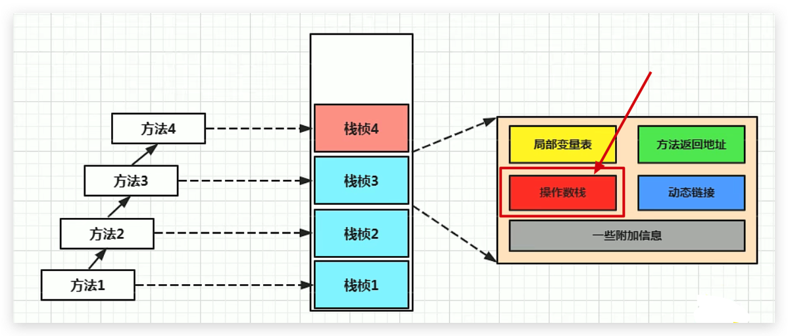

栈的含义：先进后出，可以使用数组或链表来实现，但不具有数组或链表的特性（任意位置增删改等）

而操作数栈的含义：**只是使用了数组来存储实现的栈，即按照顺序存放，有索引，但是并非采用访问索引的方式来进行数据访问的，只能通过入栈和出栈来操作数据**

每一个独立的栈帧中除了包含局部变量表以外，还包含一个`后进先出(Last-In-First-Out)`的`操作数栈`，也可以称为 `表达式栈(Expression Stack)`

<!--more-->

## 原理

- **操作数栈，在方法执行过程中，根据字节码指令，往栈中写入数据或者提取数据，即入栈（push）/ 出栈（pop）。**

  - 某些字节码指令将值压入操作数栈，其余的字节码指令将操作数取出栈。使用它们后再把结果压入栈，

  - 比如：执行复制、交换、求和等操作

    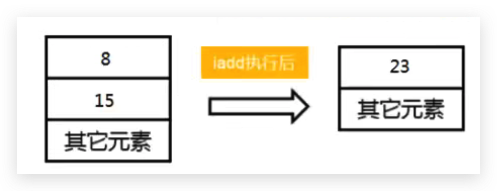

    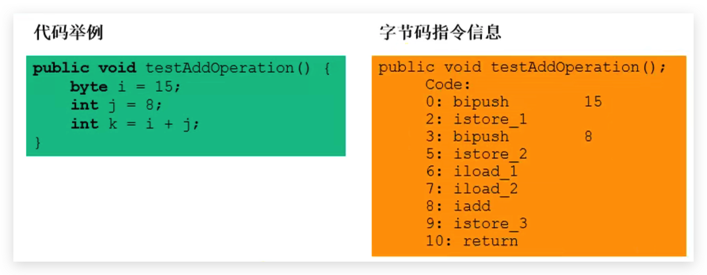

## 特点

- 操作数栈，**主要用于保存计算过程的中间结果，同时作为计算过程中变量临时的存储空间。**

- 操作数栈就是JVM执行引擎的一个工作区，当一个方法刚开始执行的时候，一个新的栈帧也会随之被创建出来，**此时这个方法的操作数栈是空的**。

- 每一个操作数栈都会拥有一个明确的栈深度用于存储数值，其所需的最大深度**在编译期就定义好了**(因为数组一旦创建，其长度就是确定的），保存在方法的 `Code` 属性中，为 `max_stack` 的值。

  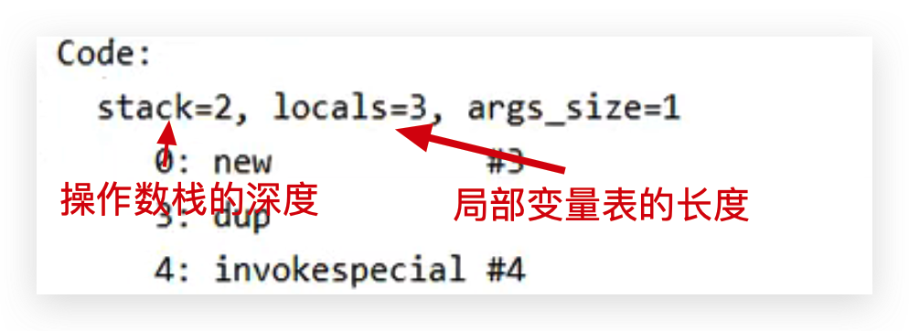

- 栈中的任何一个元素都是可以任意的Java数据类型

  - 32bit的类型占用一个栈单位深度
  - 64bit的类型占用两个栈单位深度

- 操作数栈**并非采用访问索引的方式来进行数据访问的**，而是只能通过标准的入栈和出栈操作来完成一次数据访问。只不过操作数栈是用数组这个结构来实现的而已

- **如果被调用的方法带有返回值的话，其返回值将会被压入当前栈帧的操作数栈中**，并更新PC寄存器中下一条需要执行的字节码指令。
- 操作数栈中元素的数据类型必须与字节码指令的序列严格匹配，这由编译器在编译器期间进行验证，同时在类加载过程中的类检验阶段的数据流分析阶段要再次验证。

- 另外，我们说**Java虚拟机的解释引擎是基于栈的执行引擎**，其中的栈指的就是操作数栈。

## 执行流程

java代码：

```java
public void testAddOperation() {
  //byte、short、char、boolean：都以int型来保存
  byte i = 15;
  int j = 8;
  int k = i + j;
}
```

字节码：

```sh
 0 bipush 15
 2 istore_1
 3 bipush 8
 5 istore_2
 6 iload_1
 7 iload_2
 8 iadd
 9 istore_3
10 return
```

执行流程

1. 首先执行第一条语句，PC寄存器指向的是0，也就是指令地址为0，然后使用bipush让操作数15入操作数栈。

   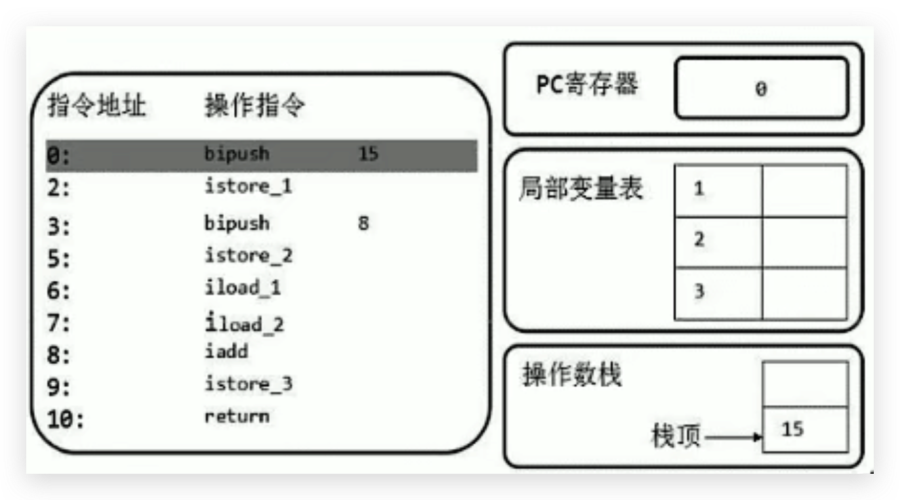

2. 执行完后，PC寄存器往下移，指向下一行代码，下一行代码就是将操作数栈的元素存储到局部变量表1的位置（istore_1），我们可以看到局部变量表的已经增加了一个元素。并且操作数栈为空了

   解释为什么局部变量表索引从 1 开始，因为该方法为实例方法，局部变量表索引为 0 的位置存放的是 this

   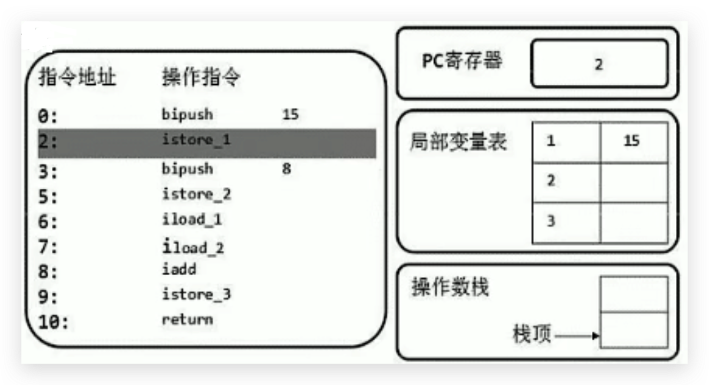

3. 然后PC下移，指向的是下一行。让操作数8也入栈，同时执行store操作，存入局部变量表中

   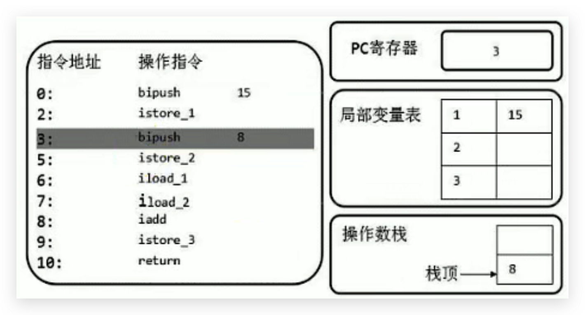

   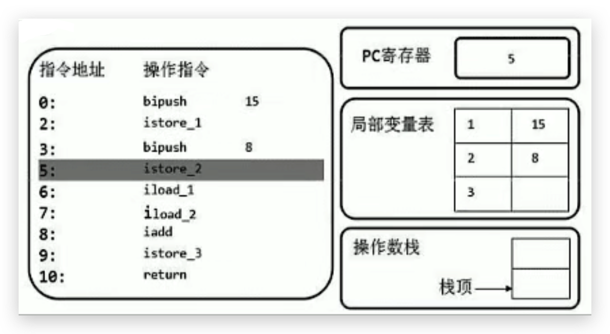

4. 然后从局部变量表中，依次将数据放在操作数栈中，等待执行 add 操作

   iload_1：取出局部变量表中索引为1的数据入操作数栈

   iload_2：取出局部变量表中索引为2的数据入操作数栈

   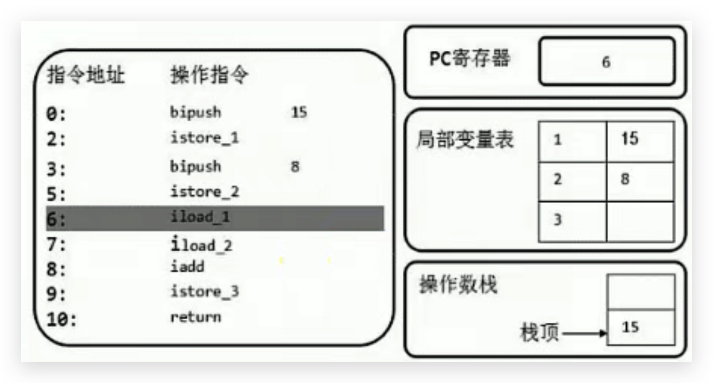

   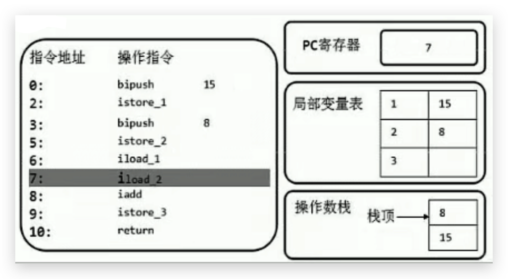

5. 然后将操作数栈中的两个元素出栈让执行引擎通过CPU执行相加操作，并存储在操作数栈中

   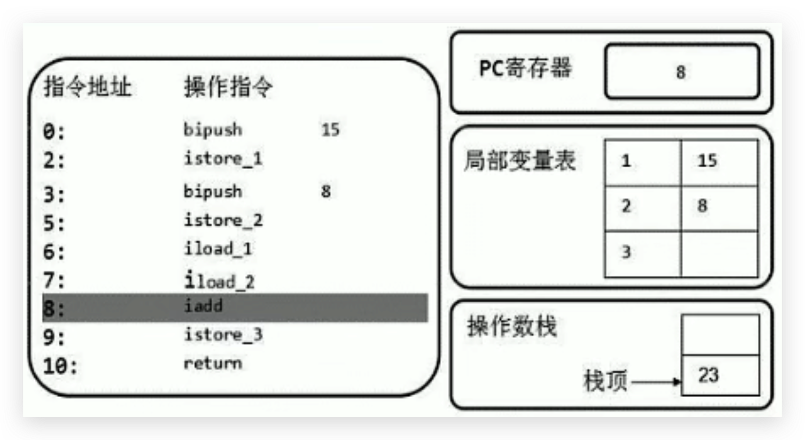

6. 然后在把操作数栈中的23执行store操作，并存储在局部变量表索引未3的位置

   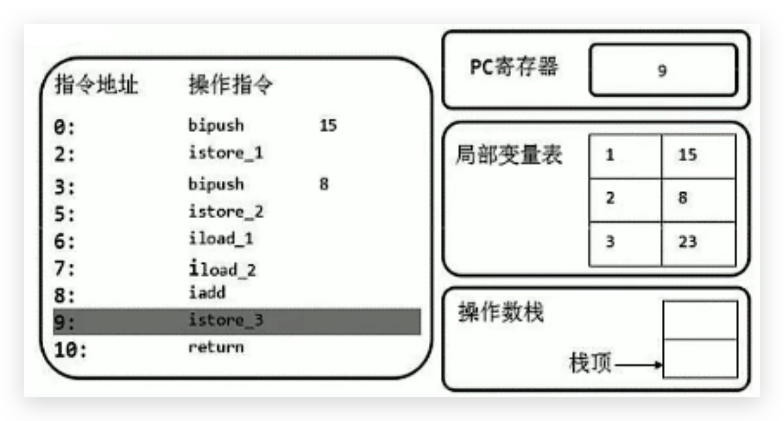

## 类型转换问题

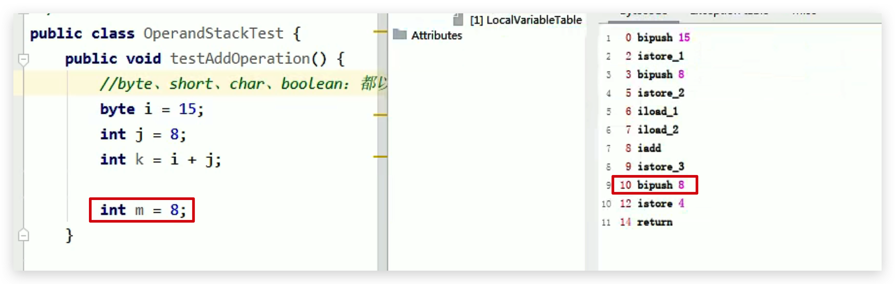

因为 8 可以存放在 byte 类型中，所以压入操作数栈的类型为 byte ，而不是 int ，所以执行的字节码指令为 bipush 8，但是存储在局部变量的时候，会转成 int 类型的变量：istore_4。

m改成800之后，byte存储不了，就成了short型，sipush 800

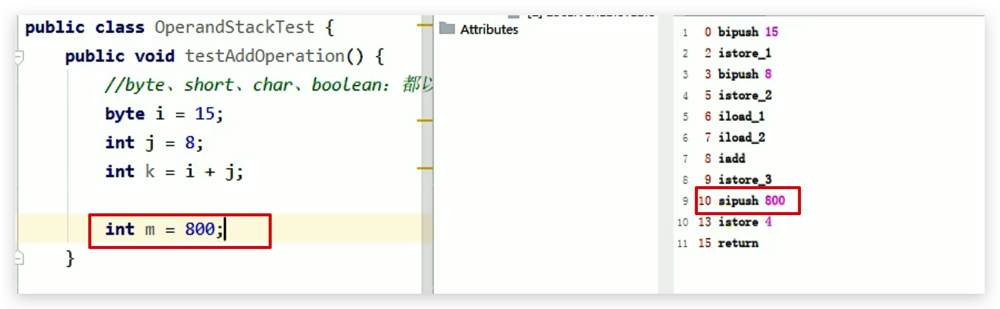

## 带有返回值的方法

**如果被调用的方法带有返回值，返回值入操作数栈**

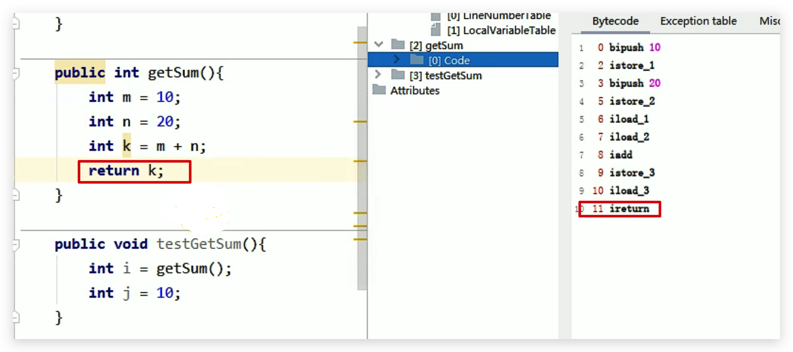

getSum() 方法字节码指令：最后带着个 ireturn

testGetSum() 方法字节码指令：一上来就加载 getSum() 方法的返回值()

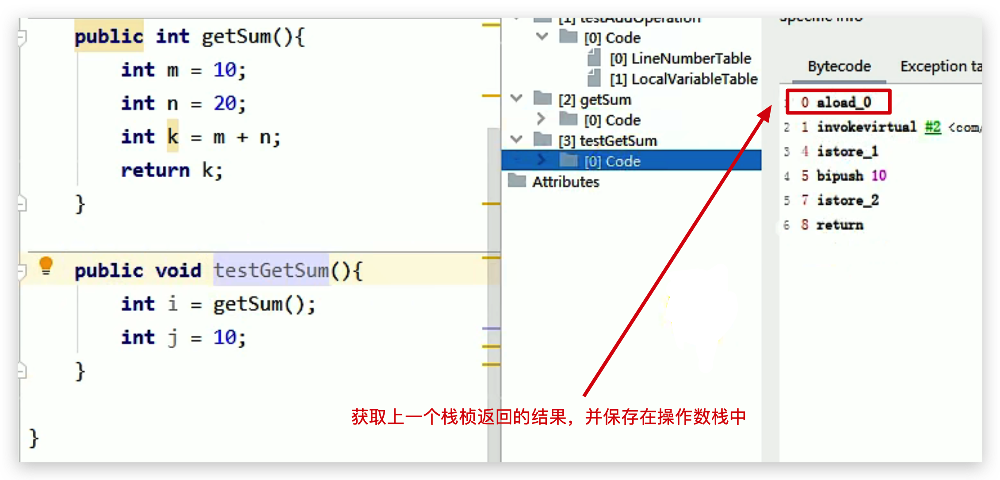

## 栈顶缓存技术（Top Of Stack Cashing）

### 背景

基于栈式架构的虚拟机所使用的零地址指令更加紧凑，但完成一项操作的时候必然需要使用更多的入栈和出栈指令，这同时也就意味着将需要更多的指令分派（instruction dispatch）次数（也就是你会发现指令很多）和导致内存读/写次数多，效率不高。

### 方案

由于操作数是存储在内存中的，因此频繁地执行内存读/写操作必然会影响执行速度。为了解决这个问题，HotSpot JVM的设计者们提出了栈顶缓存（Tos，Top-of-Stack Cashing）技术，**将栈顶元素全部缓存在物理CPU的寄存器中，以此降低对内存的读/写次数，提升执行引擎的执行效率。**

### 优点

寄存器的主要优点：指令更少，执行速度快，但是指令集（也就是指令种类）很多
