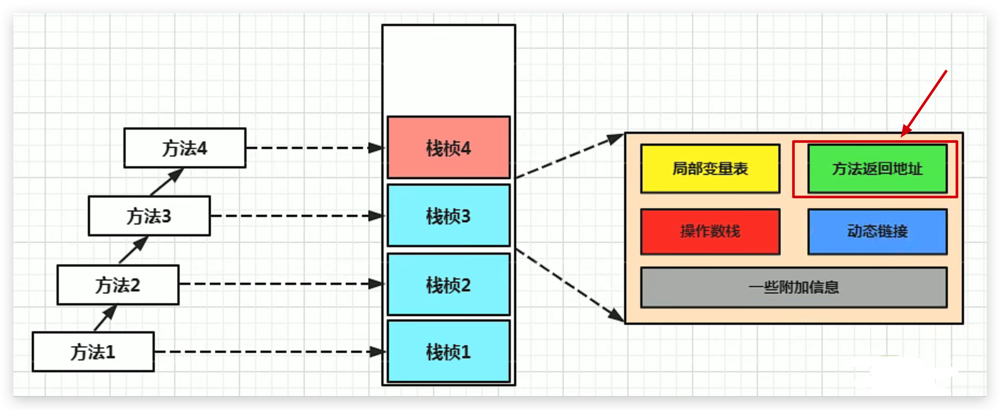
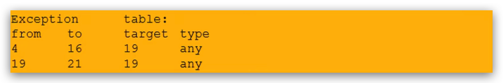

# JVM-运行时数据区-虚拟机栈-方法返回地址(Return Address)

## 定义

- 存放调用方法（栈帧）的 pc寄存器的值
- 一个方法的结束，有两种方式：
  - 正常执行完成
  - 出现未处理的异常，非正常退出
- 无论通过哪种方式退出，在方法退出后都返回到该方法被调用的位置。**方法正常退出时，调用者的pc计数器的值作为返回地址，即调用该方法的指令的下一条指令的地址**。而通过异常退出的，返回地址是要通过异常表来确定，栈帧中一般不会保存这部分信息。

<!--more-->

本质上，方法的退出就是当前栈帧出栈的过程。此时，需要恢复上层方法的局部变量表、操作数栈、将返回值压入调用者栈帧的操作数栈、设置PC寄存器值等，让调用者方法继续执行下去。

`正常完成出口和异常完成出口的区别在于：通过异常完成出口退出的不会给他的上层调用者产生任何的返回值。`

当一个方法开始执行后，只有两种方式可以退出这个方法：

## 正常完成出口

### 含义

执行引擎遇到任意一个方法返回的字节码指令（return），会有返回值传递给上层的方法调用者，简称`正常完成出口`；

### 返回指令

一个方法在正常调用完成之后，究竟需要使用哪一个返回指令，还需要根据方法返回值的实际数据类型而定。

在字节码指令中，返回指令包含：

- ireturn：当返回值是boolean，byte，char，short和int类型时使用
- lreturn：Long类型
- freturn：Float类型
- dreturn：Double类型
- areturn：引用类型
- return：返回值类型为void的方法、实例初始化方法、类和接口的初始化方法

## 异常完成出口

### 含义

在方法执行过程中遇到异常（Exception），并且这个异常没有在方法内进行处理，也就是只要在本方法的异常表中没有搜索到匹配的异常处理器，就会导致方法退出，简称`异常完成出口`。

### 异常处理表

方法执行过程中，抛出异常时的异常处理，存储在一个异常处理表，方便在发生异常的时候找到处理异常的代码

异常处理表：

- 反编译字节码文件，可得到 Exception table
- from ：字节码指令起始地址
- to ：字节码指令结束地址
- target ：出现异常跳转至地址为 19 的指令执行
- type ：捕获异常的类型

