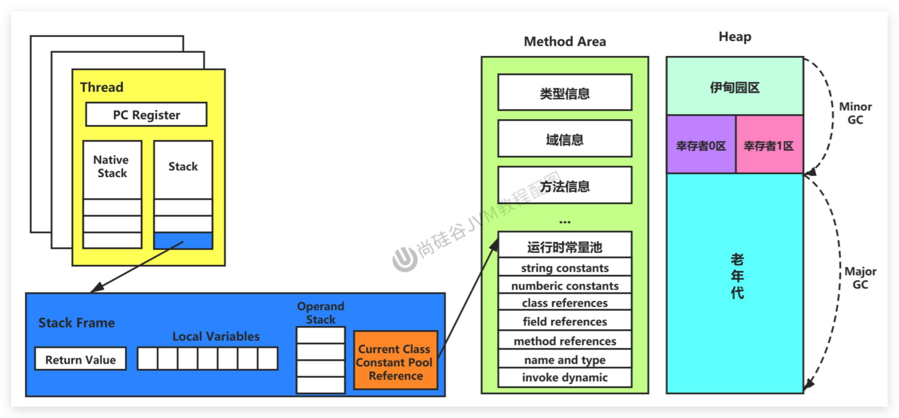

# JVM-运行时数据区-总结与面试题

## 总图

<!--more-->

## 常见面试题

1. 百度
   - 三面：说一下JVM内存模型吧，有哪些区？分别干什么的？
2. 蚂蚁金服：
   - Java8的内存分代改进
   - JVM内存分哪几个区，每个区的作用是什么？
   - 一面：JVM内存分布/内存结构？栈和堆的区别？堆的结构？为什么两个survivor区？
   - 二面：Eden和survior的比例分配
3. 小米：
   - jvm内存分区，为什么要有新生代和老年代
4. 字节跳动：
   - 二面：Java的内存分区
   - 二面：讲讲jvm运行时数据库区
   - 什么时候对象会进入老年代？
5. 京东：
   - JVM的内存结构，Eden和Survivor比例。
   - JVM内存为什么要分成新生代，老年代，持久代。新生代中为什么要分为Eden和survivor。
6. 天猫：
   - 一面：Jvm内存模型以及分区，需要详细到每个区放什么。
   - 一面：JVM的内存模型，Java8做了什么改动
7. 拼多多：
   - JVM内存分哪几个区，每个区的作用是什么？
8. 美团：
   - java内存分配
   - jvm的永久代中会发生垃圾回收吗？
   - 一面：jvm内存分区，为什么要有新生代和老年代？
