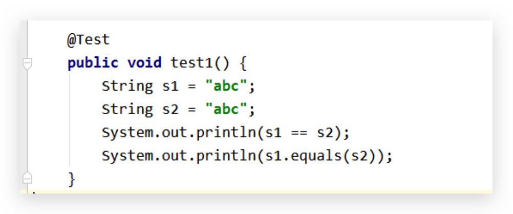
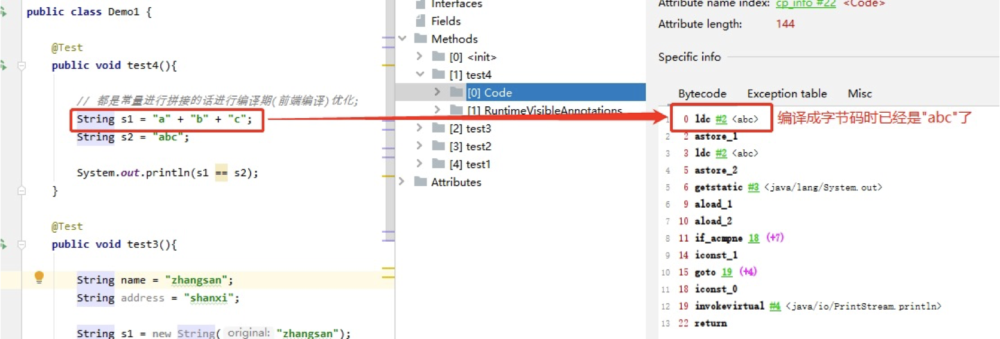
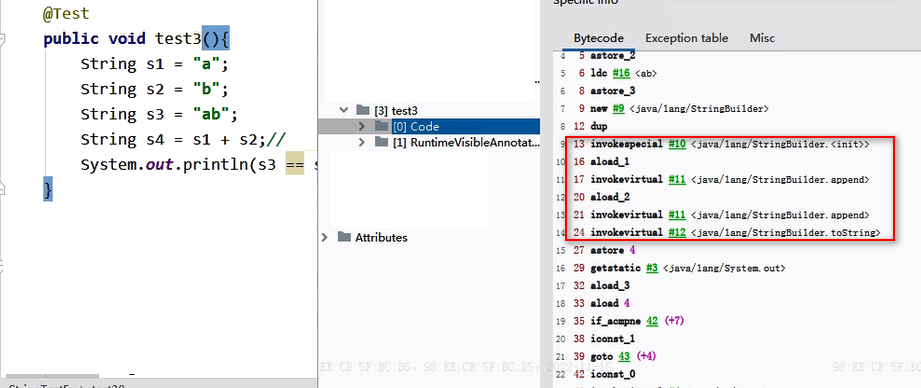
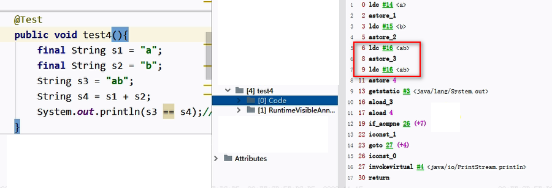

# JVM-StringTable-字符串的拼接操作

## 字符串的拼接操作

### 原理

1. 常量与常量的拼接结果在常量池中（堆中划分的一块内存），原理是编译期优化
2. 常量池中不会存在相同内容的变量
3. 拼接前后，只要其中有一个是变量，结果就在堆中（区别于1中的堆，在常量池之外的堆中）。变量拼接的原理是StringBuilder
4. 如果拼接的结果调用intern()方法，根据该字符串是否在常量池中存在，分为：
   - 如果存在，则返回字符串在常量池中的地址
   - 如果字符串常量池中不存在该字符串，则在常量池中创建一份，并返回此对象的地址

<!--more-->

### 案例一

结论：**常量与常量的拼接结果在常量池，原理是编译期优化**

代码：

```java
@Test
public void test1(){
  String s1 = "a" + "b" + "c";//编译期优化：等同于"abc"
  String s2 = "abc"; //"abc"一定是放在字符串常量池中，将此地址赋给s2

  System.out.println(s1 == s2); //true，比较的是地址
  System.out.println(s1.equals(s2)); //true，比较的是值
}
```

分析：从两个角度去证明结论

1. 反编译看class文件，S1 S2 都是一样的，所以 s1 == s2 与 s1.equals(s2) 都为 true

   

2. 从字节码指令看

   

### 案例二

结论：**拼接前后，只要其中有一个是变量，结果就在堆中；调用 intern() 方法，则主动将字符串对象存入字符串常量池中，并将其地址返回**

代码：

```java
@Test
public void test2(){
  String s1 = "javaEE";
  String s2 = "hadoop";

  String s3 = "javaEEhadoop";
  String s4 = "javaEE" + "hadoop";//编译期优化
  
  //如果拼接符号的前后出现了变量，则相当于在堆空间中new String()，具体的内容为拼接的结果：javaEEhadoop
  String s5 = s1 + "hadoop";
  String s6 = "javaEE" + s2;
  String s7 = s1 + s2;

  System.out.println(s3 == s4);//true
  System.out.println(s3 == s5);//false
  System.out.println(s3 == s6);//false
  System.out.println(s3 == s7);//false
  System.out.println(s5 == s6);//false
  System.out.println(s5 == s7);//false
  System.out.println(s6 == s7);//false
    
  //intern():判断字符串常量池中是否存在javaEEhadoop值:
  //如果存在，则返回常量池中javaEEhadoop的地址；
  //如果字符串常量池中不存在javaEEhadoop，则在常量池中加载一份javaEEhadoop，并返回此对象的地址。
  String s8 = s6.intern();
  System.out.println(s3 == s8);//true
  System.out.println(s6 == s8);//false
}
```

## 字符串拼接的底层细节

### 变量拼接的原理

代码：

```java
@Test
public void test3(){
    String s1 = "a";
    String s2 = "b";
    String s3 = "ab";
    
    String s4 = s1 + s2;//
    System.out.println(s3 == s4);//false
}
```

字节码：



原理：

s1 + s2 的执行细节：(变量s是临时定义的）
    ① StringBuilder s = new StringBuilder();
    ② s.append("a")
    ③ s.append("b")
    ④ s.toString()  --> 约等于 new String("ab")，但不等价

补充：在jdk5.0之后使用的是StringBuilder,在jdk5.0之前使用的是StringBuffer    

### 常量或常量引用拼接(fina**l)**

**字符串拼接操作不一定使用的是StringBuilder!。**

如果拼接符号左右两边都是字符串常量或常量引用变量，则仍然使用编译期优化，即非StringBuilder的方式。

举例：

```java
@Test
public void test4(){
    final String s1 = "a";
    final String s2 = "b";
    String s3 = "ab";
    String s4 = s1 + s2;
    System.out.println(s3 == s4);//true
}
```

字节码：



为变量 s4 赋值时，直接使用 #16 符号引用，即字符串常量 “ab”。

所以：**针对于final修饰类、方法、基本数据类型、引用数据类型的量的结构时，能使用上final的时候建议使用上。**

## 拼接操作与 append 操作的效率对比

### 代码

```java
@Test
public void test6(){

    long start = System.currentTimeMillis();

    //method1(100000);//4014毫秒
    method2(100000);//7毫秒

    long end = System.currentTimeMillis();

    System.out.println("花费的时间为：" + (end - start));
}

public void method1(int highLevel){
    String src = "";
    for(int i = 0;i < highLevel;i++){
        src = src + "a";//每次循环都会创建一个StringBuilder、String
    }
    //System.out.println(src);

}

public void method2(int highLevel){
    //只需要创建一个StringBuilder
    StringBuilder src = new StringBuilder();
    for (int i = 0; i < highLevel; i++) {
        src.append("a");
    }
    //System.out.println(src);
}
```

### 结论

**通过StringBuilder的append()的方式添加字符串的效率要远高于使用String的字符串拼接方式！**

详情原因：

1. 创建对象的角度：

   1. StringBuilder的append()的方式：自始至终中只创建过一个StringBuilder的对象

   2. 使用String的字符串拼接方式：创建过多个StringBuilder和String对象

2. 内存占用的角度；

   使用String的字符串拼接方式：内存中由于创建过多个StringBuilder和String对象，内存占用更大；如果进行GC，需要花费额外的时间。

### 优化空间

在实际开发中，如果基本确定要前前后后添加的字符串长度不高于某个限定值highLevel的情况下，建议使用构造器实例化，这样可以避免频繁扩容：

`StringBuilder s = new StringBuilder(highLevel); //底层是new char[highLevel]`