# JVM-StringTable-intern的使用以及StringTable的垃圾回收

## intern()的使用

###  介绍

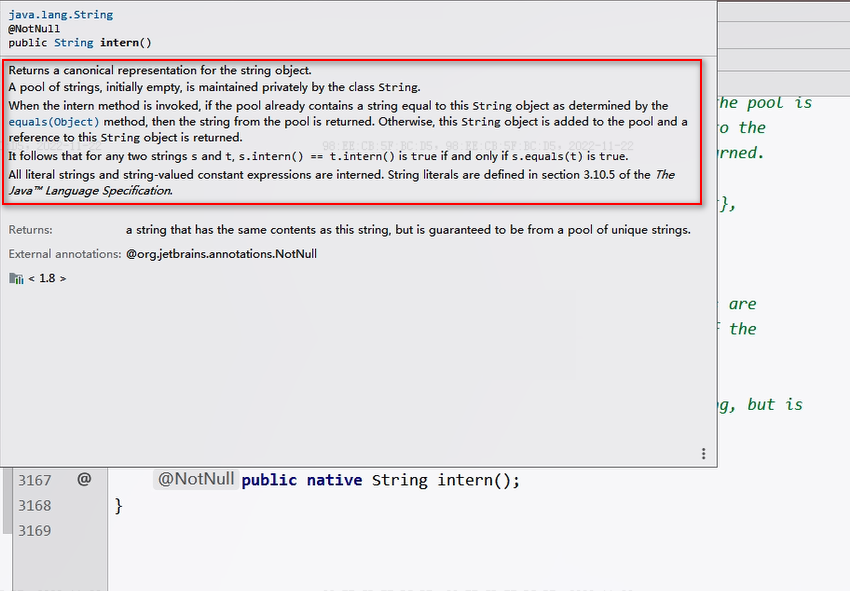

翻译：

字符串常量池池最初是空的，由String类私有地维护。在调用intern方法时，如果池中已经包含了由equals(object)方法确定的与该字符串内容相等的字符串，则返回池中的字符串地址。否则，该字符串	对象将被添加到池中，并返回对该字符串对象的地址。

<!--more-->

1. intern是一个native方法，调用的是底层C的方法

2. 如果不是用双引号声明的String对象，可以使用String提供的intern方法：intern方法会从字符串常量池中查询当前字符串是否存在，若不存在就会将当前字符串放入常量池中。

   比如：`String myInfo = new string("I love atguigu").intern();`

3. 也就是说，如果在任意字符串上调用String.intern方法，那么其返回结果所指向的那个类实例，必须和直接以常量形式出现的字符串实例完全相同。因此，下列表达式的值必定是true

   `("a"+"b"+"c").intern()=="abc"`

4. 通俗点讲，Interned String就是确保字符串在内存里只有一份拷贝，这样可以节约内存空间，加快字符串操作任务的执行速度。注意，这个值会被存放在字符串内部池（String Intern Pool）

### 举例一

**如何保证变量s指向的是字符串常量池中的数据呢？**

答：有两种方式。

- 方式一：字面量声明 `String s = "buubiu";`
- 方式二：无论前面String是如何定义的，后面都调用了` intern() `方法：
  - `String s = new String("buubiu").intern();`
  - `String s = new StringBuilder("buubiu").toString().intern();`

### 举例二

**new String(“ab”)会创建几个对象？**

代码：

```java
public class StringNewTest {
    public static void main(String[] args) {
        String str = new String("ab");
    }
}
```

字节码指令：

```java
0 new #2 <java/lang/String> //在堆中创建了一个 String 对象
3 dup
4 ldc #3 <ab> //在字符串常量池中放入 对象“ab”（如果之前字符串常量池中没有 “ab” 的话）
6 invokespecial #4 <java/lang/String.<init>>
9 astore_1
10 return
```

答：通过字节码，知道是两个

1. new关键字在堆空间创建的

2. 字符串常量池中的对象"ab"。 字节码指令：ldc

### 举例三

**new String(“a”) + new String(“b”) 会创建几个对象？**

代码：

```java
public class StringNewTest {
    public static void main(String[] args) {

        String str = new String("a") + new String("b");
    }
}
```

字节码指令：

```java
0 new #2 <java/lang/StringBuilder> //拼接字符串会创建一个 StringBuilder 对象
3 dup
4 invokespecial #3 <java/lang/StringBuilder.<init>>
7 new #4 <java/lang/String> //创建 String 对象，对应于 new String(“a”)
10 dup
11 ldc #5 <a> //在字符串常量池中放入 “a”（如果之前字符串常量池中没有 “a” 的话）
13 invokespecial #6 <java/lang/String.<init>>
16 invokevirtual #7 <java/lang/StringBuilder.append>
19 new #4 <java/lang/String> //创建 String 对象，对应于 new String(“b”)
22 dup
23 ldc #8 <b> //在字符串常量池中放入 “b”（如果之前字符串常量池中没有 “b” 的话）
25 invokespecial #6 <java/lang/String.<init>>
28 invokevirtual #7 <java/lang/StringBuilder.append>
31 invokevirtual #9 <java/lang/StringBuilder.toString> //调用 StringBuilder 的 toString() 方法，会生成一个 String 对象
34 astore_1
35 return
```

答：

- 对象1：new StringBuilder()

 - 对象2： new String("a")

 - 对象3： 常量池中的"a"

 - 对象4： new String("b")

 - 对象5： 常量池中的"b"

 - 对象6 ：new String("ab")

   深入剖析： StringBuilder的toString()；

   强调一下，toString()的调用，在字符串常量池中，没有生成"ab"

### 举例四

```java
public class 	StringIntern {
  public static void main(String[] args) {
    String s = new String("1");
    s.intern();
    String s2 = "1";
    System.out.println(s == s2);//jdk6：false   jdk7/8：false

    String s3 = new String("1") + new String("1");
    s3.intern();

    String s4 = "11";
    System.out.println(s3 == s4);//jdk6：false  jdk7/8：true
  }
}
```

分析：

- 首先在jdk6中，字符串常量池是在永久代，即方法区中，而对象是分配在堆中，所以他们的地址永远不相等；

下面来分析在Jdk7/8中的情况：

- `s == s2`
  1. 虽然第四行 `s.intern();`//调用此方法之前，字符串常量池中已经存在了"1"
  2. 由于是后调用intern()方法，并没有赋值给s，所以s还是指向在堆中的地址
  3. 而s2是字面量赋值，jvm直接把字符串常量池的“1”的地址返回给s2
  4. 所以结果为false
  5. 若第三行改为：`String s = new String("1").intern();`，则结果就为true了。

- `s3 == s4`
  1. 经过举例三分析得到：执行完第8行的代码，在堆中有了一个new String("11")这样的String对象，但是在字符串常量池中没有"11"
  2. 所以s3变量记录的地址为：new String("11")
  3. 接着执行s3.intern()，在字符串常量池中生成"11"
  4. 在JDK6的版本中，字符串常量池还在永久代，所以直接在永久代生成"11",也就有了新的地址
  5. 而在JDK7的后续版本中，字符串常量池被移动到了堆中，此时堆里已经有new String（"11"）了，**出于节省空间的目的，直接将堆中的那个字符串的引用地址储存在字符串常量池中，即字符串常量池中存的是new String（"11"）在堆中的地址**
  6. s4变量记录的地址：使用的是上一行代码代码执行时，在常量池中生成的"11"的地址
  7. 所以在JDK7后续版本中，s3和s4指向的完全是同一个地址。

- 通过内存图来分析

  jdk6:

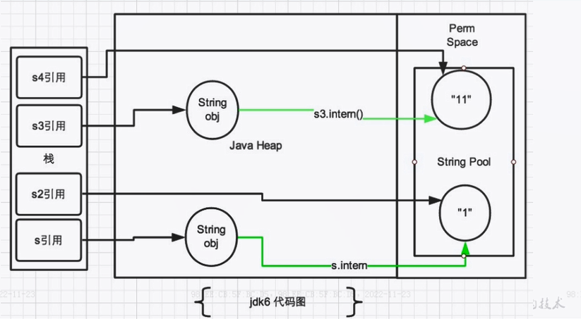

​	jdk7/8:

### 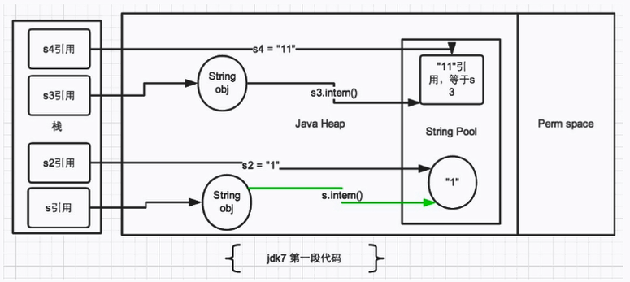举例五

是举例四的拓展

```java
public class StringIntern1 {
    public static void main(String[] args) {
        String s3 = new String("1") + new String("1");
        String s4 = "11";  
        String s5 = s3.intern();

        System.out.println(s3 == s4);//false
        System.out.println(s5 == s4);//true
    }
}
```

分析：

1. 执行完第3行代码以后，字符串常量池中，不存在"11"
2. 第4行代码：在字符串常量池中生成对象"11"
3. s3 是堆中的 "ab" ，s4 是字符串常量池中的 "ab"，所以 s3 不等于 s4
4. s5 是从字符串常量池中取回来的引用，所以s5等于s4

### 举例六

```java
public class StringExer1 {
    public static void main(String[] args) {
        String s = new String("a") + new String("b");
        String s2 = s.intern();

        System.out.println(s2 == "ab");//jdk6:true  jdk8:true
        System.out.println(s == "ab");//jdk6:false  jdk8:true
    }
}
```

答：jdk6:true，false jdk7/8:true,true

分析：

1.  执行第三行代码，相当于new String("ab")，并且在执行完以后，字符串常量池中并没有"ab"

2. 执行第四行代码后，若是jdk6：在字符串常量池（此时在永久代）中创建一个字符串"ab"；若是jdk7/8：字符串常量池（此时在堆中）中没有创建字符串"ab",而是创建一个引用，指向new String("ab")， 将此引用返回

3. 图解：

   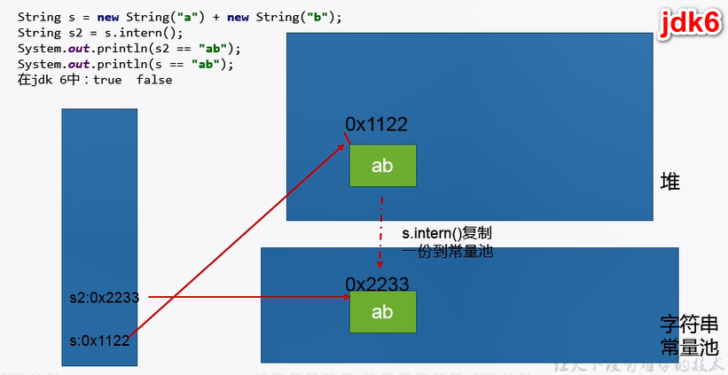

   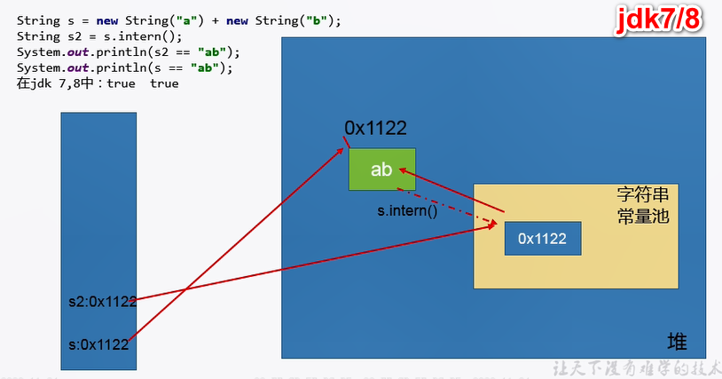

   #### 变形题一

   ```java
   public class StringExer1 {
       public static void main(String[] args) {
           //加一行这个
           String x = "ab";
           String s = new String("a") + new String("b");//new String("ab")
   
           String s2 = s.intern();
   
           System.out.println(s2 == "ab");
           System.out.println(s == "ab");
       }
   }
   ```

   答：jdk6,7,8:true，false

   分析：

   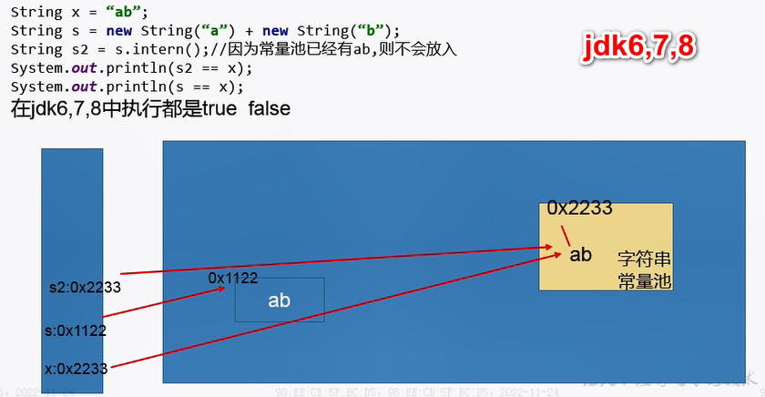

   #### 变形题二

   ```java
   public class StringExer2 {
     public static void main(String[] args) {
       String s1 = new String("ab");//执行完以后，会在字符串常量池中生成"ab"
    //   String s1 = new String("a") + new String("b");//执行完以后，不会在字符串常量池中生成"ab"
   
       s1.intern();
       String s2 = "ab";
       System.out.println(s1 == s2);//注释3行结果：true 注释4行结果：false
     }
   }
   ```

   

### 总结

总结String的intern()的使用：

- Jdk1.6中，将这个字符串对象尝试放入字符串常量池（串池）。
  - 如果串池中有，则并不会放入。返回已有的串池中的对象的地址
  - 如果没有，会把 **此对象复制一份**，放入串池，并返回串池中的对象地址
- Jdk1.7起，将这个字符串对象尝试放入字符串常量池（串池）。
  - 如果串池中有，则并不会放入。返回已有的串池中的对象的地址
  - 如果没有，则会把 **对象的引用地址复制一份**，放入串池，并返回串池中的引用地址。

### intern() 的效率测试（内存空间角度）

#### 代码

```java
public class StringIntern2 {
    static final int MAX_COUNT = 1000 * 10000;
    static final String[] arr = new String[MAX_COUNT];

    public static void main(String[] args) {
        Integer[] data = new Integer[]{1,2,3,4,5,6,7,8,9,10};

        long start = System.currentTimeMillis();
        for (int i = 0; i < MAX_COUNT; i++) {
//            arr[i] = new String(String.valueOf(data[i % data.length]));
            arr[i] = new String(String.valueOf(data[i % data.length])).intern();

        }
        long end = System.currentTimeMillis();
        System.out.println("花费的时间为：" + (end - start));

        try {
            Thread.sleep(1000000);
        } catch (InterruptedException e) {
            e.printStackTrace();
        }
        System.gc();
    }
}
```

1. 采用第10行执行的话，相当于直接 new String ：由于每个 String 对象都是 new 出来的，所以程序需要维护大量存放在堆空间中的 String 实例，程序内存占用也会变高，如图：

   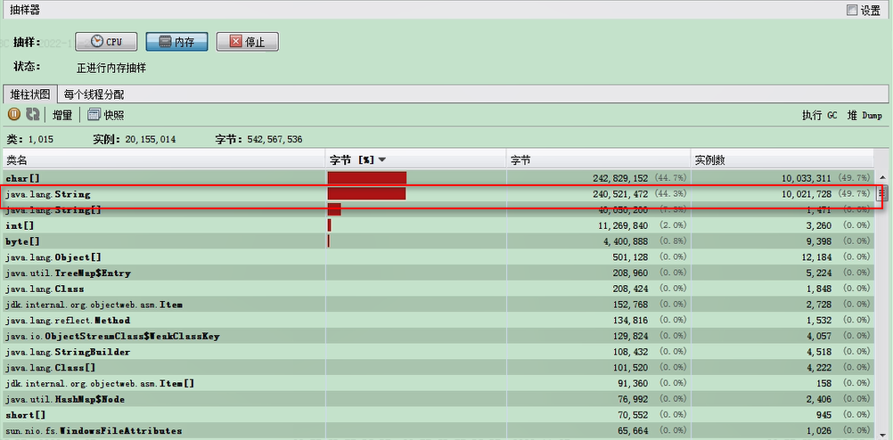

2. 采用第11行执行的话，相当于使用 intern() 方法：由于数组中字符串的引用都指向字符串常量池中的字符串，所以程序需要维护的 String 对象更少，内存占用也更低，

   原理：调用了intern()方法使用了字符串常量池里的字符串，那么前面堆里的字符串便会被GC掉，这也是intern省内存的关键原因

   如图：

   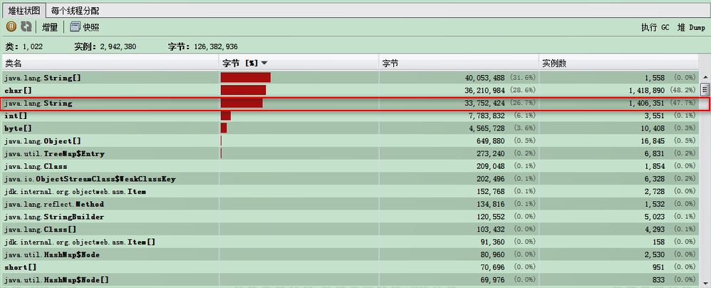

#### 结论

1. 对于程序中大量使用存在的字符串时，尤其存在很多已经重复的字符串时，使用intern()方法能够节省很大的内存空间。
2. 大的网站平台，需要内存中存储大量的字符串。比如社交网站，很多人都存储：北京市、海淀区等信息。这时候如果字符串都调用intern() 方法，就会很明显降低内存的大小。

## StringTable 的垃圾回收

代码：

```java
/**
 * String的垃圾回收:
 * -Xms15m -Xmx15m -XX:+PrintStringTableStatistics -XX:+PrintGCDetails
 */
public class StringGCTest {
    public static void main(String[] args) {
      	int total = 0;
      	int total = 100;
      	int total = 10000;
      	int total = 100000;
        for (int j = 0; j < total; j++) {
            //String.valueOf底层实际上是调用的 new String()
            String.valueOf(j).intern();
        }
    }
}
```

分析：

1. 依次把total的数值从0改到100000，打印出字符串常量池的大小，如图：

   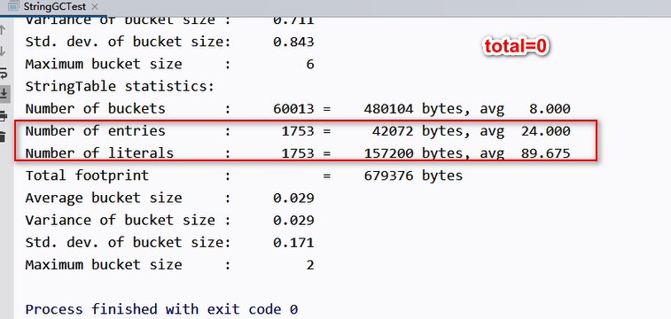

   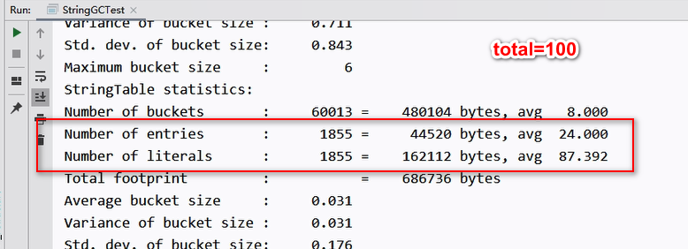

   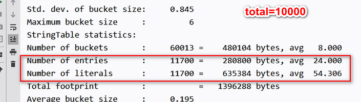

   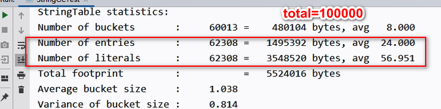

2. 以上分析得出当total为100000时，实际上字符串常量池里面是没有增加十万个的，因为发生了GC（YoungGC ），如图：

   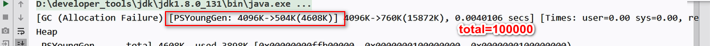

3. 说明 StringTable 区发生了垃圾回收

## G1 中的 String 去重操作

官方文档：http://openjdk.java.net/jeps/192

### 背景

> 注意不是字符串常量池的去重操作，字符串常量池本身就没有重复的

1. 对许多Java应用（有大的也有小的）做的测试得出以下结果：
   - 堆存活数据集合里面String对象占了25%
   - 堆存活数据集合里面重复的String对象有13.5%
   - String对象的平均长度是45
2. 许多大规模的Java应用的瓶颈在于内存，测试表明，在这些类型的应用里面，**Java堆中存活的数据集合差不多25%是String对象**。更进一步，这里面差不多一半String对象是重复的，重复的意思是说：`string1.equals(string2)= true`。**堆上存在重复的String对象必然是一种内存的浪费**。这个项目将在G1垃圾收集器中实现自动持续对重复的String对象进行去重，这样就能避免浪费内存。

### 实现步骤

1. 当垃圾收集器工作的时候，会访问堆上存活的对象。**对每一个访问的对象都会检查是否是候选的要去重的String对象。**
2. 如果是，把这个对象的一个引用插入到队列中等待后续的处理。一个去重的线程在后台运行，处理这个队列。处理队列的一个元素意味着从队列删除这个元素，然后尝试去重它引用的String对象。
3. 使用一个Hashtable来记录所有的被String对象使用的不重复的char数组。当去重的时候，会查这个Hashtable，来看堆上是否已经存在一个一模一样的char数组。
4. 如果存在，String对象会被调整引用那个数组，释放对原来的数组的引用，最终会被垃圾收集器回收掉。
5. 如果查找失败，char数组会被插入到Hashtable，这样以后的时候就可以共享这个数组了。

### 命令行选项启动去重

1. UseStringDeduplication(bool) ：开启String去重，**默认是不开启的，需要手动开启**。
2. PrintStringDeduplicationStatistics(bool) ：打印详细的去重统计信息
3. stringDeduplicationAgeThreshold(uintx) ：达到这个年龄的String对象被认为是去重的候选对象