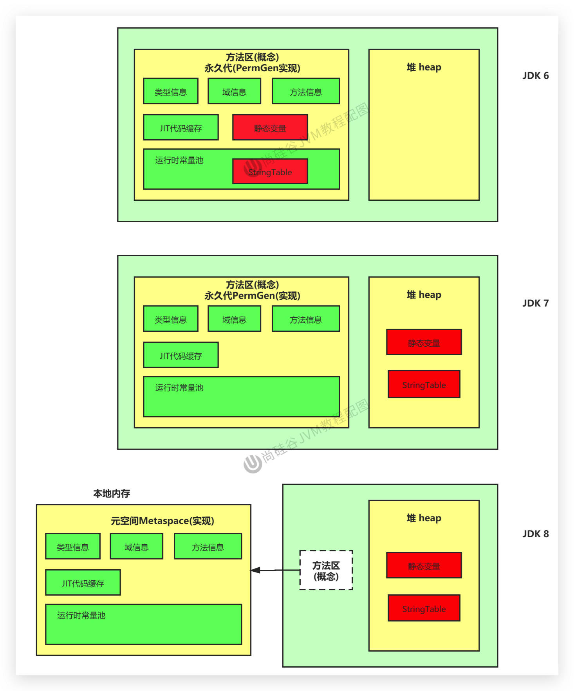
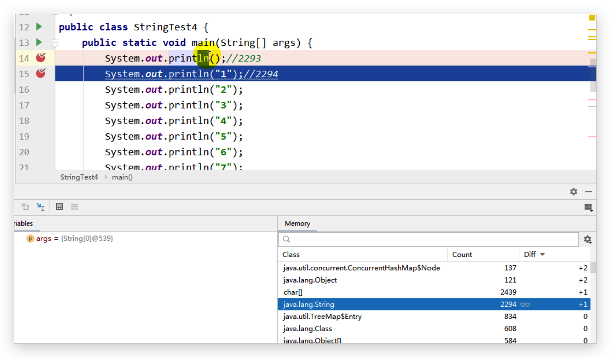
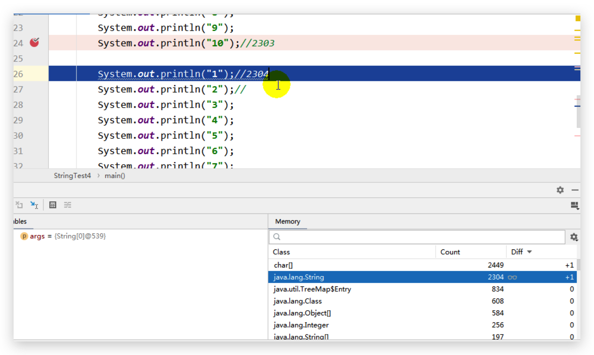
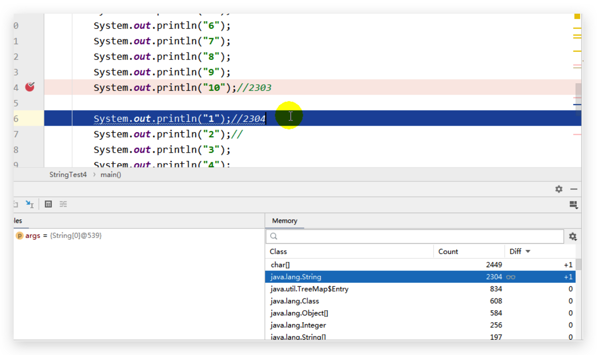
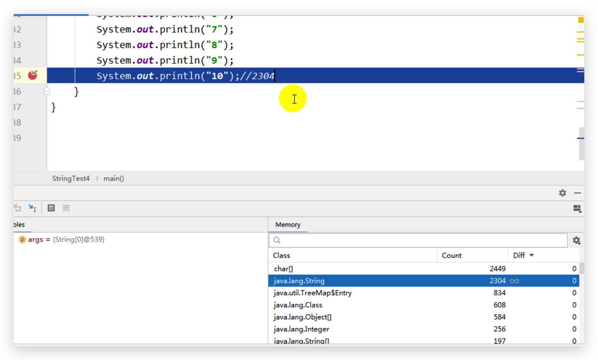
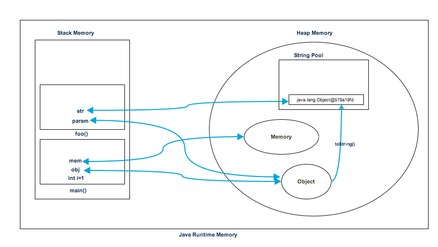

# JVM-StringTable-String的概述和基本操作

## String在JDk9中存储结构的变更

String在jdk8及以前内部定义了final char value[]用于存储字符串数据。JDK9时改为byte[]

**官方文档**：http://openjdk.java.net/jeps/254

原因：

1. String类的当前实现将字符存储在char数组中，每个字符使用两个字节(16位)。

2. 从许多不同的应用程序收集的数据表明，字符串是堆使用的主要组成部分，而且大多数字符串对象只包含拉丁字符（Latin-1）。这些字符只需要一个字节的存储空间，因此这些字符串对象的内部char数组中有一半的空间将不会使用，产生了大量浪费。

3. 之前 String 类使用 UTF-16 的 char[] 数组存储，现在改为 byte[] 数组 外加一个编码标识存储。该编码表示如果你的字符是ISO-8859-1或者Latin-1，那么只需要一个字节存。如果你是其它字符集，比如UTF-8，你仍然用两个字节存

4. 结论：String再也不用char[] 来存储了，改成了byte [] 加上编码标记，节约了一些空间

5. 同时基于String的数据结构，例如StringBuffer和StringBuilder也同样做了修改

   ```java
   // 之前
   private final char value[];
   // 之后
   private final byte[] value
   ```

<!--more-->

## String 的基本特性

### 定义

- String：字符串，使用一对 “” 引起来表示

  ```java
    String s1 = "buubiu" ;   			// 字面量的定义方式
    String s2 =  new String("buubiu");     // new 对象的方式
  ```

### 不可继承

- String被声明为final的，**不可被继承**

### 支持序列化

- String实现了Serializable接口：表示字符串是**支持序列化**的。实现了Comparable接口：表示String可以比较大小

### 不可变性

- String：代表不可变的字符序列。简称：**不可变性**。

  - 字符串常量池不允许存储相同的内容，所以 s1 == s2 为 true

    ```java
    public void test1() {
      String s1 = "abc";//字面量定义的方式
      String s2 = "abc";
      System.out.println(s1 == s2);//判断地址：true
      System.out.println(s1);//abc
      System.out.println(s2);//abc
    }
    ```
  
  - 当对字符串重新赋值时，需要重写指定内存区域赋值，不能使用原有的value进行赋值，所以 s1 == s2 为 false

    ```java
    public void test1() {
      String s1 = "abc";//字面量定义的方式
      String s2 = "abc";
      s1 = "hello";
      System.out.println(s1 == s2);//判断地址：false
      System.out.println(s1);//hello
      System.out.println(s2);//abc
    }
    ```
  
  - 当对现有的字符串进行连接操作时，也需要重新指定内存区域赋值，不能使用原有的value进行赋值，所以 s2 为 abcdef

    ```java
    public void test1() {
      String s1 = "abc";//字面量定义的方式
      String s2 = "abc";
      s2 += "def";
      System.out.println(s1 == s2);//判断地址：false
      System.out.println(s1);//abc
      System.out.println(s2);//abcdef
    }
    ```
  
  - 当调用String的replace()方法修改指定字符或字符串时，也需要重新指定内存区域赋值，不能使用原有的value进行赋值，所以 s1 不会改变，s2 为 mbc

    ```java
    public void test3() {
        String s1 = "abc";//字面量定义的方式
        String s2 = s1.replace('a', 'm');
        System.out.println(s1);//abc
        System.out.println(s2);//mbc
    }
    ```
  
  - 笔试题：

    ```java
    public class StringExer {
        String str = new String("good");
        char[] ch = {'t', 'e', 's', 't'};
    
        public void change(String str, char ch[]) {
            str = "test ok";
            ch[0] = 'b';
        }
    
        public static void main(String[] args) {
            StringExer ex = new StringExer();
            ex.change(ex.str, ex.ch);
            System.out.println(ex.str);//good
            System.out.println(ex.ch);//best
        }
    
    }
    ```
  
  **总结：通过字面量的方式（区别于new）给一个字符串赋值，此时的字符串值声明在字符串常量池中。**

## String 的底层结构

**字符串常量池是不会存储相同内容的字符串的**

- String的String Pool（字符串常量池）是一个固定大小的Hashtable，默认值大小长度是1009。如果放进String Pool的String非常多，就会造成Hash冲突严重，从而导致链表会很长，而链表长了后直接会造成的影响就是当调用String.intern()方法时性能会大幅下降。
- 使用 `-XX:StringTablesize=xx`可设置StringTable的长度
- 在JDK6中StringTable是固定的，就是`1009`的长度，所以如果常量池中的字符串过多就会导致效率下降很快，StringTablesize设置没有要求
- 在JDK7中，StringTable的长度默认值是`60013`，StringTablesize设置没有要求
- JDK8 开始，设置 StringTablbe 的长度的话，1009 是可设置的最小值。

**不同 StringTable 长度下，程序的性能**

```java
/**
 * 产生10万个长度不超过10的字符串，包含a-z,A-Z
 */
public class GenerateString {
    public static void main(String[] args) throws IOException {
        FileWriter fw =  new FileWriter("words.txt");

        for (int i = 0; i < 100000; i++) {
            //1 - 10
           int length = (int)(Math.random() * (10 - 1 + 1) + 1);
            fw.write(getString(length) + "\n");
        }

        fw.close();
    }

    public static String getString(int length){
        String str = "";
        for (int i = 0; i < length; i++) {
            //65 - 90, 97-122
            int num = (int)(Math.random() * (90 - 65 + 1) + 65) + (int)(Math.random() * 2) * 32;
            str += (char)num;
        }
        return str;
    }
}

```

```java
public class StringTest2 {
    public static void main(String[] args) {

        BufferedReader br = null;
        try {
            br = new BufferedReader(new FileReader("words.txt"));
            long start = System.currentTimeMillis();
            String data;
            while((data = br.readLine()) != null){
                data.intern(); //如果字符串常量池中没有对应data的字符串的话，则在常量池中生成
            }

            long end = System.currentTimeMillis();

            System.out.println("花费的时间为：" + (end - start));//1009:143ms  100009:47ms
        } catch (IOException e) {
            e.printStackTrace();
        } finally {
            if(br != null){
                try {
                    br.close();
                } catch (IOException e) {
                    e.printStackTrace();
                }

            }
        }
    }
}

```

- -XX:StringTableSize=1009 ：程序耗时 143ms
- -XX:StringTableSize=100009 ：程序耗时 47ms

## String 的内存分配

- 在Java语言中有8种基本数据类型和一种比较特殊的类型String。这些类型为了使它们在运行过程中速度更快、更节省内存，都提供了一种常量池的概念。
- 常量池就类似一个Java系统级别提供的缓存。8种基本数据类型的常量池都是系统协调的，**String类型的常量池比较特殊。它的主要使用方法有两种：**
  - 直接使用双引号声明出来的String对象会直接存储在常量池中。比如：`String info="buubiu";`
  - 如果不是用双引号声明的String对象，可以使用String提供的intern()方法。 

### 内存分配的演进：

- Java 6及以前，字符串常量池存放在永久代

- Java 7中 Oracle的工程师对字符串池的逻辑做了很大的改变，即将**字符串常量池的位置调整到Java堆内**

  - 所有的字符串都保存在堆（Heap）中，和其他普通对象一样，这样可以让你在进行调优应用时仅需要调整堆大小就可以了。

  - 字符串常量池概念原本使用得比较多，但是这个改动使得我们有足够的理由让我们重新考虑在Java 7中使用String.intern()。

- Java8元空间，字符串常量在堆

    

### StringTable 为什么要调整？

**官方文档**:https://www.oracle.com/java/technologies/javase/jdk7-relnotes.html#jdk7changes

1. 为什么要调整位置？
   - 永久代的默认空间大小比较小
   - 永久代垃圾回收频率低，大量的字符串无法及时回收，容易进行Full GC产生STW或者容易产生OOM：PermGen Space
   - 堆中空间足够大，字符串可被及时回收
2. 在JDK 7中，interned字符串不再在Java堆的永久代中分配，而是在Java堆的主要部分（称为年轻代和年老代）中分配，与应用程序创建的其他对象一起分配。
3. 此更改将导致驻留在主Java堆中的数据更多，驻留在永久生成中的数据更少，因此可能需要调整堆大小。

### 代码示例

```java
/**
 * jdk6中：
 * -XX:PermSize=6m -XX:MaxPermSize=6m -Xms6m -Xmx6m
 *
 * jdk8中：
 * -XX:MetaspaceSize=6m -XX:MaxMetaspaceSize=6m -Xms6m -Xmx6m
 */
public class StringTest3 {
    public static void main(String[] args) {
        //使用Set保持着常量池引用，避免full gc回收常量池行为
        Set<String> set = new HashSet<String>();
        //在short可以取值的范围内足以让6MB的PermSize或heap产生OOM了。
        short i = 0;
        while(true){
            set.add(String.valueOf(i++).intern());
        }
    }
}
```

输出结果：

jdk6:

```java
Exception in thread "main" java.lang.OutOfMemoryError: PermGen space
  at java.lang.String.intern(Native Method)
  at com.buubiu.java.StringTest3.main(StringTest3.java:22)
Process finished with exit code 1
```

jdk8:

```java
Exception in thread "main" java.lang.OutOfMemoryError: Java heap space
	at java.util.HashMap.resize(HashMap.java:703)
	at java.util.HashMap.putVal(HashMap.java:662)
	at java.util.HashMap.put(HashMap.java:611)
	at java.util.HashSet.add(HashSet.java:219)
  at com.buubiu.java.StringTest3.main(StringTest3.java:22)

Process finished with exit code 1
```

## String 的基本操作

### 举例一

Java语言规范里要求完全相同的字符串字面量，应该包含同样的Unicode字符序列（包含同一份码点序列的常量），并且必须是指向同一个String类实例。

```java
public class StringTest4 {
    public static void main(String[] args) {
        System.out.println();//2293
        System.out.println("1");//2294
        System.out.println("2");
        System.out.println("3");
        System.out.println("4");
        System.out.println("5");
        System.out.println("6");
        System.out.println("7");
        System.out.println("8");
        System.out.println("9");
        System.out.println("10");//2303
        //如下的字符串"1" 到 "10"不会再次加载
        System.out.println("1");//2304
        System.out.println("2");//2304
        System.out.println("3");
        System.out.println("4");
        System.out.println("5");
        System.out.println("6");
        System.out.println("7");
        System.out.println("8");
        System.out.println("9");
        System.out.println("10");//2304
    }
}
```

分析字符串常量池的变化

1. 程序启动时已经加载了 2293 个字符串常量

2. 加载了一个换行符（println），所以多了一个

   

3. 加载了字符串常量 “1”~“9”

   

4. 加载字符串常量 “10”

   

5. 之后的字符串"1" 到 "10"不会再次加载

   

### 举例二

```java
//官方示例代码
class Memory {
    public static void main(String[] args) {//line 1
        int i = 1;//line 2
        Object obj = new Object();//line 3
        Memory mem = new Memory();//line 4
        mem.foo(obj);//line 5
    }//line 9

    private void foo(Object param) {//line 6
        String str = param.toString();//line 7
        System.out.println(str);
    }//line 8
}
```

分析运行时内存（foo() 方法是实例方法，其实图中少了一个 this 局部变量）



在第7行创建了一个字符串 	`str`，它存在堆空间的字符串常量池中，并且在foo()栈空间创建了一个引用来指向字符串常量池中。
