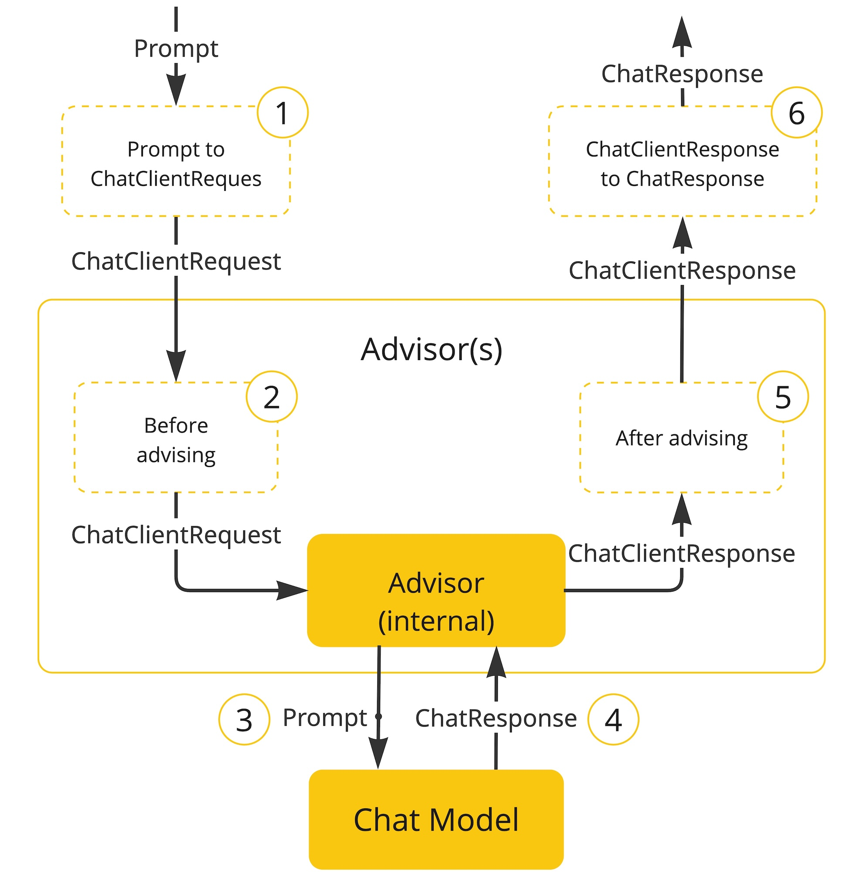
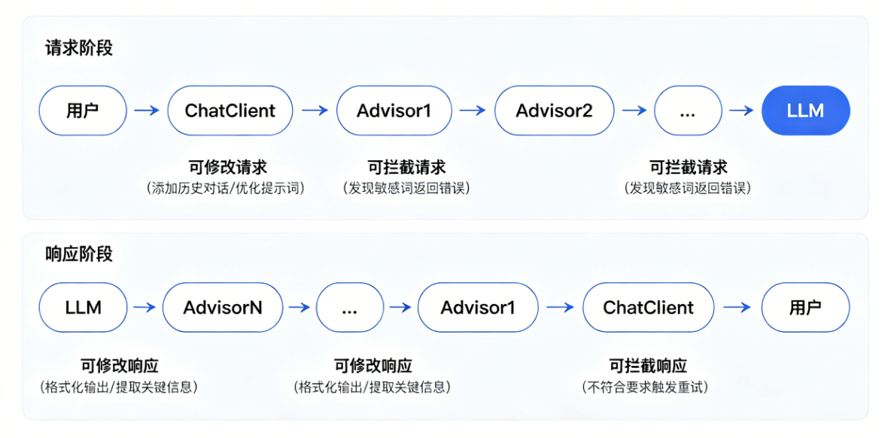
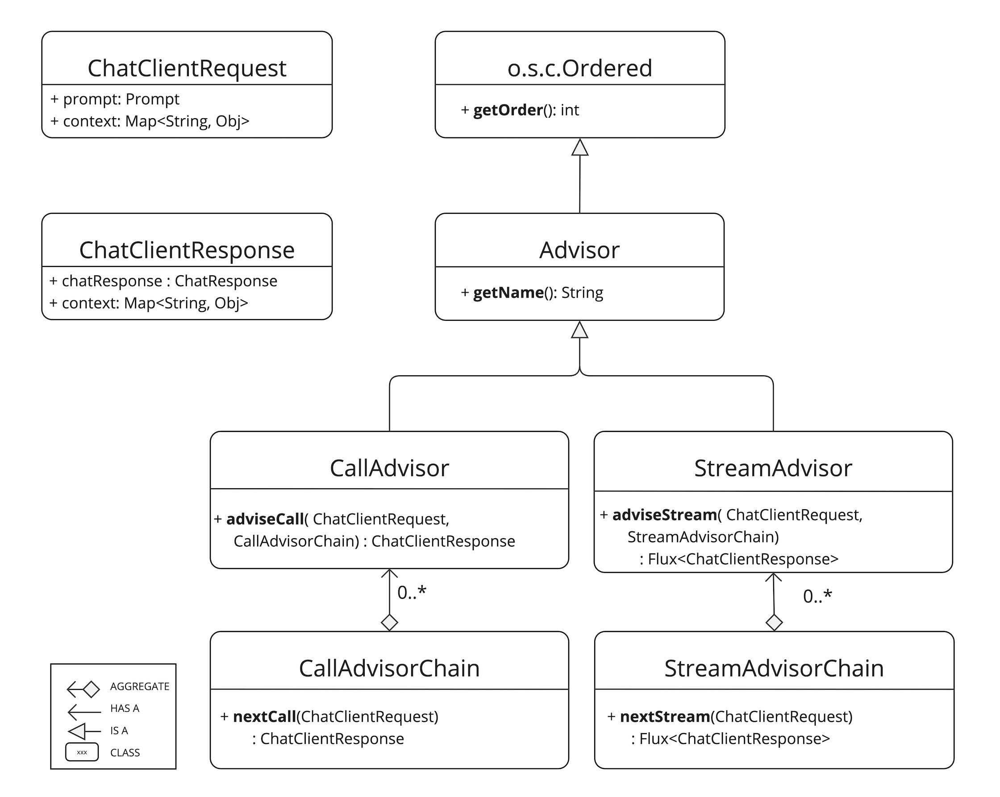

# Advisors 拦截器

## 简介

Spring AI Advisors API 提供了一种灵活而强大的方式，用于拦截、修改和增强 Spring 应用程序中的 AI 驱动交互。通过利用 Advisors API，开发人员可以创建更复杂、可重用且易于维护的 AI 组件。

Spring AI 2.0 的**Advisors（顾问）** 本质是**AI 交互的中间件 / 拦截器**，像给 AI 聊天加了一层 "智能过滤网"，能在请求发送前、响应返回后**自动处理通用逻辑**，让你专注于业务核心。

{width=400}

这个想法来自AOP（面向切面编程）。如果你学过Spring中的`AOP`或`Filter`（过滤器），那理解Advisors会觉得非常亲切。

## 工作原理



Advisors 基于**责任链模式**和**AOP 面向切面编程**思想，工作流程如下：

1. **请求阶段**：用户→ChatClient→Advisor1→Advisor2→...→LLM
   - 每个 Advisor 可以**修改请求**（如添加历史对话、优化提示词）
   - 也可以**拦截请求**（如发现敏感词直接返回错误）

2. **响应阶段**：LLM→AdvisorN→...→Advisor2→Advisor1→ChatClient→用户

   - 每个 Advisor 可以**修改响应**（如格式化输出、提取关键信息）
   - 也可以**拦截响应**（如发现不符合要求时触发重试）



Spring AI 2.0 提供两种核心接口：

- **CallAdvisor**：处理非流式请求（一问一答）
- **StreamAdvisor**：处理流式请求（边生成边返回）

核心方法是`nextCall()`（非流式）和`nextStream()`（流式），通过调用这些方法将请求传递给下一个 Advisor，形成完整的处理链。

## 常用内置 Advisors

Spring AI 2.0提供了一批内置的、可以直接使用的强大顾问，覆盖了最常见的AI增强需求：

| 顾问名称                         | 主要作用           | 通俗解释                                                     |
| :------------------------------- | :----------------- | :----------------------------------------------------------- |
| **MessageChatMemoryAdvisor**     | 对话记忆           | “记对话”：记住用户最近说了啥，让聊天感觉是连续的             |
| **PromptChatMemoryAdvisor**      | 提示记忆           | “提炼对话”：把整个聊天记忆压缩成一个精炼的提示摘要           |
| **VectorStoreChatMemoryAdvisor** | 向量存储记忆       | “搜相关知识”：根据用户问题，从向量数据库中找最相关的历史对话来增强记忆 |
| **QuestionAnswerAdvisor**        | 检索增强生成 (RAG) | “查资料”：先在知识库里查相关信息，再把信息“喂”给AI来回答问题] |
| **SimpleLoggerAdvisor**          | 日志记录           | “记流水账”：忠实记录下每次请求和响应的内容，方便调试和监控   |
| **Semantic Cache Advisor**       | 语义缓存           | “聪明缓存”：如果遇到意思相同的问题（而不是只字不差），可以直接返回之前缓存的答案，省时省力 |
| **ToolCallAdvisor**              | 工具调用           | “调用外部工具”：实现AI调用外部API、数据库等能力，通过**递归（Recursive）** 模式可以多次循环执行 |
| **GuardrailsAdvisor**            | 安全护栏           | “安全检查”：在请求到达AI前或AI响应返回前拦截不当内容         |

## 自定义实现Advisors

我们来实现一个自定义简单的请求和响应日志记录Advisor

第一步：新建MySimpleLoggerAdvisor类，实现CallAdvisor和StreamAdvisor接口，同时支持两种模式。

```java
import org.springframework.ai.chat.client.ChatClientRequest;
import org.springframework.ai.chat.client.ChatClientResponse;
import org.springframework.ai.chat.client.advisor.api.CallAdvisor;
import org.springframework.ai.chat.client.advisor.api.CallAdvisorChain;
import org.springframework.ai.chat.client.advisor.api.StreamAdvisor;
import org.springframework.ai.chat.client.advisor.api.StreamAdvisorChain;
import reactor.core.publisher.Flux;

/**
 * 实现 CallAdvisor 和 StreamAdvisor 接口，同时支持两种模式，用于日志记录
 */
public class MySimpleLoggerAdvisor implements CallAdvisor, StreamAdvisor {

    @Override
    public ChatClientResponse adviseCall(ChatClientRequest request, CallAdvisorChain chain) {
        System.out.println("发送请求前：" + request);
        ChatClientResponse response = chain.nextCall(request);
        System.out.println("接收到响应：" + response);
        return response;
    }

    @Override
    public Flux<ChatClientResponse> adviseStream(ChatClientRequest request, StreamAdvisorChain chain) {
        System.out.println("发送流式请求前：" + request);
        return chain.nextStream(request)
            .doOnNext(response -> System.out.println("收到流式响应片段：" + response));
    }

    @Override
    public String getName() {
        return "简单日志 Advisor";
    }

    /**
     * 这个 getOrder() 方法用于指定 Advisor 的执行顺序
     * 作用说明：
     * 返回值越小，优先级越高，执行顺序越靠前
     * 返回0 表示高优先级
     * 如果有多个 Advisor，Spring AI 会按照此值从小到大依次执行
     * @return
     */
    @Override
    public int getOrder() {
        return 0;
    }
}
```

第二步：ChatClientConfig 的 ChatClient 聊天客户端里，构建 ChatClient 的时候，添加Advisor。

```java
  /**
   * 配置 OpenAI ChatClient
   * @param model OpenAI 模型
   * @return ChatAI ChatClient 实例
   */
  @Bean
  public ChatClient openAiChatClient(OpenAiChatModel model) {
      return ChatClient
          .builder(model) // 创建 ChatClient 对象，以及设置模型为 model
          .defaultAdvisors(new MySimpleLoggerAdvisor()) // 添加一个自定义日志拦截器
          .build(); // 构建 ChatClient 对象
  }

  /**
   * 配置 Ollama ChatClient
   * @param model Ollama 模型
   * @return ChatOllama ChatClient 实例
   */
  @Bean
  public ChatClient ollamaChatClient(OllamaChatModel model) {
      return ChatClient
          .builder(model) // 创建 ChatClient 对象，以及设置模型为 model
          .defaultAdvisors(new MySimpleLoggerAdvisor()) // 添加一个自定义日志拦截器
          .build(); // 构建 ChatClient 对象
  }
```

最后我们来测试下：

先测试 阻塞式 
```http
http://localhost:8080/ai/openai?userInput=你是谁
```

控制台输出：

```java
发送请求前：ChatClientRequest[prompt=Prompt{messages=[UserMessage{content='你是谁', metadata={messageType=USER}, messageType=USER}], modelOptions=org.springframework.ai.openai.OpenAiChatOptions@62330945}, context={}]
接收到响应：ChatClientResponse[chatResponse=ChatResponse [metadata={ id: chatcmpl-f3eaaafb-c25c-9e9e-ab29-373ec7c92c6c, usage: DefaultUsage{promptTokens=11, completionTokens=402, totalTokens=413}, rateLimit: org.springframework.ai.chat.metadata.EmptyRateLimit@4915f95e }, generations=[Generation[assistantMessage=AssistantMessage [messageType=ASSISTANT, toolCalls=[], textContent=你好！我是 Qwen（通义千问），是由阿里巴巴集团旗下通义实验室自主研发的大语言模型。很高兴为你服务，请问今天有什么我可以帮到你的吗？, metadata={role=assistant, messageType=ASSISTANT, refusal=, finishReason=STOP, index=0, annotations=[{}], id=chatcmpl-f3eaaafb-c25c-9e9e-ab29-373ec7c92c6c}], chatGenerationMetadata=DefaultChatGenerationMetadata[finishReason='STOP', filters=0, metadata=0]]]], context={}]

```

再测试流式的

```http
http://localhost:8080/ai/openai/flux?userInput=你是谁
```

控制台输出：
```java
发送流式请求前：ChatClientRequest[prompt=Prompt{messages=[UserMessage{content='你是谁', metadata={messageType=USER}, messageType=USER}], modelOptions=org.springframework.ai.openai.OpenAiChatOptions@62330945}, context={}]
收到流式响应片段：ChatClientResponse[chatResponse=ChatResponse [metadata={ id: chatcmpl-0f6f3030-5131-91c0-bb7e-b4b83867b1e4, usage: DefaultUsage{promptTokens=0, completionTokens=0, totalTokens=0}, rateLimit: org.springframework.ai.chat.metadata.EmptyRateLimit@221ca4fc }, generations=[Generation[assistantMessage=AssistantMessage [messageType=ASSISTANT, toolCalls=[], textContent=, metadata={chunkChoice=Choice{delta=Delta{content=null, functionCall=, refusal=, role=assistant, toolCalls=, additionalProperties={reasoning_content=Thinking}}, finishReason=null, index=0, logprobs=null, additionalProperties={}}, role=assistant, messageType=ASSISTANT, finishReason=_UNKNOWN, refusal=, annotations=[], index=0, id=chatcmpl-0f6f3030-5131-91c0-bb7e-b4b83867b1e4}], chatGenerationMetadata=DefaultChatGenerationMetadata[finishReason='_UNKNOWN', filters=0, metadata=0]]]], context={}]
收到流式响应片段：ChatClientResponse[chatResponse=ChatResponse [metadata={ id: chatcmpl-0f6f3030-5131-91c0-bb7e-b4b83867b1e4, usage: DefaultUsage{promptTokens=0, completionTokens=0, totalTokens=0}, rateLimit: org.springframework.ai.chat.metadata.EmptyRateLimit@15f47653 }, generations=[Generation[assistantMessage=AssistantMessage [messageType=ASSISTANT, toolCalls=[], textContent=, metadata={chunkChoice=Choice{delta=Delta{content=null, functionCall=, refusal=, role=, toolCalls=, additionalProperties={reasoning_content= Process:

1}}, finishReason=null, index=0, logprobs=null, additionalProperties={}}, role=assistant, messageType=ASSISTANT, finishReason=_UNKNOWN, refusal=, annotations=[], index=0, id=chatcmpl-0f6f3030-5131-91c0-bb7e-b4b83867b1e4}], chatGenerationMetadata=DefaultChatGenerationMetadata[finishReason='_UNKNOWN', filters=0, metadata=0]]]], context={}]
收到流式响应片段：ChatClientResponse[chatResponse=ChatResponse [metadata={ id: chatcmpl-0f6f3030-5131-91c0-bb7e-b4b83867b1e4, usage: DefaultUsage{promptTokens=0, completionTokens=0, totalTokens=0}, rateLimit: org.springframework.ai.chat.metadata.EmptyRateLimit@52880b55 }, generations=[Generation[assistantMessage=AssistantMessage [messageType=ASSISTANT, toolCalls=[], textContent=, metadata={chunkChoice=Choice{delta=Delta{content=null, functionCall=, refusal=, role=, toolCalls=, additionalProperties={reasoning_content=.  **An}}, finishReason=null, index=0, logprobs=null, additionalProperties={}}, role=assistant, messageType=ASSISTANT, finishReason=_UNKNOWN, refusal=, annotations=[], index=0, id=chatcmpl-0f6f3030-5131-91c0-bb7e-b4b83867b1e4}], chatGenerationMetadata=DefaultChatGenerationMetadata[finishReason='_UNKNOWN', filters=0, metadata=0]]]], context={}]
收到流式响应片段：ChatClientResponse[chatResponse=ChatResponse [metadata={ id: chatcmpl-0f6f3030-5131-91c0-bb7e-b4b83867b1e4, usage: DefaultUsage{promptTokens=0, completionTokens=0, totalTokens=0}, rateLimit: org.springframework.ai.chat.metadata.EmptyRateLimit@6db78d6f }, generations=[Generation[assistantMessage=AssistantMessage [messageType=ASSISTANT, toolCalls=[], textContent=, metadata={chunkChoice=Choice{delta=Delta{content=null, functionCall=, refusal=, role=, toolCalls=, additionalProperties={reasoning_content=alyze the User's}}, finishReason=null, index=0, logprobs=null, additionalProperties={}}, role=assistant, messageType=ASSISTANT, finishReason=_UNKNOWN, refusal=, annotations=[], index=0, id=chatcmpl-0f6f3030-5131-91c0-bb7e-b4b83867b1e4}], chatGenerationMetadata=DefaultChatGenerationMetadata[finishReason='_UNKNOWN', filters=0, metadata=0]]]], context={}]
收到流式响应片段：ChatClientResponse[chatResponse=ChatResponse [metadata={ id: chatcmpl-0f6f3030-5131-91c0-bb7e-b4b83867b1e4, usage: DefaultUsage{promptTokens=0, completionTokens=0, totalTokens=0}, rateLimit: org.springframework.ai.chat.metadata.EmptyRateLimit@30e5188 }, generations=[Generation[assistantMessage=AssistantMessage [messageType=ASSISTANT, toolCalls=[], textContent=, metadata={chunkChoice=Choice{delta=Delta{content=null, functionCall=, refusal=, role=, toolCalls=, additionalProperties={reasoning_content= Input:** The user}}, finishReason=null, index=0, logprobs=null, additionalProperties={}}, role=assistant, messageType=ASSISTANT, finishReason=_UNKNOWN, refusal=, annotations=[], index=0, id=chatcmpl-0f6f3030-5131-91c0-bb7e-b4b83867b1e4}], chatGenerationMetadata=DefaultChatGenerationMetadata[finishReason='_UNKNOWN', filters=0, metadata=0]]]], context={}]
收到流式响应片段：ChatClientResponse[chatResponse=ChatResponse [metadata={ id: chatcmpl-0f6f3030-5131-91c0-bb7e-b4b83867b1e4, usage: DefaultUsage{promptTokens=0, completionTokens=0, totalTokens=0}, rateLimit: org.springframework.ai.chat.metadata.EmptyRateLimit@35fef954 }, generations=[Generation[assistantMessage=AssistantMessage [messageType=ASSISTANT, toolCalls=[], textContent=, metadata={chunkChoice=Choice{delta=Delta{content=null, functionCall=, refusal=, role=, toolCalls=, additionalProperties={reasoning_content= is asking "你是谁}}, finishReason=null, index=0, logprobs=null, additionalProperties={}}, role=assistant, messageType=ASSISTANT, finishReason=_UNKNOWN, refusal=, annotations=[], index=0, id=chatcmpl-0f6f3030-5131-91c0-bb7e-b4b83867b1e4}], chatGenerationMetadata=DefaultChatGenerationMetadata[finishReason='_UNKNOWN', filters=0, metadata=0]]]], context={}]
收到流式响应片段：ChatClientResponse[chatResponse=ChatResponse [metadata={ id: chatcmpl-0f6f3030-5131-91c0-bb7e-b4b83867b1e4, usage: DefaultUsage{promptTokens=0, completionTokens=0, totalTokens=0}, rateLimit: org.springframework.ai.chat.metadata.EmptyRateLimit@273e9e1d }, generations=[Generation[assistantMessage=AssistantMessage [messageType=ASSISTANT, toolCalls=[], textContent=, metadata={chunkChoice=Choice{delta=Delta{content=null, functionCall=, refusal=, role=, toolCalls=, additionalProperties={reasoning_content=" (Who are}}, finishReason=null, index=0, logprobs=null, additionalProperties={}}, role=assistant, messageType=ASSISTANT, finishReason=_UNKNOWN, refusal=, annotations=[], index=0, id=chatcmpl-0f6f3030-5131-91c0-bb7e-b4b83867b1e4}], chatGenerationMetadata=DefaultChatGenerationMetadata[finishReason='_UNKNOWN', filters=0, metadata=0]]]], context={}]
收到流式响应片段：ChatClientResponse[chatResponse=ChatResponse [metadata={ id: chatcmpl-0f6f3030-5131-91c0-bb7e-b4b83867b1e4, usage: DefaultUsage{promptTokens=0, completionTokens=0, totalTokens=0}, rateLimit: org.springframework.ai.chat.metadata.EmptyRateLimit@76b3a360 }, generations=[Generation[assistantMessage=AssistantMessage [messageType=ASSISTANT, toolCalls=[], textContent=, metadata={chunkChoice=Choice{delta=Delta{content=null, functionCall=, refusal=, role=, toolCalls=, additionalProperties={reasoning_content= you?).
2}}, finishReason=null, index=0, logprobs=null, additionalProperties={}}, role=assistant, messageType=ASSISTANT, finishReason=_UNKNOWN, refusal=, annotations=[], index=0, id=chatcmpl-0f6f3030-5131-91c0-bb7e-b4b83867b1e4}], chatGenerationMetadata=DefaultChatGenerationMetadata[finishReason='_UNKNOWN', filters=0, metadata=0]]]], context={}]
收到流式响应片段：ChatClientResponse[chatResponse=ChatResponse [metadata={ id: chatcmpl-0f6f3030-5131-91c0-bb7e-b4b83867b1e4, usage: DefaultUsage{promptTokens=0, completionTokens=0, totalTokens=0}, rateLimit: org.springframework.ai.chat.metadata.EmptyRateLimit@7402e2f }, generations=[Generation[assistantMessage=AssistantMessage [messageType=ASSISTANT, toolCalls=[], textContent=, metadata={chunkChoice=Choice{delta=Delta{content=null, functionCall=, refusal=, role=, toolCalls=, additionalProperties={reasoning_content=.  **Ident}}, finishReason=null, index=0, logprobs=null, additionalProperties={}}, role=assistant, messageType=ASSISTANT, finishReason=_UNKNOWN, refusal=, annotations=[], index=0, id=chatcmpl-0f6f3030-5131-91c0-bb7e-b4b83867b1e4}], chatGenerationMetadata=DefaultChatGenerationMetadata[finishReason='_UNKNOWN', filters=0, metadata=0]]]], context={}]
收到流式响应片段：ChatClientResponse[chatResponse=ChatResponse [metadata={ id: chatcmpl-0f6f3030-5131-91c0-bb7e-b4b83867b1e4, usage: DefaultUsage{promptTokens=0, completionTokens=0, totalTokens=0}, rateLimit: org.springframework.ai.chat.metadata.EmptyRateLimit@453653ca }, generations=[Generation[assistantMessage=AssistantMessage [messageType=ASSISTANT, toolCalls=[], textContent=, metadata={chunkChoice=Choice{delta=Delta{content=null, functionCall=, refusal=, role=, toolCalls=, additionalProperties={reasoning_content=ify the Persona}}, finishReason=null, index=0, logprobs=null, additionalProperties={}}, role=assistant, messageType=ASSISTANT, finishReason=_UNKNOWN, refusal=, annotations=[], index=0, id=chatcmpl-0f6f3030-5131-91c0-bb7e-b4b83867b1e4}], chatGenerationMetadata=DefaultChatGenerationMetadata[finishReason='_UNKNOWN', filters=0, metadata=0]]]], context={}]
收到流式响应片段：ChatClientResponse[chatResponse=ChatResponse [metadata={ id: chatcmpl-0f6f3030-5131-91c0-bb7e-b4b83867b1e4, usage: DefaultUsage{promptTokens=0, completionTokens=0, totalTokens=0}, rateLimit: org.springframework.ai.chat.metadata.EmptyRateLimit@16abf307 }, generations=[Generation[assistantMessage=AssistantMessage [messageType=ASSISTANT, toolCalls=[], textContent=, metadata={chunkChoice=Choice{delta=Delta{content=null, functionCall=, refusal=, role=, toolCalls=, additionalProperties={reasoning_content=/Identity:**
}}, finishReason=null, index=0, logprobs=null, additionalProperties={}}, role=assistant, messageType=ASSISTANT, finishReason=_UNKNOWN, refusal=, annotations=[], index=0, id=chatcmpl-0f6f3030-5131-91c0-bb7e-b4b83867b1e4}], chatGenerationMetadata=DefaultChatGenerationMetadata[finishReason='_UNKNOWN', filters=0, metadata=0]]]], context={}]
收到流式响应片段：ChatClientResponse[chatResponse=ChatResponse [metadata={ id: chatcmpl-0f6f3030-5131-91c0-bb7e-b4b83867b1e4, usage: DefaultUsage{promptTokens=0, completionTokens=0, totalTokens=0}, rateLimit: org.springframework.ai.chat.metadata.EmptyRateLimit@7d68ea11 }, generations=[Generation[assistantMessage=AssistantMessage [messageType=ASSISTANT, toolCalls=[], textContent=, metadata={chunkChoice=Choice{delta=Delta{content=null, functionCall=, refusal=, role=, toolCalls=, additionalProperties={reasoning_content=    *   I}}, finishReason=null, index=0, logprobs=null, additionalProperties={}}, role=assistant, messageType=ASSISTANT, finishReason=_UNKNOWN, refusal=, annotations=[], index=0, id=chatcmpl-0f6f3030-5131-91c0-bb7e-b4b83867b1e4}], chatGenerationMetadata=DefaultChatGenerationMetadata[finishReason='_UNKNOWN', filters=0, metadata=0]]]], context={}]
收到流式响应片段：ChatClientResponse[chatResponse=ChatResponse [metadata={ id: chatcmpl-0f6f3030-5131-91c0-bb7e-b4b83867b1e4, usage: DefaultUsage{promptTokens=0, completionTokens=0, totalTokens=0}, rateLimit: org.springframework.ai.chat.metadata.EmptyRateLimit@7bdf92c5 }, generations=[Generation[assistantMessage=AssistantMessage [messageType=ASSISTANT, toolCalls=[], textContent=, metadata={chunkChoice=Choice{delta=Delta{content=null, functionCall=, refusal=, role=, toolCalls=, additionalProperties={reasoning_content= am Qwen (}}, finishReason=null, index=0, logprobs=null, additionalProperties={}}, role=assistant, messageType=ASSISTANT, finishReason=_UNKNOWN, refusal=, annotations=[], index=0, id=chatcmpl-0f6f3030-5131-91c0-bb7e-b4b83867b1e4}], chatGenerationMetadata=DefaultChatGenerationMetadata[finishReason='_UNKNOWN', filters=0, metadata=0]]]], context={}]
收到流式响应片段：ChatClientResponse[chatResponse=ChatResponse [metadata={ id: chatcmpl-0f6f3030-5131-91c0-bb7e-b4b83867b1e4, usage: DefaultUsage{promptTokens=0, completionTokens=0, totalTokens=0}, rateLimit: org.springframework.ai.chat.metadata.EmptyRateLimit@c003677 }, generations=[Generation[assistantMessage=AssistantMessage [messageType=ASSISTANT, toolCalls=[], textContent=, metadata={chunkChoice=Choice{delta=Delta{content=null, functionCall=, refusal=, role=, toolCalls=, additionalProperties={reasoning_content=通义千问}}, finishReason=null, index=0, logprobs=null, additionalProperties={}}, role=assistant, messageType=ASSISTANT, finishReason=_UNKNOWN, refusal=, annotations=[], index=0, id=chatcmpl-0f6f3030-5131-91c0-bb7e-b4b83867b1e4}], chatGenerationMetadata=DefaultChatGenerationMetadata[finishReason='_UNKNOWN', filters=0, metadata=0]]]], context={}]
收到流式响应片段：ChatClientResponse[chatResponse=ChatResponse [metadata={ id: chatcmpl-0f6f3030-5131-91c0-bb7e-b4b83867b1e4, usage: DefaultUsage{promptTokens=0, completionTokens=0, totalTokens=0}, rateLimit: org.springframework.ai.chat.metadata.EmptyRateLimit@45facf3b }, generations=[Generation[assistantMessage=AssistantMessage [messageType=ASSISTANT, toolCalls=[], textContent=, metadata={chunkChoice=Choice{delta=Delta{content=null, functionCall=, refusal=, role=, toolCalls=, additionalProperties={reasoning_content=), developed by Alibaba}}, finishReason=null, index=0, logprobs=null, additionalProperties={}}, role=assistant, messageType=ASSISTANT, finishReason=_UNKNOWN, refusal=, annotations=[], index=0, id=chatcmpl-0f6f3030-5131-91c0-bb7e-b4b83867b1e4}], chatGenerationMetadata=DefaultChatGenerationMetadata[finishReason='_UNKNOWN', filters=0, metadata=0]]]], context={}]
收到流式响应片段：ChatClientResponse[chatResponse=ChatResponse [metadata={ id: chatcmpl-0f6f3030-5131-91c0-bb7e-b4b83867b1e4, usage: DefaultUsage{promptTokens=0, completionTokens=0, totalTokens=0}, rateLimit: org.springframework.ai.chat.metadata.EmptyRateLimit@7f788df7 }, generations=[Generation[assistantMessage=AssistantMessage [messageType=ASSISTANT, toolCalls=[], textContent=, metadata={chunkChoice=Choice{delta=Delta{content=null, functionCall=, refusal=, role=, toolCalls=, additionalProperties={reasoning_content= Cloud's Tongyi}}, finishReason=null, index=0, logprobs=null, additionalProperties={}}, role=assistant, messageType=ASSISTANT, finishReason=_UNKNOWN, refusal=, annotations=[], index=0, id=chatcmpl-0f6f3030-5131-91c0-bb7e-b4b83867b1e4}], chatGenerationMetadata=DefaultChatGenerationMetadata[finishReason='_UNKNOWN', filters=0, metadata=0]]]], context={}]
.....
```

## 使用内置日志记录SimpleLoggerAdvisor

修改 ChatClientConfig，构建 ChatClient 的时候，添加 SimpleLoggerAdvisor

```java
/**
 * 配置 OpenAI ChatClient
 * @param model OpenAI 模型
 * @return ChatAI ChatClient 实例
 */
@Bean
public ChatClient openAiChatClient(OpenAiChatModel model) {
    return ChatClient
        .builder(model) // 创建 ChatClient 对象，以及设置模型为 model
//            .defaultAdvisors(new MySimpleLoggerAdvisor()) // 添加一个自定义日志拦截器
        .defaultAdvisors(new SimpleLoggerAdvisor()) // 添加一个内置日志拦截器
        .build(); // 构建 ChatClient 对象
}

/**
 * 配置 Ollama ChatClient
 * @param model Ollama 模型
 * @return ChatOllama ChatClient 实例
 */
@Bean
public ChatClient ollamaChatClient(OllamaChatModel model) {
    return ChatClient
        .builder(model) // 创建 ChatClient 对象，以及设置模型为 model
//            .defaultAdvisors(new MySimpleLoggerAdvisor()) // 添加一个自定义日志拦截器
        .defaultAdvisors(new SimpleLoggerAdvisor()) // 添加一个内置日志拦截器
        .build(); // 构建 ChatClient 对象
}
```

以及application.yml里面要配置下日志级别：

```yaml
logging:
  level:
    org.springframework.ai: debug
```

我们来测试下：

```http
http://localhost:8080/ai/openai?userInput=你是谁
```

控制台日志输出，请求和响应都有完整的数据显示

```java
2026-06-09T13:48:23.113+08:00 DEBUG 44953 --- [01-HelloWorld] [nio-8080-exec-1] o.s.a.c.c.advisor.SimpleLoggerAdvisor    : request: ChatClientRequest[prompt=Prompt{messages=[UserMessage{content='你是谁', metadata={messageType=USER}, messageType=USER}], modelOptions=org.springframework.ai.openai.OpenAiChatOptions@62330945}, context={}]
2026-06-09T13:48:34.183+08:00 DEBUG 44953 --- [01-HelloWorld] [nio-8080-exec-1] o.s.a.c.c.advisor.SimpleLoggerAdvisor    : response: {
  "metadata" : {
    "empty" : false,
    "id" : "chatcmpl-700b3931-6eca-948e-9e7a-ff2a62f8b5aa",
    "model" : "qwen3.6-plus",
    "promptMetadata" : [ ],
    "rateLimit" : {
      "requestsLimit" : 0,
      "requestsRemaining" : 0,
      "requestsReset" : "PT0S",
      "tokensLimit" : 0,
      "tokensRemaining" : 0,
      "tokensReset" : "PT0S"
    },
    "usage" : {
      "promptTokens" : 11,
      "completionTokens" : 453,
      "totalTokens" : 464,
      "nativeUsage" : {
        "completion_tokens" : 453,
        "prompt_tokens" : 11,
        "total_tokens" : 464,
        "completion_tokens_details" : {
          "reasoning_tokens" : 384,
          "valid" : true,
          "text_tokens" : 453
        },
        "prompt_tokens_details" : {
          "valid" : true,
          "text_tokens" : 11
        },
        "valid" : true
      }
    }
  },
  "result" : {
    "metadata" : {
      "contentFilters" : [ ],
      "empty" : true,
      "finishReason" : "STOP"
    },
    "output" : {
      "media" : [ ],
      "messageType" : "ASSISTANT",
      "metadata" : {
        "role" : "assistant",
        "messageType" : "ASSISTANT",
        "finishReason" : "STOP",
        "refusal" : "",
        "index" : 0,
        "annotations" : [ { } ],
        "id" : "chatcmpl-700b3931-6eca-948e-9e7a-ff2a62f8b5aa"
      },
      "text" : "你好！我是 Qwen（通义千问），由阿里巴巴集团旗下通义实验室研发的大语言模型。\n\n我是一个乐于助人的 AI 思维伙伴，无论是日常对话、解答问题、内容创作，还是逻辑推理和代码编写，我都随时准备为你提供支持和帮助。\n\n今天有什么我可以为你效劳的吗？",
      "toolCalls" : [ ]
    }
  },
  "results" : [ {
    "metadata" : {
      "contentFilters" : [ ],
      "empty" : true,
      "finishReason" : "STOP"
    },
    "output" : {
      "media" : [ ],
      "messageType" : "ASSISTANT",
      "metadata" : {
        "role" : "assistant",
        "messageType" : "ASSISTANT",
        "finishReason" : "STOP",
        "refusal" : "",
        "index" : 0,
        "annotations" : [ { } ],
        "id" : "chatcmpl-700b3931-6eca-948e-9e7a-ff2a62f8b5aa"
      },
      "text" : "你好！我是 Qwen（通义千问），由阿里巴巴集团旗下通义实验室研发的大语言模型。\n\n我是一个乐于助人的 AI 思维伙伴，无论是日常对话、解答问题、内容创作，还是逻辑推理和代码编写，我都随时准备为你提供支持和帮助。\n\n今天有什么我可以为你效劳的吗？",
      "toolCalls" : [ ]
    }
  } ]
}
```


