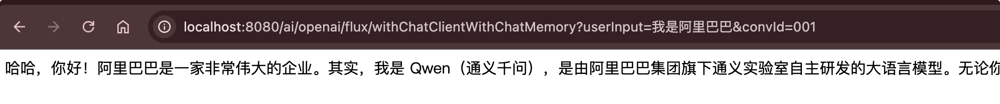
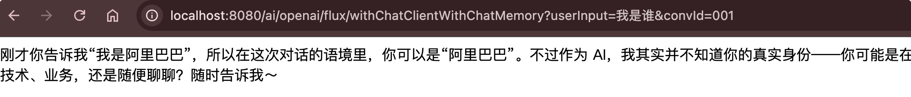

# 会话记忆 Chat Memory

## 核心概念

### 什么是 Chat Memory

大型语言模型 (LLMs) 本质是**无状态**的，无法保留历史对话信息。Spring AI 2.0 提供的**Chat Memory**功能解决了这一问题，它能：

- **存储历史对话**：自动保存用户消息和 AI 响应到记忆仓库
- **检索历史对话**：新请求时自动提取相关历史消息注入当前 Prompt
- **会话隔离**：通过`conversationId`区分不同用户 / 会话，确保上下文独立
- **消息管理**：提供灵活策略（如滑动窗口）控制保留哪些历史消息

### 核心组件架构

| 组件                     | 作用                     | 核心接口 / 类                                              |
| ------------------------ | ------------------------ | ---------------------------------------------------------- |
| **ChatMemory**           | 策略层，决定保留哪些消息 | `ChatMemory`接口，默认实现`MessageWindowChatMemory`        |
| **ChatMemoryRepository** | 存储层，负责消息 CRUD    | `ChatMemoryRepository`接口，支持多种存储后端               |
| **ChatMemoryAdvisor**    | 拦截器，自动处理记忆注入 | `MessageChatMemoryAdvisor`和`VectorStoreChatMemoryAdvisor` |

## 内置 Chat Memory 类型与存储后端

### 内置记忆策略

Spring AI 2.0 提供**两种主要记忆类型**：

1. **MessageWindowChatMemory**（默认）
   - 核心机制：维护固定大小消息窗口，超出上限时**淘汰最早消息**，**永远保留 system 消息**
   - 默认窗口大小：**20 条消息**
   - 适用场景：大多数简单多轮对话，平衡上下文完整性与 token 消耗

2. **VectorStoreChatMemory**（语义记忆）

   - 核心机制：基于向量存储的语义检索，将对话内容向量化后存储，根据语义相似度召回相关历史
   - 适用场景：长对话、需要精准语义匹配的复杂场景


### 支持的存储后端

| 存储类型  | 实现类                          | 特点                              | 适用场景               |
| --------- | ------------------------------- | --------------------------------- | ---------------------- |
| 内存存储  | `InMemoryChatMemoryRepository`  | 基于`ConcurrentHashMap`，轻量快速 | 开发测试、演示环境     |
| Redis     | `RedisChatMemoryRepository`     | 分布式、高性能、支持 TTL          | 生产环境、多实例部署   |
| JDBC      | `JdbcChatMemoryRepository`      | 关系型数据库持久化                | 需要长期存储、事务支持 |
| Cassandra | `CassandraChatMemoryRepository` | 分布式 NoSQL，高可用              | 大规模分布式系统       |

## 具体实例：构建有记忆的对话应用

我们先演示下没有记忆的对话:

```html
http://localhost:8080/ai/openai/flux?userInput=我是阿里巴巴
http://localhost:8080/ai/openai/flux?userInput=我是谁？
```


因为没有会话记忆，所以每次请求访问都是独立的。但是如果我们做聊天机器人，客服机器人，那肯定是不行的，我们需要让大模型记住历史会话上下文章。

我们来实现一下：

首先在 ChatClientConfig 里定义 ChatMemory bean

```java
/**
 * 配置 ChatMemory ，用于存储对话历史
 * 该配置类中使用了 InMemoryChatMemoryRepository ，即内存存储，用于存储对话历史。
 * @return ChatMemory 实例，用于存储对话历史
 */
@Bean
public ChatMemory chatMemory() {
    return MessageWindowChatMemory.builder()
        .maxMessages(10) // 设置最大消息数为 10
        .chatMemoryRepository(new InMemoryChatMemoryRepository()) // 内存存储
        .build();
}
```

接着 ChatClient 的 advisors 里加上 ChatMemory 会话记忆

```java
/**
 * 配置 带有聊天记录的 OpenAI ChatClient
 * @param model 模型
 * @param chatMemory 聊天记录存储
 * @return ChatClient 对象，用于与模型进行对话
 */
@Bean
public ChatClient openAiChatClientWithChatMemory(OpenAiChatModel model, ChatMemory chatMemory) {
    return ChatClient
        .builder(model) // 创建 ChatClient 对象，以及设置模型为 model
//            .defaultAdvisors(new MySimpleLoggerAdvisor()) // 添加一个自定义日志拦截器
        .defaultAdvisors(
            new SimpleLoggerAdvisor(), // 添加一个内置日志拦截器
            MessageChatMemoryAdvisor.builder(chatMemory).build() // 添加一个聊天记录拦截器
        )
        .build(); // 构建 ChatClient 对象
}
```

然后 MyAiChatController 里加上一个会话ID设置，保证聊天上下文独立。

```java
private final ChatClient openAiChatClientWithChatMemory;

/**
 * 带有聊天记录的 ChatClient 处理与 OpenAI 模型交互的请求
 * @param userInput 用户输入
 * @param convId 对话 ID
 * @return 流式响应的内容
 */
@GetMapping(value = "/ai/openai/flux/withChatClientWithChatMemory", produces = "text/html;charset=UTF-8")
public Flux<String> openAiChatFluxWithChatClientWithChatMemory(String userInput, String convId) {
    return openAiChatClientWithChatMemory.prompt() // 创建 Prompt 对象，用于构建聊天请求
        .user(userInput) // 设置用户输入
        .advisors(a -> a.param(ChatMemory.CONVERSATION_ID, convId)) // 设置对话 ID
        .stream() // 流式响应输出
        .content(); // 获取模型回复的内容
}
```

我们再来测试下，已经带有记忆功能了。：

```html
http://localhost:8080/ai/openai/flux/withChatClientWithChatMemory?userInput=我是阿里巴巴&convId=001
http://localhost:8080/ai/openai/flux/withChatClientWithChatMemory?userInput=我是谁&convId=001
```



