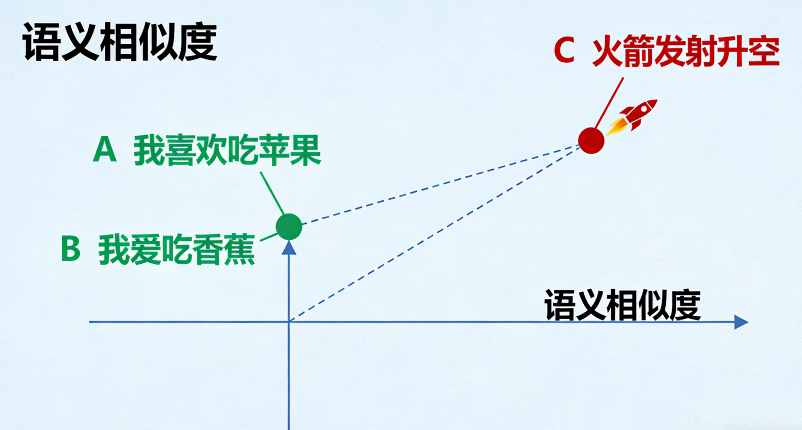
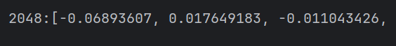
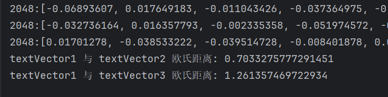

# 嵌入模型

#  嵌入模型

## 什么是嵌入模型

简单来说，**嵌入（Embedding）是一种将非数字数据（如单词、句子、图像、甚至整个文档）转换为计算机能够理解的数字向量的技术。** 

**向量是数学、物理学及工程科学中的基础概念，指同时具有大小和方向的量**‌，与只有大小没有方向的标量（如温度、质量）相对。‌‌

- **数据**：比如一句话：“我喜欢吃苹果”。
- **向量**：经过嵌入模型处理后，这句话会变成一个由数百个浮点数组成的数组，例如：`[0.125, -0.342, 0.987, ..., 0.045]`。

这个向量不是随机生成的，它通过复杂的神经网络模型训练得出，能够**捕获原始数据的语义信息**。

## 嵌入模型的核心作用

**将“意义”映射到“向量空间”**

嵌入模型最关键的特性是，它会把相似的语义内容映射到向量空间中的相近位置。

- **例子**：
  - 句子A：“我喜欢吃苹果”
  - 句子B：“我爱吃香蕉”
  - 句子C：“火箭发射升空”

经过嵌入模型后，在向量空间中：

- 句子A和句子B的距离会非常**近**（因为都是表达对水果的喜爱）。
- 句子C与A、B的距离会非常**远**（因为讨论的是完全不同的主题）。



## 为什么需要嵌入模型

1. **语义搜索**：传统的搜索引擎依赖关键词匹配（比如搜索“苹果”只会返回包含“苹果”这两个字的结果）。而基于嵌入的搜索是语义上的理解和匹配，即使搜索“一种富含维生素的水果”，也能找到关于“苹果”的文档。
2. **信息压缩与表示**：将一个复杂的对象（图片、长文本）压缩成一个固定长度的、富含语义信息的向量。
3. **作为大模型的“外部记忆”**：这是最广泛的应用之一。大模型的知识是静态的（训练到某个时间点），且上下文窗口有限。通过嵌入，我们可以将海量的私有知识（公司文档、产品手册）向量化，然后在需要时检索出最相关的部分，再“喂”给大模型，让它基于这些知识回答问题，从而解决模型的知识局限和幻觉问题。

## 常见嵌入模型

- **OpenAI 的 text-embedding-3-small 和 text-embedding-3-large**：目前性能强大的通用文本嵌入模型。
- **BAAI/bge-\* 系列**：北京智源研究院开源的优秀中英文嵌入模型。
- **sentence-transformers**：一个非常流行的Python库，提供了大量预训练的句子、段落嵌入模型。
- **多模态嵌入模型**：如 `CLIP`，可以将图片和文本嵌入到同一个向量空间，实现文本搜图、图搜图等功能。

阿里百炼平台的嵌入模型：


目前文本嵌入模型，最新版本 text-embedding-v4，支持64~2048维用户自定义向量维度。


## 代码使用

### 示例一：获取模型向量长度

1. 项目里，`application.yml`里我们指定下嵌入模型和维度

```yml
spring:
  application:
    name: 01-HelloWorld
  ai:
    openai:
      api-key: sk-4feab9xxxxxxxxxxxxxxxxf1e9268
      base-url: https://dashscope.aliyuncs.com/compatible-mode/v1
      chat:
        model: qwen3.6-plus
      embedding:
        model: text-embedding-v4 # 嵌入模型
        dimensions: 2048 # 向量维度
```

2. 然后新建`MyEmController`，以及注入`embeddingModel`，新建`embedding`测试方法。

```java
import org.springframework.ai.embedding.EmbeddingModel;
import org.springframework.ai.openai.OpenAiEmbeddingModel;
import org.springframework.context.annotation.Bean;
import org.springframework.context.annotation.Configuration;
import org.springframework.context.annotation.Primary;

/**
 * 配置类，用于配置 VectorStoreConfig
 */
@Configuration
public class VectorStoreConfig {

    /**
     * 配置 OpenAI 嵌入模型
     * @param openAiEmbeddingModel OpenAI 嵌入模型
     * @return OpenAI 嵌入模型实例
     */
    @Bean
    @Primary
    public EmbeddingModel embeddingModel(OpenAiEmbeddingModel openAiEmbeddingModel) {
        return openAiEmbeddingModel;
    }
}
```

```java
import java.util.Arrays;
import java.util.List;
import org.springframework.ai.document.Document;
import org.springframework.ai.embedding.EmbeddingModel;
import org.springframework.ai.vectorstore.SearchRequest;
import org.springframework.ai.vectorstore.VectorStore;
import org.springframework.web.bind.annotation.GetMapping;
import org.springframework.web.bind.annotation.RestController;

/**
 * 嵌入模型控制器
 * 用于测试嵌入模型
 */
@RestController
public class MyEmController {

    public final EmbeddingModel embeddingModel;

    public MyEmController(EmbeddingModel embeddingModel) {
        this.embeddingModel = embeddingModel;
    }

    /**
     * 嵌入模型的向量长度
     * @return 测试结果
     */
    @GetMapping("/embedding")
    public String embedding() {
        float[] textVector1 = embeddingModel.embed("学Java上Spring.org");
        System.out.println(textVector1.length + ":" + Arrays.toString(textVector1));
        return "success";
    }
}

```

浏览器输入：`http://localhost:8080/embedding`

控制台返回：



### 示例二：获取欧式距离

**距离越小，说明越相似**

```java
/**
   * 测试嵌入模型
   * 测试嵌入模型的向量长度和欧式距离
   * @return 测试结果
   */
  @GetMapping("/embedding")
  public String embedding() {
      float[] textVector1 = embeddingModel.embed("学Java上Spring.org");
      float[] textVector2 = embeddingModel.embed("Spring.org网站教学Java质量真不错");
      float[] textVector3 = embeddingModel.embed("我喜欢吃香蕉");

      System.out.println(textVector1.length + ":" + Arrays.toString(textVector1));
      System.out.println(textVector2.length + ":" + Arrays.toString(textVector2));
      System.out.println(textVector3.length + ":" + Arrays.toString(textVector3));

      double dist12 = euclideanDistance(textVector1, textVector2);
      double dist13 = euclideanDistance(textVector3, textVector1);

      System.out.println("textVector1 和 textVector2 的欧式距离: " + dist12);
      System.out.println("textVector1 和 textVector3 的欧式距离: " + dist13);
      return "success";
  }

  /**
   * 计算两个向量的欧式距离
   *
   * @param a 向量1
   * @param b 向量2
   * @return 欧式距离
   */
  private static double euclideanDistance(float[] a, float[] b) {
      if (a.length != b.length) {
          throw new IllegalArgumentException("向量维度不一致");
      }
      double sumSq = 0.0;
      for (int i = 0; i < a.length; i++) {
          double diff = a[i] - b[i];
          sumSq += diff * diff;
      }
      return Math.sqrt(sumSq);
  }
```

运行结果：

