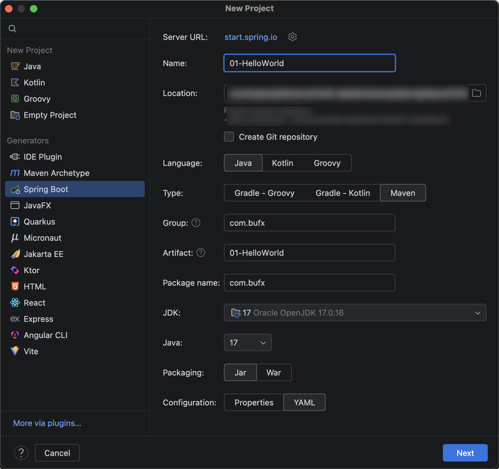
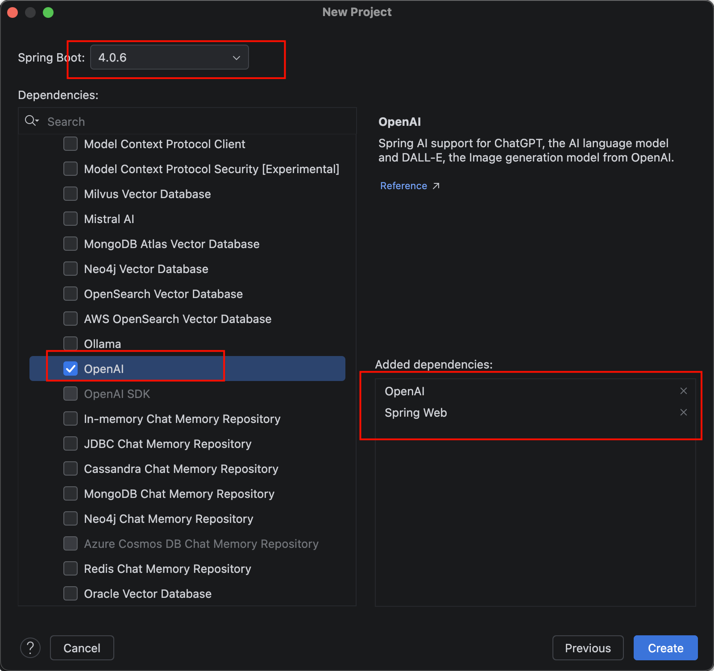

# hello-world 搭建

## 新建 HelloWorld 项目

我们新建一个Spring AI的HelloWorld项目，IDEA里点新建项目，选择Spring Initializr，Type选Maven，JDK用17,Packaging选Jar，然后点Next

{width=500}

SpringBoot选默认最新4.0.6，依赖我们先选Spring Web和OpenAI，后面不够再加。

{width=500}

## 配置application.yml

首先第一步，配置application.yml，配置上api-key(读取系统环境变量)，以及base_url，和模型

```yaml
spring:
  application:
    name: 01-HelloWorld
  ai:
    openai:
      api-key: sk-4feab9xxxxxx4ed0a4xxxxxxx1e9268
      base-url: https://dashscope.aliyuncs.com/compatible-mode/v1
      chat:
        model: qwen3.6-plus
```

## 新建配置类

第二步，新建ChatClientConfig配置类，配置ChatClient聊天客户端

```java
import org.springframework.ai.chat.client.ChatClient;
import org.springframework.ai.openai.OpenAiChatModel;
import org.springframework.context.annotation.Bean;
import org.springframework.context.annotation.Configuration;

/**
 * 配置类，用于配置 ChatClient
 */
@Configuration
public class ChatClientConfig {

    /**
     * 配置 OpenAI ChatClient
     * @param model OpenAI 模型
     * @return ChatAI ChatClient 实例
     */
    @Bean
    public ChatClient openAiChatClient(OpenAiChatModel model) {
        return ChatClient
            .builder(model) // 创建 ChatClient 对象，以及设置模型为 model
            .build(); // 构建 ChatClient 对象
    }
}
```

## 新建控制器

第三步，新建MyAiChatController控制器，接受前端用户提问，构建提示器，发送请求给大模型，以及接收大模型返回的结果，返回给前端。

```java
import org.springframework.ai.chat.client.ChatClient;
import org.springframework.web.bind.annotation.GetMapping;
import org.springframework.web.bind.annotation.RestController;

/**
 * 自定义的 AI 聊天控制器
 */
@RestController
public class MyAiChatController {

    private final ChatClient openAiChatClient;

    public MyAiChatController(ChatClient openAiChatClient) {
        this.openAiChatClient = openAiChatClient;
    }

    /**
     * 处理与 OpenAI 模型交互的请求
     *
     * @param userInput 用户输入
     * @return 模型回复的内容
     */
    @GetMapping("/ai/openai")
    public String openAiChat(String userInput) {
        return openAiChatClient.prompt() // 创建 Prompt 对象，用于构建聊天请求
            .user(userInput) // 设置用户输入
            .call() // 调用模型，返回结果
            .content(); // 获取模型回复的内容
    }
}

```

## 启动项目测试

然后我们启动项目，测试，浏览器输入：

`http://localhost:8080/ai?question=你是谁？`

## 流式响应输出

stream()方法Flux流式响应输出

前面运行的大模型返回消息的实例，都是阻塞式的信息返回，等待时间长，体验也不很友好。我们平时用聊天会话大模型，都是流式输出结果，像流水一样，一个字一个字，或者一个词一个词的流式返回信息。我们以后开发肯定是流式输出，在Spring AI 2.0当中，我们只需要使用stream()方法，以及返回Flux类型对象即可实现流式输出结果。

```java
/**
 * 处理与 OpenAI 模型交互的请求，返回流式响应
 *
 * @param userInput 用户输入
 * @return 流式响应的内容
 */
@GetMapping(value = "/ai/openai/flux", produces = "text/html;charset=UTF-8")
public Flux<String> openAiChatFlux(String userInput) {
    return openAiChatClient.prompt() // 创建 Prompt 对象，用于构建聊天请求
        .user(userInput) // 设置用户输入
        .stream() // 流式响应输出
        .content(); // 获取模型回复的内容
}
```

> **注意点，返回响应消息要设置下utf-8编码，否则会乱码**