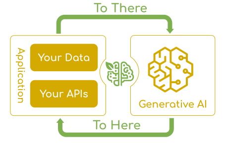

# 概述

## 简介

Spring AI 是 **Spring官方推出的AI工程应用框架**，专为Java与Spring生态设计，核心目标是将Spring生态的**可移植性、模块化、POJO优先、自动配置**等设计原则引入AI领域，让Java开发者以熟悉的方式构建AI原生应用，无需放弃已有技术栈。

目前最新版本：2.0.0-RC1 官方文档：https://docs.spring.io/spring-ai/reference/2.0/index.html

## 核心定位与设计理念

- **非大模型本体**：不提供生成式 AI 核心算法，而是作为 Spring 生态与 AI 模型的**中间层**，统一接入标准、封装交互流程。
- **核心使命**：解决 AI 集成的根本挑战 ——**将企业数据与 API 与 AI 模型高效连接**。
- **设计灵感**：借鉴 Python 生态的 LangChain、LlamaIndex 等项目，但为 Java 生态量身定制，并非直接移植。
- **兼容性**：无缝支持 Spring Boot 2.7+ 及 3.x 版本，与 Spring 生态深度融合。

## 核心特性

1. **提供商无关（统一 API 抽象）**

   通过统一接口屏蔽不同 AI 厂商差异，一套代码可切换 20+ 主流模型，支持同步 / 流式 API，兼顾灵活性与开发效率

   - 支持模型：OpenAI（GPT-3.5/4/5）、Google Gemini、Anthropic Claude、Meta Llama、Microsoft Azure OpenAI、Amazon Bedrock 等。

2. **全类型 AI 模型支持**

    覆盖主流 AI 任务类型，满足多样化场景需求

    | 模型类型                        | 核心能力                  |
    | :------------------------------ | :------------------------ |
    | 聊天补全（Chat Completion）     | 对话、问答、文本生成      |
    | 嵌入（Embedding）               | 文本向量化，支撑 RAG 检索 |
    | 文本生成图像（Text to Image）   | 图片生成与编辑            |
    | 语音转写（Audio Transcription） | 语音识别                  |
    | 文本转语音（Text to Speech）    | 语音合成                  |
    | 内容审核（Moderation）          | 内容安全过滤              |

3. **结构化输出与 POJO 映射**

   支持将 AI 模型输出直接映射为 Java POJO，简化数据处理，提升开发效率与类型安全

4. **向量数据库生态集成**

   全面适配主流向量数据库，为 RAG（检索增强生成）提供底层支撑

   - Apache Cassandra、Azure Vector Search、Chroma、Milvus、MongoDB Atlas、Neo4j、Oracle、PostgreSQL/PGVector 等。

5. **Spring 生态无缝融合**

   依托 Spring 依赖注入、自动配置、模块化能力，快速集成 AI 功能，与 Spring Boot、Spring Cloud 等组件协同工作。

## 核心价值

1. **降低开发门槛**：Java 开发者无需深入不同 AI 厂商 API 细节，用熟悉的 Spring 编程模型快速集成 AI 能力。
2. **提升可移植性**：模型切换、云厂商迁移成本极低，最小化代码修改Spring Framework。
3. **全流程封装**：提供从提示词设计、模型调用、结果处理到 RAG 流程的完整工具链，减少重复开发。
4. **企业级能力**：支持生产级部署、可观测性、安全性等企业级需求，适配复杂业务场景。

## 典型应用场景

1. **RAG 应用开发**：快速构建基于企业私有数据的检索增强生成系统，提升回答准确性与安全性。
2. **智能客服 / 助手**：集成对话模型，打造多轮交互、上下文感知的智能客服与内部助手。
3. **内容生成与处理**：自动生成文案、报告、代码，实现文本摘要、翻译、内容审核等功能Spring。
4. **多媒体 AI 应用**：结合文本生成图像、语音转写 / 合成能力，开发多媒体内容创作与处理系统Spring。
5. **企业级 AI 集成**：将 AI 能力嵌入现有 Spring 业务系统，如 ERP、CRM、OA 等，实现业务智能化升级。

## 与同类框架对比

Spring AI 相较于 LangChain4J 等 Java AI 框架，核心优势在于**深度绑定 Spring 生态**，自动配置、模块化设计更贴合 Spring 开发者习惯，同时官方维护、生态迭代更快，适合以 Spring 为技术栈的企业级项目。
