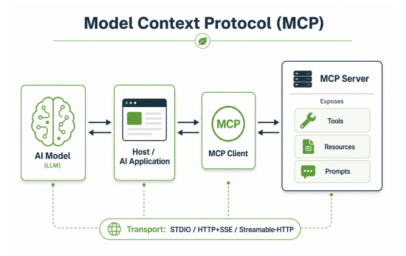
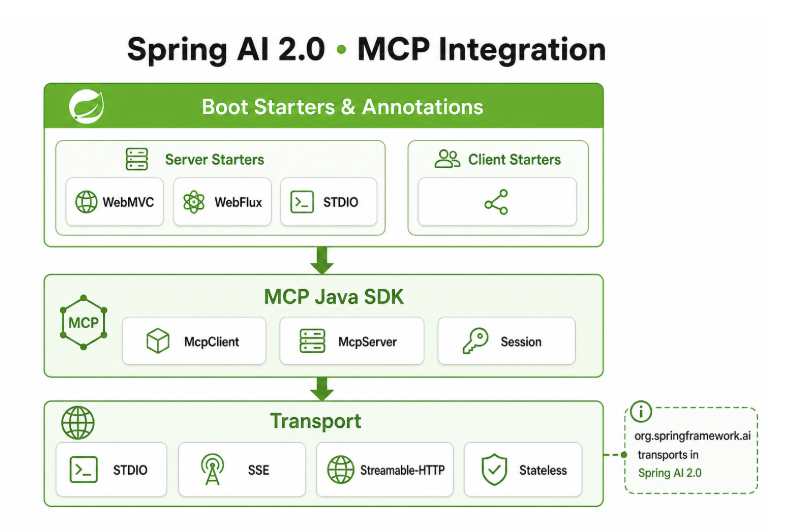

# 模型上下文协议

## 定义

**MCP** 的全称是 **Model Context Protocol**（模型上下文协议），是由 **Anthropic** 公司于 2024 年 11 月开源的一个开放协议。

你可以把它理解为 **AI 应用的“通用 USB 接口”**。它的核心目标是解决一个实际问题：**让大模型（LLM）能够安全、标准、便捷地连接到各种外部数据源和工具**。

## 核心价值

**解决“数据孤岛”问题**

在没有 MCP 之前，每个 AI 应用如果要访问数据库、文件、API 或浏览器，需要为每个数据源编写定制的集成代码（“写死”的代码连接器），开发成本高、复用性差、维护困难。

MCP 定义了一套**统一的、标准化的 API 规范**，就像为 AI 生态制定了通用的“插座”标准。一套协议，所有支持它的 AI 和工具都能即插即用。

## MCP 的工作方式

**三个角色**

1. **MCP 主机 (Host)**：需要访问外部数据的 AI 应用，例如 Claude 桌面版、IDE 插件等。
2. **MCP 客户端 (Client)**：内嵌于主机中，负责与 MCP 服务器进行一一通信。
3. **MCP 服务器 (Server)**：轻量级的服务程序，通过标准协议暴露特定功能（如文件读写、数据库查询、API 调用）。它充当“翻译器”，将 AI 需求转化为具体系统或数据操作。



## Spring AI 2.0中集成MCP

Spring AI 并不是简单“包一层 SDK”，而是把**组装工作**交给 Boot Starter，把**声明工作**交给注解模块，同时把一部分曾与 MCP Java SDK 同行的 **Spring 专用传输实现收回到 `org.springframework.ai` 体系**。



## MCP集成示例

**实时本地天气预报**

大模型是不知道当前的某个城市天气预报的，这个功能实现可以让大模型调用MCP来实现。

### Mcp-Server端

首先新建mcp-server项目。

pom.xml引入依赖：

```xml
<dependency>
    <groupId>org.springframework.ai</groupId>
    <artifactId>spring-ai-starter-mcp-server-webmvc</artifactId>
    <exclusions>
        <exclusion>
            <groupId>org.springframework.boot</groupId>
            <artifactId>spring-boot-starter-web</artifactId>
        </exclusion>
    </exclusions>
</dependency>
<dependency>
    <groupId>org.springframework.boot</groupId>
    <artifactId>spring-boot-starter-webmvc</artifactId>
</dependency>
```

application.yml，配置下mcp

```yaml
# MCP 服务端SSE (Server-Sent Events)配置：默认 GET /sse，POST 消息 /mcp/message(可通过下方属性覆盖)
spring:
  application:
    name: 02-McpServer
  ai:
    mcp:
      server:
        name: mcp-server
        version: 1.0.0
        type: SYNC
        instructions: "提供按城市名的模拟天气预报查询（演示数据）。"
        annotation-scanner:
          enabled: true
#       sse-endpoint: /sse
#       sse-message-endpoint: /mcp/message
#       base-url: ""
server:
  port: 8888
```

定义 WeatherMcpTools 

```java
import org.springframework.ai.mcp.annotation.McpTool;
import org.springframework.ai.mcp.annotation.McpToolParam;
import org.springframework.stereotype.Component;

/**
 * MCP 天气预报工具类
 */
@Component
public class WeatherMcpTools {

    @McpTool(
        name = "getWeatherForecast",
        description = "根据城市名称查询模拟天气预报（演示数据，非真实气象来源）",
        generateOutputSchema = true
    )
    public String getWeatherForecast(
        @McpToolParam(
            description = "城市名称，例如：北京、上海",
            required = true
        ) String city) {
        System.out.println("执行到天气预报MCP-SERVER");
        return city + "天气晴天 空气质量优。";
    }
}

```

然后直接启动mcp-server项目

### Mcp-Client端

接下来就是mcp-client客户端（也就是之前的HelloWorld工程）开发了。

pom.xml加下mcp-client客户端依赖

```xml
<!-- MCP 客户端：通过 SSE 连接本机 mcp-server（默认端口 8888） -->
<dependency>
  <groupId>org.springframework.ai</groupId>
  <artifactId>spring-ai-starter-mcp-client</artifactId>
</dependency>
```

application.yml里配置下mcp

```yaml
spring:
  application:
    name: 01-HelloWorld
  ai:
    mcp:
      client:
        enabled: true
        name: mcp-client
        version: 1.0.0
        type: SYNC
        # 与 mcp-server 一致，需先启动 mcp-server（默认 http://localhost:8888）
        sse:
          connections:
            mcp-weather:
              url: http://localhost:8888

```


新建MyMcpController，

```java
import org.springframework.ai.chat.client.ChatClient;
import org.springframework.ai.mcp.SyncMcpToolCallbackProvider;
import org.springframework.web.bind.annotation.GetMapping;
import org.springframework.web.bind.annotation.RestController;

/**
 * 演示：通过 Spring AI MCP 客户端连接本机 {@code mcp-server}，由大模型按需调用远端 MCP 工具（如天气预报）。
 * <p>
 * 使用前请先启动 {@code mcp-server}（默认端口 8888）
 */
@RestController
public class MyMcpController {

    private final ChatClient openAiChatClient;

    private final SyncMcpToolCallbackProvider mcpToolCallbackProvider;

    public MyMcpController(ChatClient openAiChatClient, SyncMcpToolCallbackProvider mcpToolCallbackProvider) {
        this.openAiChatClient = openAiChatClient;
        this.mcpToolCallbackProvider = mcpToolCallbackProvider;
    }

    /**
     * 调用 MCP 工具
     * @return
     */
    @GetMapping("/ai-with-mcp")
    public String aiWithMcp() {
        String result = openAiChatClient.prompt()
            .system("用户询问天气时，你必须调用工具查询后再用简短中文回答。")
            .user("查一下上海天气")
            .toolCallbacks(mcpToolCallbackProvider)
            .call()
            .content();
        System.out.println(result);
        return result;
    }
}

```

浏览器调用：`http://localhost:8080/ai-with-mcp`

控制返回：

```java
上海天气晴天，空气质量优
```

