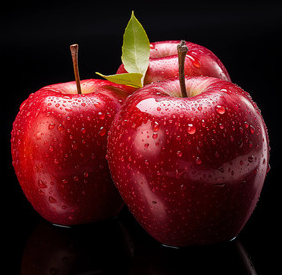

# 多模态支持

Spring AI 2.0 通过统一的**消息 API**提供强大的多模态支持，让 Java 开发者能够轻松构建处理文本、图像、音频等多种信息类型的 AI 应用。

## 什么是多模态 AI

多模态 AI 指模型能够同时理解和处理来自不同信息源（文本、图像、音频、视频等）的内容，实现跨模态的交互与生成。Spring AI 2.0 的多模态设计理念是**统一抽象、灵活扩展**，适配主流 AI 模型提供商的多模态能力。

## 支持的模态类型与场景

| 模态组合        | 典型应用场景                  | 支持模型示例                     |
| --------------- | ----------------------------- | -------------------------------- |
| 文本 + 图像     | 图像描述、OCR、视觉问答 (VQA) | GPT-4V、Gemini、Qwen-VL、Pixtral |
| 文本 + 音频     | 语音转录、语音合成、语音翻译  | GPT-4o-audio、Whisper、Gemini    |
| 文本 + 视频     | 视频内容分析、视频摘要生成    | Gemini、GPT-4o                   |
| 文生图 / 图生文 | 创意生成、图像编辑            | DALL-E、Stable Diffusion         |

## 多模态 API 核心设计

Spring AI 通过**Message 接口**及其实现类提供多模态交互的基础抽象，核心组件包括：

- UserMessage

  用户输入消息，包含两个关键字段

  - `content`：主要文本内容
  - `media`：可选媒体附件列表，支持多种模态

- Media 类

  封装媒体数据，包含两个核心属性

  - `mimeType`：指定媒体类型（如`image/png`、`audio/wav`）
  - `resource`：媒体资源（支持 ClassPathResource、FileSystemResource 等）

- **ChatClient**：流畅式 API，简化多模态请求构建与调用

## 代码使用

先准备一个图片apple.png



新建MyMultimodalityController

```java
import org.springframework.ai.chat.client.ChatClient;
import org.springframework.core.io.FileSystemResource;
import org.springframework.http.MediaType;
import org.springframework.web.bind.annotation.GetMapping;
import org.springframework.web.bind.annotation.RestController;

/**
 * 多模态控制器
 * 处理多模态请求，如文本、图片、视频等。
 */
@RestController
public class MyMultimodalityController {

    private final ChatClient openAiChatClient;

    public MyMultimodalityController(ChatClient openAiChatClient) {
        this.openAiChatClient = openAiChatClient;
    }

    /**
     * 分析图片
     * @return 分析结果文本
     */
    @GetMapping("/analyze-image")
    public String analyzeImage() {
        // 流畅式 API 构建多模态请求
        String result = openAiChatClient.prompt()
            .user(u -> u
                .text("请详细描述这张图片的内容，包括物体、颜色、场景和可能的用途")
                .media(MediaType.IMAGE_PNG, new FileSystemResource("src/main/resources/upload/apple.png"))
            )
            .call()
            .content();
        System.out.println(result);
        return result;
    }
}

```

浏览器请求：`http://localhost:8080/analyze-image`

大模型返回：

```
这张图片是一张高质量的静物摄影作品，主要展示了新鲜的红苹果。以下是详细的描述：

**1. 物体与细节：**
*   **主体：** 图片中有三个饱满的红苹果。它们呈三角形排列，两个在前景（左右各一），一个在背景（中间偏后）。
*   **质感与状态：** 苹果表面非常光滑，布满了细密的水珠（露珠或刚清洗过的水滴），这极大地增强了苹果的新鲜感和诱人程度。光线打在苹果上形成了明显的高光反射，显示出其表皮的光泽。
*   **果梗与叶子：** 前景的两个苹果都保留着细长的褐色果梗（茎），直立向上。位于后方中间的苹果上插着一片嫩绿的叶子，为画面增添了一抹生机和自然气息。

**2. 颜色：**
*   **主色调：** 鲜艳的深红色（类似蛇果或花牛苹果的颜色），色彩饱和度很高，看起来非常浓郁。
*   **背景色：** 纯黑色。这种高对比度的背景使得红色的苹果更加突出，视觉冲击力强。
*   **点缀色：** 叶子的嫩绿色和果梗的深褐色，以及水珠反射出的白色高光。

**3. 场景与构图：**
*   **环境：** 这是一个典型的摄影棚静物拍摄场景。苹果放置在一个黑色的、具有反光效果的平面上（可能是黑色玻璃或亚克力板），因为可以在苹果底部看到淡淡的倒影。
*   **光影：** 采用了专业的布光，光线从上方或侧前方打下来，勾勒出苹果的轮廓和立体感，同时让水珠晶莹剔透。

**4. 可能的用途：**
*   **商业广告：** 非常适合用于水果超市、生鲜电商或果汁品牌的宣传海报，强调“新鲜”、“多汁”和“健康”。
*   **健康与营养素材：** 常用于关于健康饮食、维生素补充、减肥或“一天一苹果，医生远离我”等主题的文章配图。
*   **设计素材/壁纸：** 由于画面干净、色彩对比强烈，常被用作电脑桌面壁纸或设计项目的背景素材。
*   **摄影教学：** 作为静物摄影中关于布光、质感表现（水珠）和色彩对比的范例。
```
