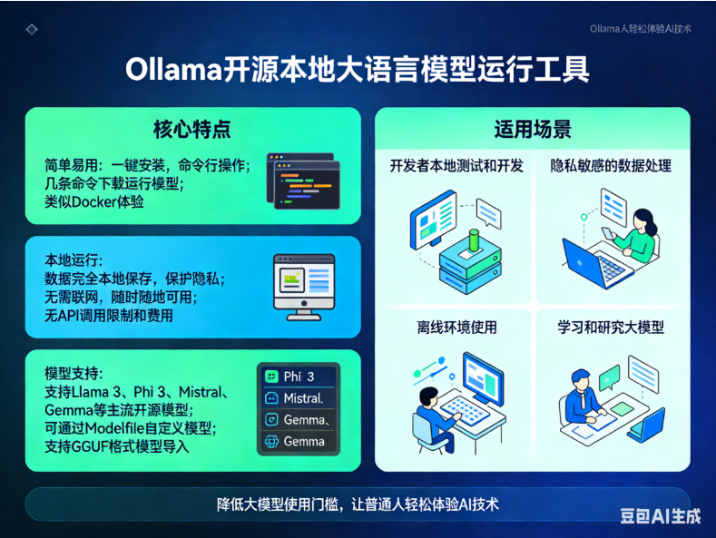
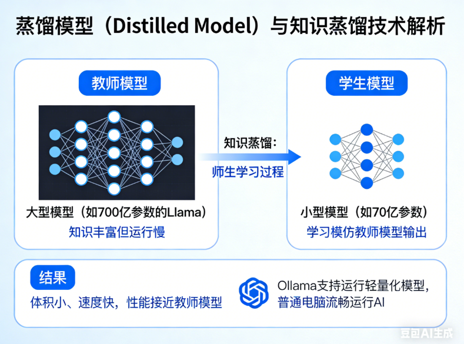
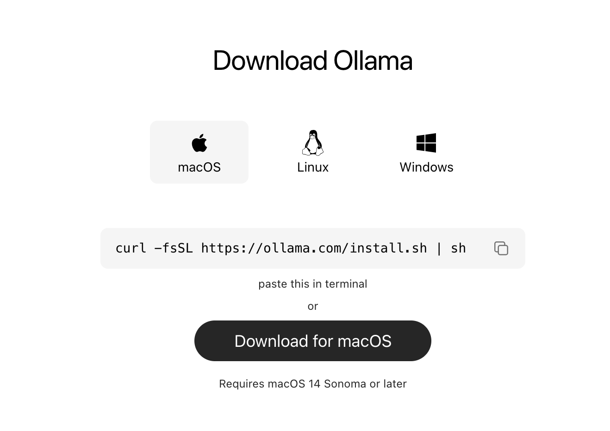
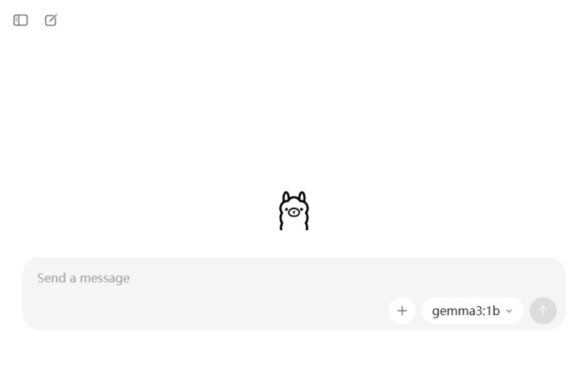
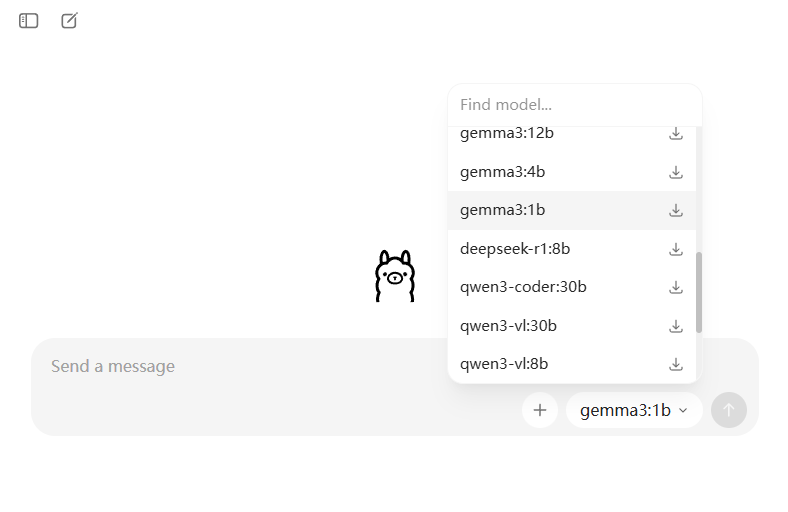

# Ollama 集成

## 简介

Ollama官网：https://ollama.com/

Ollama 是一个开源的本地大语言模型运行工具，它让用户能够轻松地在自己的电脑上部署和使用各种大型语言模型，无需联网也不需要昂贵的云服务。



### 核心特点

**1. 简单易用**

- 一键安装，命令行操作
- 几条命令就能下载和运行模型
- 类似 Docker 的使用体验

**2. 本地运行**

- 数据完全本地保存，保护隐私
- 无需联网，随时随地可用
- 没有 API 调用限制和费用

**3. 模型支持**

- 支持 Llama 3、Phi 3、Mistral、Gemma 等主流开源模型
- 可通过 Modelfile 自定义模型
- 支持 GGUF 格式的模型导入

### 适用场景

- 开发者本地测试和开发
- 隐私敏感的数据处理
- 离线环境使用
- 学习和研究大模型

Ollama 极大地降低了普通人使用大语言模型的门槛，让任何人都能方便地在自己的电脑上体验先进的 AI 技术。

## Ollama蒸馏模型介绍

**蒸馏模型**（Distilled Model）是**通过知识蒸馏技术压缩后的小型模型**，Ollama 支持运行这类轻量化模型，让普通电脑也能流畅运行 AI。

### 什么是知识蒸馏？



知识蒸馏就像一个**师生学习过程**：

- **教师模型**：大型模型（如 700 亿参数的 Llama），知识丰富但运行慢
- **学生模型**：小型模型（如 70 亿参数），学习模仿教师模型的输出
- **结果**：学生模型体积小、速度快，同时保持接近教师模型的性能

### Ollama 支持的蒸馏模型

**1. Llama 3.2 系列（Meta）**

- 1B 和 3B 参数版本
- 适合移动设备和低配置电脑
- 保持较好的对话能力

**2. Phi-3 系列（微软）**

- Mini（3.8B）、Small（7B）版本
- 微软精心挑选训练数据
- 小尺寸但推理能力强

**3. Gemma 系列（Google）**

- 2B 和 7B 参数
- 基于 Gemini 技术蒸馏而来
- 开源免费商用

**4. Qwen 系列（阿里）**

- 0.5B、1.8B、4B、7B 版本
- 中英文能力均衡
- 适合中文场景

### 蒸馏模型在 Ollama 中的优势

**性能对比**（以 Llama 3 为例）：

| 模型   | 参数 | 内存需求 | 速度 | 适用设备   |
| :----- | :--- | :------- | :--- | :--------- |
| 原版   | 70B  | >140GB   | 慢   | 服务器     |
| 蒸馏版 | 8B   | ~16GB    | 快   | 个人电脑   |
| 蒸馏版 | 3B   | ~6GB     | 极快 | 笔记本/RPi |

**实际好处**：

- 普通电脑（8-16GB 内存）也能运行
- 生成速度快 3-10 倍
- 功耗低，适合长时间运行
- 硬盘空间占用小

## Ollama下载安装

ollama下载地址：https://ollama.com/download

点击 下载即可。



安装后出现下面这个界面，就说明安装好了



默认界面还是很简约的，提供了聊天对话框，以及右侧可以选择模型，我们可以搜索然后下载需要的模型



这里面每个模型后面都有多少b，比如4b，这个b就是10亿参数，4b就是40亿参数，我们根据当前机器的显卡显存大小来选择具体的参数模型，比如你电脑就4个G的显存，那就选个4b，如果是高配32G显存，那基本都能跑。

比如我们选择一个4b(40亿参数)的qwen模型，去提问“你是谁？”，那么Ollama先会自动下载模型，然后回答问题。

## Spring AI项目调用本地Ollama模型

首先第一步，我们要加下Ollama依赖

```xml
<dependency>
  <groupId>org.springframework.ai</groupId>
  <artifactId>spring-ai-starter-model-ollama</artifactId>
</dependency>
```

第二步，application.yml里面配置下ollama

```yaml
spring:
  application:
    name: 01-HelloWorld
  ai:
    openai:
      api-key: sk-4feab9xxxxxx4ed0a4xxxxxxx1e9268
      base-url: https://dashscope.aliyuncs.com/compatible-mode/v1
      chat:
        model: qwen3.6-plus
    ollama:
      base-url: http://localhost:11434
      chat:
        model: qwen3:4b
```

第三步：我们在ChatClientConfig配置类里面，配置下Ollama的聊天客户端的Bean

```java
/**
 * 配置 Ollama ChatClient
 * @param model Ollama 模型
 * @return ChatOllama ChatClient 实例
 */
@Bean
public ChatClient ollamaChatClient(OllamaChatModel model) {
    return ChatClient
        .builder(model) // 创建 ChatClient 对象，以及设置模型为 model
        .build(); // 构建 ChatClient 对象
}

```

第四步：MyAiChatController控制器里面，再加一个/ai/ollama请求的接口处理方法

```java
/**
 * 处理与 Ollama 模型交互的请求
 *
 * @param userInput 用户输入
 * @return 模型回复的内容
 */
@GetMapping("/ai/ollama")
public String ollamaChat(String userInput) {
    return ollamaChatClient.prompt() // 创建 Prompt 对象，用于构建聊天请求
        .user(userInput) // 设置用户输入
        .call() // 调用模型，返回结果
        .content(); // 获取模型回复的内容
}
```

最后我们来测试下：

浏览器请求地址：`http://localhost:8080/ai2?question=你是谁？`
