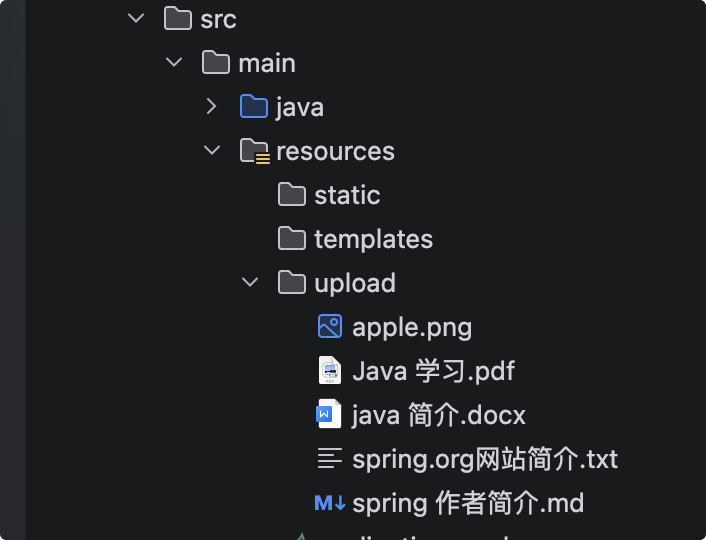
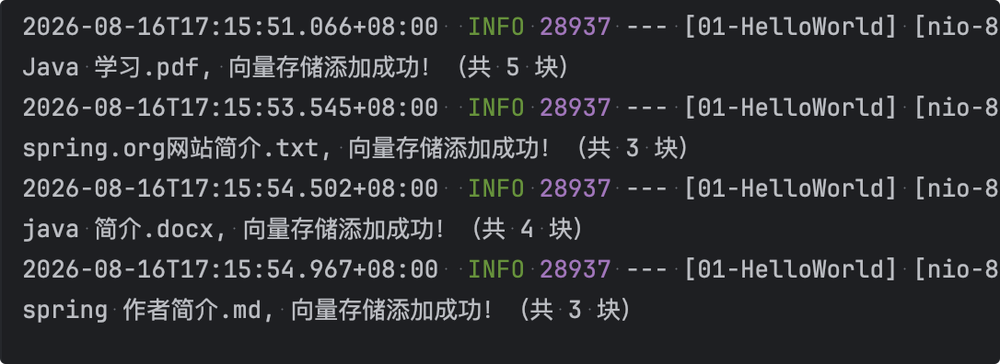
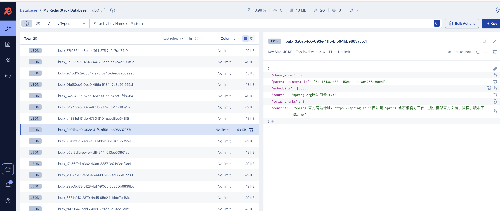
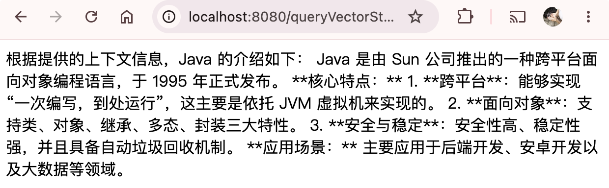

# 检索增强生成

## 简介

`RAG`(`Retrieval-Augmented-Generation`，检索增强生成) 是在大模型回答前，先从外部知识库检索相关内容，再把这些内容作为上下文交给 LLM 生成答案。


这是目前最经典的AI应用架构，可以清晰地看到嵌入模型和向量数据库是如何配合的。

**场景**：构建一个基于公司内部知识库的智能问答机器人。

**第一步：数据预处理与索引（入库阶段）**

1. **准备文档**：收集所有公司文档（PDF、Word、内部Wiki等）。
2. **文本分块**：将长文档切分成更小的段落或“块”。
3. **生成嵌入**：使用**嵌入模型**，为每一个文本块生成一个向量。
4. **存储**：将生成的向量，连同原始的文本块和相关的元数据（如文档来源、页码），一起存入**向量数据库**。

**第二步：用户提问与检索（查询阶段）**

1. **用户提问**：用户问：“我们公司的年假政策是什么？”
2. **问题嵌入**：使用**相同的嵌入模型**，将用户的这个问题也转换成一个向量。
3. **向量检索**：将这个代表问题的向量发送到**向量数据库**进行查询。数据库会迅速返回与问题向量最相似的K个文本块向量。
4. **获取上下文**：根据返回的向量ID，取出对应的原始文本块内容。

**第三步：生成答案（生成阶段）**

1. **构建提示词**：将用户的问题 + 检索到的相关文本块（作为上下文）组合成一个提示词。
2. **调用大语言模型**：将提示词发送给大语言模型（如GPT-4），并指示它“请根据提供的上下文回答问题”。
3. **返回答案**：大模型阅读并理解上下文后，生成一个准确、有据可依的答案返回给用户。

## 技术背景

随着大语言模型（LLM）快速普及，**RAG（检索增强生成）**技术成为解决大模型幻觉、私有化知识库落地的核心方案。传统本地知识库开发存在文档适配单一、向量库部署复杂、代码冗余度高等问题。

**Spring AI 2.0** 作为Spring生态全新迭代的AI开发框架，简化了大模型、向量数据库、文档解析的集成流程，提供统一的标准化API；而**Redis Stack**自带向量存储模块，无需额外部署独立向量库，具备低延迟、高并发、易运维的优势，非常适合中小型RAG项目快速落地。

要想开发轻量化RAG工程，需完整实现以下核心能力：

- **多格式文档解析**：支持PDF、Word(DOC)、纯文本(TXT)、Markdown(MD)四种主流文档格式；
- **智能文本切分**：基于令牌数实现语义分片，避免语义割裂，适配大模型上下文限制；
- **Redis向量存储**：文档切片生成向量，持久化存入Redis向量数据库；
- **标准化RAG架构**：遵循ETL（抽取-转换-加载）流程，代码可直接生产复用；
- **极简接口调试**：提供文件上传、向量检索、知识库清空接口，方便测试验证。

## RAG执行流程

严格遵循标准RAG的ETL执行流程，流程简洁清晰：

1. **E抽取（Extract）**：读取本地上传的PDF/DOC/TXT/MD文件，提取纯文本内容，过滤乱码、格式符号、空白行；
2. **T转换（Transform）**：通过分词器将长文本切分为固定大小的文本切片，补充切片元数据（文件名、格式、上传时间）；
3. **L加载（Load）**：调用Embedding模型将文本切片转为浮点型向量，存入Redis向量索引；
4. **检索问答**：用户提问时，将问题转为向量，在Redis中相似度匹配，召回相似文档片段，结合大模型生成答案。

## DocumentReader：文档抽取

对于 **MD、TXT、DOC、PDF** 四种格式，推荐混合使用 Tika 万能解析器 + 专用解析器的策略：

| 文档格式     | 推荐解析器                                                   | 说明                        |
| :----------- | :----------------------------------------------------------- | :-------------------------- |
| **MD**       | `MarkdownDocumentReader` 或 `TikaDocumentReader`             | 专用解析器性能更优          |
| **TXT**      | `TextReader`（spring-ai-core 自带）                          | 无需额外依赖                |
| **DOC/DOCX** | `TikaDocumentReader`                                         | Tika 对 Office 格式支持完善 |
| **PDF**      | `PagePdfDocumentReader`（按页）或 `ParagraphPdfDocumentReader`（按段落） | 专用解析器保持文档结构      |

`TikaDocumentReader` 通过 Apache Tika 统一支持 PDF、DOC/DOCX、PPT/PPTX、HTML 等大量格式。专用 PDF 解析器额外提供了按页/按段落的更精细控制。


首先pom.xml里加下多格式文档解析依赖依赖：

```xml
<!-- Tika 通用文档读取器 -->
<dependency>
    <groupId>org.springframework.ai</groupId>
    <artifactId>spring-ai-tika-document-reader</artifactId>
</dependency>

<!-- Markdown 文档读取器 -->
<dependency>
    <groupId>org.springframework.ai</groupId>
    <artifactId>spring-ai-markdown-document-reader</artifactId>
</dependency>
```

1. `TikaDocumentReader` 能处理 `.md` 文件

   Markdown 本质上是文本，Tika 会按识别的类型把内容 抽成可读文本（多数情况下拿到的就是源码里的 Markdown 文本，等价于当作富文本格式的“正文抽取”），所以 不会因格式是 `.md` 就完全读不了。

2. 和 `MarkdownDocumentReader` 的差别

   - Tika：偏“抽到一段连续文字”，不负责按一级/二级标题、水平线、`MarkdownDocumentReaderConfig` 那套语义去拆分 `Document`。
   - Spring AI 自带的 `MarkdownDocumentReader`：才是为 Markdown 结构与切块 设计的。

3. 实际选型建议

   - 只关心 把 md 当普通文本扔进向量库、再交给通用切分器：用 `TikaDocumentReader` 通常可行。
   - 要做 按标题分段、合理利用 Markdown 结构：应优先用 `MarkdownDocumentReader`，而不是指望 Tika 给你同样的结构语义。

## 封装统一文档解析工具类

```java
import java.io.File;
import java.util.List;
import org.springframework.ai.document.Document;
import org.springframework.ai.document.DocumentReader;
import org.springframework.ai.reader.markdown.MarkdownDocumentReader;
import org.springframework.ai.reader.tika.TikaDocumentReader;
import org.springframework.core.io.FileSystemResource;
import org.springframework.core.io.Resource;
import org.springframework.stereotype.Component;

/**
 * 多格式文档解析工具类
 * 支持：PDF、Word（doc, docx）、TXT/TEXT、MD格式
 */
@Component
public class DocumentParseUtil {

    /**
     * 解析文档
     * @param filePath 文档路径
     * @return 解析后的文档列表
     */
    public List<Document> parse(String filePath) {
        File file = new File(filePath);
        String suffix = filePath.substring(filePath.lastIndexOf(".") + 1).toLowerCase();
        Resource resource = new FileSystemResource(file);
        DocumentReader reader = switch (suffix) {
            case "pdf", "doc", "docx", "txt", "text" -> new TikaDocumentReader(resource);
            case "md", "markdown" -> new MarkdownDocumentReader(file.toURI().toString());
            default -> throw new IllegalArgumentException("不支持的文档格式: " + suffix);
        };
        return reader.get();
    }
}

```

## 自定义文本切分配置

`TokenTextSplitter` 是一个基于 Token 数量进行文本分割的工具，主要用于将长文本切分成合适大小的块（chunk），以便后续嵌入（embedding）或 LLM 处理。其核心参数及含义如下：

| 参数                    | 类型              | 默认值                  | 含义                                                         |
| :---------------------- | :---------------- | :---------------------- | :----------------------------------------------------------- |
| `encodingType`          | `EncodingType`    | `CL100K_BASE`           | 指定用于 Token 化的编码类型（如 OpenAI 的 `cl100k_base`）。不同的编码对应不同的分词方式，影响 Token 计数和分割结果。 |
| `chunkSize`             | `int`             | `800`                   | 每个文本块允许的 **最大 Token 数**。当达到该上限时尝试在合适的标点处断开，若无法断开则直接截断。 |
| `minChunkSizeChars`     | `int`             | `350`                   | **最小字符数阈值**，用于判断是否在标点处分割。当从块末尾查找标点且标点位置索引大于该值时，才在该标点处分割，否则继续按 Token 数量直接分割。 |
| `minChunkLengthToEmbed` | `int`             | `5`                     | **最终块的最小字符长度**。如果切分出的块文本长度（trim 后）小于该值，则丢弃该块，不纳入结果列表。 |
| `maxNumChunks`          | `int`             | `10000`                 | **最大可生成的块数量**。防止对超长文本无限分割，达到此上限后即使还有剩余文本也停止生产新块。 |
| `keepSeparator`         | `boolean`         | `true`                  | 是否保留分隔符（主要是换行符 `\n`）。为 `true` 时保留并 trim 块文本；为 `false` 时将块中的换行符替换为空格再 trim。 |
| `punctuationMarks`      | `List<Character>` | `['.', '?', '!', '\n']` | 定义 **断句标点符号**。当块接近 `chunkSize` 时，会从后向前查找这些符号的位置，并尽量在最后一个符号处分割，使块更自然。 |

这些参数共同控制了分割的粒度、自然度以及最终输出的块质量。可通过内部 `Builder` 类进行自定义配置。

配置代码：

```java
import org.springframework.ai.transformer.splitter.TokenTextSplitter;
import org.springframework.context.annotation.Bean;
import org.springframework.context.annotation.Configuration;

/**
 * 文本分块配置类
 */
@Configuration
public class TextSplitterConfig {

    @Bean
    public TokenTextSplitter tokenTextSplitter() {
        return TokenTextSplitter.builder()
            .withChunkSize(50) // 单个文本块的最大 token 数
            .withMaxNumChunks(1000) // 最大可生成的块数量。防止对超长文本无限分割，达到此上限后即使还有剩余文本也会停止生产新块。
            .build();
    }
}

```

## 创建Cotroller服务接口

准备好4个测试文件，放项目目录下:


```java
import com.xxxx.util.DocumentParseUtil;
import java.util.List;
import org.springframework.ai.chat.client.ChatClient;
import org.springframework.ai.chat.client.advisor.vectorstore.QuestionAnswerAdvisor;
import org.springframework.ai.document.Document;
import org.springframework.ai.transformer.splitter.TokenTextSplitter;
import org.springframework.ai.vectorstore.SearchRequest;
import org.springframework.ai.vectorstore.VectorStore;
import org.springframework.web.bind.annotation.GetMapping;
import org.springframework.web.bind.annotation.RestController;
import reactor.core.publisher.Flux;

/**
 * RAG 控制器
 */
@RestController
public class MyRagController {

    // 向量数据库
    private final VectorStore  vectorStore;

    // 文本分块器
    private final TokenTextSplitter tokenTextSplitter;

    // 文档解析工具
    private final DocumentParseUtil documentParseUtil;

    public MyRagController(VectorStore vectorStore, TokenTextSplitter tokenTextSplitter,
        DocumentParseUtil documentParseUtil) {
        this.vectorStore = vectorStore;
        this.tokenTextSplitter = tokenTextSplitter;
        this.documentParseUtil = documentParseUtil;
    }

    /**
     * 添加文档到向量数据库
     *
     * @return 添加结果
     */
    @GetMapping("/addDocsToVectorStore")
       public String addDocsToVectorStore() {
        addChunkedDocuments("src/main/resources/upload/Java 学习.pdf", "Java 学习.pdf");
        addChunkedDocuments("src/main/resources/upload/spring.org网站简介.txt", "spring.org网站简介.txt");
        addChunkedDocuments("src/main/resources/upload/java 简介.docx", "java 简介.docx");
        addChunkedDocuments("src/main/resources/upload/spring 作者简介.md", "spring 作者简介.md");
        return "success";
    }

    /**
     * 解析后按 token 切分再入库，避免单条 Document 超长嵌入模型输入上限
     * @param filePath 文档路径
     * @param label 文档标签
     */
    private void addChunkedDocuments(String filePath, String label) {
        List<Document> raw = documentParseUtil.parse(filePath);
        List<Document> chunks = tokenTextSplitter.apply(raw);
        vectorStore.add(chunks);
        System.out.println(label + ", 向量存储添加成功！（共 " + chunks.size() + " 块）");
    }
}

```

浏览器输入： `http://localhost:8080/addDocsToVectorStore`



已经存入了Redis向量数据库。



## 相似度检索

MyRagController.java里加上query方法：

```java
/**
 * 查询向量数据库
 * @return 查询结果
 */
@GetMapping("/queryVectorStore")
public String query() {
    List<Document> docs = vectorStore.similaritySearch(
        SearchRequest.builder()
            .query("介绍下Java")
            .topK(3)
            .build());
    System.out.println(docs);
    return "success";
}
```

浏览器输入：`http://localhost:8080/queryVectorStore`

```java
[Document{id='b4a4f2ac-0877-485b-9127-5ba1421f0e1b', text='Java 简介
Java 是由 Sun 公司推出的跨平台面向对象编程语言，1995 年正式发布。
核心特点：
1. 跨平台：一次', media='null', metadata={distance=0.21088218688964844, vector_score=0.421764433384}, score=0.7891178131103516}, Document{id='29ac5d83-b128-4a17-9008-5c350b6839bd', text='编写，到处运行，依托 JVM 虚拟机实现。
2. 面向对象：支持类、对象、继承、多态、封装三大特', media='null', metadata={distance=0.20890569686889648, vector_score=0.417811393738}, score=0.7910943031311035}, Document{id='17a56f9d-e362-40ad-8857-3e21a3caf0a4', text='性。
3. 安全性高、稳定性强，具备自动垃圾回收机制。
应用场景：后端开发、安卓开发、大数据、', media='null', metadata={distance=0.18277311325073242, vector_score=0.365546226501}, score=0.8172268867492676}]
```

## 实现 RAG

Spring AI 提供了 `QuestionAnswerAdvisor`（问答顾问器），可自动实现“检索 → 增强上下文 → 调用 LLM 生成答案”的 RAG 流程：

Spring AI 通过`Advisor`API为常见的 RAG 流程提供开箱即用的支持。

要使用`QuestionAnswerAdvisor`或`VectorStoreChatMemoryAdvisor`,您需要将`spring-ai-advisors-vector-store`依赖项添加到您的项目中：

```xml
<dependency>
   <groupId>org.springframework.ai</groupId>
   <artifactId>spring-ai-advisors-vector-store</artifactId>
</dependency>
```

MyRagController里，我们首先加下 openAiChatClient 会话客户端，因为我们需要请求大模型，当然我们这次是要带上本地向量检索结果后，再去请求大模型，再加下queryWithLLM方法。

```java
// 大模型
private final ChatClient openAiChatClient;

  /**
   * 结合大模型查询向量数据库
   * @return 查询结果
   */
  @GetMapping(value = "/queryVectorStoreWithLLM", produces = "text/html;charset=UTF-8")
  public Flux<String> queryWithLLM() {
      QuestionAnswerAdvisor qaAdvisor = QuestionAnswerAdvisor.builder(vectorStore)
          .searchRequest(SearchRequest.builder()
              .topK(3) // 搜索结果数量
              .similarityThreshold(0.7) //相似度阈值，0-1之间，值越大要求越严格过滤低相关性的结果，提高 RAG 回答质量
              .build())
          .build();
      Flux<String> result = openAiChatClient.prompt()
          .advisors(qaAdvisor)
          .user("介绍下Java")
          .stream()
          .content();
      System.out.println(result);
      return result;
  }
```

浏览器请求： `http://localhost:8080/queryVectorStoreWithLLM`

大模型返回结果：

