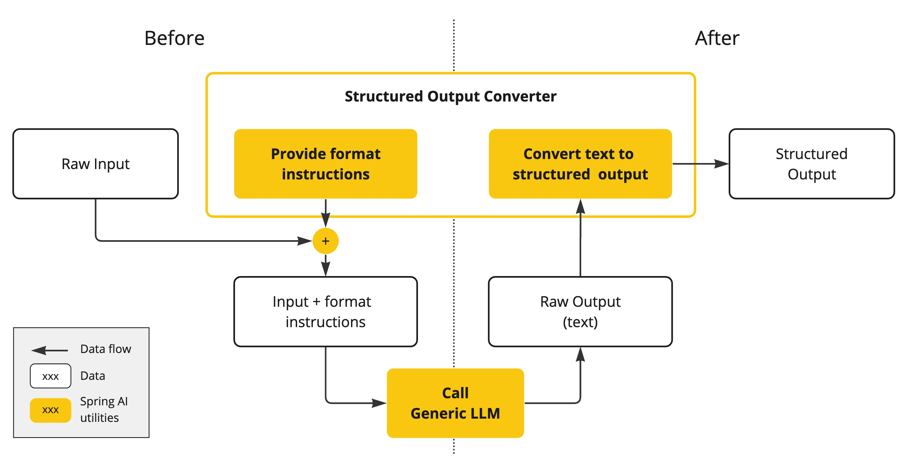
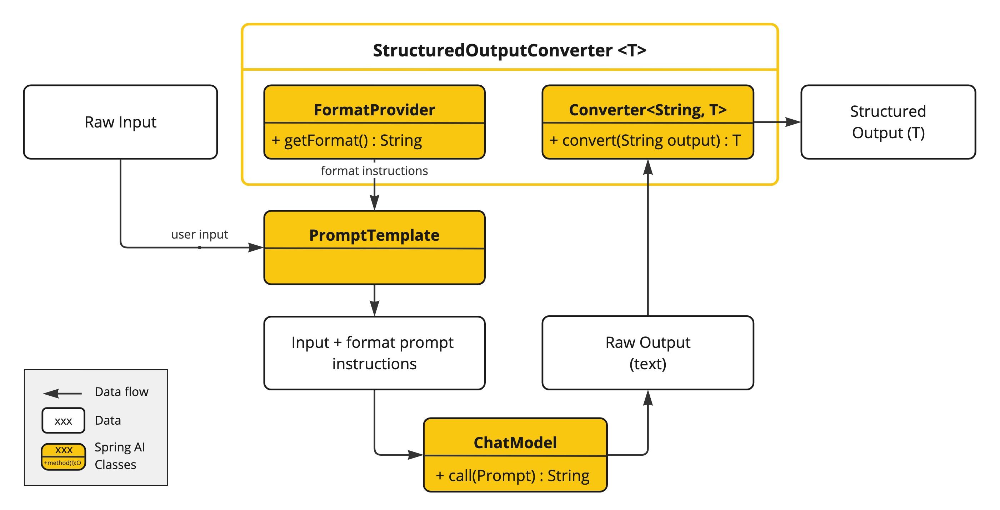

# 结构化输出

## 结构化输出核心概念

Spring AI 2.0 的**结构化输出**是将大语言模型 (LLM) 的自然语言响应转换为**可预测、类型安全的 Java 对象**（如 POJO、Record、Map、List 等）的机制，避免手动解析文本的复杂性和不稳定性。

### 为什么需要结构化输出

| 自然文本输出         | 结构化输出                     |
| -------------------- | ------------------------------ |
| 格式不固定，解析困难 | 格式严格，直接映射为 Java 对象 |
| 无类型安全，易出错   | 强类型校验，编译期检查         |
| 下游系统集成复杂     | 可直接传递给其他应用程序函数   |
| 维护成本高           | 减少解析逻辑，提升系统稳定性   |

### Spring AI 2.0 结构化输出核心特性

1. **自动 JSON Schema 生成**：基于 Java 类自动生成 JSON Schema，确保模型输出符合预期格式
2. **多种转换器支持**：BeanOutputConverter、MapOutputConverter、ListOutputConverter 等
3. **原生结构化输出**：支持模型内置的 JSON 模式（如 OpenAI 的 JSON mode），提高输出可靠性
4. **链式调用简化**：通过`.entity()`方法直接将响应转换为目标类型，代码更简洁
5. **集合类型支持**：轻松处理 List、Set 等集合类型的结构化输出

## 核心实现方式

### 两种主要方案

| 方案           | 说明                                              | 适用场景                                    |
| -------------- | ------------------------------------------------- | ------------------------------------------- |
| **自动转换**   | 使用`.entity()`方法，Spring AI 自动处理转换       | 大多数通用场景，代码简洁高效                |
| **显式转换器** | 手动创建`BeanOutputConverter`等，精细控制转换过程 | 复杂场景，需要自定义 JSON Schema 或验证规则 |

### 原生结构化输出

Spring AI 2.0 支持模型原生的结构化输出能力，通过`AdvisorParams.ENABLE_NATIVE_STRUCTURED_OUTPUT`启用，自动处理以下流程：

1. 生成 JSON Schema
2. 配置模型使用 JSON 模式
3. 验证输出格式
4. 反序列化为 Java 对象

## 实例 1：基础 POJO 结构化输出

定义目标 Java 类（Record）

```java
import java.util.List;

/**
 * @comment: 使用 Java 16+ 的 Record 特性，编译器会自动生成构造器、equals、hashCode方法
 */
public record TopicBook(
    String topic, // 书籍主题
    List<String> books // 书籍列表
) {}
```

创建服务类实现结构化输出

```java
/**
 * 结构化输出：将模型回复的内容转换为结构化的 Java 对象
 * @param topic 书籍主题
 * @return 书籍主题对象
 */
@GetMapping("/ai/openai/structuredOutput/topicBook")
public TopicBook openAiChatStructuredOutputTopicBook(String topic) {
    TopicBook topicBook = openAiChatClient.prompt() // 创建 Prompt 对象，用于构建聊天请求
        .system("你是一个专业的书评助手") // 设置系统提示词
        .user(u -> u.text("请给我推荐三本关于{topic}的书籍，只需要返回书籍的名称").param("topic", topic)) // 设置用户输入
        .call() // 响应输出
        .entity(TopicBook.class); // 映射为 TopicBook 对象
    System.out.println(topicBook);
    return topicBook;
}
```

浏览器请求：`http://localhost:8080/ai/openai/structuredOutput/topicBook?topic=java`

后台输出：

```java
TopicBooks[topic=Java, books=[Head First Java, Effective Java, Java Concurrency in Practice]]
```

## 实例 2：集合类型结构化输出

定义书评类

```java
/**
 * @comment: 使用 Java 16+ 的 Record 特性，编译器会自动生成构造器、equals、hashCode方法
 */
public record BookReview(
    String reviewerName, // 评论人姓名
    int rating, // 评分
    String comment // 评论内容
) {}
```

生成多条书评

```java
/**
 * 结构化输出：将模型回复的内容转换为结构化的 Java 对象集合
 * @param bookName 书籍名称
 * @return 书籍评价列表
 */
@GetMapping("/ai/openai/structuredOutput/bookReview")
public List<BookReview> openAiChatStructuredOutputBookReview(String bookName) {
    List<BookReview> bookReviews = openAiChatClient.prompt() // 创建 Prompt 对象，用于构建聊天请求
        .user(u -> u.text("请给{bookName}书籍三条评价信息").param("bookName", bookName)) // 设置用户输入
        .call() // 调用模型，返回结果
        .entity(new ParameterizedTypeReference<List<BookReview>>(){});
    System.out.println(bookReviews);
    return bookReviews;
}
```


浏览器请求：`http://localhost:8080/ai/openai/structuredOutput/bookReview`

后台输出：

```java
[BookReview[reviewerName=Alice Chen, rating=5, comment=以生动有趣的漫画和互动练习讲解Java基础，非常适合初学者建立编程思维，但部分代码示例需结合新版JDK调整。], BookReview[reviewerName=David Smith, rating=4, comment=项目驱动的学习方式让人印象深刻，通过构建实际应用巩固了面向对象概念，建议补充多线程和Lambda表达式的现代实践。], BookReview[reviewerName=Maria Garcia, rating=4, comment=幽默的叙事风格降低了学习门槛，但章节进度跳跃较大，需要配合官方文档查漏补缺，整体仍是入门首选。]]
```

## 底层实现原理

大型语言模型生成结构化输出的能力，对于依赖于可靠解析输出值的下游应用至关重要。开发人员希望快速地将人工智能模型的输出转换为数据类型，例如JSON、XML或Java类，以便传递给其他应用程序的函数和方法。

Spring AI`Structured Output Converters`有助于将大语言模型的输出转换为结构化格式。如下图所示，这种方法围绕大语言模型文本补全端点运行：



使用通用补全API从大型语言模型（LLM）生成结构化输出，需要对输入和输出进行细致处理。在调用LLM前后，结构化输出转换器发挥着至关重要的作用，以确保实现所需的输出结构。

在大语言模型调用之前，转换器会将格式说明附加到提示中，为模型生成所需输出结构提供明确指导。这些说明充当蓝图，引导模型的响应符合指定的格式。

下图展示了使用结构化输出 API 时的数据流。

