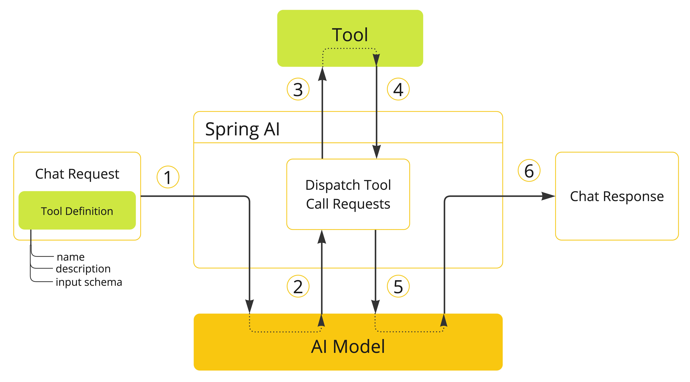

# 工具调用

#  工具调用

## 什么是工具调用

工具调用（Tool Calling，又称 Function Calling）是 Spring AI 2.0 的核心能力之一，它让 LLM 能够调用你在 Java 后端中定义的函数，从而**打通了 AI 与外部系统的连接**。简单来说，就是让大模型不仅能“聊天”，还能真正“做事”——比如查询数据库、调用 API、执行业务逻辑等。

在 Spring AI 2.0 中，工具调用已与 Java 方法签名全面打通，只需用 `@Tool` 注解标记一个 Java 方法，AI 就能像调用本地函数一样调用它。

在没有工具调用的情况下，AI 模型只能基于其训练数据回答问题，无法获取实时信息或执行操作。例如，当你问“现在几点了？”时，模型会回答：“我无法获取实时信息，请告诉我当前日期。”而有了工具调用，模型可以自动调用你提供的 `getCurrentDateTime()` 方法，精准地返回当前时间。

我们可以先测试下，浏览器输入：`http://localhost:8080/ai/openai/flux?userInput=现在几点了`


## 核心工作原理

工具调用的核心流程可以概括为四个步骤：

1. **定义工具**：在 Java 代码中定义一个方法，并用 `@Tool(description = "xxx")` 注解标明其功能描述。
2. **注册工具**：将工具类实例注册到 `ChatClient` 中，Spring AI 会自动将其转换为 AI 模型可识别的 JSON Schema。
3. **模型决策**：当 LLM 判断需要调用工具时，会在响应中生成 JSON 格式的调用指令（包含函数名和参数），而非直接输出最终答案。
4. **执行与应答**：Spring AI 将 JSON 指令转换为实际的方法调用，并将结果返回给模型，模型再基于这些“实时数据”生成最终的自然语言回答。

> **重要提醒**：请务必注意，模型本身**从不直接执行任何代码**。它只是根据用户问题和定义的工具，以 JSON 格式“请求”你执行这个工具。真正的执行权 100% 掌握在你的 Java 应用中，这是一个关键的安全设计。


## 实例：让 AI 学会“看时间”

下面通过一个完整的代码示例，展示如何让 AI 获取当前日期和时间。本实例基于 Spring AI 2.0 推荐的 `@Tool` 注解方式。

首先写一个获取时间的实现：

```java
import java.time.LocalDateTime;
import java.time.format.DateTimeFormatter;
import org.springframework.ai.tool.annotation.Tool;
import org.springframework.context.i18n.LocaleContextHolder;
import org.springframework.stereotype.Component;

/**
 * 时间工具类
 * 用于获取当前时间、格式化时间等操作
 */
@Component
public class DateTimeTools {

    @Tool(description = "获取用户在指定时区的当前日期和时间，用户回答需要实时时间的问题")
    public String getCurrentTime() {
        // 获取当前时区
        var zoneId = LocaleContextHolder.getTimeZone().toZoneId();
        var now = LocalDateTime.now().atZone(zoneId);
        // 格式化时间 为 yyyy-MM-dd HH:mm:ss 格式
        return DateTimeFormatter.ofPattern("yyyy-MM-dd HH:mm:ss").format(now);
    }
}
```

**对比说明**：两种常见的工具定义方式：

- **@Tool 注解（推荐）**：代码最简洁，只需在方法上添加 `@Tool` 注解即可。这是 Spring AI 2.0 主推的新 API，也是本实例采用的方式。
- **FunctionCallback 方式（旧版）**：在 Spring AI 1.x 中需要实现复杂的 `Function` 接口，代码量较大。此 API 已被标记为过时（deprecated），建议在新项目中使用 `@Tool` 注解的方式。


其次，在 MyAiChatControlle r控制器里，在调用 `ChatClient` 时，通过 `.tools()` 方法将定义好的工具注册进去。

```java
private final DateTimeTools dateTimeTools;

/**
 * 工具调用：在模型回复中调用外部工具，以获取额外的信息
 * @param userInput 用户输入
 * @return 流式响应的内容
 */
@GetMapping(value = "/ai/openai/flux/withChatClientWithTools", produces = "text/html;charset=UTF-8")
public Flux<String> openAiChatFluxWithChatClientWithTools(String userInput) {
    return openAiChatClient.prompt() // 创建 Prompt 对象，用于构建聊天请求
        .user(userInput) // 设置用户输入
        .tools(dateTimeTools) // 注册时间工具
        .stream() // 流式响应输出
        .content(); // 获取模型回复的内容
}
```

我们再测试下，浏览器输入：`http://localhost:8080/ai/openai/flux/withChatClientWithTools?userInput=现在几点了`


通过对比可以清晰地看出：**注册工具后，AI 自动识别需求并调用了 getCurrentDateTime 方法，从而提供了精准的实时信息**

## 进阶实践：让 AI 执行操作

工具调用不仅能获取信息，还能让 AI 执行具体操作。以下示例展示了如何实现**闹钟设置功能**。

在工具类 DateTimeTools 中添加操作型工具

```java
@Tool(description = "设置闹钟，调用此工具可在指定时间触发提醒。时间参数必须是 ISO-8601 格式，例如：2023-12-25 12:00:00")
public void setAlarm(@ToolParam(description = "闹钟的触发时间，标准格式：yyyy-MM-dd HH:mm:ss") String alarmTime) {
    System.out.println("⏰ 闹钟已设置，将在 " + alarmTime + " 提醒用户。");
    // 此处可扩展实际定时任务逻辑：如存入数据库、发送推送通知等
}
```

现在向 AI 提问："帮我设置一个 20分钟后的闹钟。"


带工具注册的调用会自动触发如下流程：

1. AI 模型首先调用 `getCurrentDateTime` 获取当前时间。
2. 模型计算出 20 分钟后对应的时间点。
3. 模型调用 `setAlarm` 工具，传入计算出的具体时间。
4. 控制台输出闹钟设置成功的提示。

这正是 Agent 模式的雏形：**模型负责理解意图、拆解任务、规划步骤，你只需提供对应的工具方法，AI 就能自动编排执行**。

## 工具调用底层实现原理

Spring AI 通过一组灵活的抽象支持工具调用，使您能够以一致的方式定义、解析和执行工具。本节概述了 Spring AI 中工具调用的主要概念和组件。



1. 当我们希望将某个工具提供给模型使用时，会将其定义包含在聊天请求中。每个工具定义包括名称、描述以及输入参数的模式。
2. 当模型决定调用工具时，它会发送一条包含工具名称和按照定义的模式建模的输入参数的响应。
3. 应用程序负责使用工具名称来识别并执行带有所提供输入参数的工具。
4. 应用程序会处理工具调用的结果。
5. 应用程序将工具调用结果发送回模型。
6. 模型使用工具调用结果作为额外上下文，生成最终响应。

工具是工具调用的构建模块，它们由`ToolCallback`接口进行建模。Spring AI 提供了内置支持，可从方法和函数中指定`ToolCallback`(s) ，但也可以随时定义自己的`ToolCallback`实现，以支持更多用例。

`ChatModel`实现会透明地将工具调用请求分发到相应的`ToolCallback`实现，并将工具调用结果返回给模型，最终由模型生成最终响应。它们通过`ToolCallingManager`接口来完成这一过程，该接口负责管理工具执行的生命周期。