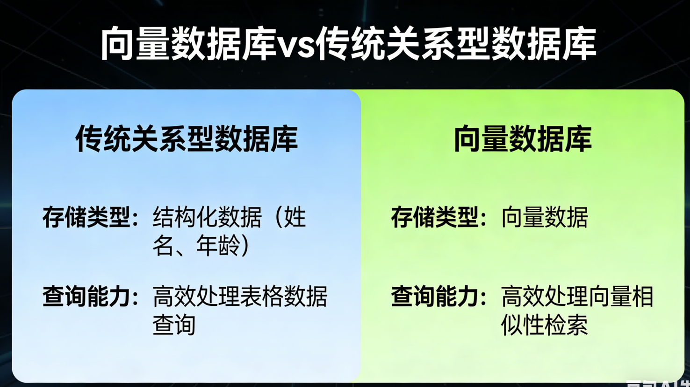
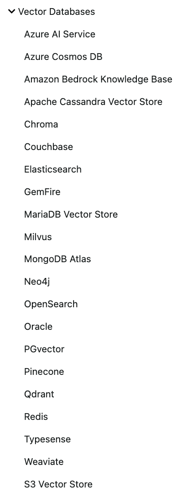
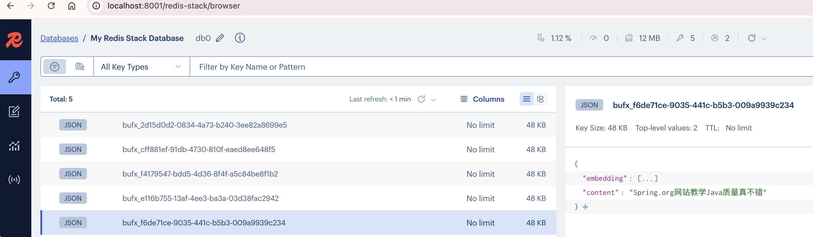

# 向量数据库

## 什么是向量数据库



**向量数据库是一种专门设计用来存储、索引和查询向量数据的数据库。**

传统的关系型数据库擅长存储和查询结构化数据（如表格中的姓名、年龄），但它们无法高效处理向量的“相似性检索”需求。

## 向量数据库的核心作用

**相似性搜索**


向量数据库的核心能力是**近似最近邻检索**。

- **任务**：给定一个查询向量，在数据库中快速找到与之最相似的K个向量。

- **算法**：它不进行暴力的一一比对，而是使用专门的索引算法（如 HNSW——分层可导航小世界图，IVF——倒排文件索引）来极大地提高搜索效率。即便数据库中有十亿个向量，也能在毫秒级内返回结果。

- **距离度量**：通常通过计算向量之间的“距离”来衡量相似度。

  - **余弦相似度**：衡量方向上的相似度（最常用）。
  - **欧氏距离**：衡量空间中的直线距离。
  - **点积**：衡量两个向量的投影。

## 为什么需要向量数据库

1. **高效的检索性能**：专为大规模向量相似性搜索优化，这是传统数据库无法做到的。
2. **元数据过滤**：在实际应用中，向量通常还附带元数据。例如，一个商品图片的向量可能还附有“商品ID”、“价格”、“类别”等信息。向量数据库允许你在进行相似性搜索时，同时根据这些元数据进行过滤（例如，“找到与这件红色T恤最相似的衣服，且价格低于100元”）。
3. **数据管理**：提供增删改查、数据持久化、备份、容灾等标准的数据库功能。
4. **与嵌入模型和大模型的完美集成**：它们共同构成了现代AI应用（如RAG——检索增强生成）的数据流水线。

## 常用的向量数据库

以下是5个最常用的向量数据库对比表格：

| 数据库       | 类型           | 特点                       | 优点                                     | 适用场景                             |
| :----------- | :------------- | :------------------------- | :--------------------------------------- | :----------------------------------- |
| **Pinecone** | 商业SaaS       | 全托管云服务               | 上手最快，零运维，提供免费额度           | 快速原型开发，不想自己搭建维护的项目 |
| **Milvus**   | 开源/商业      | 功能最全面的专业向量数据库 | 支持十亿级向量，索引类型丰富，性能强大   | 大规模生产环境，对性能要求高的场景   |
| **Qdrant**   | 开源/商业      | Rust编写，性能优异         | 内存占用低，API友好，支持过滤            | 需要高性能、资源受限的环境           |
| **Chroma**   | 开源           | Python原生，轻量级         | 极简API，与LangChain集成好，本地开发友好 | 本地开发、学习、小型项目             |
| **pgvector** | PostgreSQL扩展 | 基于PostgreSQL             | 支持ACID事务，SQL语法，无需引入新数据库  | 已有PostgreSQL，向量数据量百万级以内 |

## 嵌入模型与向量数据库协同工作


这是目前最经典的AI应用架构，可以清晰地看到嵌入模型和向量数据库是如何配合的。

**场景**：构建一个基于公司内部知识库的智能问答机器人。

**第一步：数据预处理与索引（入库阶段）**

1. **准备文档**：收集所有公司文档（PDF、Word、内部Wiki等）。
2. **文本分块**：将长文档切分成更小的段落或“块”。
3. **生成嵌入**：使用**嵌入模型**，为每一个文本块生成一个向量。
4. **存储**：将生成的向量，连同原始的文本块和相关的元数据（如文档来源、页码），一起存入**向量数据库**。

**第二步：用户提问与检索（查询阶段）**

1. **用户提问**：用户问：“我们公司的年假政策是什么？”
2. **问题嵌入**：使用**相同的嵌入模型**，将用户的这个问题也转换成一个向量。
3. **向量检索**：将这个代表问题的向量发送到**向量数据库**进行查询。数据库会迅速返回与问题向量最相似的K个文本块向量。
4. **获取上下文**：根据返回的向量ID，取出对应的原始文本块内容。

**第三步：生成答案（生成阶段）**

1. **构建提示词**：将用户的问题 + 检索到的相关文本块（作为上下文）组合成一个提示词。
2. **调用大语言模型**：将提示词发送给大语言模型（如GPT-4），并指示它“请根据提供的上下文回答问题”。
3. **返回答案**：大模型阅读并理解上下文后，生成一个准确、有据可依的答案返回给用户。


Spring AI2.0支持的向量数据库还是比较多的。这里选用Redis。

https://docs.spring.io/spring-ai/reference/api/vectordbs.html



这里的Redis不是普通的Redis Server，而是支持向量存储的redis-stack。

### 选用Redis-stack

```yml
services:
  redis-stack:
    container_name: redis-stack
    image: redis/redis-stack:latest
    ports:
      - 6379:6379
      - 8001:8001
    volumes:
      - ./volumes/config/redis-stack.conf:/redis-stack.conf
      - ./volumes/data:/data
    environment:
      TZ: "Asia/Shanghai"
      REDIS_ARGS: "--requirepass redis-stack"
    networks: 
      - redis-stack

networks:
  redis-stack:
    driver: bridge
    name: redis-stack
```

### 代码使用

项目里把向量存入Redis-stack向量数据库。

首先第一步，pom.xml加下redis的向量支持依赖以及jedis客户端。

```xml
<dependency>
  <groupId>org.springframework.ai</groupId>
  <artifactId>spring-ai-starter-vector-store-redis</artifactId>
</dependency>
<!--
  Spring AI RedisVectorStoreAutoConfiguration 仅在存在 JedisConnectionFactory 时生效（不用 Lettuce）。
  因此改用 Jedis，并从 starter 中排除 Lettuce。
-->
<dependency>
  <groupId>org.springframework.boot</groupId>
  <artifactId>spring-boot-starter-data-redis</artifactId>
  <exclusions>
    <exclusion>
      <groupId>io.lettuce</groupId>
      <artifactId>lettuce-core</artifactId>
    </exclusion>
  </exclusions>
</dependency>
<dependency>
  <groupId>redis.clients</groupId>
  <artifactId>jedis</artifactId>
</dependency>
```

接下来第二步：application.yml里配置下redis连接，以及redis向量配置

```yml
spring:
  application:
    name: 01-HelloWorld
  data:
    redis:
      client-type: jedis
      url: redis://:redis-stack@localhost:6379
  ai:
    openai:
      api-key: sk-4feab9b9xxxxxxxxxxxxxxxxf1e9268
      base-url: https://dashscope.aliyuncs.com/compatible-mode/v1
      chat:
        model: qwen3.6-plus
      embedding:
        model: text-embedding-v4 # 嵌入模型
        dimensions: 2048 # 向量维度
    vectorstore:
      redis:
        initialize-schema: true # 是否在启动时创建/初始化向量索引等结构
        index-name: bufx_ai_vector_index # RedisSearch 里的索引名
        prefix: "bufx_" # 存向量文档用的 Redis 键前缀

```

最后第三步，MyEmController里，我们注入VectorStore，以及写一个addDoc和query

```java
public final VectorStore vectorStore;

/**
 * 添加文档到向量数据库
 * @return 添加结果
 */
@GetMapping("/addDoc")
public String addDoc() {
    List<Document> docs = List.of(
        new Document("学Java上Spring.org"),
        new Document("Spring.org网站教学Java质量真不错"),
        new Document("我喜欢吃香蕉")
    );
    vectorStore.add(docs);
    return "success";
}

/**
 * 查询向量数据库
 * @return 查询结果
 */
@GetMapping("/query")
public String query() {
    List<Document> docs = vectorStore.similaritySearch(
        SearchRequest.builder()
            .query("去哪学Java?")
            .topK(2)
            .build()
    );
    System.out.println(docs);
    return "success";
}
```

我们来测试下，浏览器输入：`http://localhost:8080/addDoc`

我们可以用 redis-stack可视化服务，来查看redis向量数据。浏览器输入：`http://localhost:8001/`



我们在通过VectorStore的 similaritySearch 方法进行相似性搜索。

浏览器输入：`http://localhost:8080/query`

返回结果：

```json
[Document{id='1dc1fc3c-0bd6-46ad-b857-fecb74636ea5', text='学java上Spring.org', media='null', metadata={distance=0.15828251838684082, vector_score=0.316565096378}, score=0.8417174816131592}, Document{id='33ff1eb9-3ca4-4381-80e4-b1ed4670ff56', text='Spring.org是个学Java的好地方', media='null', metadata={distance=0.15871202945709229, vector_score=0.317424118519}, score=0.8412879705429077}]
```

找到两个最相似的结果。