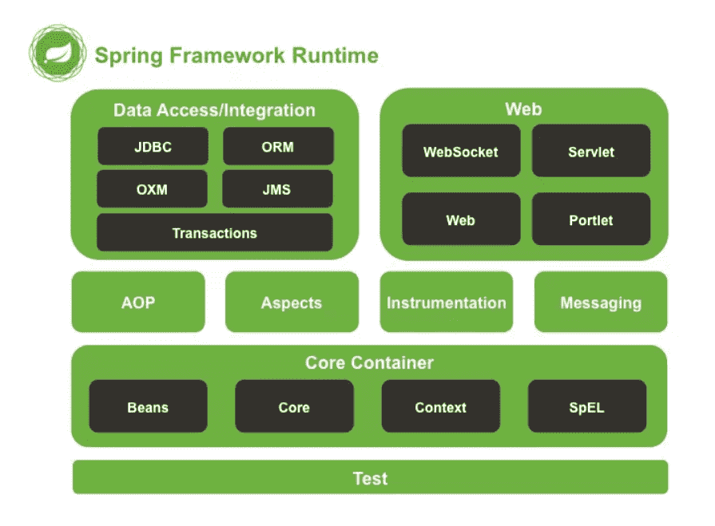

# Spring 概述

## 什么是 spring?

`Spring` 是一个轻量级 Java 开发框架，最早有 Rod Johnson 创建，目的是**为了解决企业级应用开发的业务逻辑层和其他各层的耦合问题**。它是一个分层的 `JavaSE/JavaEE full-stack（一站式）`轻量级开源框架，为开发 Java 应用程序提供全面的基础架构支持。`Spring` 负责基础架构，因此 Java 开发者可以专注于应用程序的开发。

Spring 最根本的使命是**解决企业级应用开发的复杂性，即简化 Java 开发。**

Spring 可以做很多事情，它为企业级开发提供给了丰富的功能，但是这些功能的底层都依赖于它的两个核心特性，也就是`依赖注入（dependency injection，DI）`和`面向切面编程（aspect-oriented programming，AOP）`。

为了降低 Java 开发的复杂性，Spring 采取了以下 4 种关键策略

- 基于 POJO 的轻量级和最小侵入性编程；
- 通过依赖注入和面向接口实现松耦合；
- 基于切面和惯例进行声明式编程；
- 通过切面和模板减少样板式代码。

## Spring 框架的设计目标，设计理念，和核心是什么

**Spring 设计目标：**Spring 为开发者提供一个一站式轻量级应用开发平台；

**Spring 设计理念：**在 JavaEE 开发中，支持 `POJO` 和 `JavaBean` 开发方式，使应用面向接口开发，充分支持 OO（面向对象）设计方法；Spring 通过 IOC 容器实现对象耦合关系的管理，并实现依赖反转，将对象之间的依赖关系交给 IOC 容器，实现解耦；

**Spring 框架的核心：**IOC 容器和 AOP 模块。通过 IOC 容器管理 POJO 对象以及他们之间的耦合关系；通过 AOP 以动态非侵入的方式增强服务。

IOC 让相互协作的组件保持松散的耦合，而 AOP 编程允许你把遍布于应用各层的功能分离出来形成可重用的功能组件。

## Spring 的优缺点是什么？

优点

- 方便解耦，简化开发

  Spring 就是一个`大工厂`，可以将所有对象的创建和依赖关系的维护，交给 Spring 管理。

* AOP 编程的支持

  Spring 提供面向切面编程，可以方便的实现对程序进行`权限拦截、运行监控`等功能。

- 声明式事务的支持

  只需要通过配置就可以完成对事务的管理，而无需手动编程。

* 方便程序的测试

  Spring 对 `Junit4` 支持，可以通过注解方便的测试 Spring 程序。

- 方便集成各种优秀框架

  Spring 不排斥各种优秀的开源框架，其内部提供了对各种优秀框架的直接支持（如：`Struts、Hibernate、MyBatis` 等）。

- 降低 JavaEE API 的使用难度

  Spring 对 JavaEE 开发中非常难用的一些 API（`JDBC、JavaMail、远程调用`等），都提供了封装，使这些 API 应用难度大大降低。

缺点

- Spring 明明一个很轻量级的框架，却给人感觉大而全
- Spring 依赖反射，反射影响性能
- 使用门槛升高，入门 Spring 需要较长时间

## Spring 有哪些应用场景

**应用场景：**JavaEE 企业应用开发，包括 `SSH、SSM` 等

**Spring 价值：**

- Spring 是非侵入式的框架，目标是使应用程序代码对框架依赖最小化；
- Spring 提供一个一致的编程模型，使应用直接使用 POJO 开发，与运行环境隔离开来；
- Spring 推动应用设计风格向面向对象和面向接口开发转变，提高了代码的重用性和可测试性；

## Spring 由哪些模块组成？

Spring 总共大约有 `20` 个模块， 由 `1300` 多个不同的文件构成。 而这些组件被分别整合在`核心容器（Core Container）` 、 `AOP（Aspect Oriented Programming）和设备支持（Instrmentation）` 、`数据访问与集成（Data Access/Integeration）` 、 `Web`、 `消息（Messaging）` 、 `Test` 等 `6` 个模块中。

以下是 Spring 5 的模块结构图：

- **spring core：**提供了框架的基本组成部分，包括控制反转（Inversion of Control，IOC）和依赖注入（Dependency Injection，DI）功能。
- **spring beans：**提供了 BeanFactory，是工厂模式的一个经典实现，Spring 将管理对象称为 Bean。
- **spring context：**构建于 core 封装包基础上的 context 封装包，提供了一种框架式的对象访问方法。
- **spring jdbc：**提供了一个 JDBC 的抽象层，消除了烦琐的 JDBC 编码和数据库厂商特有的错误代码解析， 用于简化 JDBC。
- **spring aop：**提供了面向切面的编程实现，让你可以自定义拦截器、切点等。
- **spring Web：**提供了针对 Web 开发的集成特性，例如文件上传，利用 servlet listeners 进行 ioc 容器初始化和针对 Web 的 ApplicationContext。
- **spring test：**主要为测试提供支持的，支持使用 JUnit 或 TestNG 对 Spring 组件进行单元测试和集成测试。

## Spring 框架中都用到了哪些设计模式？

1. **工厂模式：**BeanFactory 就是简单工厂模式的体现，用来创建对象的实例；
2. **单例模式：**Bean 默认为单例模式。
3. **代理模式：**Spring 的 AOP 功能用到了 JDK 的动态代理和 CGLIB 字节码生成技术；
4. **模板方法：**用来解决代码重复的问题。比如. RestTemplate, JmsTemplate, JpaTemplate。
5. **观察者模式：**定义对象间一种一对多的依赖关系，当一个对象的状态发生改变时，所有依赖于它的对象都会得到通知被制动更新，如 Spring 中 listener 的实现–ApplicationListener。

## 详细讲解一下核心容器模块

这是基本的 Spring 模块，提供 spring 框架的基础功能，BeanFactory 是 任何以 spring 为基础的应用的核心。Spring 框架建立在此模块之上，它使 Spring 成为一个容器。

Bean 工厂是工厂模式的一个实现，提供了控制反转功能，用来把应用的配置和依赖从真正的应用代码中分离。最常用的就是 org.springframework.beans.factory.xml.XmlBeanFactory ，它根据 XML 文件中的定义加载 beans。该容器从 XML 文件读取配置元数据并用它去创建一个完全配置的系统或应用。

## Spring 框架中有哪些不同类型的事件

Spring 提供了以下 5 种标准的事件：

1. 上下文更新事件（ContextRefreshedEvent）：在调用 ConfigurableApplicationContext 接口中的 refresh()方法时被触发。

2. 上下文开始事件（ContextStartedEvent）：当容器调用 ConfigurableApplicationContext 的 Start()方法开始/重新开始容器时触发该事件。

3. 上下文停止事件（ContextStoppedEvent）：当容器调用 ConfigurableApplicationContext 的 Stop()方法停止容器时触发该事件。

4. 上下文关闭事件（ContextClosedEvent）：当 ApplicationContext 被关闭时触发该事件。容器被关闭时，其管理的所有单例 Bean 都被销毁。

5. 请求处理事件（RequestHandledEvent）：在 Web 应用中，当一个 http 请求（request）结束触发该事件。如果一个 bean 实现了 ApplicationListener 接口，当一个 ApplicationEvent 被发布以后，bean 会自动被通知。

## Spring 应用程序有哪些不同组件？

Spring 应用一般有以下组件：

- 接口 - 定义功能。
- Bean 类 - 它包含属性，setter 和 getter 方法，函数等。
- Bean 配置文件 - 包含类的信息以及如何配置它们。
- Spring 面向切面编程（AOP） - 提供面向切面编程的功能。
- 用户程序 - 它使用接口。

## 使用 Spring 有哪些方式？

使用 Spring 有以下方式：

- 作为一个成熟的 Spring Web 应用程序。
- 作为第三方 Web 框架，使用 Spring Frameworks 中间层。
- 作为企业级 Java Bean，它可以包装现有的 POJO（Plain Old Java Objects）。
- 用于远程使用。

参考：https://blog.csdn.net/ThinkWon
