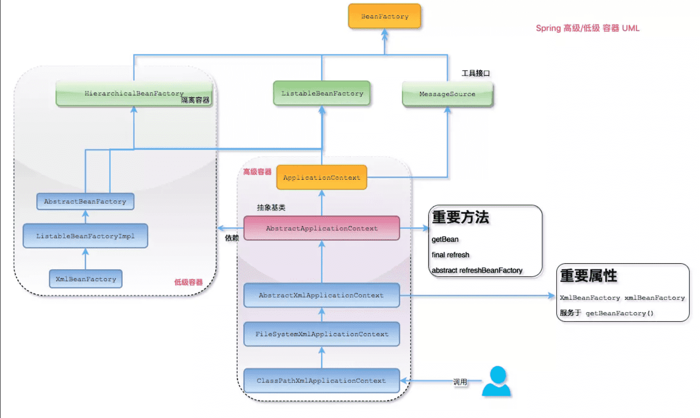

# Spring 控制反转（IOC）

## 什么是 Spring IOC 容器？

控制反转即 `IOC (Inversion of Control)`，它把传统上由程序代码直接操控的对象的调用权交给容器，通过容器来实现对象组件的装配和管理。所谓的“控制反转”概念就是对组件对象控制权的转移，从程序代码本身转移到了外部容器。

`Spring IOC` 负责创建对象，管理对象（通过依赖注入 `DI`），装配对象，配置对象，并且管理这些对象的整个生命周期。

## 控制反转(IOC)有什么作用

- 管理对象的创建和依赖关系的维护。对象的创建并不是一件简单的事，在对象关系比较复杂时，如果依赖关系需要程序猿来维护的话，那是相当头疼的

- 解耦，由容器去维护具体的对象

- 托管了类的产生过程，比如我们需要在类的产生过程中做一些处理，最直接的例子就是代理，如果有容器程序可以把这部分处理交给容器，应用程序则无需去关心类是如何完成代理的

## IOC 的优点是什么？

- IOC 或 依赖注入把应用的代码量降到最低。
- 它使应用容易测试，单元测试不再需要单例和 JNDI 查找机制。
- 最小的代价和最小的侵入性使松散耦合得以实现。
- IOC 容器支持加载服务时的饿汉式初始化和懒加载。

## Spring IOC 的实现机制

Spring 中的 IOC 的实现原理就是**工厂模式加反射机制。**

示例：

```java
interface Fruit {
   public abstract void eat();
 }

class Apple implements Fruit {
    public void eat(){
        System.out.println("Apple");
    }
}

class Orange implements Fruit {
    public void eat(){
        System.out.println("Orange");
    }
}

class Factory {
    public static Fruit getInstance(String ClassName) {
        Fruit f=null;
        try {
            f=(Fruit)Class.forName(ClassName).newInstance();
        } catch (Exception e) {
            e.printStackTrace();
        }
        return f;
    }
}

class Client {
    public static void main(String[] a) {
        Fruit f=Factory.getInstance("io.github.dunwu.spring.Apple");
        if(f!=null){
            f.eat();//Apple
        }
    }
}
```

## Spring 的 IOC 支持哪些功能

Spring 的 IOC 设计支持以下功能：

- 依赖注入
- 依赖检查
- 自动装配
- 支持集合
- 指定初始化方法和销毁方法
- 支持回调某些方法（但是需要实现 Spring 接口，略有侵入）

**其中，最重要的就是依赖注入，从 XML 的配置上说，即 ref 标签。对应 Spring RuntimeBeanReference 对象。**

对于 IOC 来说，最重要的就是容器。容器管理着 Bean 的生命周期，控制着 Bean 的依赖注入。

## BeanFactory 和 ApplicationContext 有什么区别？

BeanFactory 和 ApplicationContext 是 Spring 的两大核心接口，都可以当做 Spring 的容器。其中 ApplicationContext 是 BeanFactory 的子接口。

**依赖关系**

BeanFactory：是 Spring 里面最底层的接口，包含了各种 Bean 的定义，读取 bean 配置文档，管理 bean 的加载、实例化，控制 bean 的生命周期，维护 bean 之间的依赖关系。

ApplicationContext 接口作为 BeanFactory 的派生，除了提供 BeanFactory 所具有的功能外，还提供了更完整的框架功能：

- 继承 MessageSource，因此支持国际化。

- 统一的资源文件访问方式。

- 提供在监听器中注册 bean 的事件。

- 同时加载多个配置文件。

- 载入多个（有继承关系）上下文 ，使得每一个上下文都专注于一个特定的层次，比如应用的 web 层。

**加载方式**

BeanFactroy 采用的是延迟加载形式来注入 Bean 的，即只有在使用到某个 Bean 时(调用 getBean())，才对该 Bean 进行加载实例化。这样，我们就不能发现一些存在的 Spring 的配置问题。如果 Bean 的某一个属性没有注入，BeanFacotry 加载后，直至第一次使用调用 getBean 方法才会抛出异常。

ApplicationContext，它是在容器启动时，一次性创建了所有的 Bean。这样，在容器启动时，我们就可以发现 Spring 中存在的配置错误，这样有利于检查所依赖属性是否注入。 ApplicationContext 启动后预载入所有的单实例 Bean，通过预载入单实例 bean ,确保当你需要的时候，你就不用等待，因为它们已经创建好了。

相对于基本的 BeanFactory，ApplicationContext 唯一的不足是占用内存空间。当应用程序配置 Bean 较多时，程序启动较慢。

**创建方式**

BeanFactory 通常以编程的方式被创建，ApplicationContext 还能以声明的方式创建，如使用 ContextLoader。

**注册方式**

BeanFactory 和 ApplicationContext 都支持 BeanPostProcessor、BeanFactoryPostProcessor 的使用，但两者之间的区别是：BeanFactory 需要手动注册，而 ApplicationContext 则是自动注册。

## Spring 如何设计容器的，BeanFactory 和 ApplicationContext 的关系详解

Spring 作者 Rod Johnson 设计了两个接口用以表示容器。

- BeanFactory
- ApplicationContext

BeanFactory 简单粗暴，可以理解为就是个 HashMap，Key 是 BeanName，Value 是 Bean 实例。通常只提供注册（put），获取（get）这两个功能。我们可以称之为 “**低级容器**”。

ApplicationContext 可以称之为 “**高级容器**”。因为他比 BeanFactory 多了更多的功能。他继承了多个接口。因此具备了更多的功能。例如资源的获取，支持多种消息（例如 JSP tag 的支持），对 BeanFactory 多了工具级别的支持等待。所以你看他的名字，已经不是 BeanFactory 之类的工厂了，而是 “应用上下文”， 代表着整个大容器的所有功能。该接口定义了一个 refresh 方法，此方法是所有阅读 Spring 源码的人的最熟悉的方法，用于刷新整个容器，即重新加载/刷新所有的 bean。

当然，除了这两个大接口，还有其他的辅助接口，这里就不介绍他们了。

BeanFactory 和 ApplicationContext 的关系

为了更直观的展示 “低级容器” 和 “高级容器” 的关系，这里通过常用的 ClassPathXmlApplicationContext 类来展示整个容器的层级 UML 关系。



有点复杂？ 先不要慌，我来解释一下。

最上面的是 BeanFactory，下面的 3 个绿色的，都是功能扩展接口，这里就不展开讲。

看下面的隶属 ApplicationContext 粉红色的 “高级容器”，依赖着 “低级容器”，这里说的是依赖，不是继承哦。他依赖着 “低级容器” 的 getBean 功能。而高级容器有更多的功能：支持不同的信息源头，可以访问文件资源，支持应用事件（Observer 模式）。

通常用户看到的就是 “高级容器”。 但 BeanFactory 也非常够用啦！

左边灰色区域的是 “低级容器”， 只负载加载 Bean，获取 Bean。容器其他的高级功能是没有的。例如上图画的 refresh 刷新 Bean 工厂所有配置，生命周期事件回调等。

小结

说了这么多，不知道你有没有理解 Spring IOC？ 这里小结一下：IOC 在 Spring 里，只需要低级容器就可以实现，2 个步骤：

- 加载配置文件，解析成 BeanDefinition 放在 Map 里。

- 调用 getBean 的时候，从 BeanDefinition 所属的 Map 里，拿出 Class 对象进行实例化，同时，如果有依赖关系，将递归调用 getBean 方法 —— 完成依赖注入。

上面就是 Spring 低级容器（BeanFactory）的 IOC。

至于高级容器 ApplicationContext，他包含了低级容器的功能，当他执行 refresh 模板方法的时候，将刷新整个容器的 Bean。同时其作为高级容器，包含了太多的功能。一句话，他不仅仅是 IOC。他支持不同信息源头，支持 BeanFactory 工具类，支持层级容器，支持访问文件资源，支持事件发布通知，支持接口回调等等。

## ApplicationContext 通常的实现是什么？

**FileSystemXmlApplicationContext：**此容器从一个 XML 文件中加载 beans 的定义，XML Bean 配置文件的全路径名必须提供给它的构造函数。

**ClassPathXmlApplicationContext：**此容器也从一个 XML 文件中加载 beans 的定义，这里，你需要正确设置 classpath 因为这个容器将在 classpath 里找 bean 配置。

**WebXmlApplicationContext：**此容器加载一个 XML 文件，此文件定义了一个 WEB 应用的所有 bean。

## 什么是 Spring 的依赖注入？

控制反转 IOC 是一个很大的概念，可以用不同的方式来实现。其主要实现方式有两种：依赖注入和依赖查找

依赖注入：相对于 IOC 而言，依赖注入(DI)更加准确地描述了 IOC 的设计理念。所谓依赖注入（Dependency Injection），即组件之间的依赖关系由容器在应用系统运行期来决定，也就是由容器动态地将某种依赖关系的目标对象实例注入到应用系统中的各个关联的组件之中。组件不做定位查询，只提供普通的 Java 方法让容器去决定依赖关系。

## 依赖注入的基本原则

依赖注入的基本原则是：应用组件不应该负责查找资源或者其他依赖的协作对象。配置对象的工作应该由 IOC 容器负责，“查找资源”的逻辑应该从应用组件的代码中抽取出来，交给 IOC 容器负责。容器全权负责组件的装配，它会把符合依赖关系的对象通过属性（JavaBean 中的 setter）或者是构造器传递给需要的对象。

## 依赖注入有什么优势

依赖注入之所以更流行是因为它是一种更可取的方式：让容器全权负责依赖查询，受管组件只需要暴露 JavaBean 的 setter 方法或者带参数的构造器或者接口，使容器可以在初始化时组装对象的依赖关系。其与依赖查找方式相比，主要优势为：

- 查找定位操作与应用代码完全无关。
- 不依赖于容器的 API，可以很容易地在任何容器以外使用应用对象。
- 不需要特殊的接口，绝大多数对象可以做到完全不必依赖容器。

## 有哪些不同类型的依赖注入实现方式？

依赖注入是时下最流行的 IOC 实现方式，依赖注入分为接口注入（Interface Injection），Setter 方法注入（Setter Injection）和构造器注入（Constructor Injection）三种方式。其中接口注入由于在灵活性和易用性比较差，现在从 Spring4 开始已被废弃。

**构造器依赖注入：**构造器依赖注入通过容器触发一个类的构造器来实现的，该类有一系列参数，每个参数代表一个对其他类的依赖。

**Setter 方法注入：**Setter 方法注入是容器通过调用无参构造器或无参 static 工厂 方法实例化 bean 之后，调用该 bean 的 setter 方法，即实现了基于 setter 的依赖注入。

## 构造器依赖注入和 Setter 方法注入的区别

|        构造函数注入        |        setter 注入         |
| :------------------------: | :------------------------: |
|        没有部分注入        |         有部分注入         |
|    不会覆盖 setter 属性    |     会覆盖 setter 属性     |
| 任意修改都会创建一个新实例 | 任意修改不会创建一个新实例 |
|     适用于设置很多属性     |     适用于设置少量属性     |

两种依赖方式都可以使用，构造器注入和 Setter 方法注入。最好的解决方案是用构造器参数实现强制依赖，setter 方法实现可选依赖。

<font color=gray size=2>参考：https://blog.csdn.net/ThinkWon</font>
