# Nacos使用

##  什么是Nacos

官方：https://nacos.io/zh-cn/index.html

英文缩写：Name Configurations 表示注册中心和配置中心


Nacos 致力于帮助您发现、配置和管理微服务。Nacos 提供了一组简单易用的特性集，帮助您快速实现动态服务发现、服务配置、服务元数据及流量管理。

**总结：**Nacos就是微服务架构中服务注册中心以及统一配置中心,用来替换原来的(eureka,consul)以及config组件。

##  安装Nacos

###  准备环境

Nacos 依赖 [Java](https://docs.oracle.com/cd/E19182-01/820-7851/inst_cli_jdk_javahome_t/) 环境来运行。如果您是从代码开始构建并运行Nacos，还需要为此配置 [Maven](https://maven.apache.org/index.html)环境，请确保是在以下版本环境中安装使用:

1. 64 bit OS，支持 Linux/Unix/Mac/Windows，推荐选用 Linux/Unix/Mac。
2. 64 bit JDK 1.8+；[下载](http://www.oracle.com/technetwork/java/javase/downloads/jdk8-downloads-2133151.html) & [配置](https://docs.oracle.com/cd/E19182-01/820-7851/inst_cli_jdk_javahome_t/)。
3. Maven 3.2.x+；[下载](https://maven.apache.org/download.cgi) & [配置](https://maven.apache.org/settings.html)。

###  下载Nacos（1.4.0）

https://github.com/alibaba/nacos/releases

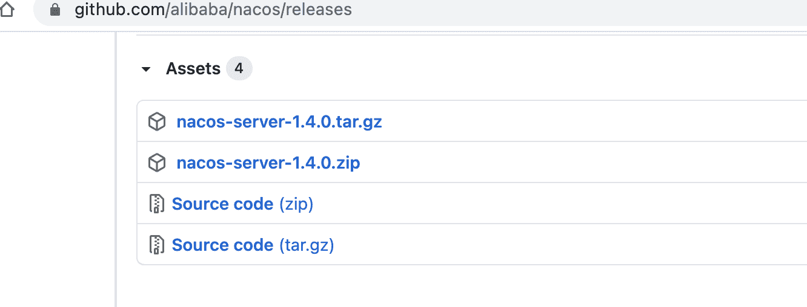

###  解压缩安装包到指定位置

```shell
- bin  			启动nacos服务的脚本目录
- conf 			nacos的配置文件目录
- target 		nacos的启动依赖存放目录
- data		  nacos启动成功后保存数据的目录(启动后生成)
- logs			nacos的启动运行日志目录（启动后生成）
```

###  启动安装服务

```shell 
- linux/unix/mac启动
	打开终端进入nacos的bin目录执行如下命令 
	./startup.sh -m standalone

- windows启动
	在 cmd中 
	执行 startup.cmd -m standalone 或者双击startup.cmd运行文件。
```

###  访问nacos的web服务管理界面

http://localhost:8848/nacos/

用户名 和 密码都是nacos

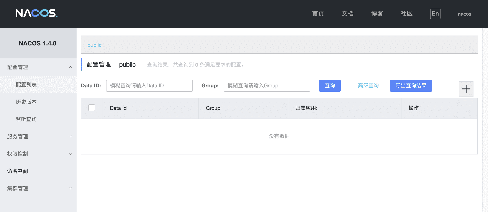

##  开发服务注册到Nacos

###  创建项目并引入依赖

分别创建服务消费者（users）和服务提供着（products）两个项目

```xml
<!--引入nacos client 依赖-->
<dependency>
  <groupId>com.alibaba.cloud</groupId>
  <artifactId>spring-cloud-starter-alibaba-nacos-discovery</artifactId>
</dependency>
```

###  修改配置文件

```properties
#指定当前服务端口
server.port=9099
#指定服务名称
spring.application.name=users
#指定nacos服务地址
spring.cloud.nacos.server-addr=localhost:8848
#指定注册中心地址
spring.cloud.nacos.discovery.server-addr=${spring.cloud.nacos.server-addr}
#暴露所有web端点(可不加)
management.endpoints.web.exposure.include=*
```

###  入口类加入服务注册注解

`注意：新版本之后这一步可以省略不写`

```java
@SpringBootApplication
@EnableDiscoveryClient
public class Springcloudalibaba03Products9098Application {

	public static void main(String[] args) {
		SpringApplication.run(Springcloudalibaba03Products9098Application.class, args);
	}

}
```

###  启动项目并查看nacos控制台

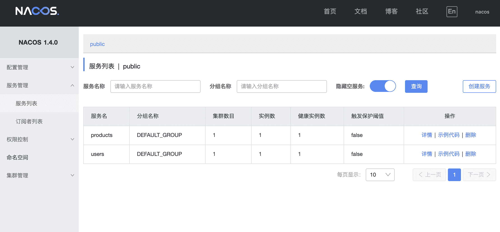

##  Nacos配合OpenFeign进行服务间调用

- 在服务提供着开发个接口

```java
/**
 * @author buubiu
 **/
@RestController
@Slf4j
public class ProductController {

	@Value("${server.port}")
	private int port;

	@GetMapping("/product/find")
	public Map<String, Object> find(@RequestParam("id") String id) {
		Map<String, Object> map = new HashMap<>();
		log.info("进入傻姑娘片服务，当前接收的商品id为：[{}]", id);
		map.put("status", true);
		map.put("msg","当前商品服务调用成功，查询商品id为："+id+",当前处理服务的端口为：" + port);
		return map;
	}
}
```

- 在服务消费者进行调用

###  通过restTemplate直接调用

```java
/**
 * @author buubiu
 **/
@RestController
@Slf4j
public class UserController {

   @GetMapping("/user/getProductInfo")
   public String getProductInfo(String productId) {

		//第一种方式：通过restTemplate直接调用
		RestTemplate restTemplate = new RestTemplate();
		String forObject = restTemplate
			.getForObject("http://localhost:9098/product/find?id=" + productId, String.class);

      log.info("返回的信息：[{}]", forObject);
      return forObject;
   }
}
```

###  DiscoveryClient (restTemplate + ribbon负载均衡客户端)

自定义负载均衡

```java
/**
 * @author buubiu
 **/
@RestController
@Slf4j
public class UserController {

	@Autowired
	private DiscoveryClient discoveryClient;

	@GetMapping("/user/getProductInfo")
	public String getProductInfo(String productId) {

		//restTemplate + ribbon 负载均衡客户端 DiscoveryClient LoadBalancerClient LoadBalanced注解形式
		//第二种方式：DiscoveryClient获取到所有的服务器地址，然后再自定义负载均衡
		List<ServiceInstance> productsServiceInstances = discoveryClient.getInstances("products");
		for (ServiceInstance productsServiceInstance: productsServiceInstances){
			log.info("服务地址：[{}]",productsServiceInstance.getUri());
		}

		log.info("返回的信息：[{}]", forObject);
		return forObject;
	}
}
```

###   LoadBalancerClient (restTemplate + ribbon负载均衡客户端)

自动负载均衡

```java
/**
 * @author buubiu
 **/
@RestController
@Slf4j
public class UserController {

	@Autowired
	private LoadBalancerClient loadBalancerClient;

	@GetMapping("/user/getProductInfo")
	public String getProductInfo(String productId) {

		//restTemplate + ribbon 负载均衡客户端 DiscoveryClient LoadBalancerClient LoadBalanced注解形式
		//第三种方式：LoadBalancerClient 自动负载均衡
		ServiceInstance productServiceInstance = loadBalancerClient.choose("products");
		log.info("当前处理服务负载均衡客户端主机为：[{}]",productServiceInstance.getUri());
		String forObject = restTemplate
			.getForObject(productServiceInstance.getUri() + "/product/find?id=" + productId,
				String.class);
		log.info("返回的信息：[{}]", forObject);
		return forObject;
	}
}
```

###   LoadBalanced注解形式(restTemplate + ribbon负载均衡客户端)

- 首先创建一个具有负载均衡的RestTemplate对象

```java
/**
 * @author buubiu
 **/
@Configuration
public class RestTemplateConfig {

	@Bean
	@LoadBalanced //代表创建一个具有负载均衡的RestTemplate对象
	public RestTemplate getRestTemplate() {
		return new RestTemplate();
	}
}
```

- 然后再去调用

```java
/**
 * @author buubiu
 **/
@RestController
@Slf4j
public class UserController {
  
	@Autowired
	private RestTemplate restTemplate;

	@GetMapping("/user/getProductInfo")
	public String getProductInfo(String productId) {

		//restTemplate + ribbon 负载均衡客户端 DiscoveryClient LoadBalancerClient LoadBalanced注解形式
		//第四种方式：LoadBalanced注解形式 (新增RestTemplateConfig 配置类）
		String forObject = restTemplate
			.getForObject("http://products/product/find?id=" + productId, String.class);
    
		log.info("返回的信息：[{}]", forObject);
		return forObject;
	}
}
```

###   openfeign调用（底层用ribbon做负载均衡）--`推荐`

- 首先创建调用商品服务的feign接口

```java
/**
 * 调用商品服务feign接口
 * @author buubiu
 **/
@FeignClient("products")
public interface ProductClient {

	@GetMapping("/product/find")
	Map<String, Object> find(@RequestParam("id") String id);
}

```

- 然后再去调用

```java
/**
 * @author buubiu
 **/
@RestController
@Slf4j
public class UserController {

	@Autowired
	private ProductClient productClient;

	@GetMapping("/user/getProductInfo")
	public String getProductInfo(String productId) {
    
		//第五种方式：openfeign调用（底层用ribbon做负载均衡）
		Map<String, Object> map = productClient.find(productId);

		log.info("返回的信息：[{}]", map.toString());
		return map.toString();
	}
}
```

##  Nacos作为配置中心使用

###  创建项目并引入依赖

```xml
<!--引入nacos client依赖-->
<dependency>
  <groupId>com.alibaba.cloud</groupId>
  <artifactId>spring-cloud-starter-alibaba-nacos-discovery</artifactId>
</dependency>
<!--引入nacos config 依赖-->
<dependency>
  <groupId>com.alibaba.cloud</groupId>
  <artifactId>spring-cloud-starter-alibaba-nacos-config</artifactId>
</dependency>
```

###  修改配置文件

由于要去获取配置中心的配置文件，所有本地的配置文件要改名为：bootstrap.proterties

```properties
##连接nacos配置中心
#远程配置中心的地址
spring.cloud.nacos.server-addr=localhost:8848
#去指定nacos地址读取配置
spring.cloud.nacos.config.server-addr=${spring.cloud.nacos.server-addr}
#读取配置的命名空间ID(如果是默认public，不要配置)
#spring.cloud.nacos.config.namespace=
#读取配置的分组(默认DEFAULT_GROUP)
spring.cloud.nacos.config.group=DEFAULT_GROUP

#spring.application.name 和 spring.profiles.active 和 spring.cloud.nacos.config.file-extension 一起组成了配置中心的文件名称:configclient-prod.properties
#配置应用名，也是配置中心的文件前缀
spring.application.name=configclient
#配置配中心的环境 是文件名称的中缀
spring.profiles.active=prod
#配置中心的文件后缀(默认properties)
spring.cloud.nacos.config.file-extension=properties
```

###  在nacos中创建配置

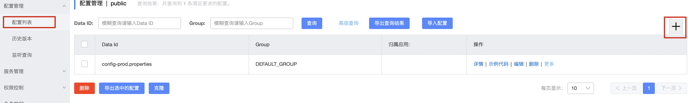

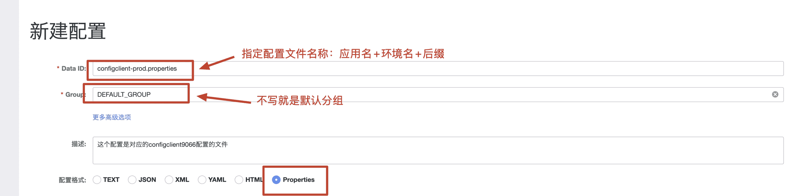

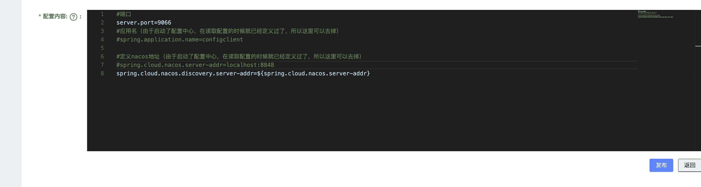

###  编写控制器测试配置读取情况

```java
/**
 * @author buubiu
 **/
@RestController
@Slf4j
public class TestController {

	@Value("${user.name}")
	private String name;
	
	public String test() {
		log.info("当前获取配置中name为：[{}]", name);
		return "当前获取配置中name为："+name;
	}

}
```

###  启动项目测试配置读取


###  DataId

用来读取远程配置中心的中具体配置文件其完整格式如下:

`${prefix}-${spring.profile.active}.${file-extension}
`

- prefix 默认为 spring.application.name 的值，也可以通过配置项 spring.cloud.nacos.config.prefix来配置。

- spring.profile.active 即为当前环境对应的 profile，详情可以参考 Spring Boot文档。 注意：当 spring.profile.active 为空时，对应的连接符 - 也将不存在，dataId 的拼接格式变成` ${prefix}.${file-extension}`

- file-exetension 为配置内容的数据格式，可以通过配置项 spring.cloud.nacos.config.file-extension 来配置。目前只支持 properties 和 yaml 类型。

###  实现自动配置刷新

默认情况下nacos已经实现了自动配置刷新功能，如果需要刷新配置直接在控制器中加入`@RefreshScpoper`注解即可

```java
/**
 * @author buubiu
 **/
@RestController
@Slf4j
@RefreshScope
public class TestController {

	@Value("${user.name}")
	private String name;

	@GetMapping("/test/test")
	public String test() {
		log.info("当前获取配置中name为：[{}]", name);
		return "当前获取配置中name为："+name;
	}

}
```

然后再控制台修改配置，刷新页面发现值变了


##  命名空间

###  命名空间介绍（namespace）

官方：https://github.com/alibaba/spring-cloud-alibaba/wiki/Nacos-config

namespace命名空间是nacos针对于企业级开发设计用来针对于不同环境的区分,比如在企业开发时有测试环境,生产环境,等其他环境,因此为了保证不同环境配置实现隔离,提出了namespace的概念,默认在nacos中存在一个public命名空间所有配置在没有指定命名空间时都在这个命名空间中获取配置,在实际开发时可以针对于不能环境创建不同的namespace空间。默认空间不能删除!

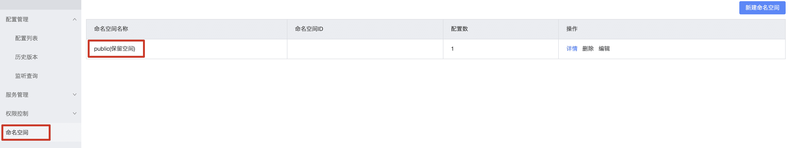

###  创建其他命名空间

每个命名空间都有一个唯一id,这个id是读取配置时指定空间的唯一标识

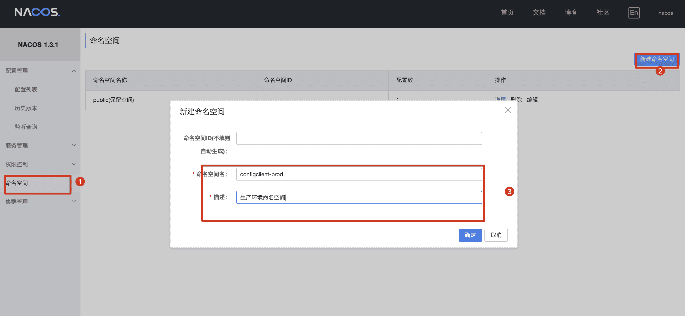

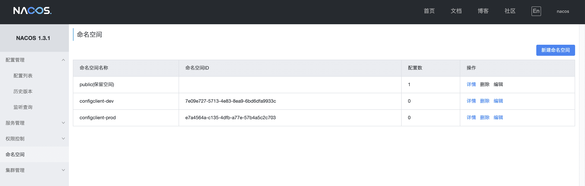

###  在配置列表查看命名空间

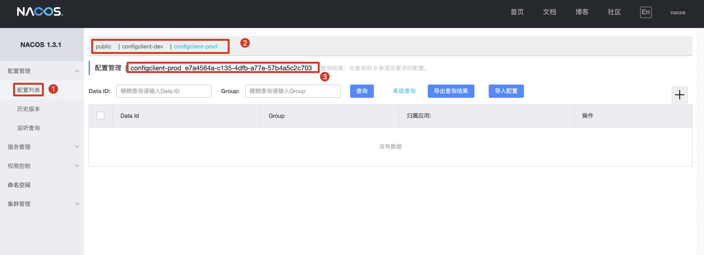

###  在指定空间下创建配置文件

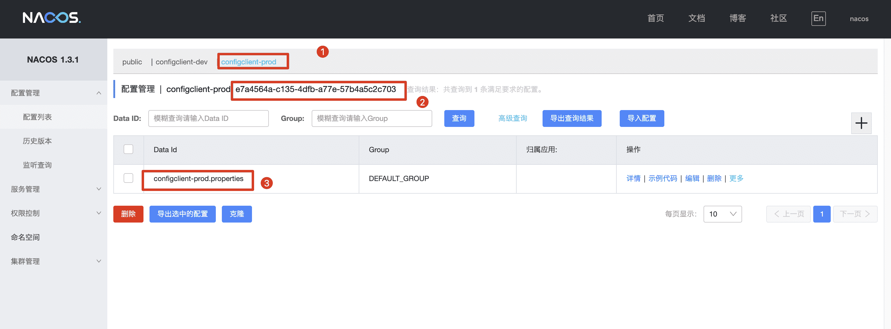

###  在项目中使用命名空间指定配置

```properties
##连接nacos配置中心
#远程配置中心的地址
spring.cloud.nacos.server-addr=localhost:8848
#去指定nacos地址读取配置
spring.cloud.nacos.config.server-addr=${spring.cloud.nacos.server-addr}
#读取配置的命名空间(如果是默认public，不要配置
spring.cloud.nacos.config.namespace=e7a4564a-c135-4dfb-a77e-57b4a5c2c703
#读取配置的分组(默认DEFAULT_GROUP)
spring.cloud.nacos.config.group=DEFAULT_GROUP

#spring.application.name 和 spring.profiles.active 和 spring.cloud.nacos.config.file-extension 一起组成了配置中心的文件名称:configclient-prod.properties

#配置应用名，也是配置中心的文件前缀
spring.application.name=configclient
#配置配中心的环境 是文件名称的中缀
spring.profiles.active=prod
#配置中心的文件后缀(默认properties)
spring.cloud.nacos.config.file-extension=properties
```

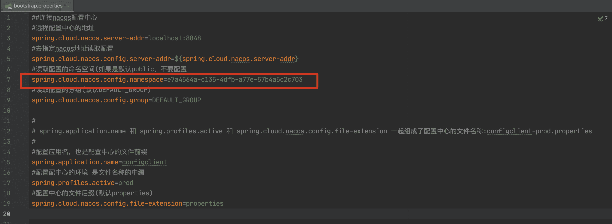

###  启动项目测试配置


##  配置分组

###  分组介绍（GROUP）

配置分组是对配置集进行分组，通过一个有意义的字符串（如 Buy 或 Trade ）来表示，不同的配置分组下可以有相同的配置集（Data ID）。当您在 Nacos 上创建一个配置时，如果未填写配置分组的名称，则配置分组的名称默认采用 DEFAULT_GROUP 。配置分组的常见场景：可用于区分不同的项目或应用，例如：学生管理系统的配置集可以定义一个group为：STUDENT_GROUP。

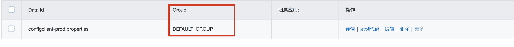

###  创建分组

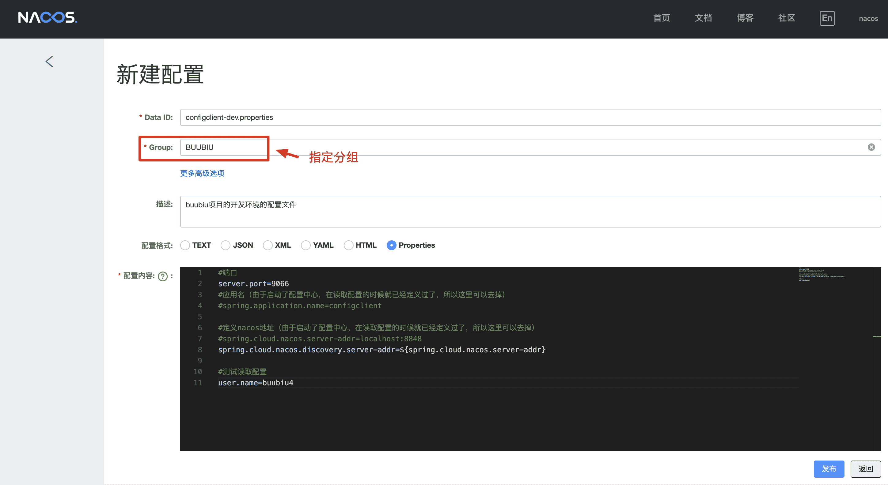

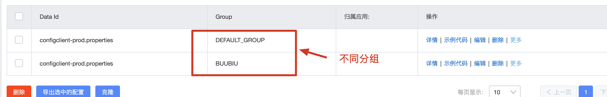

###  项目读取指定分组的配置

```properties
##连接nacos配置中心
#远程配置中心的地址
spring.cloud.nacos.server-addr=localhost:8848
#去指定nacos地址读取配置
spring.cloud.nacos.config.server-addr=${spring.cloud.nacos.server-addr}
#读取配置的命名空间(如果是默认public，不要配置
spring.cloud.nacos.config.namespace=e7a4564a-c135-4dfb-a77e-57b4a5c2c703
#读取配置的分组(默认DEFAULT_GROUP)
spring.cloud.nacos.config.group=BUUBIU

#spring.application.name 和 spring.profiles.active 和 spring.cloud.nacos.config.file-extension 一起组成了配置中心的文件名称:configclient-prod.properties

#配置应用名，也是配置中心的文件前缀
spring.application.name=configclient
#配置配中心的环境 是文件名称的中缀
spring.profiles.active=prod
#配置中心的文件后缀(默认properties)
spring.cloud.nacos.config.file-extension=properties
```

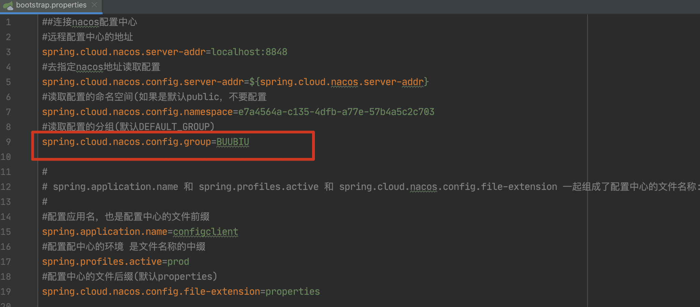

###  启动项目测试配置


