# Sentinel流量卫兵的使用

##  什么是Sentinel

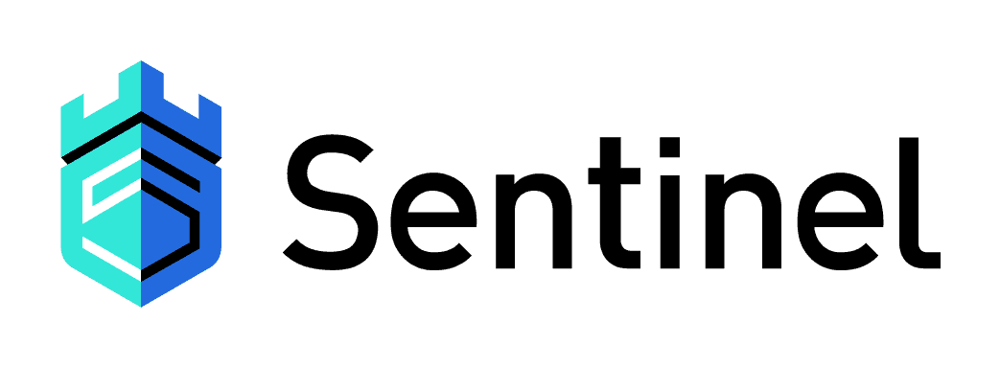{width=300}

官方：

https://spring-cloud-alibaba-group.github.io/github-pages/hoxton/en-us/index.html#_introduction_of_sentinel

https://github.com/alibaba/Sentinel/wiki/%E4%BB%8B%E7%BB%8D

As microservices become popular, the stability of service calls is becoming increasingly important. [Sentinel](https://github.com/alibaba/Sentinel) takes "flow" as the breakthrough point, and works on multiple fields including flow control, circuit breaking and load protection to protect service reliability.				---[摘自官网]

**翻译：**随着微服务的流行，服务和服务之间的稳定性变得越来越重要。Sentinel 以流量为切入点，从流量控制、熔断降级、系统负载保护等多个维度保护服务的稳定性。

**通俗定义：**用来在微服务系统中保护微服务的作用， 如何 服务雪崩 服务熔断  服务降级 就是用来替换hystrix

##  特性

- **丰富的应用场景**：Sentinel 承接了阿里巴巴近 10 年的双十一大促流量的核心场景，例如秒杀（即突发流量控制在系统容量可以承受的范围）、消息削峰填谷、集群流量控制、实时熔断下游不可用应用等。
- **完备的实时监控**：Sentinel 同时提供实时的监控功能。您可以在控制台中看到接入应用的单台机器秒级数据，甚至 500 台以下规模的集群的汇总运行情况。
- **广泛的开源生态**：Sentinel 提供开箱即用的与其它开源框架/库的整合模块，例如与 Spring Cloud、Dubbo、gRPC 的整合。您只需要引入相应的依赖并进行简单的配置即可快速地接入 Sentinel。
- **完善的 SPI 扩展点**：Sentinel 提供简单易用、完善的 SPI 扩展接口。您可以通过实现扩展接口来快速地定制逻辑。例如定制规则管理、适配动态数据源等。

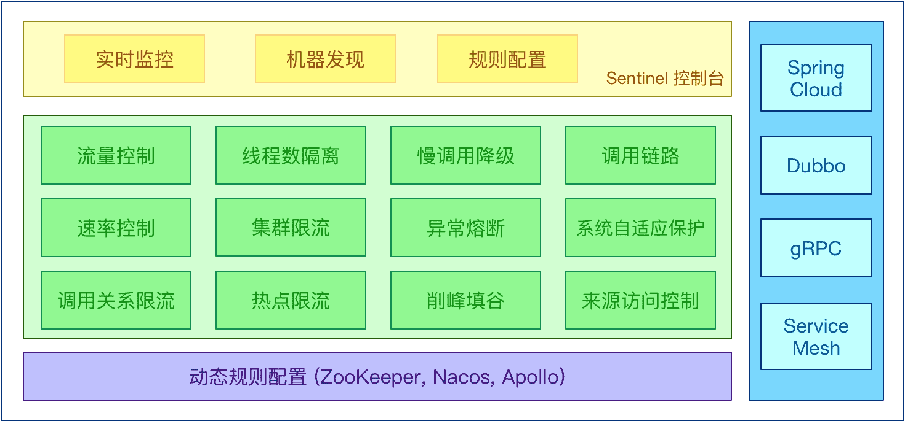

##  Sentinel使用

sentinel提供了两个服务组件

- 一个是 sentinel 用来实现微服务系统中服务熔断、降级等功能。这点和hystrix 类似
- 一个是 sentinel dashboard 用来监控微服务系统中流量调用等情况。这点和hystrix dashboard类似

###  sentinel dashboard的安装

####  下载

https://github.com/alibaba/Sentinel/releases

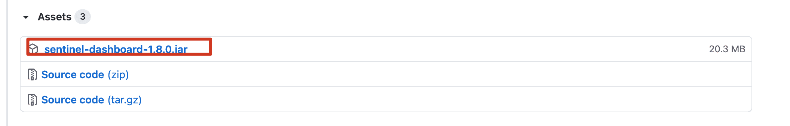

####  启动

仪表盘是个jar包可以直接通过java命令启动 如: java -jar 方式运行 默认端口为 8080

```shell
java -Dserver.port=8888 -jar sentinel-dashboard-1.8.0.jar 
```

####  访问WEB界面

http://localhost:8888

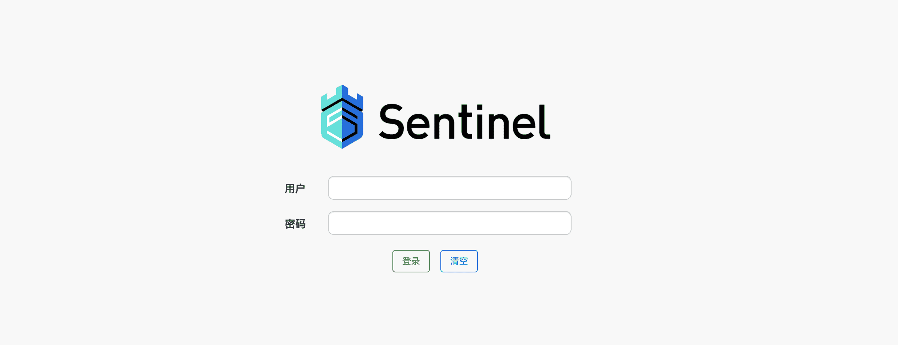

####  登录

用户名和密码默认都是：sentinel

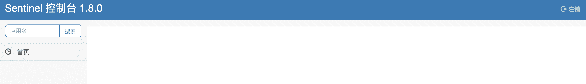

##  Sentinel实时监控服务

###  创建项目引入依赖

```xml
<!--引入sentinel 依赖-->
<dependency>
  <groupId>com.alibaba.cloud</groupId>
  <artifactId>spring-cloud-starter-alibaba-sentinel</artifactId>
</dependency>
```

###  修改配置文件

```properties
server.port=8789
spring.application.name=nacosclient

spring.cloud.nacos.server-addr=localhost:8848
spring.cloud.nacos.discovery.server-addr=${spring.cloud.nacos.server-addr}

management.endpoints.web.exposure.include=*

#开启sentinel（默认开启）
spring.cloud.sentinel.enabled=true
#开启sentinel立即加载，即不需要先调用才会有监控
spring.cloud.sentinel.eager=true
#设置sentinel dashboard地址
spring.cloud.sentinel.transport.dashboard=localhost:8888
#设置与dashboard通信的端口(默认8719)
spring.cloud.sentinel.transport.port=8719
```

###  启动项目并测试

####  访问dashboard界面查看服务监控

默认情况下sentiel为延迟加载,不会在启动之后立即创建服务监控,需要对服务进行调用时才会初始化

###  开发控制服务

```java
/**
 * @author buubiu
 **/
@RestController
@Slf4j
public class TestController {

	@GetMapping("/test/test")
	public String test() {
		log.info("进入test服务！！！");
		return "test服务调用成功！！！";
	}
	
	@GetMapping("/test/test1")
	public String test1() {
		log.info("进入test1服务！！！");
		return "test1服务调用成功！！！";
	}
}
```

###  启动项目并进行调用

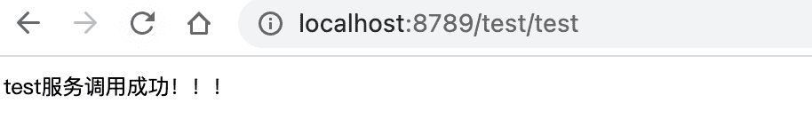

###  查看监控界面

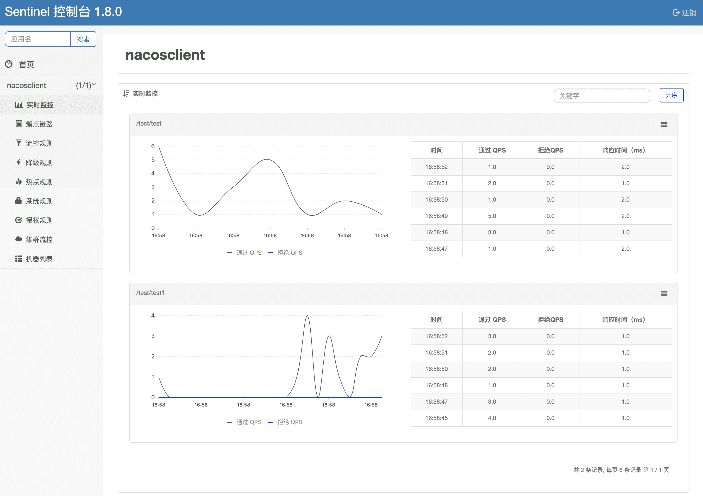

##  Sentinel流量控制

###  介绍

官方：https://github.com/alibaba/Sentinel/wiki/%E6%B5%81%E9%87%8F%E6%8E%A7%E5%88%B6

**流量控制**（flow control），其原理是监控应用流量的 QPS 或并发线程数等指标，当达到指定的阈值时对流量进行控制，以避免被瞬时的流量高峰冲垮，从而保障应用的高可用性。

同一个资源可以创建多条限流规则。`FlowSlot` 会对该资源的所有限流规则依次遍历，直到有规则触发限流或者所有规则遍历完毕。

一条限流规则主要由下面几个因素组成，我们可以组合这些元素来实现不同的限流效果：

- `resource`：资源名，即限流规则的作用对象（**一般都写请求路径，也可以写请求的别名**，别名是注解`SentinelResource`的value值）
- `count`: 限流阈值
- `grade`: 限流阈值类型（QPS 或并发线程数）
- `limitApp`: 流控针对的调用来源，若为 `default` 则不区分调用来源
- `strategy`: 调用关系限流策略
- `controlBehavior`: 流量控制效果（直接拒绝、Warm Up、匀速排队）

流量控制主要有两种统计类型，一种是统计并发线程数，另外一种则是统计 QPS。

###  QPS限流

####  配置QPS流量控制

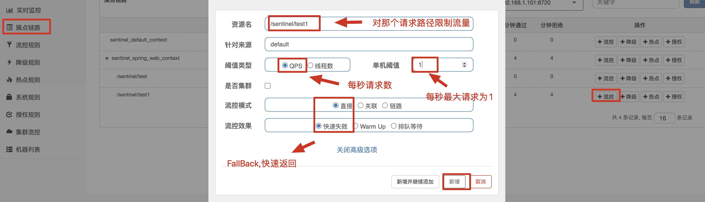

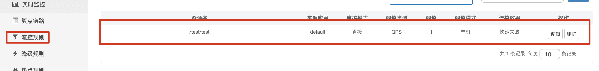

####  访问测试

每秒只能最大接收1个请求，超过1个报错

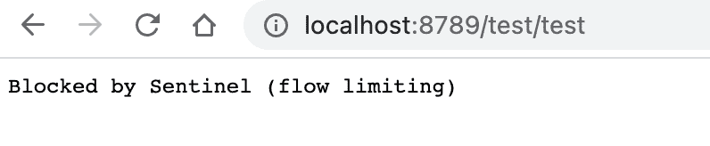

###  线程数限流

####  配置线程数限流

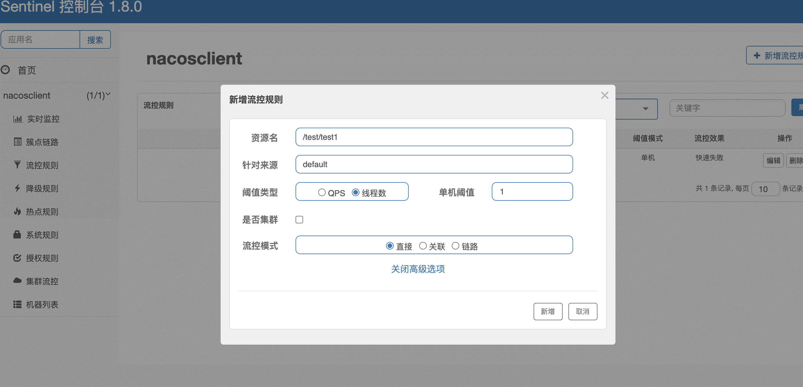

####  访问测试

用`JMeter`测试

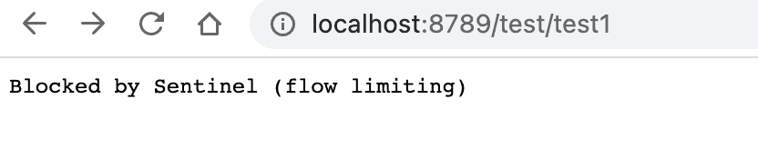

###  流控模式

有三种模式

####   直接限流

**官方**：https://github.com/alibaba/Sentinel/wiki/%E6%B5%81%E9%87%8F%E6%8E%A7%E5%88%B6

**定义**：标识流量控制规则到达阈值直接触发流量控制

####  关联限流

**官方**：https://github.com/alibaba/Sentinel/wiki/%E6%B5%81%E9%87%8F%E6%8E%A7%E5%88%B6

**定义**：当两个资源之间具有资源争抢或者依赖关系的时候，这两个资源便具有了关联。比如对数据库同一个字段的读操作和写操作存在争抢，读的速度过高会影响写得速度，写的速度过高会影响读的速度。如果放任读写操作争抢资源，则争抢本身带来的开销会降低整体的吞吐量。可使用关联限流来避免具有关联关系的资源之间过度的争抢，举例来说，read_db 和 write_db 这两个资源分别代表数据库读写，我们可以给 read_db 设置限流规则来达到写优先的目的：设置 strategy 为 RuleConstant.STRATEGY_RELATE 同时设置 refResource 为 write_db。这样当写库操作过于频繁时，读数据的请求会被限流。


####  链路限流

**官方**：https://github.com/alibaba/Sentinel/wiki/%E6%B5%81%E9%87%8F%E6%8E%A7%E5%88%B6

**定义**：

`NodeSelectorSlot` 中记录了资源之间的调用链路，这些资源通过调用关系，相互之间构成一棵调用树。这棵树的根节点是一个名字为 `machine-root` 的虚拟节点，调用链路的入口都是这个虚节点的子节点。

一棵典型的调用树如下图所示：

```
     	          machine-root
                    /       \
                   /         \
             Entrance1     Entrance2
                /             \
               /               \
      DefaultNode(nodeA)   DefaultNode(nodeA)
```

上图中来自入口 `Entrance1` 和 `Entrance2` 的请求都调用到了资源 `NodeA`，Sentinel 允许只根据某个入口的统计信息对资源限流。比如我们可以设置 `strategy` 为 `RuleConstant.STRATEGY_CHAIN`，同时设置 `refResource` 为 `Entrance1` 来表示只有从入口 `Entrance1` 的调用才会记录到 `NodeA` 的限流统计当中，而不关心经 `Entrance2` 到来的调用。

###  流控效果

####  直接拒绝

（RuleConstant.CONTROL_BEHAVIOR_DEFAULT）方式是默认的流量控制方式，当QPS超过任意规则的阈值后，新的请求就会被立即拒绝，拒绝方式为抛出FlowException。

####  Warm Up

（RuleConstant.CONTROL_BEHAVIOR_WARM_UP）方式，即预热/冷启动方式。当系统长期处于低水位的情况下，当流量突然增加时，直接把系统拉升到高水位可能瞬间把系统压垮。通过"冷启动"，让通过的流量缓慢增加，在一定时间内逐渐增加到阈值上限，给冷系统一个预热的时间，避免冷系统被压垮。
更多:https://github.com/alibaba/Sentinel/wiki/%E9%99%90%E6%B5%81---%E5%86%B7%E5%90%AF%E5%8A%A8

####  匀速排队

(RuleConstant.CONTROL_BEHAVIOR_RATE_LIMITER）方式会严格控制请求通过的间隔时间，也即是让请求以均匀的速度通过，对应的是漏桶算法。 只能对请求进行排队等待
更多:https://github.com/alibaba/Sentinel/wiki/%E6%B5%81%E9%87%8F%E6%8E%A7%E5%88%B6-%E5%8C%80%E9%80%9F%E6%8E%92%E9%98%9F%E6%A8%A1%E5%BC%8F

##  熔断降级

###  介绍

官方：https://github.com/alibaba/Sentinel/wiki/%E7%86%94%E6%96%AD%E9%99%8D%E7%BA%A7

除了流量控制以外，对调用链路中不稳定的资源进行熔断降级也是保障高可用的重要措施之一。由于调用关系的复杂性，如果调用链路中的某个资源不稳定，最终会导致请求发生堆积。Sentinel **熔断降级**会在调用链路中某个资源出现不稳定状态时（例如调用超时或异常比例升高），对这个资源的调用进行限制，让请求快速失败，避免影响到其它的资源而导致级联错误。当资源被降级后，在接下来的降级时间窗口之内，对该资源的调用都自动熔断（默认行为是抛出 `DegradeException`）。

> **注意**：本文档针对 Sentinel 1.8.0 以下版本。1.8.0 版本及以上对熔断降级特性进行了全新的改进升级，请使用最新版本以更好地利用熔断降级的能力。

###  降级策略

####  平均响应时间 (DEGRADE_GRADE_RT)

当 1s 内持续进入 N （默认最少5）个请求，对应时刻的平均响应时间（秒级）均超过阈值（count，以 ms 为单位），那么在接下的时间窗口（DegradeRule 中的 timeWindow，以 s 为单位）之内，对这个方法的调用都会自动地熔断（抛出 DegradeException）。注意 Sentinel 默认统计的 RT 上限是 4900 ms，超出此阈值的都会算作 4900 ms，若需要变更此上限可以通过启动配置项 -Dcsp.sentinel.statistic.max.rt=xxx 来配置。


####  异常比例 (DEGRADE_GRADE_EXCEPTION_RATIO)

当资源的每秒请求量 >= N（可配置），并且每秒异常总数占通过量的比值超过阈值（DegradeRule 中的 count）之后，资源进入降级状态，即在接下的时间窗口（DegradeRule 中的 timeWindow，以 s 为单位）之内，对这个方法的调用都会自动地返回。异常比率的阈值范围是 [0.0, 1.0]，代表 0% - 100%。


####  异常数 (DEGRADE_GRADE_EXCEPTION_COUNT)

当资源近 1 分钟的异常数目超过阈值之后会进行熔断。注意由于统计时间窗口是分钟级别的，若 timeWindow 小于 60s，则结束熔断状态后仍可能再进入熔断状态。


##  @SentinelResource注解

###  介绍

官方：https://github.com/alibaba/Sentinel/wiki/%E6%B3%A8%E8%A7%A3%E6%94%AF%E6%8C%81

>注意：注解方式埋点不支持 private 方法。

`@SentinelResource` 用于定义资源，并提供可选的异常处理和 fallback 配置项。 `@SentinelResource` 注解包含以下属性：

- `value`：资源名称，必需项（不能为空）
- `entryType`：entry 类型，可选项（默认为 `EntryType.OUT`）
- `blockHandler` / `blockHandlerClass`: `blockHandler` 对应处理 `BlockException` 的函数名称，可选项。blockHandler 函数访问范围需要是 `public`，返回类型需要与原方法相匹配，参数类型需要和原方法相匹配并且最后加一个额外的参数，类型为 `BlockException`。blockHandler 函数默认需要和原方法在同一个类中。若希望使用其他类的函数，则可以指定 `blockHandlerClass` 为对应的类的 `Class` 对象，注意对应的函数必需为 static 函数，否则无法解析。
- `fallback`/`fallbackClass`：fallback 函数名称，可选项，用于在抛出异常的时候提供 fallback 处理逻辑。fallback 函数可以针对所有类型的异常（除了`exceptionsToIgnore`里面排除掉的异常类型）进行处理。fallback 函数签名和位置要求：
  - 返回值类型必须与原函数返回值类型一致；
  - 方法参数列表需要和原函数一致，或者可以额外多一个 `Throwable` 类型的参数用于接收对应的异常。
  - fallback 函数默认需要和原方法在同一个类中。若希望使用其他类的函数，则可以指定 `fallbackClass` 为对应的类的 `Class` 对象，注意对应的函数必需为 static 函数，否则无法解析。
- `defaultFallback`（since 1.6.0）：默认的 fallback 函数名称，可选项，通常用于通用的 fallback 逻辑（即可以用于很多服务或方法）。默认 fallback 函数可以针对所有类型的异常（除了`exceptionsToIgnore`里面排除掉的异常类型）进行处理。若同时配置了 fallback 和 defaultFallback，则只有 fallback 会生效。defaultFallback 函数签名要求：
  - 返回值类型必须与原函数返回值类型一致；
  - 方法参数列表需要为空，或者可以额外多一个 `Throwable` 类型的参数用于接收对应的异常。
  - defaultFallback 函数默认需要和原方法在同一个类中。若希望使用其他类的函数，则可以指定 `fallbackClass` 为对应的类的 `Class` 对象，注意对应的函数必需为 static 函数，否则无法解析。
- `exceptionsToIgnore`（since 1.6.0）：用于指定哪些异常被排除掉，不会计入异常统计中，也不会进入 fallback 逻辑中，而是会原样抛出。

1.8.0 版本开始，`defaultFallback` 支持在类级别进行配置。

> 注：1.6.0 之前的版本 fallback 函数只针对降级异常（`DegradeException`）进行处理，**不能针对业务异常进行处理**。

特别地，若 blockHandler 和 fallback 都进行了配置，则被限流降级而抛出 `BlockException` 时只会进入 `blockHandler` 处理逻辑。若未配置 `blockHandler`、`fallback` 和 `defaultFallback`，则被限流降级时会将 `BlockException` **直接抛出**（若方法本身未定义 throws BlockException 则会被 JVM 包装一层 `UndeclaredThrowableException`）。

###  举例使用

####  BlockHandler/BlockHandlerClass使用

`blockHandler` / `blockHandlerClass`: `blockHandler` 对应处理 `BlockException` 的函数名称，可选项。blockHandler 函数访问范围需要是 `public`，返回类型需要与原方法相匹配，参数类型需要和原方法相匹配并且最后加一个额外的参数，类型为 `BlockException`。blockHandler 函数默认需要和原方法在同一个类中。若希望使用其他类的函数，则可以指定 `blockHandlerClass` 为对应的类的 `Class` 对象，注意对应的函数必需为 static 函数，否则无法解析。

1. 改造原来的controller

```java
/**
 * @author buubiu
 **/
@RestController
@Slf4j
public class TestController {

	@GetMapping("/test/test")
	@SentinelResource(value = "aaa",blockHandler = "testBlockHandler")
	public String test(int id) {
		log.info("进入test服务！！！,传入的ID为：[{}]",id);
		if (id < 0) {
			throw new RuntimeException("非法参数！！！");
		}
		return "test服务调用成功！！！"+id;
	}
}
```

2. 添加blockHandler的FallBack方法

```java
/**
 * @author buubiu
 **/
@RestController
@Slf4j
public class TestController {

	@GetMapping("/test/test")
	@SentinelResource(value = "aaa",blockHandler = "testBlockHandler")
	public String test(int id) {
		log.info("进入test服务！！！,传入的ID为：[{}]",id);
		if (id < 0) {
			throw new RuntimeException("非法参数！！！");
		}
		return "test服务调用成功！！！"+id;
	}

	//处理流控异常、降级异常 自定义的异常信息方法
	public String testBlockHandler(int id, BlockException blockException) {
		if (blockException instanceof FlowException) {
			return "活动异常火爆，当前请求被限流！！！" + blockException.getClass().getSimpleName();
		}
		if (blockException instanceof DegradeException) {
			return "当前服务已被降级处理，请稍好再试！！！" + blockException.getClass().getSimpleName();
		}
		return "当前服务不可用！！！";
	}
}
```

3. 启动项目，测试流控和降级

**注意：由于我们针对/test/test使用了注解，并且加了value值，所以在所有的规则配置中的资源名，不能为请求路径了，应该为value的值，即aaa**

- 测试流控

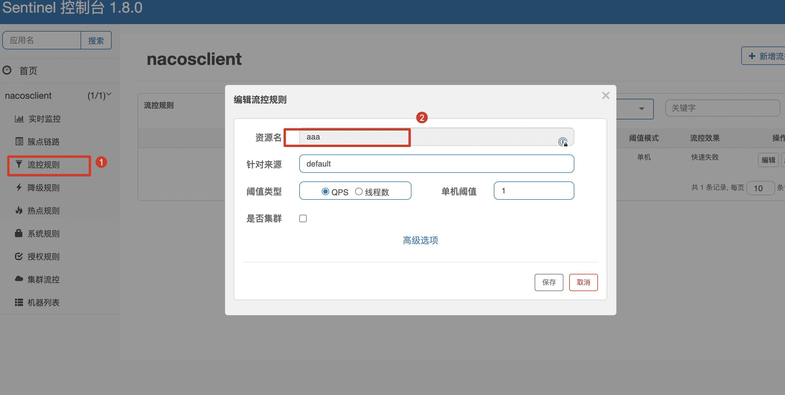

- 测试降级(注意：要先删除流控规则，否则不好测试出效果)

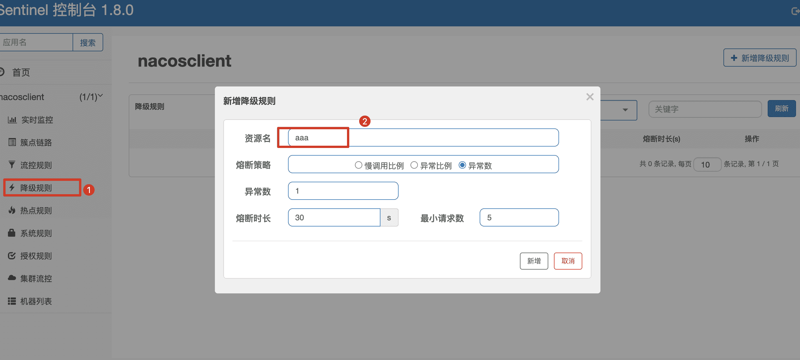


####  Fallback/FallbackClass使用

`fallback`/`fallbackClass`：fallback 函数名称，可选项，用于在抛出异常的时候提供 fallback 处理逻辑。fallback 函数可以针对所有类型的异常（除了`exceptionsToIgnore`里面排除掉的异常类型）进行处理。fallback 函数签名和位置要求：

- 返回值类型必须与原函数返回值类型一致；
- 方法参数列表需要和原函数一致，或者可以额外多一个 `Throwable` 类型的参数用于接收对应的异常。
- fallback 函数默认需要和原方法在同一个类中。若希望使用其他类的函数，则可以指定 `fallbackClass` 为对应的类的 `Class` 对象，注意对应的函数必需为 static 函数，否则无法解析。

1. 改造原来的controller

```java
/**
 * @author buubiu
 **/
@RestController
@Slf4j
public class TestController {

	@GetMapping("/test/test")
	@SentinelResource(value = "aaa",blockHandler = "testBlockHandler", fallback = "testFallBack")
	public String test(int id) {
		log.info("进入test服务！！！,传入的ID为：[{}]",id);
		if (id < 0) {
			throw new RuntimeException("非法参数！！！");
		}
		return "test服务调用成功！！！"+id;
	}

	//处理流控异常、降级异常 自定义的异常信息方法
	public String testBlockHandler(int id, BlockException blockException) {
		if (blockException instanceof FlowException) {
			return "活动异常火爆，当前请求被限流！！！" + blockException.getClass().getSimpleName();
		}
		if (blockException instanceof DegradeException) {
			return "当前服务已被降级处理，请稍好再试！！！" + blockException.getClass().getSimpleName();
		}
		return "当前服务不可用！！！";
	}
}
```

2. 添加FackBack的FallBack方法

```java
/**
 * @author buubiu
 **/
@RestController
@Slf4j
public class TestController {

	@GetMapping("/test/test")
	@SentinelResource(value = "aaa",blockHandler = "testBlockHandler", fallback = "testFallBack")
	public String test(int id) {
		log.info("进入test服务！！！,传入的ID为：[{}]",id);
		if (id < 0) {
			throw new RuntimeException("非法参数！！！");
		}
		return "test服务调用成功！！！"+id;
	}

	//处理流控异常、降级异常 自定义的异常信息方法
	public String testBlockHandler(int id, BlockException blockException) {
		if (blockException instanceof FlowException) {
			return "活动异常火爆，当前请求被限流！！！" + blockException.getClass().getSimpleName();
		}
		if (blockException instanceof DegradeException) {
			return "当前服务已被降级处理，请稍好再试！！！" + blockException.getClass().getSimpleName();
		}
		return "当前服务不可用！！！";
	}

	//处理其他异常
	public String testFallBack(int id) {
		return id + ":为非法参数，请检查后再重试！！！";
	}
}
```

3. 启动项目，测试自定义异常


