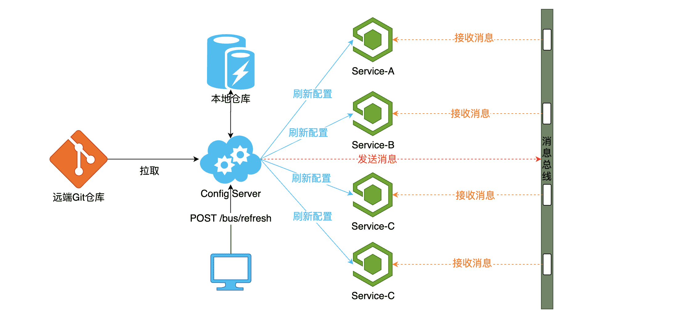
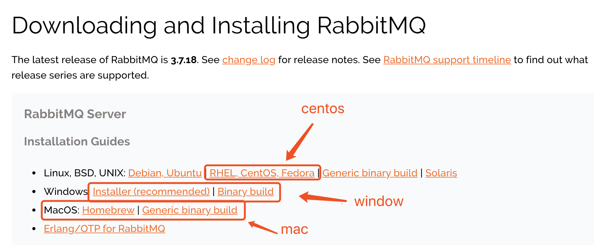
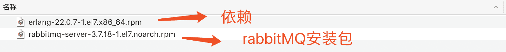
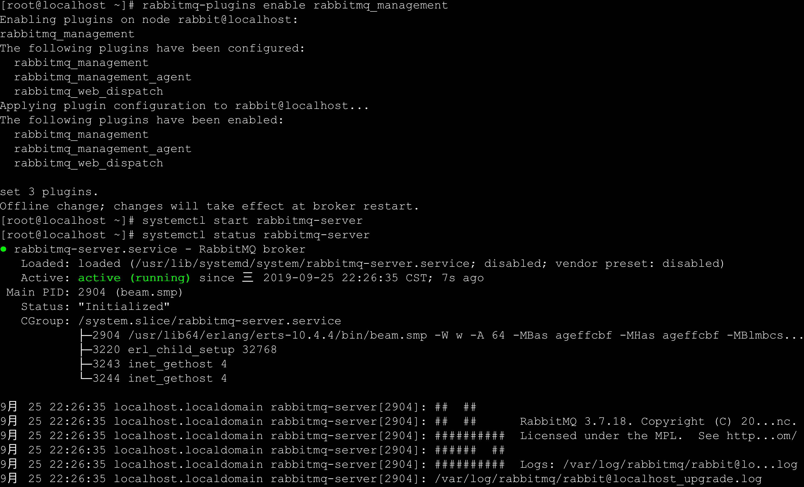
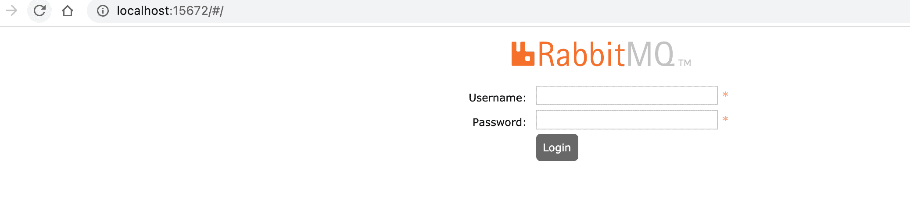
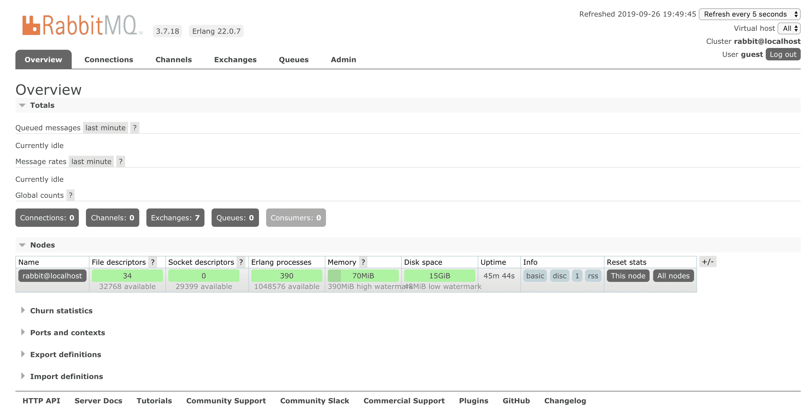
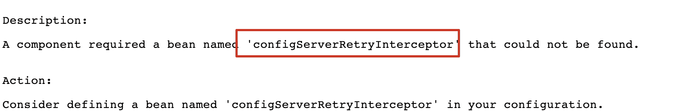
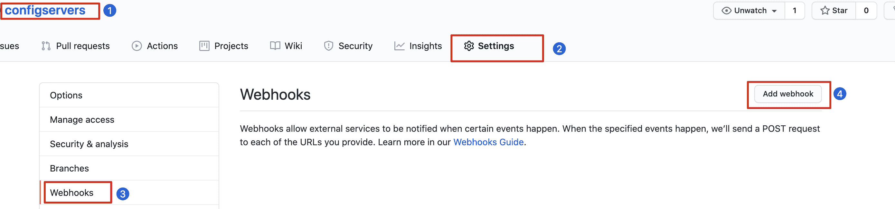
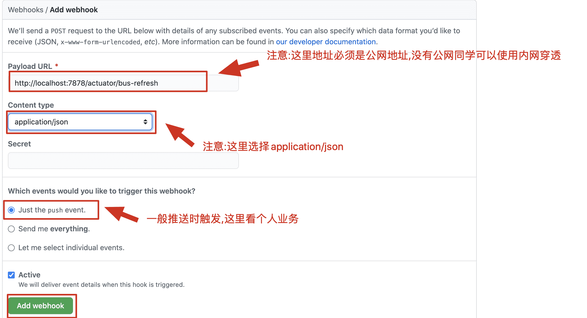

# Bus组件的使用

##  什么是Bus

官方：https://spring.io/projects/spring-cloud-bus

Spring Cloud Bus links nodes of a distributed system with a lightweight message broker. This can then be used to broadcast state changes (e.g. configuration changes) or other management instructions. AMQP and Kafka broker implementations are included with the project. Alternatively, any [Spring Cloud Stream](https://spring.io/projects/spring-cloud-stream) binder found on the classpath will work out of the box as a transport.   --摘自官网

**翻译：**springcloudbus使用轻量级消息代理将分布式系统的节点连接起来。然后，可以使用它来广播状态更改（例如配置更改）或其他管理指令。AMQP和Kafka broker实现包含在项目中。或者，在类路径上找到的任何springcloudstream绑定器都可以作为传输使用。

**通俗定义：**bus称之为springcloud中消息总线,主要用来在微服务系统中实现远端配置更新时通过广播形式通知所有客户端刷新配置信息,避免手动重启服务的工作

##  实现配置刷新原理



##  搭建RabbitMQ服务

###  下载安装包

**可以直接使用docker安装更方便**

`官网下载地址`: https://www.rabbitmq.com/download.html



> `最新版本`: 3.7.18

###  下载的安装包



> `注意`:这里的安装包是centos7安装的包

###  安装步骤

```markdown
  1.将rabbitmq安装包上传到linux系统中
	erlang-22.0.7-1.el7.x86_64.rpm
	rabbitmq-server-3.7.18-1.el7.noarch.rpm

  2.安装Erlang依赖包
	rpm -ivh erlang-22.0.7-1.el7.x86_64.rpm

  3.安装RabbitMQ安装包(需要联网)
	yum install -y rabbitmq-server-3.7.18-1.el7.noarch.rpm
		注意:默认安装完成后配置文件模板在:/usr/share/doc/rabbitmq-server-3.7.18/rabbitmq.config.example目录中,需要	
				将配置文件复制到/etc/rabbitmq/目录中,并修改名称为rabbitmq.config
  4.复制配置文件
	cp /usr/share/doc/rabbitmq-server-3.7.18/rabbitmq.config.example /etc/rabbitmq/rabbitmq.config

  5.查看配置文件位置
	ls /etc/rabbitmq/rabbitmq.config

  6.修改配置文件(参见下图:)
	vim /etc/rabbitmq/rabbitmq.config 
```

将上图中配置文件中红色部分去掉`%%`,以及最后的`,`逗号 修改为下图:

```markdown
  7.执行如下命令,启动rabbitmq中的插件管理
	rabbitmq-plugins enable rabbitmq_management
	
	出现如下说明:
		Enabling plugins on node rabbit@localhost:
    rabbitmq_management
    The following plugins have been configured:
      rabbitmq_management
      rabbitmq_management_agent
      rabbitmq_web_dispatch
    Applying plugin configuration to node rabbit@localhost...
    The following plugins have been enabled:
      rabbitmq_management
      rabbitmq_management_agent
      rabbitmq_web_dispatch

    set 3 plugins.
    Offline change; changes will take effect at broker restart.

  8.启动RabbitMQ的服务
	systemctl start rabbitmq-server
	systemctl restart rabbitmq-server
	systemctl stop rabbitmq-server
	

  9.查看服务状态(见下图:)
	systemctl status rabbitmq-server
  ● rabbitmq-server.service - RabbitMQ broker
     Loaded: loaded (/usr/lib/systemd/system/rabbitmq-server.service; disabled; vendor preset: disabled)
     Active: active (running) since 三 2019-09-25 22:26:35 CST; 7s ago
   Main PID: 2904 (beam.smp)
     Status: "Initialized"
     CGroup: /system.slice/rabbitmq-server.service
             ├─2904 /usr/lib64/erts-10.4.4/bin/beam.smp -W w -A 64 -MBas ageffcbf -MHas ageffcbf -
             MBlmbcs...
             ├─3220 erl_child_setup 32768
             ├─3243 inet_gethost 4
             └─3244 inet_gethost 4
      .........
```



```markdown
  10.关闭防火墙服务
	systemctl disable firewalld
    Removed symlink /etc/systemd/system/multi-user.target.wants/firewalld.service.
    Removed symlink /etc/systemd/system/dbus-org.fedoraproject.FirewallD1.service.
	systemctl stop firewalld   

  11.访问web管理界面
	http://localhost:15672
```

 

```markdown
  12.登录管理界面
	username:  guest
	password:  guest
```



```markdown
  13.MQ服务搭建成功
```

##  实现自动配置刷新

###  在所有项目中引入bus依赖

```xml
<!--引入bus依赖-->
<dependency>
  <groupId>org.springframework.cloud</groupId>
  <artifactId>spring-cloud-starter-bus-amqp</artifactId>
</dependency>
```

###  修改配置文件

包括统一配置中心（config server）和每个配置客户端（config client）的，由于每个配置客户端的配置在远程仓库，所以把下面配置复制到远程仓库上即可。

```properties
#mq的连接主机
spring.rabbitmq.host=localhost
#mq的连接端口(web界面是15672，TCP协议是5672)
spring.rabbitmq.port=5672
#mq的连接用户名
spring.rabbitmq.username=guest
#mq的连接密码
spring.rabbitmq.password=guest
```

###  启动config server和config client

若config client项目发现报一下错误，则是因为：springcloud新版本中（`BUG`）默认链接不到远程服务器不会报错,但是在使用bus消息总线时必须开启连接远程服务失败报错，**不过后续SpringCloud官方会修复**

**解决办法：**在config client项目的配置文件中加入下面配置

```properties
#开启连接不到远程服务器立即报错
spring.cloud.config.fail-fast=true
```




###  修改远程仓库配置后刷新配置

`修改远程配置后，只需要在统一配置中心执行post接口就可以刷新所有客户端服务的配置了`

- 修改前：


- 别忘记把config server项目配置：开启所有web端点暴漏

```properties
#开启所有web端点暴漏
management.endpoints.web.exposure.include=*
```


- 执行post请求：

```shell
curl -X POST http://localhost:7878/actuator/bus-refresh
```

- 修改后：


##  指定服务刷新配置

###  说明

默认情况下使用curl -X POST http://localhost:7878/actuator/bus-refresh这种方式刷新配置是全部广播形式,也就是所有的微服务都能接收到刷新配置通知,但有时我们修改的仅仅是某个服务的配置,这个时候对于其他服务的通知是多余的,因此就需要指定服务进行通知

###  指定服务刷新配置实现

- 指定端口刷新某个具体服务: curl -X POST http://localhost:7878/actuator/bus-refresh/configclient:9090

- 指定服务id刷新服务集群节点: curl -X POST http://localhost:7878/actuator/bus-refresh/configclient

`注意：configclient代表刷新服务的唯一标识`

##  集成webhook实现自动刷新

###  配置webhooks

1. 添加webhooks



2. 在webhooks中添加刷新配置的接口



###  解决404错误问题

在配置中心config server服务端加入过滤器进行解决(springcloud新版本中一个BUG)

```java
/**
 * @author buubiu
 **/
@Component
public class UrlFilter  implements Filter {
	@Override
	public void init(FilterConfig filterConfig) throws ServletException {

	}

	@Override
	public void doFilter(ServletRequest request, ServletResponse response, FilterChain chain) throws IOException, ServletException {
		HttpServletRequest httpServletRequest = (HttpServletRequest)request;
		HttpServletResponse httpServletResponse = (HttpServletResponse)response;

		String url = new String(httpServletRequest.getRequestURI());

		//只过滤/actuator/bus-refresh请求
		if (!url.endsWith("/bus-refresh")) {
			chain.doFilter(request, response);
			return;
		}

		//获取原始的body
		String body = readAsChars(httpServletRequest);

		System.out.println("original body:   "+ body);

		//使用HttpServletRequest包装原始请求达到修改post请求中body内容的目的
		CustometRequestWrapper requestWrapper = new CustometRequestWrapper(httpServletRequest);

		chain.doFilter(requestWrapper, response);

	}

	@Override
	public void destroy() {

	}

	private class CustometRequestWrapper extends HttpServletRequestWrapper {
		public CustometRequestWrapper(HttpServletRequest request) {
			super(request);
		}

		@Override
		public ServletInputStream getInputStream() throws IOException {
			byte[] bytes = new byte[0];
			ByteArrayInputStream byteArrayInputStream = new ByteArrayInputStream(bytes);

			return new ServletInputStream() {
				@Override
				public boolean isFinished() {
					return byteArrayInputStream.read() == -1 ? true:false;
				}

				@Override
				public boolean isReady() {
					return false;
				}

				@Override
				public void setReadListener(ReadListener readListener) {

				}

				@Override
				public int read() throws IOException {
					return byteArrayInputStream.read();
				}
			};
		}
	}

	public static String readAsChars(HttpServletRequest request)
	{

		BufferedReader br = null;
		StringBuilder sb = new StringBuilder("");
		try
		{
			br = request.getReader();
			String str;
			while ((str = br.readLine()) != null)
			{
				sb.append(str);
			}
			br.close();
		}
		catch (IOException e)
		{
			e.printStackTrace();
		}
		finally
		{
			if (null != br)
			{
				try
				{
					br.close();
				}
				catch (IOException e)
				{
					e.printStackTrace();
				}
			}
		}
		return sb.toString();
	}
}
```

在入口类加入扫描filter的注解

```java
@SpringBootApplication
@EnableDiscoveryClient
@EnableConfigServer
@ServletComponentScan("com.buubiu.filters")//扫描filters包
public class Springcloud09Configserver7878Application {

	public static void main(String[] args) {
		SpringApplication.run(Springcloud09Configserver7878Application.class, args);
	}

}
```

###  启动项目，修改远程配置并测试
