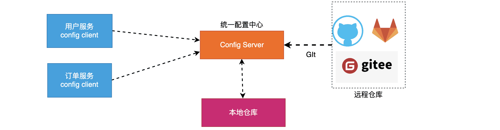
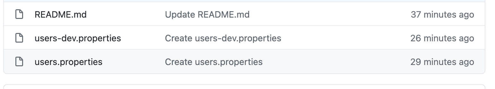
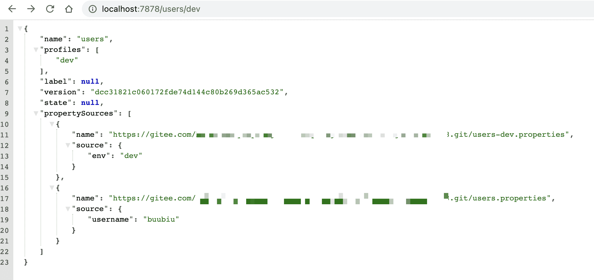
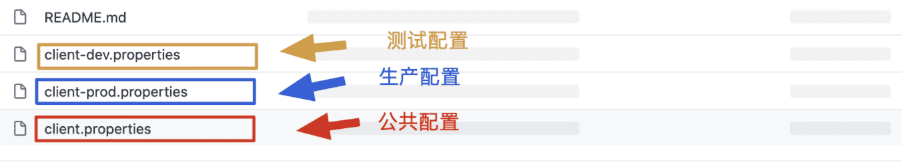
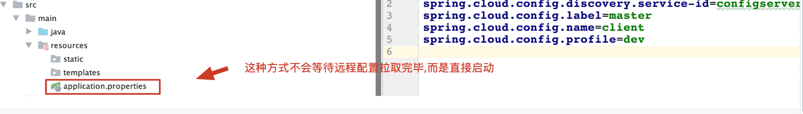
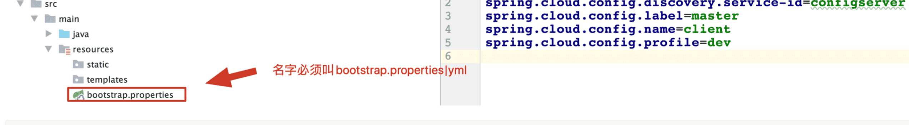

# Config组件使用

##  什么是Config

###  介绍

官方：https://spring.io/projects/spring-cloud-config

简要描述：config(配置)又称为 统一配置中心顾名思义,就是将配置统一管理,配置统一管理的好处是在日后大规模集群部署服务应用时相同的服务配置一致,日后再修改配置只需要统一修改全部同步,不需要一个一个服务手动维护。

###  统一配置中心组件流程图



##  Config Server开发

###  新建项目引入依赖

```xml
<!--引入config server 依赖-->
<dependency>
  <groupId>org.springframework.cloud</groupId>
  <artifactId>spring-cloud-config-server</artifactId>
</dependency>
```

###  在入口类开启统一配置中心服务

```java
@SpringBootApplication
@EnableConfigServer
public class Springcloud09Configserver7878Application {

	public static void main(String[] args) {
		SpringApplication.run(Springcloud09Configserver7878Application.class, args);
	}

}
```

###  修改配置文件

- `必须配置统一配置中心服务中修改配置文件指向远程仓库地址`
- 指定分支和本地仓库的位置（建议）

```properties
server.port=7878
spring.application.name=configserver
spring.cloud.consul.host=localhost
spring.cloud.consul.port=8500
spring.cloud.consul.discovery.service-name=${spring.application.name}

#必须配置远程仓库地址，否则启动失败(github有网络问题)
spring.cloud.config.server.git.uri=https://gitee.com/xxx/xxx.git
#私有仓库访问用户名
#spring.cloud.config.server.git.username=
#私有仓库访问密码
#spring.cloud.config.server.git.password=

#一定要是个空目录，因为在首次会将该目录清空
spring.cloud.config.server.git.basedir=/Users/xxx/localconfig
#指定使用远程仓库中哪个分支中的内容
spring.cloud.config.server.git.default-label=master
```

###  启动工程并拉取远程配置

####  三种方式拉取

1. http://localhost:7878/users-xxx.properties
2. http://localhost:7878/users-xxx.json
3. http://localhost:7878/users-xxx.ymal



####  拉取远程配置规则

`label/name-profiles.yml`

- `label:代表去哪个分支获取，默认使用master分支`
- `name:代表读取哪个具体的配置文件名称`
- `profiles:代表读取配置文件环境（有dev,prod,test等）`


####  查看拉取配置详情信息

http://localhost:7878/users/dev

- `users：代表远程仓库的配置名称`
- `dev：代表远程仓库的配置环境`



##  Config Client开发

###  新建项目进入依赖

```xml
<!--引入Config Client依赖-->
<dependency>
  <groupId>org.springframework.cloud</groupId>
  <artifactId>spring-cloud-starter-config</artifactId>
</dependency>
```

###  编写配置文件(application.properties)

```properties
#开启统一配置中心服务，让本客户端去远程仓库去查找配置，而不是本地
spring.cloud.config.discovery.enabled=true
#指定统一配置服务中心的服务唯一标识(consul里面的服务名称)
spring.cloud.config.discovery.service-id=configserver
#指定从仓库的哪个分支拉取配置
spring.cloud.config.label=master
#指定拉取配置文件的名称
spring.cloud.config.name=clients
#指定拉取配置文件的环境
spring.cloud.config.profile=dev
```

###  远程仓库创建配置文件

- clients.properties `【用来存放公共配置】`

```properties
spring.application.name=configclient
spring.cloud.consul.host=localhost
spring.cloud.consul.port=8500
spring.cloud.consul.discovery.service-name=${spring.application.name}
username=buubiu
```

- clients-dev.properties `【用来存放开发环境相关配置，这里以端口为例】`

```properties
server.port=7880
```

- clients-prod.properties `【用来存放生产相关配置】`

```properties
server.port=7879
```



###  启动客户端

直接启动发现启动报错

报错原因：项目中目前使用的是application.properties启动项目,使用这个配置文件在springboot项目启动过程中不会等待远程配置拉取,直接根据配置文件中内容启动,因此当需要注册中心,服务端口等信息时,远程配置还没有拉取到,所以直接报错。



**解决办法：**

应该在项目启动时先等待拉取远程配置,拉取远程配置成功之后再根据远程配置信息启动即可,为了完成上述要求springboot官方提供了一种解决方案,就是在使用统一配置中心时应该将微服务的配置文件名修改为bootstrap.(properties|yml),bootstrap.properties作为配置启动项目时,会优先拉取远程配置,远程配置拉取成功之后根据远程配置启动当前应用。



在重新启动，成功！

###  在客户端内获取远程配置

```java
/**
 * @author buubiu
 **/
@RestController
public class ClientController {

	@Value("${server.port}")
	private String port;

	@Value("${username}")
	private String username;

	@GetMapping("/client/init")
	public String init() {
		return "当前请求的端口为："+port+";username为："+username;
	}
}
```

###  访问页面


##  手动配置刷新

###  说明

在生产环境中,微服务可能非常多,每次修改完远端配置之后,不可能对所有服务进行重新启动,这个时候需要让修改配置的服务能够刷新远端修改之后的配置,从而不要每次重启服务才能生效,进一步提高微服务系统的维护效率。在springcloud中也为我们提供了手动刷新配置和自动刷新配置两种策略,这里我们先试用手动配置文件刷新。

###  在config client端加入刷新暴漏端点

```properties
#开启所有web端点暴漏
management.endpoints.web.exposure.include=*
```

###  在需要刷新代码的类中加入刷新配置的注解

```java
/**
 * @author buubiu
 **/
@RestController
@RefreshScope //刷新配置注解
public class ClientController {

	@Value("${server.port}")
	private int port;

	@Value("${username}")
	private String username;

	@GetMapping("/client/init")
	public String init() {
		return "当前请求的端口为："+port+";username为："+username;
	}
}
```

###  启动并测试


###  手动调用刷新配置接口

修改远程仓库的username值，然后执行curl命令

```shell
➜ curl -X POST http://localhost:7879/actuator/refresh
["config.client.version","username"]%   
```


