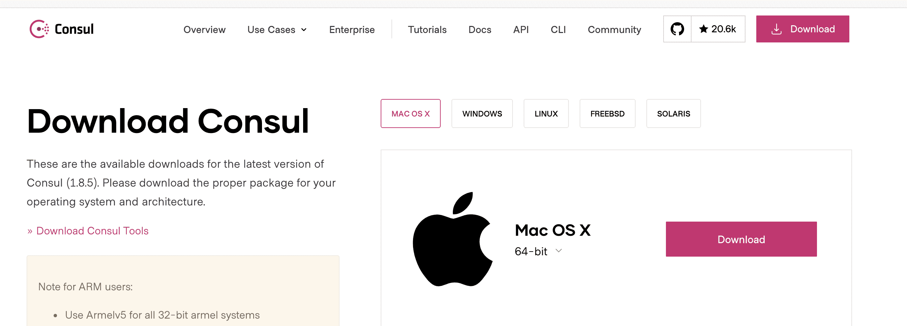
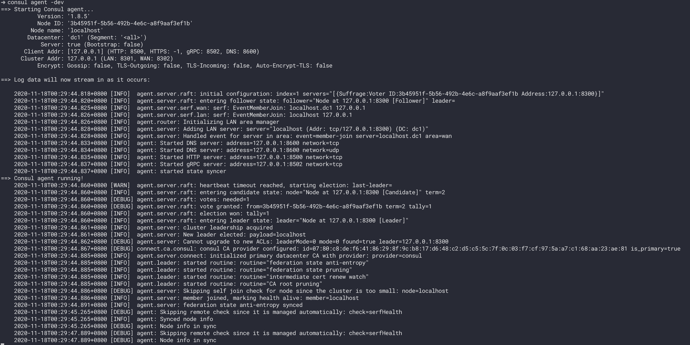
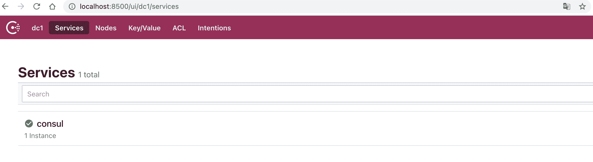
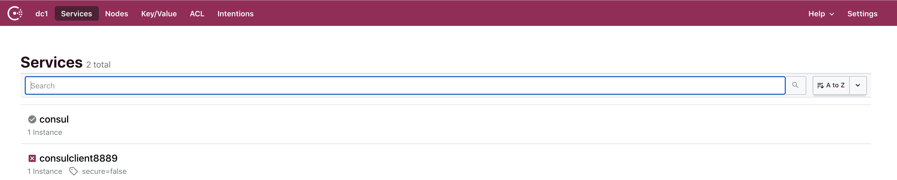
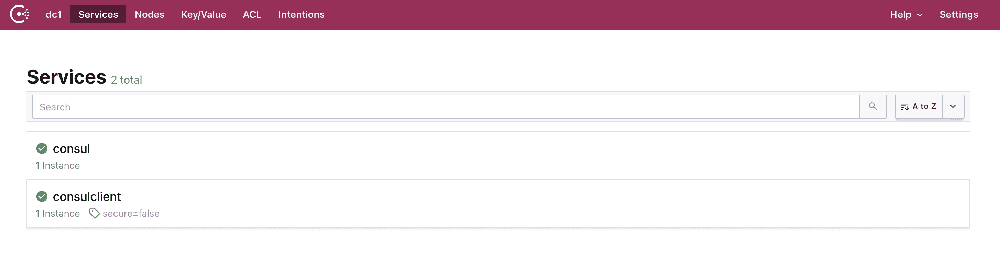

# Consul基本使用

## 简介

官网：https://www.consul.io

consul是一个可以提供服务发现，健康检查，多数据中心，Key/Value存储等功能的分布式服务框架，用于实现分布式系统的服务发现与配置。与其他分布式服务注册与发现的方案，使用起来也较为简单。Consul用Golang实现，因此具有天然可移植性(支持Linux、Windows和Mac OS X)；安装包仅包含一个可执行文件，方便部署。

## 安装consul

### 下载consul

地址：https://www.consul.io/downloads



### 安装consul

官方安装视频地址: https://learn.hashicorp.com/consul/getting-started/install.html

1. 解压之后发现consul只有一个脚本文件


2. 根据解压缩目录配置环境变量[这里是macos和linux系统配置]

   路径：`~/.bash_profile`

```shell
#consul配置
export CONSUL_HOME=/Users/buubiu/tools/consul
export PATH=$PATH:$CONSUL_HOME/
```

3. 查看consul环境变量是否配置成功,执行命令出现如下信息代表成功

   `consul -v`

```sh
Consul v1.8.5
Revision 1e03567d3
Protocol 2 spoken by default, understands 2 to 3 (agent will automatically use protocol >2 when speaking to compatible agents)
```

4. 启动consul服务

   `consul agent -dev`



5. 访问consul的web服务端口

   地址：http://localhost:8500

   `consul默认服务端口是8500`



## 开发consul客户端（即微服务）

### 创建项目并引入consul client依赖

```xml
<!--引入consul client 依赖-->
<dependency>
  <groupId>org.springframework.cloud</groupId>
  <artifactId>spring-cloud-starter-consul-discovery</artifactId>
</dependency>
```

### 编写配置

```properties
server.port=8889
spring.application.name=consulclient
#注册consul服务的主机
spring.cloud.consul.host=localhost
#注册consul服务的端口
spring.cloud.consul.port=8500
#指定注册的服务名称 默认就是应用名
spring.cloud.consul.discovery.service-name=${spring.application.name}
```

### 启动服务查看consul界面服务信息



### consul开启健康监控检查

`默认情况加consul监控健康是开启的,但是必须依赖健康监控依赖才能正确监控健康状态所以直接启动会显示错误,引入健康监控依赖之后服务正常`

```xml
<!--注意：必须引入健康检查依赖，如果没有引入这个依赖，即使服务可用，但是在consul服务注册中获取不到服务状态，consul注册中心始终认为不可用-->
<dependency>
  <groupId>org.springframework.boot</groupId>
  <artifactId>spring-boot-starter-actuator</artifactId>
</dependency>
```



### consul关闭健康监控检查（不推荐）

```properties
#关闭consul服务的健康检查（不推荐）
spring.cloud.consul.discovery.register-health-check=false
```

