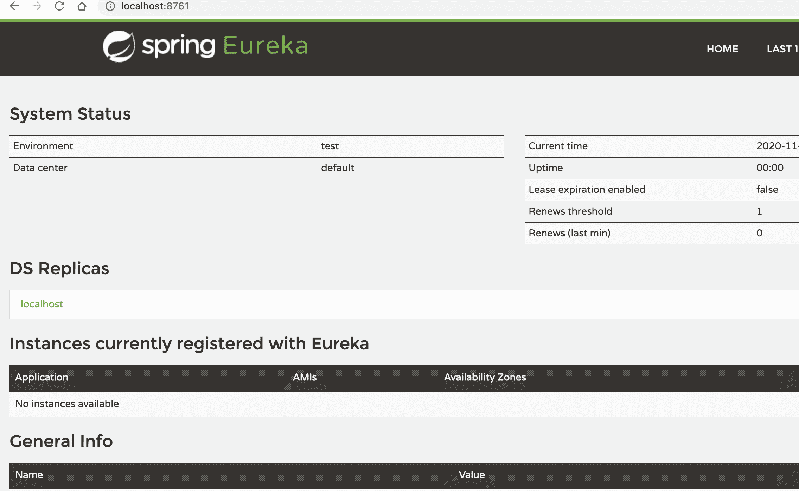
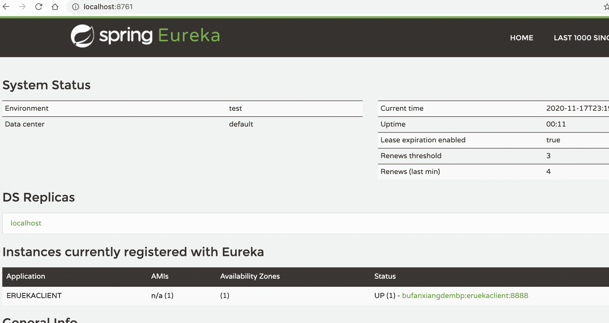
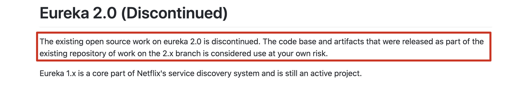

# Eureka基本使用

## 简介

官网：https://github.com/Netflix/eureka/wiki

Eureka是Netflix开发的服务发现框架，本身是一个基于REST的服务。SpringCloud将它集成在其子项目spring-cloud-netflix中，以实现SpringCloud的服务注册和发现功能。
Eureka包含两个组件：Eureka Server和Eureka Client。

## 开发Eureka Server

### 创建项目并引入eureka server依赖

```xml
<!--引入Eureka Server依赖-->
<dependency>
  <groupId>org.springframework.cloud</groupId>
  <artifactId>spring-cloud-starter-netflix-eureka-server</artifactId>
</dependency>
```

### 编写配置application.properties

```properties
#执行服务端口
server.port=8761
#指定服务名称 唯一标识
spring.application.name=eurekaserver
#指定服务注册中心的地址
eureka.client.service-url.defaultZone=http://localhost:8761/eureka
#不再将自己同时作为客户端进行注册
eureka.client.register-with-eureka=false
#关闭 作为客户端时从eureka server获取服务信息
eureka.client.fetch-registry=false
```

### 开启Eureka Server，入口类加入注解

```java
@SpringBootApplication
@EnableEurekaServer
public class Springcoud02Eurekaserver8761Application {

	public static void main(String[] args) {
		SpringApplication.run(Springcoud02Eurekaserver8761Application.class, args);
	}

}
```

### 访问页面

http://localhost:8761



## 开发Eureka Client

### 创建项目并引入eureka client依赖

```xml
<!--引入eureka client 依赖-->
<dependency>
  <groupId>org.springframework.cloud</groupId>
  <artifactId>spring-cloud-starter-netflix-eureka-client</artifactId>
</dependency>
```

### 编写配置

```properties
#服务端口号
server.port=8888
#服务名称唯一标识
spring.application.name=eruekaclient
#eureka注册中心地址
eureka.client.service-url.defaultZone=http://localhost:8761/eureka
```

### 开启Eureka Client，入口类加入注解

```java
@SpringBootApplication
@EnableEurekaClient
public class Springcloud03Eurekaclient8888Application {

	public static void main(String[] args) {
		SpringApplication.run(Springcloud03Eurekaclient8888Application.class, args);
	}

}
```

### 访问页面



## Eureka自我保护机制

服务频繁启动时 EurekaServer出现警告

`EMERGENCY! EUREKA MAY BE INCORRECTLY CLAIMING INSTANCES ARE UP WHEN THEY'RE NOT. RENEWALS ARE LESSER THAN THRESHOLD AND HENCE THE INSTANCES ARE NOT BEING EXPIRED JUST TO BE SAFE.`

### 自我保护机制

- 官网地址: https://github.com/Netflix/eureka/wiki/Server-Self-Preservation-Mode
- 默认情况下，如果Eureka Server在一定时间内（默认90秒）没有接收到某个微服务实例的心跳，Eureka Server将会移除该实例。但是当网络分区故障发生时，微服务与Eureka Server之间无法正常通信，而微服务本身是正常运行的，此时不应该移除这个微服务，所以引入了自我保护机制。Eureka Server在运行期间会去统计心跳失败比例在 15 分钟之内是否低于 85%，如果低于 85%，Eureka Server 会将这些实例保护起来，让这些实例不会过期。这种设计的哲学原理就是"宁可信其有不可信其无!"。自我保护模式正是一种针对网络异常波动的安全保护措施，使用自我保护模式能使Eureka集群更加的健壮、稳定的运行。

### 在eureka server端关闭自我保护机制（不建议）

```properties
#关闭自我保护（不建议）
eureka.server.enable-self-preservation=false
#超时3s自动清除（不建议）
eureka.server.eviction-interval-timer-in-ms=3000
```

### 在eureka client端（微服务）修改减短服务心跳的时间（不建议）

```properties
#用来修改eureka server默认接收心跳的最大时间 默认是90s（不建议）
eureka.instance.lease-expiration-duration-in-seconds=10
#指定客户端多久向eureka server发送一次心跳 默认是30s（不建议）
eureka.instance.lease-renewal-interval-in-seconds=5
```

尽管如此关闭自我保护机制还是会出现警告

`THE SELF PRESERVATION MODE IS TURNED OFF. THIS MAY NOT PROTECT INSTANCE EXPIRY IN CASE OF NETWORK/OTHER PROBLEMS.`

- **`官方并不建议在生产情况下关闭`**

## Eureka 停止更新

官方停止更新说明
- https://github.com/Netflix/eureka/wiki
- 在1.x版本项目还是活跃的,但是在2.x版本中停止维护,出现问题后果自负!!!



