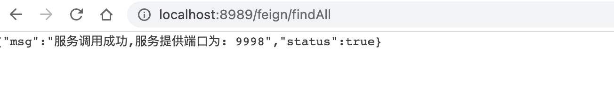
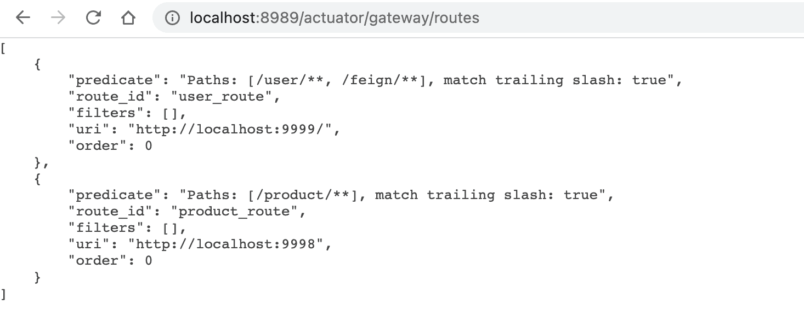
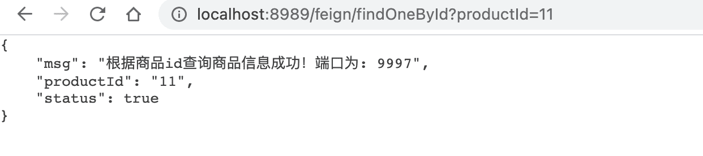
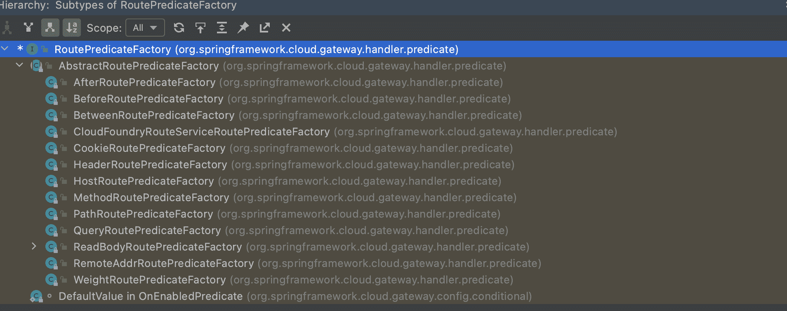
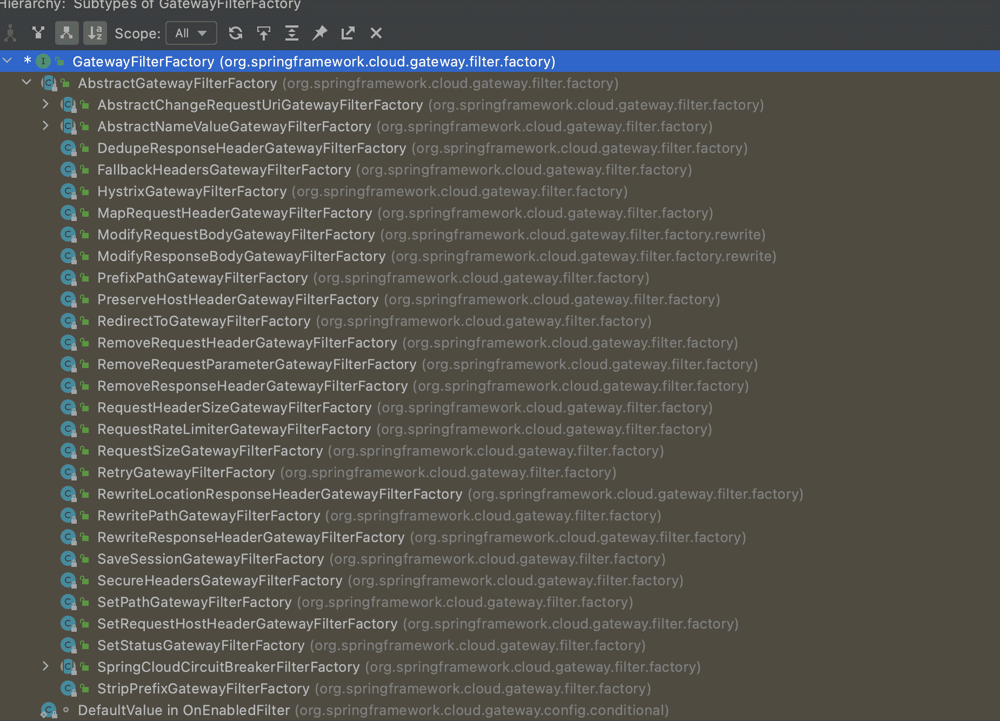
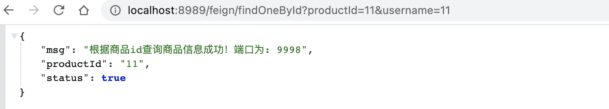
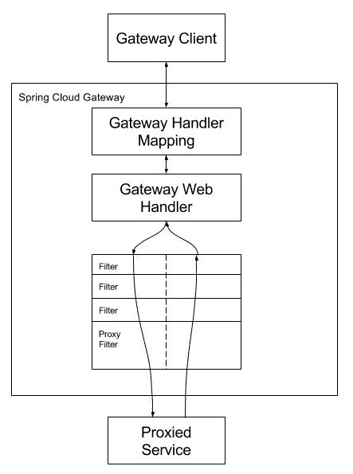

# Gateway组件的使用

##  简介

官方：https://spring.io/projects/spring-cloud-gateway

This project provides a library for building an API Gateway on top of Spring MVC. Spring Cloud Gateway aims to provide a simple, yet effective way to route to APIs and provide cross cutting concerns to them such as: security, monitoring/metrics, and resiliency.

**翻译：**这个项目提供了一个在springmvc之上构建API网关的库。springcloudgateway旨在提供一种简单而有效的方法来路由到api，并为api提供横切关注点，比如：安全性、监控/度量和弹性。

##  特性

基于springboot2.x 和 spring webFlux 和 Reactor 构建 响应式异步非阻塞IO模型
- 动态路由
- 请求过滤

##  开发网关动态路由

###  配置方式

创建项目引入网关依赖

```xml
<!--引入gateway网关依赖-->
<dependency>
  <groupId>org.springframework.cloud</groupId>
  <artifactId>spring-cloud-starter-gateway</artifactId>
</dependency>
<!--引入consul依赖-->
<dependency>
  <groupId>org.springframework.cloud</groupId>
  <artifactId>spring-cloud-starter-consul-discovery</artifactId>
</dependency>
<!--引入actuator 健康检查依赖-->
<dependency>
  <groupId>org.springframework.boot</groupId>
  <artifactId>spring-boot-starter-actuator</artifactId>
</dependency>
```

####  快捷方式配置路由`（推荐）`

修改配置文件

```yaml
spring:
  application:
    name: gateway
  cloud:
    consul:
      host: localhost
      port: 8500
    gateway:
      routes:
        - id: user_route #指定路由唯一标识
          uri: http://localhost:9999/ #指定路由服务的地址
          predicates:
            - Path=/user/**,/feign/** #指定路由规则
        - id: product_route
          uri: http://localhost:9998
          predicates:
            - Path=/product/**
server:
  port: 8989
```

启动工程，并访问测试

http://localhost:8989/feign/findAll



####  Java方式配置路由

开发Java类并注解

```java
/**
 * @author buubiu
 **/
@Configuration
public class GatewayConfig {

	@Bean
	public RouteLocator customRouteLocator(RouteLocatorBuilder builder) {
		return builder.routes()
				.route("user_route",r -> r.path("/user/**","/feign/**").uri("http://localhost:9999/"))
				.route("product_route",r -> r.path("/product/**").uri("http://localhost:9998/"))
				.build();
	}
}
```

启动工程，并访问测试

http://localhost:8989/feign/findAll


##  查看网关路由规则列表

###  介绍

gateway提供了路由访问规则列表的web界面，但是默认是关闭的，如果想要查看服务器路由规则可以在配置文件中开启

###  开启路由规则列表

```yaml
spring:
  application:
    name: gateway
  cloud:
    consul:
      host: localhost
      port: 8500
    gateway:
      routes:
        - id: user_route #指定路由唯一标识
          uri: http://localhost:9999/ #指定路由服务的地址
          predicates:
            - Path=/user/**,/feign/** #指定路由规则
        - id: product_route
          uri: http://localhost:9998
          predicates:
            - Path=/product/**

server:
  port: 8989

#开启所有web端点暴露
management:
  endpoints:
    web:
      exposure:
        include: "*"
```

###  访问路由管理列表地址

http://localhost:8989/actuator/gateway/routes



##  配置路由服务负载均衡

###  介绍

现有路由配置方式，都是基于服务地址写死的路由转发，能不能根据服务名称进行路由转发的同时实现负载均衡呢？

###  动态路由以及负载均衡转发配置

```yaml
spring:
  application:
    name: gateway
  cloud:
    consul:
      host: localhost
      port: 8500
    gateway:
      routes:
        - id: user_route #指定路由唯一标识
          #uri: http://localhost:9999/ #指定路由服务的地址
          uri: lb://users #lb(loadbalance): 代表转发后服务使用负载均衡，users代表服务注册中心上的服务名
          predicates:
            - Path=/user/**,/feign/** #指定路由规则
        - id: product_route
          #uri: http://localhost:9998
          uri: lb://products
          predicates:
            - Path=/product/**
      discovery:
        locator:
          enabled: true #若想使用服务名进行负载均衡，必须开启根据服务名动态获取路由

server:
  port: 8989

#开启所有web端点暴露
management:
  endpoints:
    web:
      exposure:
        include: "*"
```

###  访问页面并进行测试

http://localhost:8989/feign/findOneById?productId=11



##  常用路由predicate（断言，验证）

###  Gateway支持多种方式的predicate



###  使用predicate

修改配置文件

```yaml
spring:
  application:
    name: gateway
  cloud:
    consul:
      host: localhost
      port: 8500
    gateway:
      routes:
        - id: user_route #指定路由唯一标识
          #uri: http://localhost:9999/ #指定路由服务的地址
          uri: lb://users #lb(loadbalance): 代表转发后服务使用负载均衡，users代表服务注册中心上的服务名
          predicates:
            - Path=/user/**,/feign/** #指定路由规则
             - After=2020-11-23T11:39:33.993+08:00[Asia/Shanghai]
             - Before=2020-11-23T11:39:33.993+08:00[Asia/Shanghai]
             - Between=2020-07-21T11:39:33.993+08:00[Asia/Shanghai],2020-07-21T11:39:33.993+08:00[Asia/Shanghai]
             - Cookie=username,buubiu
             - Cookie=username,[A-Za-z0-9]+
             - Header=X-Request-Id,\id+
        - id: product_route
          #uri: http://localhost:9998
          uri: lb://products
          predicates:
            - Path=/product/**
      discovery:
        locator:
          enabled: true #若想使用服务名进行负载均衡，必须开启根据服务名动态获取路由

server:
  port: 8989

#开启所有web端点暴露
management:
  endpoints:
    web:
      exposure:
        include: "*"
```

###  常用断言说明

官方：https://docs.spring.io/spring-cloud-gateway/docs/2.2.5.RELEASE/reference/html/#gateway-request-predicates-factories

```markdown
`指定日期之后的请求进行路由`
- After=2020-07-21T11:33:33.993+08:00[Asia/Shanghai]  		

`指定日期之前的请求进行路由`
- Before=2020-07-21T11:33:33.993+08:00[Asia/Shanghai]      

`指定日期之间的请求进行路由`
- Between=2017-01-20T17:42:47.789-07:00[America/Denver], 2017-01-21T17:42:47.789-07:00[America/Denver]

`基于指定cookie的请求进行路由（支持正则表达式）`
- Cookie=username,chenyn																		
- Cookie=username,[A-Za-z0-9]+															
例如：	`curl http://localhost:8989/user/findAll --cookie "username=zhangsna"`
	
`基于请求头中的指定属性的正则匹配路由(这里全是整数)`
- Header=X-Request-Id, \d+																 
例如：	`curl http://localhost:8989/user/findAll -H "X-Request-Id:11"`
	
`基于指定的请求方式请求进行路由`
- Method=GET,POST																						 
```

##  常用的Filter以及自定义Filter

###  介绍

官方：https://docs.spring.io/spring-cloud-gateway/docs/2.2.5.RELEASE/reference/html/#gatewayfilter-factories

Route filters allow the modification of the incoming HTTP request or outgoing HTTP response in some manner. Route filters are scoped to a particular route. Spring Cloud Gateway includes many built-in GatewayFilter Factories.

**翻译：**路由过滤器允许以某种方式修改传入的HTTP请求或传出的HTTP响应。路由筛选器的作用域是特定路由。springcloudgateway包括许多内置的GatewayFilter工厂。

**作用：**当我们有很多个服务时，比如下图中的user-service、order-service、product-service等服务，客户端请求各个服务的Api时，每个服务都需要做相同的事情，比如鉴权、限流、日志输出等。


###  使用内置过滤器

官方：https://docs.spring.io/spring-cloud-gateway/docs/2.2.5.RELEASE/reference/html/#gatewayfilter-factories



**使用方法：**在配置文件添加fileters配置

```yaml
spring:
  application:
    name: gateway
  cloud:
    consul:
      host: localhost
      port: 8500
    gateway:
      routes:
        - id: user_route #指定路由唯一标识
          #uri: http://localhost:9999/ #指定路由服务的地址
          uri: lb://users #lb(loadbalance): 代表转发后服务使用负载均衡，users代表服务注册中心上的服务名
          predicates:
            - Path=/user/**,/feign/** #指定路由规则
             - After=2020-11-23T11:39:33.993+08:00[Asia/Shanghai]
             - Before=2020-11-23T11:39:33.993+08:00[Asia/Shanghai]
             - Between=2020-07-21T11:39:33.993+08:00[Asia/Shanghai],2020-07-21T11:39:33.993+08:00[Asia/Shanghai]
             - Cookie=username,buubiu
             - Cookie=username,[A-Za-z0-9]+
             - Header=X-Request-Id,\id+
          filters:
            - AddRequestParameter=productId,12
            - AddResponseHeader=username,buubiu

        - id: product_route
          #uri: http://localhost:9998
          uri: lb://products
          predicates:
            - Path=/product/**
      discovery:
        locator:
          enabled: true #若想使用服务名进行负载均衡，必须开启根据服务名动态获取路由

server:
  port: 8989

#开启所有web端点暴露
management:
  endpoints:
    web:
      exposure:
        include: "*"
```

###  自定义Filter的使用

####  书写自定义filter类

```java
/**
 * @author buubiu
 * 自定义全局Filter
 * 		作用：在进入所有路由转发之前都要经过，而内置filter只是针对某一个路由转发拦截的
 **/
@Configuration
@Slf4j
public class CustomGlobalFilter implements GlobalFilter, Ordered {

	@Override
	public Mono<Void> filter(ServerWebExchange exchange, GatewayFilterChain chain) {
		log.info("进入自定义的filter");
		if (exchange.getRequest().getQueryParams().get("username") != null) {
			log.info("用户身份信息合法，放行请求继续执行！！！");
			return chain.filter(exchange);
		}
		log.info("非法用户，拒绝访问！！！");
		return exchange.getResponse().setComplete();
	}

	//filter 数字越小越先执行
	//-1 最先执行
	@Override
	public int getOrder() {
		return -1;
	}
}
```

####  访问页面并测试请求



##  predicate(断言),filte(过滤),route(路由)三者关系

数据请求流程：

`predicate-->filte-->route`

`先经过断言，放行后在经过filter，最后才到路由转发，返回时原路返回。类似于栈`



其中，web Handler相当于断言（predicate）
