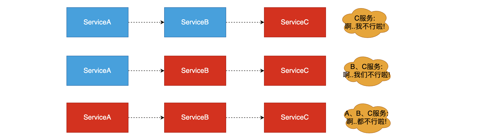
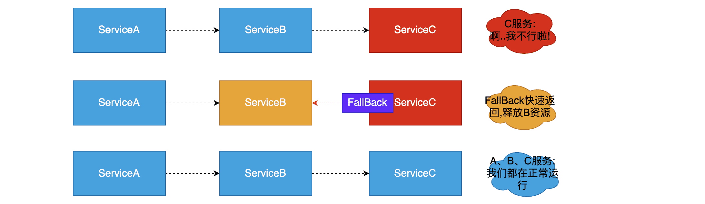
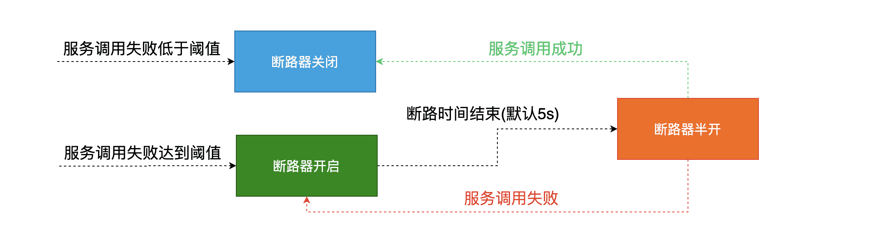
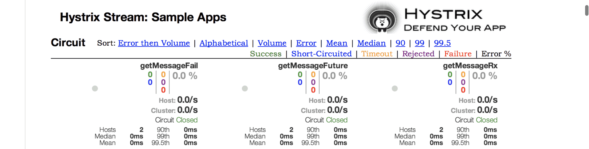
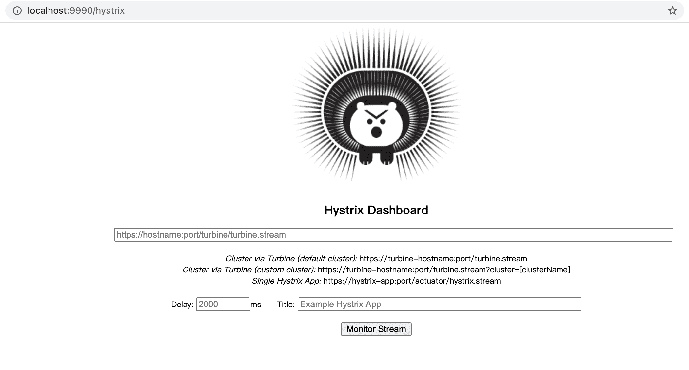
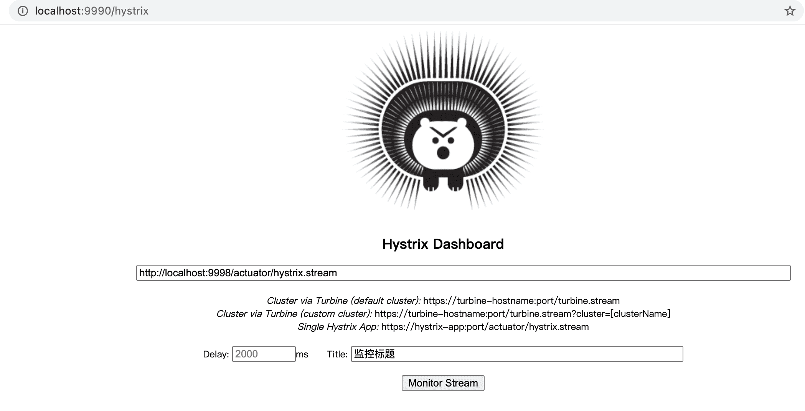
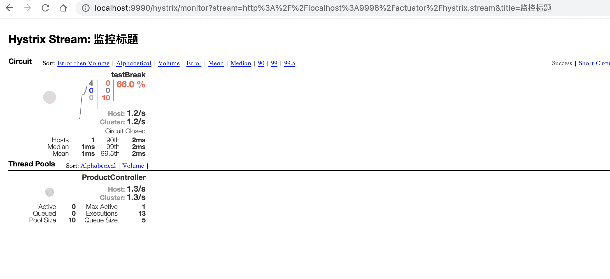

# Hystrix组件使用


In a distributed environment, inevitably some of the many service dependencies will fail. Hystrix is a library that helps you control the interactions between these distributed services by adding latency tolerance and fault tolerance logic. Hystrix does this by isolating points of access between the services, stopping cascading failures across them, and providing fallback options, all of which improve your system’s overall resiliency.														--[摘自官方]

## 介绍

官方：https://github.com/Netflix/Hystrix

**翻译**: 在分布式环境中，许多服务依赖项不可避免地会失败。Hystrix是一个库，它通过添加延迟容忍和容错逻辑来帮助您控制这些分布式服务之间的交互。Hystrix通过隔离服务之间的访问点、停止它们之间的级联故障以及提供后备选项来实现这一点，所有这些都可以提高系统的整体弹性。

**通俗定义**: Hystrix是一个用于处理分布式系统的延迟和容错的开源库，在分布式系统中，许多依赖不可避免的会调用失败，超时、异常等，Hystrix能够保证在一个依赖出问题的情况下，不会导致整体服务失败，避免级联故障(服务雪崩现象)，提高分布式系统的弹性。

## 服务雪崩

### 定义

在微服务之间进行服务调用是由于某一个服务故障，导致级联服务故障的现象，称为雪崩效应。雪崩效应描述的是提供方不可用，导致消费方不可用并将不可用逐渐放大的过程。

### 图解雪崩效应

如存在如下图调用链路：


而此时，Service A的流量波动很大，流量经常会突然性增加！那么在这种情况下，就算Service A能扛得住请求，Service B和Service C未必能扛得住这突发的请求。此时，如果Service C因为抗不住请求，变得不可用。那么Service B的请求也会阻塞，慢慢耗尽Service B的线程资源，Service B就会变得不可用。紧接着，Service A也会不可用，这一过程如下图所示



## 解决方法

### 服务熔断

#### 定义

“熔断器”本身是一种开关装置，当某个服务单元发生故障之后，通过断路器的故障监控，某个异常条件被触发，直接熔断整个服务。向调用方法返回一个符合预期的、可处理的备选响应(FallBack),而不是长时间的等待或者抛出调用方法无法处理的异常，就保证了服务调用方的线程不会被长时间占用，避免故障在分布式系统中蔓延，乃至雪崩。如果目标服务情况好转则恢复调用。服务熔断是解决服务雪崩的重要手段。

#### 服务熔断图示



### 服务降级

#### 定义

服务压力剧增的时候根据当前的业务情况及流量对一些服务和页面有策略的降级，以此缓解服务器的压力，以保证核心任务的进行。同时保证部分甚至大部分任务客户能得到正确的相应。也就是当前的请求处理不了了或者出错了，给一个默认的返回。

**通俗**: 关闭系统中边缘服务 保证系统核心服务的正常运行  称之为服务降级

#### 服务降级图示


### 熔断和降级总结

#### 共同点

- 目的很一致，都是从可用性可靠性着想，为防止系统的整体缓慢甚至崩溃，采用的技术手段；
- 最终表现类似，对于两者来说，最终让用户体验到的是某些功能暂时不可达或不可用；
- 粒度一般都是服务级别，当然，业界也有不少更细粒度的做法，比如做到数据持久层（允许查询，不允许增删改）；
- 自治性要求很高，熔断模式一般都是服务基于策略的自动触发，降级虽说可人工干预，但在微服务架构下，完全靠人显然不可能，开关预置、配置中心都是必要手段；

#### 异同点

- 触发原因不太一样，服务熔断一般是某个服务（下游服务）故障引起，而服务降级一般是从整体负荷考虑；
- 管理目标的层次不太一样，熔断其实是一个框架级的处理，每个微服务都需要（无层级之分），而降级一般需要对业务有层级之分（比如降级一般是从最外围服务开始）

#### 总结

- 熔断必会触发降级,所以熔断也是降级一种,区别在于熔断是对调用链路的保护,而降级是对系统过载的一种保护处理

## 服务熔断的实现（在服务提供者实现）

### 项目中引入hystrix依赖

```xml
<!--引入hystrix依赖-->
<dependency>
  <groupId>org.springframework.cloud</groupId>
  <artifactId>spring-cloud-starter-netflix-hystrix</artifactId>
</dependency>
```

### 修改启动类开启断路器

```java
@SpringBootApplication
@EnableCircuitBreaker //用来开启断路器
public class Springcloud05Products9998Application {

	public static void main(String[] args) {
		SpringApplication.run(Springcloud05Products9998Application.class, args);
	}

}
```

### 使用HystrixCommand注解实现断路

在服务提供者的业务类中添加：

```java
/**
 * @author buubiu
 **/
@RestController
@Slf4j
public class ProductController {

	//模拟熔断器
	@GetMapping("/product/break")
	@HystrixCommand(fallbackMethod = "testBreakFall")
	public String testBreak(Integer productId) {
		log.info("接收的商品productId为：[{}]", productId);
		if (productId < 0) {
			throw new RuntimeException("数据不合法");
		}
		return "当前接收商品productId为："+ productId;
	}

	public String testBreakFall(Integer productId){
		return "当前数据不合法: "+productId;
	}
}
```

### 访问测试

- 正常参数访问


- 错误参数访问


### 断路器打开条件

从上面演示过程中会发现如果触发一定条件断路器会自动打开,过了一点时间正常之后又会关闭。那么断路器打开条件是什么呢？

官方：https://cloud.spring.io/spring-cloud-netflix/2.2.x/reference/html/#circuit-breaker-spring-cloud-circuit-breaker-with-hystrix

A service failure in the lower level of services can cause cascading failure all the way up to the user. When calls to a particular service exceed `circuitBreaker.requestVolumeThreshold` (default: 20 requests) and the failure percentage is greater than `circuitBreaker.errorThresholdPercentage` (default: >50%) in a rolling window defined by `metrics.rollingStats.timeInMilliseconds` (default: 10 seconds), the circuit opens and the call is not made. In cases of error and an open circuit, a fallback can be provided by the developer.																		--摘自官方

原文翻译之后,总结`打开关闭的条件`:
1. 当满足一定的阀值的时候（默认10秒内超过20个请求次数）

2. 当失败率达到一定的时候（默认10秒内超过50%的请求失败）

3. 到达以上阀值，断路器将会开启

4. 当开启的时候，所有请求都不会进行转发

5. 一段时间之后（默认是5秒），这个时候断路器是半开状态，会让其中一个请求进行转发。如果成功，断路器会关闭，若失败，继续开启。重复4和5。



### 默认的服务FallBack处理方法

如果为每一个服务方法开发一个降级,对于我们来说,可能会出现大量的代码的冗余,不利于维护,这个时候就需要加入默认服务降级处理方法

```java
/**
 * @author buubiu
 **/
@RestController
@Slf4j
public class ProductController {

	//模拟熔断器
	@GetMapping("/product/break")
	//@HystrixCommand(fallbackMethod = "testBreakFall")
	@HystrixCommand(defaultFallback = "defaultBreakFall")
	public String testBreak(Integer productId) {
		log.info("接收的商品productId为：[{}]", productId);
		if (productId < 0) {
			throw new RuntimeException("数据不合法");
		}
		return "当前接收商品productId为："+ productId;
	}

	public String defaultBreakFall() {
		return "当前服务已被熔断，暂时不可用！";
	}
}
```

## 服务降级的实现（在服务消费者实现）

### 引入hystrix依赖

```xml
<!--引入hystrix依赖-->
<dependency>
  <groupId>org.springframework.cloud</groupId>
  <artifactId>spring-cloud-starter-netflix-hystrix</artifactId>
</dependency>
```

### 配置文件开启feign支持hystrix

```properties
#开启feign支持hystrix
feign.hystrix.enabled=true
```

### 开发fallback处理类

必须要实现OpenFeign客户端接口

```java
/**
 * @author buubiu
 **/
@Component
public class ProductClientFallBack implements ProductClient {

	@Override
	public String testBreak(Integer productId) {
		return "当前根据查询所有不可用，服务已被降级！";
	}
}
```

### 在OpenFeign客户端中加入Hystrix

`fallback = ProductClientFallBack.class`

```java
/**
 * @author buubiu
 **/
//用来标识当前接口是一个 feign 组件
//value:书写调用服务serviceId(服务名称)
//fallback:用来指定服务降级的客户端实现类
@FeignClient(value = "products",fallback = ProductClientFallBack.class)
public interface ProductClient {
	@GetMapping("/product/break")
	String testBreak(Integer productId);
}
```

### 访问测试

- 正常参数访问


- 错误参数访问


`注意：`

`1. 如果服务端熔断和客户端降级同时开启,要求服务端熔断方法的返回值必须与客户端方法降级的返回值一致!!`

`2. 如果服务端熔断和客户端降级同时开启,熔断的优先级高于降级的优先级，所以上面错误返回的数据是服务熔断的!!`

## Hystrix Dashboard使用

### 介绍

Hystrix Dashboard的一个主要优点是它收集了关于每个HystrixCommand的一组度量。Hystrix仪表板以高效的方式显示每个断路器的运行状况。



### 使用方法

#### 新建项目引入hystrix dashboard 依赖

```xml
<!--引入 hystrix dashboard 依赖-->
<dependency>
  <groupId>org.springframework.cloud</groupId>
  <artifactId>spring-cloud-starter-netflix-hystrix-dashboard</artifactId>
</dependency>
```

#### 入口类中开启hystrix dashboard

```java
@SpringBootApplication
@EnableHystrixDashboard //开启监控面板
public class Springcloud07Hystrixdashboard9990Application {

	public static void main(String[] args) {
		SpringApplication.run(Springcloud07Hystrixdashboard9990Application.class, args);
	}

}
```

#### 启动hystrix dashboard 应用，并访问

http://localhost:9990/hystrix



#### 修改仪表盘项目的配置文件

```properties
#允许监控的白名单，这里代表全部监控
hystrix.dashboard.proxy-stream-allow-list=*
```

#### 修改被监控项目的配置文件

```properties
#熔断监控配置
management.endpoints.web.exposure.include=*
```

#### 通过监控界面监控

- 填写监控路径：http://localhost:9998/actuator/hystrix.stream



- 点击 Monitor Stream 查看控制台

  当发起服务调用时，控制台就会显示结果：



## Hystrix 和 Hystrix Dashboard停止维护

官方：https://github.com/Netflix/Hystrix

Hystrix is no longer in active development, and is currently in maintenance mode.

Hystrix (at version 1.5.18) is stable enough to meet the needs of Netflix for our existing applications. Meanwhile, our focus has shifted towards more adaptive implementations that react to an application’s real time performance rather than pre-configured settings (for example, through [adaptive concurrency limits](https://medium.com/@NetflixTechBlog/performance-under-load-3e6fa9a60581)). For the cases where something like Hystrix makes sense, we intend to continue using Hystrix for existing applications, and to leverage open and active projects like [resilience4j](https://github.com/resilience4j/resilience4j) for new internal projects. We are beginning to recommend others do the same.            --[官方说明]

**翻译:**Hystrix（版本1.5.18）足够稳定，可以满足Netflix对我们现有应用程序的需求。同时，我们的重点已经转移到对应用程序的实时性能作出反应的更具适应性的实现，而不是预先配置的设置（例如，通过自适应并发限制）。对于像Hystrix这样的东西有意义的情况，我们打算继续在现有的应用程序中使用Hystrix，并在新的内部项目中利用诸如resilience4j这样的开放和活跃的项目。我们开始建议其他人也这样做。

The hystrix-dashboard component of this project has been deprecated and moved to [Netflix-Skunkworks/hystrix-dashboard](https://github.com/Netflix-Skunkworks/hystrix-dashboard). Please see the README there for more details including important security considerations.                                             ---[官方说明]

**翻译：**该项目的hystrix-dashboard组件已被弃用，并移至Netflix-Skunkworks / hystrix-dashboard。请参阅自述文件以获取更多详细信息，包括重要的安全注意事项。

