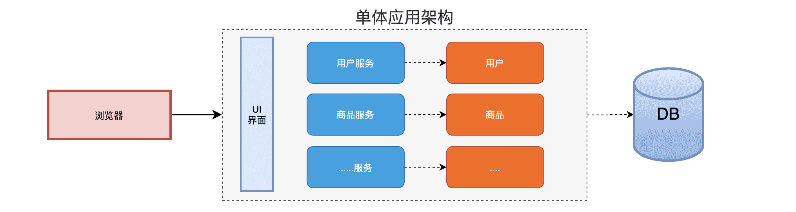
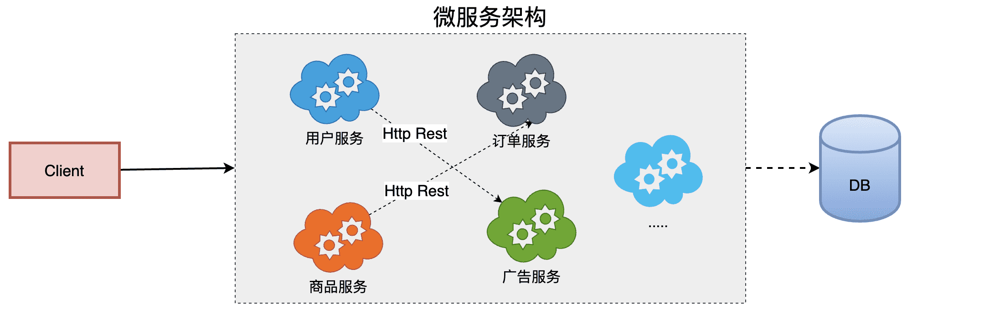

# 微服务介绍

- 版本：Hoxton SR9

In short, the microservice architectural style is an approach to developing a single application as `a suite of small services(一系列微小服务)`, each `running in its own process(运行在自己的进程里)` and communicating with lightweight mechanisms, often an HTTP resource API. These services are `built around business capabilities(围绕自己的业务开发)` and `independently deployable(独立部署)` by fully automated deployment machinery. `There is a bare minimum of centralized management of these services(基于分布式管理)`, which may be written in different programming languages and use different data storage technologies.                        -----[摘自官网]

## 什么是微服务

- 官方定义:

  **微服务就是由一系列围绕自己业务开发的微小服务构成,他们独立部署运行在自己的进程里,基于分布式的管理**

- 通俗定义:

  **微服务是一种架构，这种架构是将单个的整体应用程序分割成更小的项目关联的独立的服务。一个服务通常实现一组独立的特性或功能，包含自己的业务逻辑和适配器。各个微服务之间的关联通过暴露api来实现。这些独立的微服务不需要部署在同一个虚拟机，同一个系统和同一个应用服务器中。**

## 为什么是微服务

### 单体应用

1. 优点
   - 单一架构模式在项目初期很小的时候开发方便，测试方便，部署方便，运行良好。
2. 缺点
   - 应用随着时间的推进，加入的功能越来越多，最终会变得巨大，一个项目中很有可能数百万行的代码，互相之间繁琐的jar包。
   - 久而久之，开发效率低，代码维护困难
   - 还有一个如果想整体应用采用新的技术，新的框架或者语言，那是不可能的。
   - 任意模块的漏洞或者错误都会影响这个应用，降低系统的可靠性

### 微服务架构应用

1. 优点

   - 将服务拆分成多个单一职责的小的服务，进行单独部署，服务之间通过网络进行通信

   - 每个服务应该有自己单独的管理团队，高度自治
   - 服务各自有自己单独的职责，服务之间松耦合，避免因一个模块的问题导致服务崩溃

2. 缺点
   - 开发人员要处理分布式系统的复杂性
   - 多服务运维难度，随着服务的增加，运维的压力也在增大
   - 服务治理 和 服务监控 关键

## 架构的演变

**架构的演变过程**

[单一应用架构] `===>` [垂直应用架构] `===>` [分布式服务架构] `===>` [流动计算架构]||[微服务架构] `===>` [未知]

### All in One Application 单一架构

`起初当网站流量很小时,将所有功能都写在一个应用里面,对整个应用进行部署,以减少部署节点和成本。对于这个架构简化增删改查的工作量的数据访问框架（ORM）是关键。`

### Vertical Application 垂直架构

`当访问量逐渐增大，单一应用增加机器带来的加速度越来越小，提升效率的方法之一是将应用拆成互不相干的几个应用，以提升效率。此时，用于加速前端页面开发的Web框架(MVC)是关键。`

### Distributed Service  分布式服务架构

`当垂直应用越来越多，应用之间交互不可避免，将核心业务抽取出来，作为独立的服务，逐渐形成稳定的服务中心，使前端应用能更快速的响应多变的市场需求。此时，用于提高业务复用及整合的分布式服务框架(RPC)是关键。`

### Elastic Computin 流动计算架构即微服务架构

`当服务越来越多，容量的评估，小服务资源的浪费等问题逐渐显现，此时需增加一个调度中心基于访问压力实时管理集群容量，提高集群利用率。此时，用于提高机器利用率的资源调度和治理中心(SOA)是关键`

## 微服务的解决方案

### Dubbo(阿里系)

1. 初出茅庐:2011年末，阿里巴巴在GitHub上开源了基于Java的分布式服务治理框架Dubbo，之后它成为了国内该类开源项目的佼佼者，许多开发者对其表示青睐。同时，先后有不少公司在实践中基于Dubbo进行分布式系统架构，目前在GitHub上，它的fork、star数均已破万。Dubbo致力于提供高性能和透明化的RPC远程服务调用方案，以及SOA服务治理方案，使得应用可通过高性能RPC实现服务的输出、输入功能和Spring框架无缝集成。Dubbo包含远程通讯、集群容错和自动发现三个核心部分。

2. 停止维护:从2012年10月23日Dubbo 2.5.3发布后，在Dubbo开源将满一周年之际，阿里基本停止了对Dubbo的主要升级。只在之后的2013年和2014年更新过2次对Dubbo 2.4的维护版本，然后停止了所有维护工作。Dubbo对Srping的支持也停留在了Spring 2.5.6版本上。

3. 死而复生:多年漫长的等待，随着微服务的火热兴起，在国内外开发者对阿里不再升级维护Dubbo的吐槽声中，阿里终于开始重新对Dubbo的升级和维护工作。在2017年9月7日，阿里发布了Dubbo的2.5.4版本，距离上一个版本2.5.3发布已经接近快5年时间了。在随后的几个月中，阿里Dubbo开发团队以差不多每月一版本的速度开始快速升级迭代，修补了Dubbo老版本多年来存在的诸多bug，并对Spring等组件的支持进行了全面升级。

4. 2018年1月8日，Dubbo创始人之一梁飞在Dubbo交流群里透露了Dubbo 3.0正在动工的消息。Dubbo 3.0内核与Dubbo 2.0完全不同，但兼容Dubbo 2.0。Dubbo 3.0将以Streaming为内核，不再是Dubbo 时代的RPC，但是RPC会在Dubbo 3.0中变成远程Streaming对接的一种可选形态。从Dubbo新版本的路线规划上可以看出，新版本的Dubbo在原有服务治理的功能基础上，将全面拥抱微服务解决方案。

5. 结论:当前由于RPC协议、注册中心元数据不匹配等问题，在面临微服务基础框架选型时Dubbo与Spring Cloud是只能二选一，这也是为什么大家总是拿Dubbo和Spring Cloud做对比的原因之一。Dubbo之后会积极寻求适配到Spring Cloud生态，比如作为Spring Cloud的二进制通信方案来发挥Dubbo的性能优势，或者Dubbo通过模块化以及对http的支持适配到Spring Cloud。

### Spring Cloud

- Spring Cloud NetFlix(美国 在线视频网站)
	基于美国Netflix公司开源的组件进行封装,提供了微服务一栈式的解决方案。 G版本之前

- Spring Cloud alibaba
	在Spring cloud netflix基础上封装了阿里巴巴的微服务解决方案。
	
- Spring Cloud                          
	目前spring官方趋势正在逐渐吸收Netflix组件的精华,并在此基础进行二次封装优化,打造spring专有的解决方案
