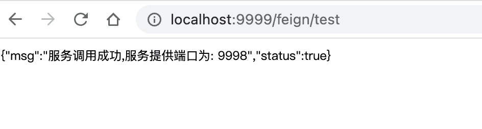
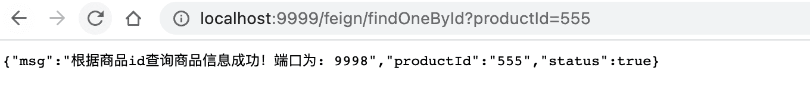
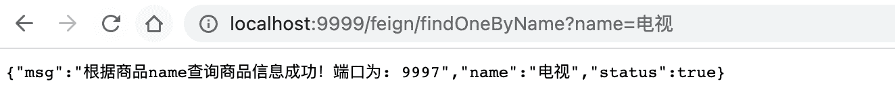
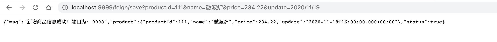

# OpenFeign组件的使用

## 简介

官方：https://cloud.spring.io/spring-cloud-openfeign/reference/html/

Feign是一个声明式的伪Http客户端，它使得写Http客户端变得更简单。使用Feign，只需要创建一个接口并注解。它具有可插拔的注解特性(可以使用springmvc的注解)，可使用Feign 注解和JAX-RS注解。Feign支持可插拔的编码器和解码器。Feign默认集成了Ribbon，默认实现了负载均衡的效果并且springcloud为feign添加了springmvc注解的支持。

## OpenFeign服务调用

### 服务调用方 引入OpenFeign依赖

```xml
<!--引入openfeign依赖-->
<dependency>
  <groupId>org.springframework.cloud</groupId>
  <artifactId>spring-cloud-starter-openfeign</artifactId>
</dependency>
```

### 入口类加入注解开启OpenFeign支持

```java
@SpringBootApplication
@EnableFeignClients //开启openfeign支持
public class Springcloud06Users9999Application {

	public static void main(String[] args) {
		SpringApplication.run(Springcloud06Users9999Application.class, args);
	}

}
```

### 创建一个客户端调用接口

```java
/**
 * @author buubiu
 **/
@FeignClient("products") //用来标识当前接口是一个 feign 组件 value:书写调用服务serviceId(服务名称)
public interface ProductClient {

	@GetMapping("/product/findAll")
	String findAll();
}
```

### 使用feignClient客户端对象调用服务

```java
/**
 * @author buubiu
 **/
@RestController
@Slf4j
public class TestFeignController {

  //注入客户端对象
	@Autowired
	private ProductClient productClient;

	@GetMapping("/feign/test")
	public String test() {
		log.info("进入测试feign调用的方法....");
		String product = productClient.findAll();
		log.info("调用商品服务返回的信息：[{}]", product);
		return product;
	}
}
```

### 访问并测试服务

http://localhost:9999/feign/test



## openFeign服务调用传递参数

### GET方式调用服务传递参数

1. 在服务提供者添加方法(根据商品id获取商品信息)

```java
/**
 * @author buubiu
 **/
@RestController
@Slf4j
public class ProductController {
	
	@Value("${server.port}")
	private int port;
  
	//根据商品id获取商品信息
	@GetMapping("/product/findOneById")
	public Map<String, Object> findOneById(@RequestParam("productId") String productId) {
		log.info("商品服务，接收到商品id为：[{}]", productId);
		Map<String, Object> map = new HashMap<String,Object>();
		map.put("msg","根据商品id查询商品信息成功！端口为: "+port);
		map.put("status",true);
		return map;
	}
}
```

2. 在服务消费者的feignclient中声明对应的方法

```java
/**
 * @author buubiu
 **/
@FeignClient("products") //用来标识当前接口是一个 feign 组件 value:书写调用服务serviceId(服务名称)
public interface ProductClient {

	//根据商品id获取商品信息
	@GetMapping("/product/findOneById")
	Map<String, Object> findOneById(@RequestParam("productId") String productId);
}
```

3. 在服务消费者的业务中调用并传递参数

```java
/**
 * @author buubiu
 **/
@RestController
@Slf4j
public class TestFeignController {

	//注入客户端对象
	@Autowired
	private ProductClient productClient;
  
	@GetMapping("/feign/findOneById")
	public Map<String, Object> findOneById(String productId) {
		log.info("用来测试OpenFiegn的GET方式参数传递");
		Map<String, Object> msg = productClient.findOneById(productId);
		log.info("调用返回信息：[{}]", msg);
		return msg;
	}
}
```

4. 访问并测试



### POST方式调用服务传递参数

#### 传递零散参数（`@RequestParam`）

1. 在服务提供者添加方法(根据商品name获取商品信息)

```java
/**
 * @author buubiu
 **/
@RestController
@Slf4j
public class ProductController {

	@Value("${server.port}")
	private int port;

	//根据商品name获取商品信息
	@PostMapping("/product/findOneByName")
	public Map<String, Object> findOneByName(@RequestParam("name") String name) {
		log.info("商品服务，接收到商品name为：[{}]", name);
		Map<String, Object> map = new HashMap<String, Object>();
		map.put("msg", "根据商品name查询商品信息成功！端口为: " + port);
		map.put("status", true);
		map.put("name", name);
		return map;
	}
}
```

2. 在服务消费者的feignclient中声明对应的方法

```java
/**
 * @author buubiu
 **/
@FeignClient("products") //用来标识当前接口是一个 feign 组件 value:书写调用服务serviceId(服务名称)
public interface ProductClient {

	//根据商品name获取商品信息
	@PostMapping("/product/findOneByName")
	Map<String, Object> findOneByName(@RequestParam("name") String name);
}
```

3. 在服务消费者的业务中调用并传递参数

```java
/**
 * @author buubiu
 **/
@RestController
@Slf4j
public class TestFeignController {

	//注入客户端对象
	@Autowired
	private ProductClient productClient;

	@GetMapping("/feign/findOneByName")
	public Map<String, Object> findOneByName(String name) {
		log.info("用来测试OpenFiegn的POST方式传递零散参数");
		Map<String, Object> msg = productClient.findOneByName(name);
		log.info("调用返回信息：[{}]", msg);
		return msg;
	}
}
```

4. 访问并测试



#### 传递对象参数（`@RequestBody`）

1. 首先分别在服务提供者和服务消费者封装一个商品对象

```java
/**
 * @author buubiu
 **/
@Data
public class Product {

	private Integer productId;
	private String name;
	private Double price;
	private Date update;
}
```

1. 在服务提供者添加方法(新增商品信息)

```java
/**
 * @author buubiu
 **/
@RestController
@Slf4j
public class ProductController {

	@Value("${server.port}")
	private int port;

	//新增商品信息
	@PostMapping("/product/save")
	public Map<String, Object> save(@RequestBody Product product) {
		log.info("商品服务，接收到商品信息为：[{}]", product);
		Map<String, Object> map = new HashMap<String, Object>();
		map.put("msg", "新增商品信息成功！端口为: " + port);
		map.put("status", true);
		map.put("product", product);
		return map;
	}
}
```

2. 在服务消费者的feignclient中声明对应的方法

```java
/**
 * @author buubiu
 **/
@FeignClient("products") //用来标识当前接口是一个 feign 组件 value:书写调用服务serviceId(服务名称)
public interface ProductClient {

	//新增商品信息
	@PostMapping("/product/save")
	Map<String, Object> save(@RequestBody Product product);
}
```

3. 在服务消费者的业务中调用并传递参数

```java
/**
 * @author buubiu
 **/
@RestController
@Slf4j
public class TestFeignController {

	//注入客户端对象
	@Autowired
	private ProductClient productClient;

	@GetMapping("/feign/save")
	public Map<String, Object> save(Product product) {
		log.info("用来测试OpenFiegn的POST方式传递对象参数");
		Map<String, Object> msg = productClient.save(product);
		log.info("调用返回信息：[{}]", msg);
		return msg;
	}
}
```

4. 访问并测试



## OpenFeign超时设置

### 超时说明

默认情况下,openFiegn在进行服务调用时,要求服务提供方处理业务逻辑时间必须在`1S`内返回,如果超过1S没有返回则OpenFeign会直接报错,不会等待服务执行,但是往往在处理复杂业务逻辑是可能会超过1S,因此需要修改OpenFeign的默认服务调用超时时间。

### 修改默认超时时间

在服务消费者方修改：

```properties
#配置指定服务连接超时时间
feign.client.config.products.connect-timeout=5000
#配置指定服务等待超时时间
feign.client.config.products.read-timeout=5000
#配置所有服务连接超时时间
#feign.client.config.default.connect-timeout=5000
#配置所有服务等待时间
#feign.client.config.default.read-timeout=5000
```

## OpenFeign调用详细日志展示

### 说明

往往在服务调用时我们需要详细展示feign的日志,默认feign在调用并不是最详细日志输出,因此在调试程序时应该开启feign的详细日志展示。feign对日志的处理非常灵活可为每个feign客户端指定日志记录策略，每个客户端都会创建一个logger默认情况下logger的名称是feign的全限定名需要注意的是，feign日志的打印只会DEBUG级别做出响应。

我们可以为feign客户端配置各自的logger.level对象，告诉feign记录那些日志logger.lever有以下的几种值

| 等级      | 说明                                          |
| --------- | --------------------------------------------- |
| `NONE`    | 不记录任何日志                                |
| `BASIC`   | 仅仅记录请求方法，url，响应状态代码及执行时间 |
| `HEADERS` | 记录Basic级别的基础上，记录请求和响应的header |
| `FULL`    | 记录HEADERS级别的基础上，记录body和元数据     |

### 配置日志展示

在服务消费者方修改：

```properties
#开启指定服务日志展示
feign.client.config.products.logger-level=full
#开启全局服务日志展示
#feign.client.config.default.logger-level=full
#指定feign调用客户端对象所在包，必须是debug级别
logging.level.com.buubiu.feignClients=debug
```
