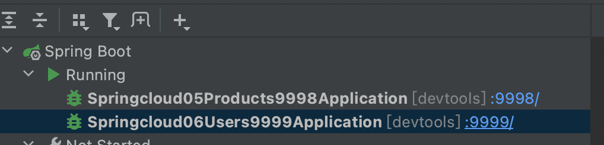
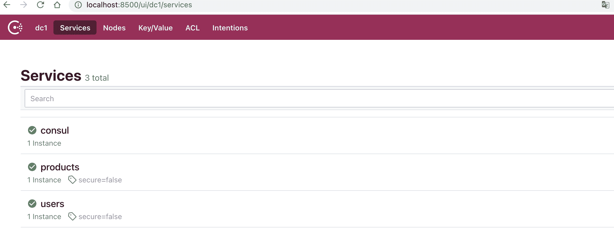
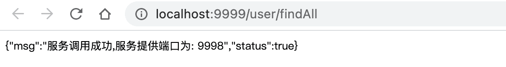
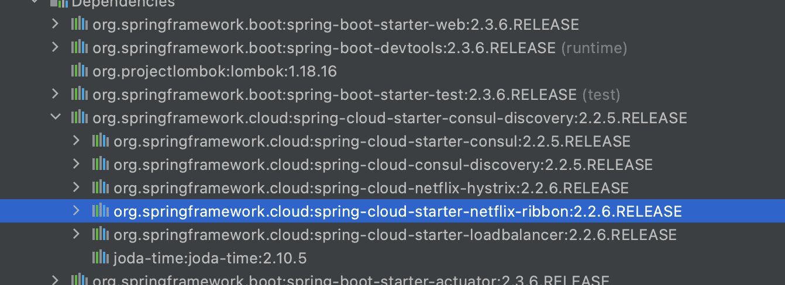
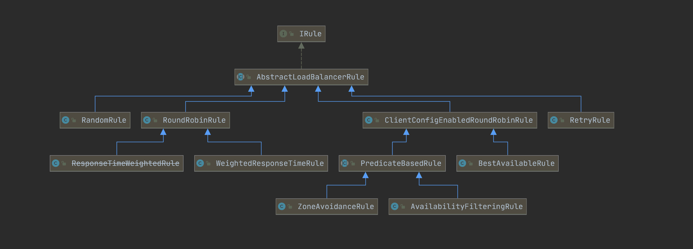
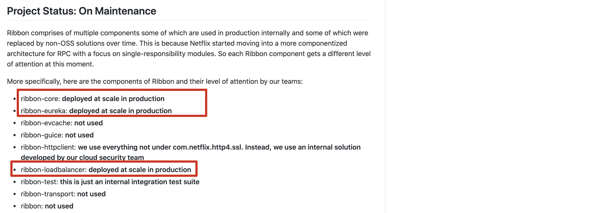

# 服务间通信方式及Ribbon使用

在整个微服务架构中,我们比较关心的就是服务间的服务改如何调用,有哪些调用方式?


**在springcloud中服务间调用方式主要是使用 http restful方式进行服务间调用**

## 基于RestTemplate的服务调用

**说明**

spring框架提供的RestTemplate类可用于在应用中调用rest服务，它简化了与http服务的通信方式，统一了RESTful的标准，封装了http链接， 我们只需要传入url及返回值类型即可。相较于之前常用的HttpClient，RestTemplate是一种更优雅的调用RESTful服务的方式。

### 创建两个服务并注册到consul注册中心中

- users    代表用户服务 端口为 9999
- products 代表商品服务 端口为 9998

`注意:这里服务仅仅用来测试,没有实际业务意义`


### 在商品服务中提供服务方法

```java
/**
 * @author buubiu
 **/
@RestController
@Slf4j
public class ProductController {
	@Value("${server.port}")
	private int port;
	@GetMapping("/product/findAll")
	public Map<String,Object> findAll(){
		log.info("商品服务查询所有调用成功,当前服务端口:[{}]",port);
		Map<String, Object> map = new HashMap<String,Object>();
		map.put("msg","服务调用成功,服务提供端口为: "+port);
		map.put("status",true);
		return map;
	}
}
```

### 在用户服务中使用restTemplate进行调用

```java
/**
 * @author buubiu
 **/
@RestController
@Slf4j
public class UserController {
	@GetMapping("/user/findAll")
	public String findAll(){
		log.info("调用用户服务...");
		//1.使用restTemplate调用商品服务
		RestTemplate restTemplate = new RestTemplate();
		String forObject = restTemplate.getForObject("http://localhost:9998/product/findAll",
			String.class);
		return forObject;
	}
}
```

### 启动服务





### 测试服务调用

浏览器访问用户服务 http://localhost:9999/user/findAll



### 总结

- restTemplate是直接基于服务地址调用没有在服务注册中心获取服务,也没有办法完成服务的负载均衡如果需要实现服务的负载均衡需要自己书写服务负载均衡策略。

### restTemplate直接调用存在问题

-  直接使用restTemplate方式调用没有经过服务注册中心获取服务地址,代码写死不利于维护,当服务宕机时不能高效剔除
-  调用服务时没有负载均衡需要自己实现负载均衡策略

## 基于Ribbon的服务调用

**说明**

官方网址: https://github.com/Netflix/ribbon

Spring Cloud Ribbon是一个基于HTTP和TCP的客户端负载均衡工具，它基于Netflix Ribbon实现。通过Spring Cloud的封装，可以让我们轻松地将面向服务的REST模版请求自动转换成客户端负载均衡的服务调用。

### 项目中引入依赖

**说明**

1. `如果使用的是eureka client 和 consul client,无须引入依赖,因为在eureka,consul中默认集成了ribbon组件`

2. `如果使用的client中没有ribbon依赖需要显式引入如下依赖`

```xml
<!--引入ribbon依赖-->
<dependency>
  <groupId>org.springframework.cloud</groupId>
  <artifactId>spring-cloud-starter-netflix-ribbon</artifactId>
</dependency>
```

### 查看consul client 中依赖的ribbon



### 使用普通负载均衡进行服务调用

```java
/**
 * @author buubiu
 **/
@RestController
@Slf4j
public class UserController {

	@GetMapping("/user/findAllProduct")
	public String findAllProduct() {
		log.info("进入用户服务....");
		//1.使用resttemplate方式直接调用
		RestTemplate restTemplate = new RestTemplate();
		String forObject = restTemplate.getForObject("http://"+randomHost()+"/product/findAll", String.class);
		log.info("商品服务调用返回结果：[{}]",forObject);
		return forObject;
	}

	public static String randomHost() {
		List<String> list = new ArrayList<>();
		list.add("localhost:9998");
		list.add("localhost:9997");
		int i = new Random().nextInt(2);
		return list.get(i);
	}
}

```


### 使用RestTemplate + Ribbon进行服务调用

#### 使用`discovery client` 进行客户端调用

```java
/**
 * @author buubiu
 **/
@RestController
@Slf4j
public class UserController {

	@Autowired
	private DiscoveryClient discoveryClient;

	@GetMapping("/user/findAllProduct")
	public List<ServiceInstance>  findAllProduct() {
		log.info("进入用户服务....");

		//2.ribbon调用方式-discovery client
		List<ServiceInstance> serviceInstances = discoveryClient.getInstances("products");
		for (ServiceInstance serviceInstance : serviceInstances) {
			System.out.println(serviceInstance.getHost());
			System.out.println(serviceInstance.getPort());
		}
		return serviceInstances;

	}
}
```

#### 使用`loadBalancerClient` 进行客户端调用

```java
/**
 * @author buubiu
 **/
@RestController
@Slf4j
public class UserController {

	@Autowired
	private LoadBalancerClient loadBalancerClient;

	@GetMapping("/user/findAllProduct")
	public String findAllProduct() {
		log.info("进入用户服务....");

		//3.ribbon调用方式-loadBalancerClient(默认负载均衡是：轮训)
		ServiceInstance serviceInstance = loadBalancerClient.choose("products");
		System.out.println(serviceInstance.getHost());
		System.out.println(serviceInstance.getPort());
		String url = "http://"+serviceInstance.getHost()+":"+serviceInstance.getPort()+"/product/findAll";
		RestTemplate restTemplate = new RestTemplate();
		String forObject = restTemplate.getForObject(url, String.class);
		return forObject;

	}
}
```

#### 使用`@loadBalance` 进行客户端调用

1. 首先要创建具有负载均衡作用的restTemplate

```java
/**
 * @author buubiu
 **/
@Configuration
public class RestTemplateConfig {

	//在工厂中创建一个restTemplate对象
	@Bean
	@LoadBalanced //代表ribbon负载均衡的restTemplate客户端对象
	public RestTemplate getRestTemplate() {
		return new RestTemplate();
	}
}
```

2. 然后在业务层进行服务调用

```java
/**
 * @author buubiu
 **/
@RestController
@Slf4j
public class UserController {

	@Autowired //具有负载均衡作用的restTemplate
	private RestTemplate restTemplate;

	@GetMapping("/user/findAllProduct")
	public String findAllProduct() {
		log.info("进入用户服务....");
		//4.ribbon调用方式-@loadBalance
		String forObject = restTemplate.getForObject("http://products/product/findAll", String.class);
		return forObject;

	}

}
```

`注意：products为注册到consul中的应用名称，即服务提供者的spring.application.name`

## Ribbon负载均衡策略

### ribbon常用负载均衡算法

- RoundRobinRule

  轮训策略，按顺序循环选择server

  

- RandomRule

  随机策略，随机选择server

  

- AvailabilityFilteringRule

  可用过滤策略

  `会先过滤由于多次访问故障而处于断路器跳闸状态的服务，还有并发的连接数量超过阈值的服务，然后对剩余的服务列表按照轮询策略进行访问`

  

- WeightedResponseTimeRule

  响应时间加权策略

  `根据平均响应的时间计算所有服务的权重，响应时间越快服务权重越大被选中的概率越高，刚启动时如果统计信息不足，则使用RoundRobinRule策略，等统计信息足够会切换到`

  

- RetryRule

  重试策略

  `先按照RoundRobinRule的策略获取服务，如果获取失败则在制定时间内进行重试，获取可用的服务`

  

- BestAvailableRule

  最低并发策略

  `会先过滤掉由于多次访问故障而处于断路器跳闸状态的服务，然后选择一个并发量最小的服务`

  



### 修改服务的默认负载均衡策略

修改服务（消费者）的配置文件

例如：修改成随机策略

```properties
server.port=9999
spring.application.name=users
#注册consul服务的主机
spring.cloud.consul.host=localhost
#注册consul服务的端口
spring.cloud.consul.port=8500
#修改服务负载均衡策略
products.ribbon.NFLoadBalancerRuleClassName=com.netflix.loadbalancer.RandomRule
```

## Ribbon停止维护

官方停止维护说明：https://github.com/Netflix/ribbon


