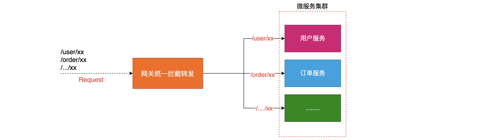

# 服务网关组件的使用

## 什么是服务网关

### 说明

**网关统一服务入口，可方便实现对平台众多服务接口进行管控，对访问服务的身份认证、防报文重放与防数据篡改、功能调用的业务鉴权、响应数据的脱敏、流量与并发控制，甚至基于API调用的计量或者计费等等。**

`网关 = 路由转发 + 过滤器`

`路由转发：`**接收一切外界请求，转发到后端的微服务上去；**

`过滤器:`**在服务网关中可以完成一系列的横切功能，例如权限校验、限流以及监控等，这些都可以通过过滤器完成。**

### 为什么需要网关

- 网关可以实现服务的统一管理
- 网关可以解决微服务中通用代码的冗余问题（如权限控制，流量监控，限流等）

### 网关组件在微服务中的架构图

## 服务网关组件

### zuul组件的使用

[zuul组件的使用](https://www.buubiu.com/2020/11/23/zuul%E7%BB%84%E4%BB%B6%E7%9A%84%E4%BD%BF%E7%94%A8/)

### Gateway组件的使用

[Gateway组件的使用](https://www.buubiu.com/2020/11/23/Gateway%E7%BB%84%E4%BB%B6%E7%9A%84%E4%BD%BF%E7%94%A8/)

