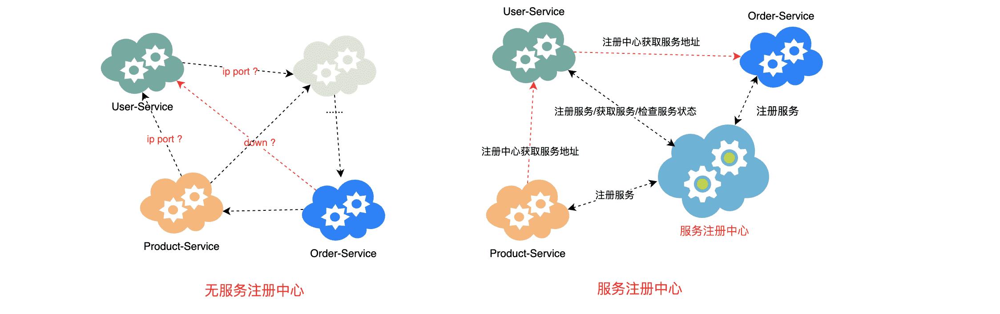

# 服务注册中心介绍

## 服务注册中心

### 什么是服务注册中心

所谓服务注册中心就是在整个的微服务架构中单独提出一个服务，这个服务不完成系统的任何的业务功能，仅仅用来完成对整个微服务系统的服务注册和服务发现，以及对服务健康状态的监控和管理功能。

- 可以对所有的微服务的信息进行存储，如微服务的名称、IP、端口等
- 可以在进行服务调用时通过服务发现查询可用的微服务列表及网络地址进行服务调用
- 可以对所有的微服务进行心跳检测，如发现某实例长时间无法访问，就会从服务注册表移除该实例。

## 常用的注册中心

springcloud支持的多种注册中心Eureka(netflix)、Consul、Zookeeper、以及阿里巴巴推出Nacos组件。这些注册中心在本质上都是用来管理服务的注册和发现以及服务状态的检查的。

### Eureka

[Eureka基本使用](https://www.buubiu.com/Eureka基本使用/)

### Consul

[Consul基本使用](https://www.buubiu.com/Consul基本使用/)

### Nacos

[Nacos基本使用](https://buubiu.com/Nacos%E4%BD%BF%E7%94%A8/)

## 不同注册中心区别

### CAP定理

CAP定理：CAP定理又称CAP原则，指的是在一个分布式系统中，一致性（Consistency）、可用性（Availability）、分区容错性（Partition tolerance）。CAP 原则指的是，这三个要素最多只能同时实现两点，不可能三者兼顾。

- **一致性（C）**：在分布式系统中的所有数据备份，在同一时刻是否同样的值。（等同于所有节点访问同一份最新的数据副本）
- **可用性（A）**：在集群中一部分节点故障后，集群整体是否还能响应客户端的读写请求。（对数据更新具备高可用性）
- **分区容忍性（P）**：就是高可用性，一个节点崩了，并不影响其它的节点（100个节点，挂了几个，不影响服务，越多机器越好）

### Eureka特点（AP）

Eureka中没有使用任何的数据强一致性算法保证不同集群间的Server的数据一致，仅通过数据拷贝的方式争取注册中心数据的最终一致性，虽然放弃数据强一致性但是换来了Server的可用性，降低了注册的代价，提高了集群运行的健壮性。

### Consul特点（CP）

基于Raft算法，Consul提供强一致性的注册中心服务，但是由于Leader节点承担了所有的处理工作，势必加大了注册和发现的代价，降低了服务的可用性。通过Gossip协议，Consul可以很好地监控Consul集群的运行，同时可以方便通知各类事件，如Leader选择发生、Server地址变更等。

### zookeeper特点（CP）

基于Zab协议，Zookeeper可以用于构建具备数据强一致性的服务注册与发现中心，而与此相对地牺牲了服务的可用性和提高了注册需要的时间。 

### **Nacos** (可选择 **AP** 或 **CP**)

- **一致性（C）**：Nacos 提供强一致性（支持 Raft 协议），但也可以配置为最终一致性。
- **可用性（A）**：Nacos 也可以提供高可用性，特别是在没有网络分区的情况下。当有部分节点不可用时，其他节点可以继续提供服务。
- **分区容错性（P）**：Nacos 通过支持分布式部署，能够容忍一定程度的网络分区，保证系统的稳定性。
- **CAP 定理类型**：**AP** 或 **CP**。
  - 默认情况下，Nacos 偏向 **AP**，即高可用性和分区容忍性，但在一些场景下也可以通过配置来确保一致性，从而让它更偏向 **CP**。
  - 如果 Nacos 配置为支持强一致性（例如使用 Raft 协议），它可以保证 **CP** 特性。

### Eureka、Consul与Zookeeper比较

|  组件名   | 语言 |       CAP        | 一致性算法 | 服务健康检查 |    对外暴漏接口    | Spring Cloud集成 |
| :-------: | :--: | :--------------: | :--------: | :----------: | :----------------: | :--------------: |
|  Eureka   | Java |        AP        |     无     |   可配支持   |   HTTP/客户端SDK   |      已集成      |
|  Consul   |  Go  |        CP        |    Raft    |     支持     | HTTP/DNS/客户端SDK |      已集成      |
| Zookeeper | Java |        CP        |   Paxos    |     支持     |     客户端SDK      |      已集成      |
|   nacos   | Java | 默认AP（可配CP） | CP时用Raft |     支持     | HTTP/DNS/客户端SDK |      已集成      |

