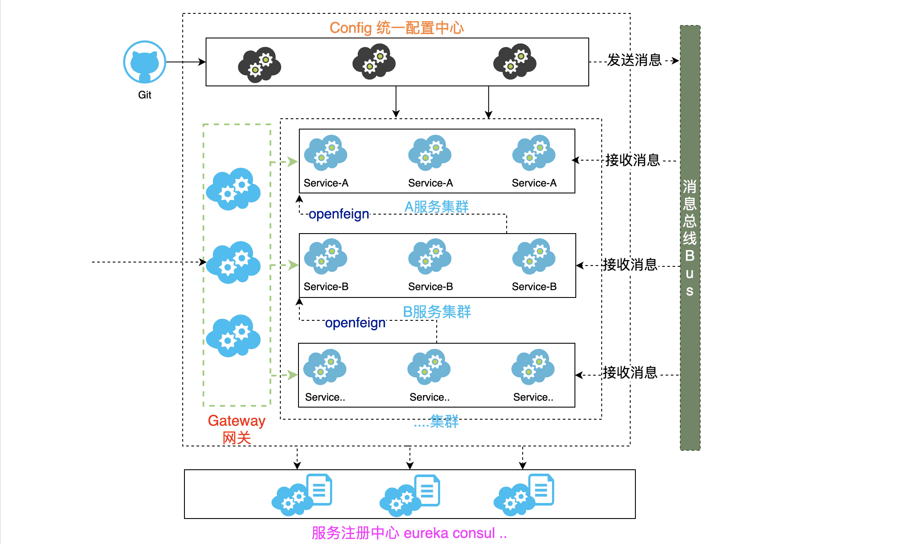
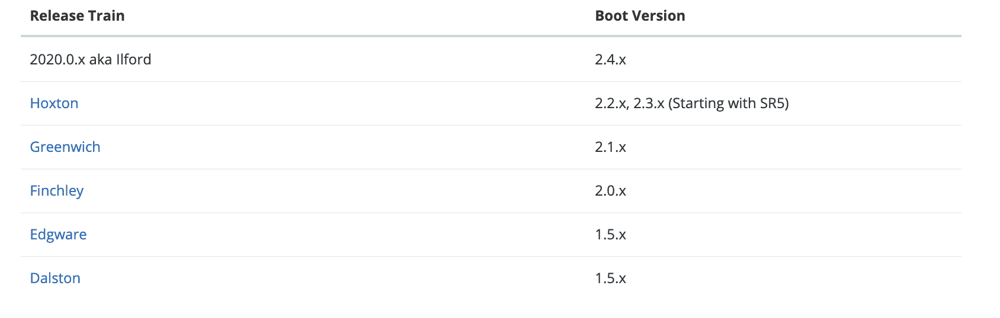

# SpringCloud介绍及环境搭建

## 什么是SpringCloud

### 官方定义

- 官方网址: https://docs.spring.io/spring-cloud/docs/Hoxton.SR9/reference/html/

**Spring Cloud provides tools for developers to quickly build some of the common patterns in distributed systems** (e.g. `configuration management`,` service discovery`, `circuit breakers, intelligent routing, micro-proxy, control bus`). Coordination of distributed systems leads to boiler plate patterns, and using Spring Cloud developers can quickly stand up services and applications that implement those patterns.  -------[摘自官网]

**翻译**

springcloud为开发人员提供了在分布式系统中快速构建一些通用模式的工具（例如配置管理、服务发现、断路器、智能路由、微代理、控制总线）。分布式系统的协调导致了锅炉板模式，使用springcloud开发人员可以快速地建立实现这些模式的服务和应用程序。

**通俗理解**

- springcloud是一个含概多个子项目的开发工具集,集合了众多的开源框架,他利用了Spring Boot开发的便利性实现了很多功能,如服务注册,服务注册发现,负载均衡等.SpringCloud在整合过程中主要是针对Netflix(耐非)开源组件的封装.SpringCloud的出现真正的简化了分布式架构的开发。
- NetFlix 是美国的一个在线视频网站,微服务业的翘楚,他是公认的大规模生产级微服务的杰出实践者,NetFlix的开源组件已经在他大规模分布式微服务环境中经过多年的生产实战验证,因此Spring Cloud中很多组件都是基于NetFlix组件的封装。

**微服务架构下所存在问题?**

- 要有个组件帮助我们记录服务,监控服务,服务发现  服务注册和发现组件  注册中心
- 服务调用问题http rest方式调用  --- 如何调用? 服务调用时如何实现服务负载均衡 ?
- 服务雪崩效应?  
- 服务配置文件管理?   
- 网关组件?    

### 核心架构及其组件

| 组件名称                    | 组件描述                     |
| --------------------------- | ---------------------------- |
| eurekaserver、consul、nacos | 服务注册中心组件             |
| rabbion & openfeign         | 服务负载均衡 和 服务调用组件 |
| hystrix & hystrix dashboard | 服务断路器  和  服务监控组件 |
| zuul、gateway               | 服务网关组件                 |
| config                      | 统一配置中心组件             |
| bus                         | 消息总线组件                 |
| ......                      | ......                       |



## 环境搭建

### 版本命名

- 官网地址:https://spring.io/projects/spring-cloud

Spring Cloud is an umbrella(伞) project consisting of independent projects with, in principle, different release cadences. To manage the portfolio a BOM (Bill of Materials) is published with a curated set of dependencies on the individual project (see below). The release trains have names, not versions, to avoid confusion with the sub-projects. The names are an alphabetic sequence (so you can sort them chronologically) with names of London Tube stations ("Angel" is the first release, "Brixton" is the second). When point releases of the individual projects accumulate to a critical mass, or if there is a critical bug in one of them that needs to be available to everyone, the release train will push out "service releases" with names ending ".SRX", where "X" is a number.     ---[摘自官网]

**翻译**

springcloud是一个由众多独立子项目组成的大型综合项目，原则每个子项目上有不同的发布节奏,都维护自己发布版本号。为了更好的管理springcloud的版本,通过一个资源清单BOM(Bill of Materials),为避免与子项目的发布号混淆，所以没有采用版本号的方式，而是通过命名的方式。这些名字是按字母顺序排列的。如伦敦地铁站的名称（“天使”是第一个版本，“布里斯顿”是第二个版本,"卡姆登"是第三个版本）。当单个项目的点发布累积到一个临界量，或者其中一个项目中有一个关键缺陷需要每个人都可以使用时，发布序列将推出名称以“.SRX”结尾的“服务发布”，其中“X”是一个数字。

**伦敦地铁站名称 [了解]**

Angel、Brixton、Camden、Dalston、Edgware、Finchley、Greenwich、Hoxton、

### 版本选择

版本选择官方建议 https://spring.io/projects/spring-cloud

| 版本名称         | 版本说明                                                     | 备注                                                         |
| ---------------- | ------------------------------------------------------------ | ------------------------------------------------------------ |
| Angel            | 版本基于springboot1.2.x版本构建与1.3版本不兼容               | `2017年Brixton and Angel release官方宣布报废`                |
| Brixton          | 版本基于springboot1.3.x版本构建与1.2版本不兼容               | `2017年Brixton and Angel release官方宣布报废`                |
| Camden           | 版本基于springboot1.4.x版本构建并在1.5版本通过测试           | `2018年Camden release官方宣布报废`                           |
| Dalston、Edgware | 版本基于springboot1.5.x版本构建目前不能再springboot2.0.x版本中使用 | `Dalston(达尔斯顿)将于2018年12月官方宣布报废。Edgware将遵循Spring Boot 1.5.x的生命周期结束。` |
| Finchley         | 版本基于springboot2.0.x版本进行构建,不能兼容1.x版本          |                                                              |
| Greenwich        | 版本基于springboot2.1.x版本进行构建,不能兼容1.x版本          |                                                              |
| Hoxton           | 版本基于springboot2.2.x版本进行构建                          |                                                              |



### 环境搭建

#### 说明

- SpringBoot 2.2.X
- SpringCloud Hoxton
- Java8+
- Maven 3.3.6+
- IDEA 2018.3.5+

#### 创建springboot项目

#### 引入springcloud的版本管理

```xml
<!--定义springcloud使用版本号-->
<properties>
  <java.version>1.8</java.version>
  <spring-cloud.version>Hoxton.SR9</spring-cloud.version>
</properties>
<!--全局管理springcloud版本,并不会引入具体依赖-->
<dependencyManagement>
  <dependencies>
    <dependency>
      <groupId>org.springframework.cloud</groupId>
      <artifactId>spring-cloud-dependencies</artifactId>
      <version>${spring-cloud.version}</version>
      <type>pom</type>
      <scope>import</scope>
    </dependency>
  </dependencies>
</dependencyManagement>
```

完成上述操作springboot与springcloud环境搭建完成，接下来就是使用到具体的springcloud组件,在项目中引入具体的组件即可
