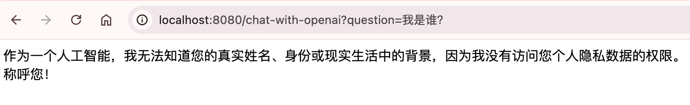
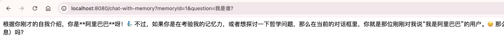
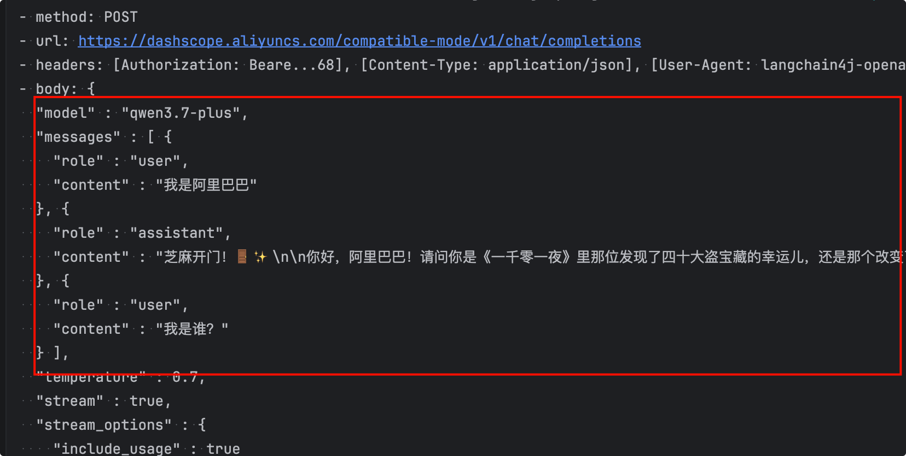
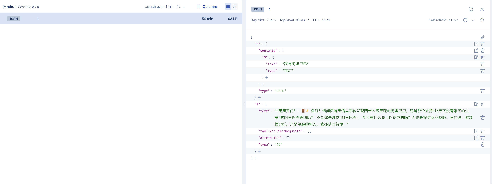
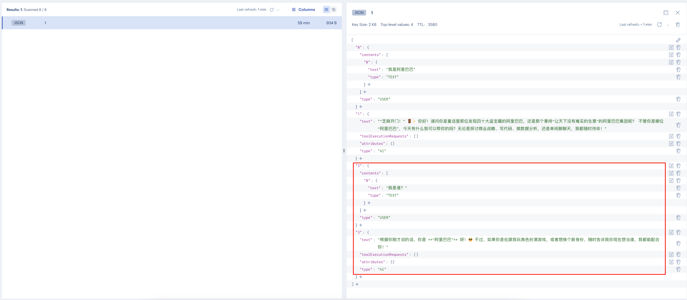

# 会话记忆

## 介绍

LangChain4j 提供了强大的会话记忆（Chat Memory）功能，用于解决大模型“无状态”的问题，能让你的 AI 应用在多轮对话中保持上下文连贯性。

我们先演示下没有记忆的对话:

```html
http://localhost:8080/chat-with-openai?question=我是阿里巴巴
http://localhost:8080/chat-with-openai?question=我是谁？
```




因为没有会话记忆，所以每次请求访问都是独立的。但是如果我们做聊天机器人，客服机器人，那肯定是不行的，我们需要让大模型记住历史会话上下文章。

## 会话记忆的核心机制

**Memory vs. History**

 `ChatMemory` 是 LangChain4j 提供的核心机制，它管理与送入模型的上下文。与记录完整对话的 `History` 不同，`ChatMemory` 会利用算法（如驱逐旧消息、摘要、注入信息等）来“记忆”部分信息，以**适应模型的上下文限制**、**控制调用成本**和**降低响应延迟**。

## 内置的 `ChatMemory` 实现

LangChain4j 提供了两种开箱即用的 `ChatMemory` 实现，你也可以通过实现 `ChatMemory` 接口来扩展。

- **MessageWindowChatMemory**：作为滑动窗口保留最近 N 条消息，简单易懂，非常适合快速原型开发和轮次不多的对话场景。
- **TokenWindowChatMemory**：同样是滑动窗口，但以 Token 数为限制指标。它能更精细地控制发送给模型的上下文长度（尤其在 Token 敏感场景），但会完全驱逐超过限制的消息。

## 会话隔离：`@MemoryId` 注解

默认情况下，`ChatMemory` 是所有用户/会话共享的，会导致“记忆串线”。`@MemoryId` 注解提供了优雅的解决方案。在 AI Service 接口方法中标注该注解，LangChain4j 会自动为每个 memoryId 创建并维护一个独立的 `ChatMemory` 实例。


## 示例一：默认内存记忆

首先AssistantConfig里定义ChatMemoryProvider

```java
  @Bean
  public ChatMemoryProvider memoryChatMemoryProvider(){
      return memoryId -> MessageWindowChatMemory.builder()
              .id(memoryId)  // 记忆id 会话隔离用
              .maxMessages(20)   // 窗口大小，可按需调整
              .build();
  }
```

再新建一个Assistant4Service，AIService里要配置 chatMemoryProvider

```java
package com.bufx.service;

import dev.langchain4j.service.MemoryId;
import dev.langchain4j.service.UserMessage;
import dev.langchain4j.service.spring.AiService;
import dev.langchain4j.service.spring.AiServiceWiringMode;
import reactor.core.publisher.Flux;

@AiService(
        wiringMode = AiServiceWiringMode.EXPLICIT, // 手动指定接入模型 手动装配
        streamingChatModel = "openAiStreamingChatModel", // 配置模型
        chatMemoryProvider  = "memoryChatMemoryProvider" // 会话记忆
)
public interface Assistant4Service {

    /**
     *  会话记忆
     * @param memoryId 会话id
     * @param question 提问
     * @return
     */
    Flux<String> chat(@MemoryId String memoryId, @UserMessage String question);
}
```


最后MyChatController里注入Assistant4Service以及实现chat6

```java
private final Assistant4Service assistant4Service;
/**
 * 会话记忆
 */
@GetMapping(value = "/chat-with-memory",produces = "text/html;charset=utf-8")
public Flux<String> chatWithMemory(String memoryId,String question) {
    return assistant4Service.chat(memoryId,question);
}
```

再测试下：先提问，我是阿里巴巴。记得浏览器地址栏带上memoryId


再次提问，我是谁？，大模型已经记住我是阿里巴巴了。



本质上是第二次向大模型发送提问请求的时候，已经把历史提问和回答都一并作为提示词，请求大模型了。



## 示例二：持久会话

做会话持久化，可以存db或者redis，我们一般企业级开发用的是redis。

这里的Redis不是普通的Redis Server，而是支持向量存储的redis-stack。

```yml
services:
  redis-stack:
    container_name: redis-stack
    image: redis/redis-stack:latest
    ports:
      - 6379:6379
      - 8001:8001
    volumes:
      - ./volumes/config/redis-stack.conf:/redis-stack.conf
      - ./volumes/data:/data
    environment:
      TZ: "Asia/Shanghai"
      REDIS_ARGS: "--requirepass redis-stack"
    networks: 
      - redis-stack

networks:
  redis-stack:
    driver: bridge
    name: redis-stack
```

6379端口映射的是redis-stack服务，8001端口映射的是可视化服务。

首先第一步：pom.xml里加下redis依赖

```xml
<dependency>
  <groupId>dev.langchain4j</groupId>
  <artifactId>langchain4j-community-redis-spring-boot4-starter</artifactId>
  <version>1.18.0-beta28</version>
</dependency>
```


接着第二步：application.yml里配置redis连接配置

```yaml
langchain4j:
  community:
    redis:
      enabled: false   # 关闭 Redis 向量库自动配置，仅保留手动配置的会话记忆
  redis:
    host: localhost
    port: 6379
    password: redis-stack # 无密码留空
    ttl-seconds: 3600  # 每个会话 key 过期时间，演示用 1 小时
```


接着第三步：新建redis会话配置类：RedisChatMemoryConfig

```java
package com.bufx.config;

import dev.langchain4j.community.store.memory.chat.redis.RedisChatMemoryStore;
import dev.langchain4j.community.store.memory.chat.redis.RedisChatMemoryStore.Builder;
import org.springframework.boot.context.properties.ConfigurationProperties;
import org.springframework.boot.context.properties.EnableConfigurationProperties;
import org.springframework.context.annotation.Bean;
import org.springframework.context.annotation.Configuration;

@Configuration
@ConfigurationProperties(prefix = "langchain4j.redis")
@EnableConfigurationProperties(RedisChatMemoryConfig.class)
public class RedisChatMemoryConfig {

    private String host;
    private int port;
    private String password;
    private long ttlSeconds;

    @Bean
    public RedisChatMemoryStore redisChatMemoryStore() {
        Builder builder = RedisChatMemoryStore.builder()
            .host(host)
            .port(port)
            .ttl(ttlSeconds);
        if (password != null && !password.isBlank()) {
            builder.password(password).user("default");
            // Redis 6+ ACL 可再加 .user("default")
        }
        return builder.build();
    }

    public String getHost() {
        return host;
    }

    public void setHost(String host) {
        this.host = host;
    }

    public int getPort() {
        return port;
    }

    public void setPort(int port) {
        this.port = port;
    }

    public String getPassword() {
        return password;
    }

    public void setPassword(String password) {
        this.password = password;
    }

    public long getTtlSeconds() {
        return ttlSeconds;
    }

    public void setTtlSeconds(long ttlSeconds) {
        this.ttlSeconds = ttlSeconds;
    }
}

```


修改AssistantConfig，添加下redisChatMemoryProvider

```java
@Bean
public ChatMemoryProvider redisChatMemoryProvider(RedisChatMemoryStore redisChatMemoryStore){
    return memoryId -> MessageWindowChatMemory.builder()
        .chatMemoryStore(redisChatMemoryStore)
        .id(memoryId)
        .maxMessages(20)
        .build();
}
```

最后，修改Assistant4Service为redisChatMemoryProvider

```java
package com.bufx.service;

import dev.langchain4j.service.MemoryId;
import dev.langchain4j.service.UserMessage;
import dev.langchain4j.service.spring.AiService;
import dev.langchain4j.service.spring.AiServiceWiringMode;
import reactor.core.publisher.Flux;

@AiService(
        wiringMode = AiServiceWiringMode.EXPLICIT, // 手动指定接入模型 手动装配
        streamingChatModel = "openAiStreamingChatModel", // 配置模型
//        chatMemoryProvider  = "memoryChatMemoryProvider" // 会话记忆
        chatMemoryProvider  = "redisChatMemoryProvider" // 会话记忆
)
public interface Assistant4Service {

    /**
     *  会话记忆
     * @param memoryId 会话id
     * @param question 提问
     * @return
     */
    Flux<String> chat(@MemoryId String memoryId, @UserMessage String question);
}
```


我们继续测试，先跟大模型说，我是阿里巴巴；


redis客户端里，我们看下，已经存储了会话信息



我们再次向大模型提问，我是谁？


redis客户端里我们刷新看下，也进行了更新：


