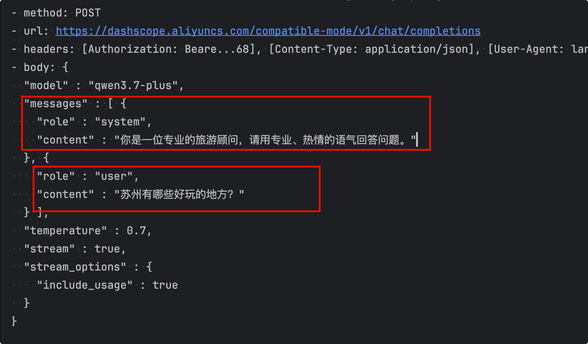
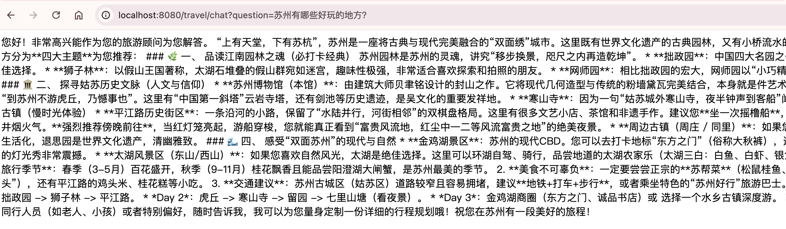
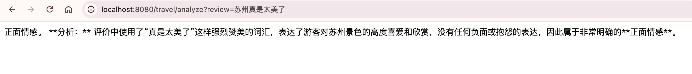
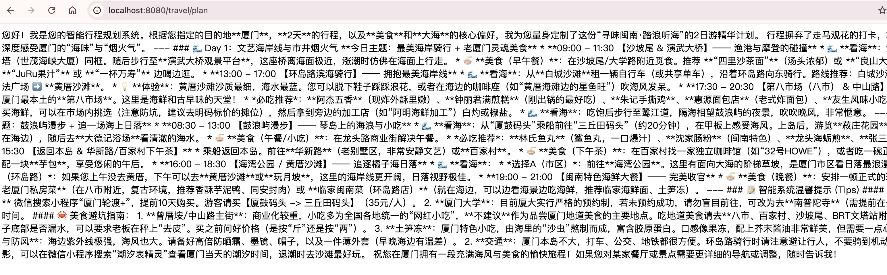

# 对话与提示词工程

LangChain4j为复杂的提示词工程和对话管理，提供了一套简洁、声明式的解决方案。其核心是通过**AI服务（AiServices）** 与消息注解，让开发者只需定义Java接口，即可轻松编排与大模型的交互。

## 核心概念

在LangChain4j中，每一次与大模型的交互，都围绕两类核心消息展开：

- **SystemMessage (系统消息)**：为AI设定“角色”和“规则”，定义其在整个对话中的身份、行为准则、回复风格，它由开发者预先设定，不随用户输入而改变。
- **UserMessage (用户消息)**：代表用户在当前轮次中提出的具体问题或指令，是对话中的动态输入部分。

## 声明式开发

通过声明一个普通的Java接口，并使用 `@SystemMessage` 和 `@UserMessage` 注解，LangChain4j 的 **AiServices** 会自动生成其实现，并将方法调用转换为与大模型的交互。

###  @SystemMessage

**为 AI 设定“人设”**

`@SystemMessage` 注解于接口或方法之上，为后续所有对话奠定行为基础。

- 支持通过 `fromResource` 属性从外部文件加载模板，便于管理和更新提示词。
- 当 `@SystemMessage` 内容修改后，原有的聊天记忆（ChatMemory）会失效，以确保新“身份”不受旧历史影响。

###  @UserMessage

**定义用户输入模板**

`@UserMessage` 注解于方法参数上，用于指示哪个参数是用户输入。

- 若方法只有一个参数，则它默认作为用户消息，可省略 `@UserMessage` 注解。
- 当方法有多个参数时，必须用 `@UserMessage` 明确指定哪一个是用户输入。

###  占位符与变量注入

<span v-pre>`{{it}}`  </span> 和 `@V`

为了构建动态提示词，可以在消息模板中使用占位符，然后在运行时将方法参数注入其中。

- 当方法只有一个参数时，可以用 <span v-pre>`{{it}}`  </span>作为默认占位符来引用它。
- 对于多个参数，需使用 `@V("变量名")` 注解参数，并在提示词模板中使用 <span v-pre>  `{{变量名}}`  </span> 来进行注入。

此外，LangChain4j 还内置了如 <span v-pre> `{{current_date}}`  </span>的实用占位符，可直接在消息模板中获取当前日期。

## 代码使用

### 示例一：简单问答

新建一个新的TravelAssistantService.我们使用openAI方式，流式响应输出

```java
package com.bufx.service;

import dev.langchain4j.service.SystemMessage;
import dev.langchain4j.service.spring.AiService;
import dev.langchain4j.service.spring.AiServiceWiringMode;
import reactor.core.publisher.Flux;

/**
 * @comment: 旅行助手服务
 */
@AiService(
    wiringMode = AiServiceWiringMode.EXPLICIT, // 手动指定接入模型 手动装配
    streamingChatModel = "openAiStreamingChatModel" // 指定模型
)
public interface TravelAssistantService {

    /**
     *  --- 场景1: 简单问答 ---
     * 注意：由于只有一个参数，@UserMessage 注解可以省略，框架会自动将参数视为用户消息
     * @param userMessage
     * @return
     */
    @SystemMessage("你是一位专业的旅游顾问，请用专业、热情的语气回答问题。")
    Flux<String> chat(String userMessage);
}

```


再新建一个MyTravelChatController

```java
package com.bufx.controller;

import com.bufx.service.TravelAssistantService;
import org.springframework.web.bind.annotation.GetMapping;
import org.springframework.web.bind.annotation.RequestMapping;
import org.springframework.web.bind.annotation.RestController;
import reactor.core.publisher.Flux;

/**
 * TODO 类描述
 *
 */
@RestController
@RequestMapping("/travel")
public class MyTravelChatController {

    private final TravelAssistantService travelAssistantService;

    public MyTravelChatController(TravelAssistantService travelAssistantService) {
        this.travelAssistantService = travelAssistantService;
    }

    @GetMapping(value = "/chat", produces = "text/html;charset=utf-8")
    public Flux<String> chat(String question) {
        return travelAssistantService.chat(question);
    }
}

```


浏览器请求测试：`http://localhost:8080/travel/chat?question=苏州有哪些好玩的地方？`


我们看下请求日志，role：system 就是系统设定，role：user就是用户问题



大模型进行了专业友好的响应：



### 示例二：使用占位符

我们在看一个 @UserMessage 作为用户提示词模板的实例。

```java
package com.bufx.service;

import dev.langchain4j.service.SystemMessage;
import dev.langchain4j.service.UserMessage;
import dev.langchain4j.service.spring.AiService;
import dev.langchain4j.service.spring.AiServiceWiringMode;
import reactor.core.publisher.Flux;

/**
 * @comment: 旅行助手服务
 */
@AiService(
    wiringMode = AiServiceWiringMode.EXPLICIT, // 手动指定接入模型 手动装配
    streamingChatModel = "openAiStreamingChatModel" // 指定模型
)
public interface TravelAssistantService {

    /**
     *  --- 场景1: 简单问答 ---
     * 注意：由于只有一个参数，@UserMessage 注解可以省略，框架会自动将参数视为用户消息
     * @param userMessage
     * @return
     */
    @SystemMessage("你是一位专业的旅游顾问，请用专业、热情的语气回答问题。")
    Flux<String> chat(String userMessage);

    /**
     *  --- 场景2: 结构化评价分析 (使用 {{it}} 占位符) ---
     *  注解 @UserMessage，并通过 {{it}} 指定用户输入的位置
     * @param review
     * @return
     */
    @UserMessage("分析以下旅游评价的正面或负面情感：\n\n评价：{{it}}")
    Flux<String> analyzeSentiment(String review);
}

```


MyTravelChatController 里在加下analyze方法：

```java
package com.bufx.controller;

import com.bufx.service.TravelAssistantService;
import org.springframework.web.bind.annotation.GetMapping;
import org.springframework.web.bind.annotation.RequestMapping;
import org.springframework.web.bind.annotation.RestController;
import reactor.core.publisher.Flux;

/**
 * TODO 类描述
 */
@RestController
@RequestMapping("/travel")
public class MyTravelChatController {

    private final TravelAssistantService travelAssistantService;

    public MyTravelChatController(TravelAssistantService travelAssistantService) {
        this.travelAssistantService = travelAssistantService;
    }

    @GetMapping(value = "/chat", produces = "text/html;charset=utf-8")
    public Flux<String> chat(String question) {
        return travelAssistantService.chat(question);
    }

    @RequestMapping(value = "/analyze",produces = "text/html;charset=utf-8")
    public Flux<String> analyze(String review) {
        return travelAssistantService.analyzeSentiment(review);
    }
}

```


浏览器输入测试：`http://localhost:8080/travel/analyze?review=苏州真是太美了`

浏览器返回：



### 示例三：使用多参数

最后我们在看一个@SystemMessage和@UserMessage，以及@V注解参数使用的示例：

```java
package com.bufx.service;

import dev.langchain4j.service.SystemMessage;
import dev.langchain4j.service.UserMessage;
import dev.langchain4j.service.V;
import dev.langchain4j.service.spring.AiService;
import dev.langchain4j.service.spring.AiServiceWiringMode;
import reactor.core.publisher.Flux;

/**
 * @comment: 旅行助手服务
 */
@AiService(
    wiringMode = AiServiceWiringMode.EXPLICIT, // 手动指定接入模型 手动装配
    streamingChatModel = "openAiStreamingChatModel" // 指定模型
)
public interface TravelAssistantService {

    /**
     *  --- 场景1: 简单问答 ---
     * 注意：由于只有一个参数，@UserMessage 注解可以省略，框架会自动将参数视为用户消息
     * @param userMessage
     * @return
     */
    @SystemMessage("你是一位专业的旅游顾问，请用专业、热情的语气回答问题。")
    Flux<String> chat(String userMessage);

    /**
     *  --- 场景2: 结构化评价分析 (使用 {{it}} 占位符) ---
     *  注解 @UserMessage，并通过 {{it}} 指定用户输入的位置
     * @param review
     * @return
     */
    @UserMessage("分析以下旅游评价的正面或负面情感：\n\n评价：{{it}}")
    Flux<String> analyzeSentiment(String review);

    /**
     * --- 场景3: 动态定制行程单 (使用 @V 注入多参数) --- 使用 @UserMessage 明确指定用户输入是问题部分，并用 @V 注入其他变量
     *
     * @param destination
     * @param days
     * @param preference
     * @return
     */
    @SystemMessage("你是一个旅行社的智能行程规划系统。")
    @UserMessage("根据以下目的地：{{destination}}，天数：{{days}}，偏好：{{preference}}，生成一份详细的旅行计划。")
    Flux<String> planTrip(@V("destination") String destination, @V("days") int days,
        @V("preference") String preference);
}

```


MyTravelChatControllerf类加下plan方法：

```java
package com.bufx.controller;

import com.bufx.service.TravelAssistantService;
import org.springframework.web.bind.annotation.GetMapping;
import org.springframework.web.bind.annotation.RequestMapping;
import org.springframework.web.bind.annotation.RestController;
import reactor.core.publisher.Flux;

/**
 * TODO 类描述
 */
@RestController
@RequestMapping("/travel")
public class MyTravelChatController {

    private final TravelAssistantService travelAssistantService;

    public MyTravelChatController(TravelAssistantService travelAssistantService) {
        this.travelAssistantService = travelAssistantService;
    }

    @GetMapping(value = "/chat", produces = "text/html;charset=utf-8")
    public Flux<String> chat(String question) {
        return travelAssistantService.chat(question);
    }

    @RequestMapping(value = "/analyze",produces = "text/html;charset=utf-8")
    public Flux<String> analyze(String review) {
        return travelAssistantService.analyzeSentiment(review);
    }

    @RequestMapping(value = "/plan",produces = "text/html;charset=utf-8")
    public Flux<String> plan() {
        return travelAssistantService.planTrip("厦门", 2, "美食和大海");
    }
}

```


最后我们测试下：`http://localhost:8080/travel/plan`

