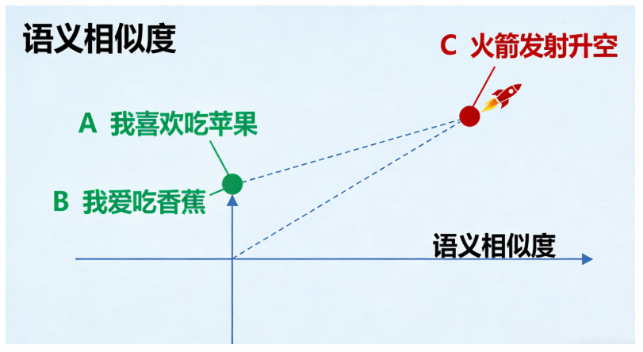
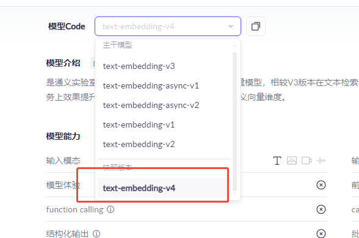
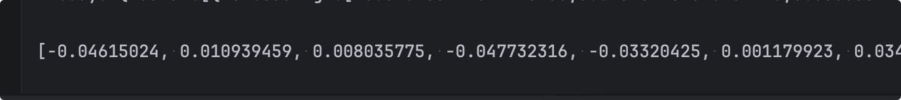
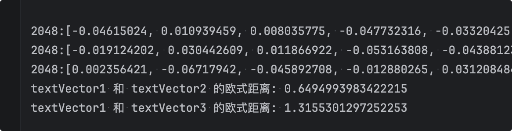

# 嵌入模型

## 什么是嵌入模型

简单来说，**嵌入（Embedding）是一种将非数字数据（如单词、句子、图像、甚至整个文档）转换为计算机能够理解的数字向量的技术。** 

**向量是数学、物理学及工程科学中的基础概念，指同时具有大小和方向的量**‌，与只有大小没有方向的标量（如温度、质量）相对。‌‌

- **数据**：比如一句话：“我喜欢吃苹果”。
- **向量**：经过嵌入模型处理后，这句话会变成一个由数百个浮点数组成的数组，例如：`[0.125, -0.342, 0.987, ..., 0.045]`。

这个向量不是随机生成的，它通过复杂的神经网络模型训练得出，能够**捕获原始数据的语义信息**。

## 嵌入模型的核心作用

**将“意义”映射到“向量空间”**

嵌入模型最关键的特性是，它会把相似的语义内容映射到向量空间中的相近位置。

- **例子**：
  - 句子A：“我喜欢吃苹果”
  - 句子B：“我爱吃香蕉”
  - 句子C：“火箭发射升空”

经过嵌入模型后，在向量空间中：

- 句子A和句子B的距离会非常**近**（因为都是表达对水果的喜爱）。
- 句子C与A、B的距离会非常**远**（因为讨论的是完全不同的主题）。



## 为什么需要嵌入模型

1. **语义搜索**：传统的搜索引擎依赖关键词匹配（比如搜索“苹果”只会返回包含“苹果”这两个字的结果）。而基于嵌入的搜索是语义上的理解和匹配，即使搜索“一种富含维生素的水果”，也能找到关于“苹果”的文档。
2. **信息压缩与表示**：将一个复杂的对象（图片、长文本）压缩成一个固定长度的、富含语义信息的向量。
3. **作为大模型的“外部记忆”**：这是最广泛的应用之一。大模型的知识是静态的（训练到某个时间点），且上下文窗口有限。通过嵌入，我们可以将海量的私有知识（公司文档、产品手册）向量化，然后在需要时检索出最相关的部分，再“喂”给大模型，让它基于这些知识回答问题，从而解决模型的知识局限和幻觉问题。

## 常见嵌入模型

- **OpenAI 的 text-embedding-3-small 和 text-embedding-3-large**：目前性能强大的通用文本嵌入模型。
- **BAAI/bge-\* 系列**：北京智源研究院开源的优秀中英文嵌入模型。
- **sentence-transformers**：一个非常流行的Python库，提供了大量预训练的句子、段落嵌入模型。
- **多模态嵌入模型**：如 `CLIP`，可以将图片和文本嵌入到同一个向量空间，实现文本搜图、图搜图等功能。

阿里百炼平台的嵌入模型：


目前文本嵌入模型，最新版本 text-embedding-v4，支持64~2048维用户自定义向量维度。



## 代码使用

### 示例一：获取模型向量长度

项目里，application.yml里我们指定下嵌入模型和维度

```yaml
langchain4j:
  open-ai:
    embedding-model:
      api-key: sk-4feaxxxxxxxxxxxxxx1e9268
      model-name: text-embedding-v4
      base-url: https://dashscope.aliyuncs.com/compatible-mode/v1
      dimensions: 2048          # 可选；v4 支持 64/128/256/512/768/1024/1536/2048
      log-requests: true
      log-responses: true
```


然后controller包下，新建MyEmController，以及注入embeddingModel，新建em测试方法。

```java
package com.bufx.controller;

import dev.langchain4j.data.embedding.Embedding;
import dev.langchain4j.model.embedding.EmbeddingModel;
import dev.langchain4j.model.output.Response;
import java.util.Arrays;
import org.springframework.web.bind.annotation.RequestMapping;
import org.springframework.web.bind.annotation.RestController;

@RestController
public class MyEmController {

    private final EmbeddingModel embeddingModel;

    public MyEmController(EmbeddingModel embeddingModel) {
        this.embeddingModel = embeddingModel;
    }

    @RequestMapping("/em")
    public String em() {
        Response<Embedding> response = embeddingModel.embed("学Java上Spring.org");
        float[] vector = response.content().vector();  // 浮点数组
        int dim = response.content().dimension();      // 维度，应与 dimensions 配置一致
        System.out.println(Arrays.toString(vector) +":"+vector.length+":"+dim);
        return "success";
    }
}

```


浏览器运行测试：`http://localhost:8080/em`



### 示例二：获取欧式距离

我们在看一个示例，求下欧氏距离，距离越小，说明越相似：

```java
@RequestMapping("/em2")
public String em2(){
    float[] textVector1 = embeddingModel.embed("学Java上Spring.org").content().vector();
    float[] textVector2 = embeddingModel.embed("Spring.org网站教学Java质量真不错").content().vector();
    float[] textVector3 = embeddingModel.embed("我喜欢吃香蕉").content().vector();

    System.out.println(textVector1.length + ":" + Arrays.toString(textVector1));
    System.out.println(textVector2.length + ":" + Arrays.toString(textVector2));
    System.out.println(textVector3.length + ":" + Arrays.toString(textVector3));

    double dist12 = euclideanDistance(textVector1, textVector2);
    double dist13 = euclideanDistance(textVector3, textVector1);

    System.out.println("textVector1 和 textVector2 的欧式距离: " + dist12);
    System.out.println("textVector1 和 textVector3 的欧式距离: " + dist13);
    return "success";
}

/**
 * 计算两个向量的欧式距离
 * @param a
 * @param b
 * @return
 */
public static double euclideanDistance(float[] a, float[] b) {
    if (a.length != b.length) {
        throw new IllegalArgumentException("向量维度不一致");
    }
    double sum = 0;
    for (int i = 0; i < a.length; i++) {
        double d = a[i] - b[i];
        sum += d * d;
    }
    return Math.sqrt(sum);
}
```

浏览器运行测试：`http://localhost:8080/em2`

