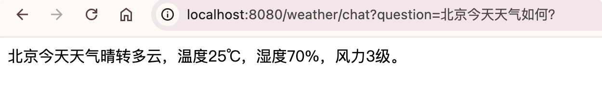
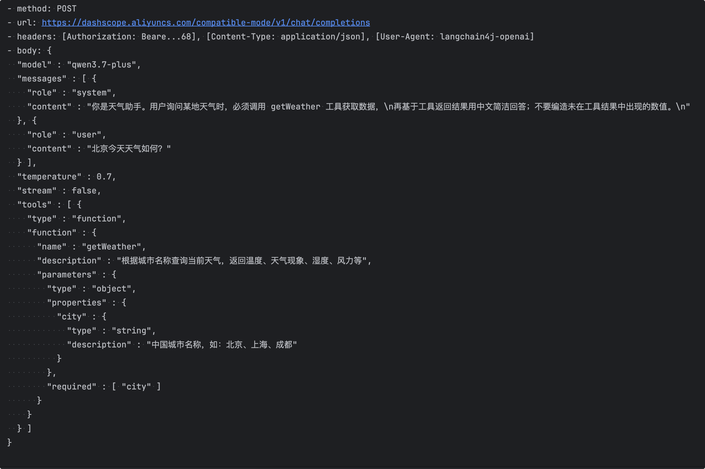
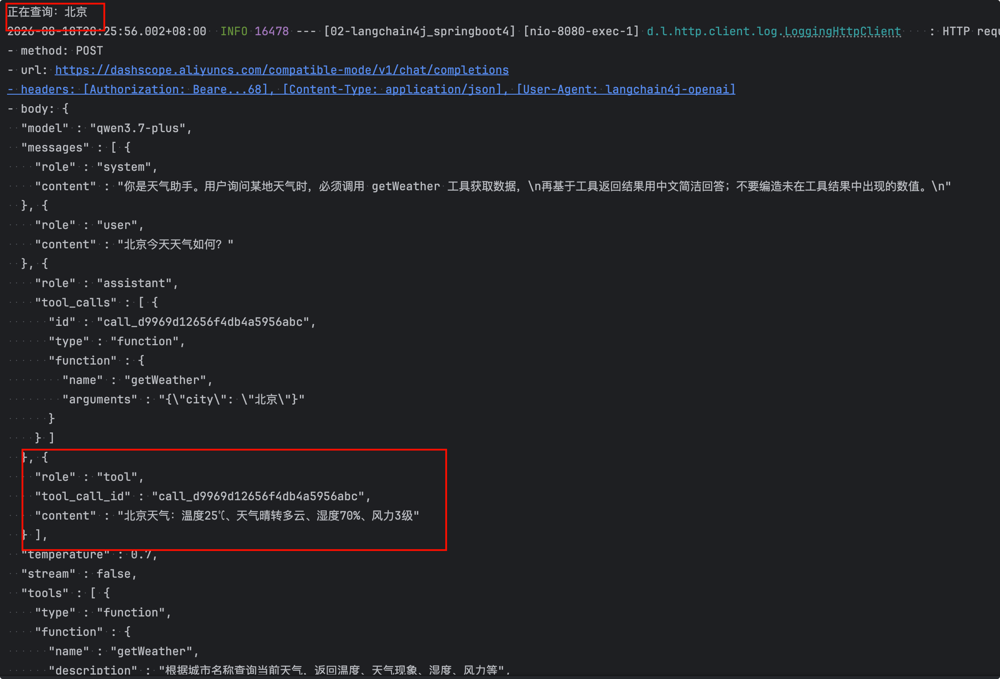
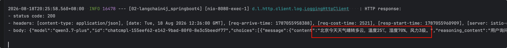
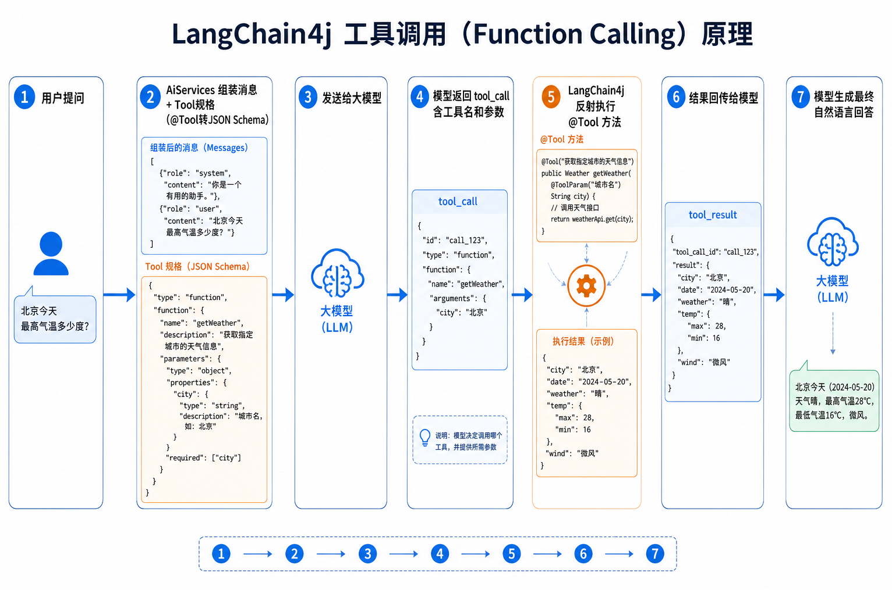

# 工具调用

## 引入

大模型本身只会「说话」。但有些任务它并不擅长——比如精确算术、查实时天气、查你自己的业务数据库。这时候就需要 **工具调用**（也叫 **Function Calling**）。

## 约定

需要特别强调的是：**LLM 本身并不能真正执行函数**，它只是在响应中表达调用特定工具的**意图**（包括要调用哪个工具、传入什么参数），真正的执行由开发者完成，然后将结果返回给 LLM 继续生成回答。

例如，当用户问"475695037565 的平方根是多少？"时，LLM 本身的计算并不精确。但如果为它提供了 `squareRoot` 工具，它会返回一个调用请求 `squareRoot(475695037565)`，框架执行后得到结果 `689706.486532`，LLM 再基于此给出精确答案。

## 代码示例

我们来看一个具体示例，调用天气预报的工具类，因为大模型是不知道某个城市今天的天气信息的，所以我们可以定义一个工具类，模拟来返回某个城市今天的天气信息。


首先第一步：定义Tool工具类，WeatherTool

```java
package com.bufx.tool;

import dev.langchain4j.agent.tool.P;
import dev.langchain4j.agent.tool.Tool;
import org.springframework.stereotype.Component;

@Component
public class WeatherTool {

    @Tool("根据城市名称查询当前天气，返回温度、天气现象、湿度、风力等")
    public String getWeather(@P("中国城市名称，如：北京、上海、成都") String city) {
        System.out.println("正在查询：" + city);
        // 模拟逻辑
        if ("北京".equals(city)) {
            return "北京天气：温度25℃、天气晴转多云、湿度70%、风力3级";
        } else if ("上海".equals(city)) {
            return "上海天气：温度28℃、天气晴转小雨、湿度60%、风力4级";
        } else if ("成都".equals(city)) {
            return "成都天气：温度23℃、天气晴转小雨、湿度65%、风力3级";
        }
        return "暂不支持该城市查询天气";
    }
}

```


再新建一个WeatherAssistantService, AI Service里tools属性指定工具weatherTool。

```java
package com.bufx.service;

import dev.langchain4j.service.SystemMessage;
import dev.langchain4j.service.spring.AiService;
import dev.langchain4j.service.spring.AiServiceWiringMode;

@AiService(
    wiringMode = AiServiceWiringMode.EXPLICIT, // 手动指定接入模型 手动装配
    chatModel = "openAiChatModel", // 指定模型
    tools = {"weatherTool"} // 指定工具
)
public interface WeatherAssistantService {

    @SystemMessage("""
        你是天气助手。用户询问某地天气时，必须调用 getWeather 工具获取数据，
        再基于工具返回结果用中文简洁回答；不要编造未在工具结果中出现的数值。
        """)
    String chat(String userMessage);
}

```


再新建一个MyWeatherController,注入weatherAssistantService，以及新建chat方法：

```java
package com.bufx.controller;

import com.bufx.service.WeatherAssistantService;
import org.springframework.web.bind.annotation.GetMapping;
import org.springframework.web.bind.annotation.RequestMapping;
import org.springframework.web.bind.annotation.RestController;

@RestController
@RequestMapping("/weather")
public class MyWeatherController {

    private final WeatherAssistantService weatherAssistantService;

    public MyWeatherController(WeatherAssistantService weatherAssistantService) {
        this.weatherAssistantService = weatherAssistantService;
    }

    @GetMapping("/chat")
    public String chat(String question) {
        return weatherAssistantService.chat(question);
    }
}

```


我们来测试下，先问下 北京的天气。`http://localhost:8080/weather/chat?question=北京今天天气如何？`



控制台 输出的 日志，我们可以看到第一次请求的时候，工具信息都一并作为提示词发送给大模型。



langchaing4j框架调用本地工具weather工具，得到 北京城市的天气信息后，也一并作为提示词，再次去请求大模型。



最终大模型第二次返回的结果才是到业务逻辑层，最终返回到前端页面。



下面是这个项目执行的具体原理图

