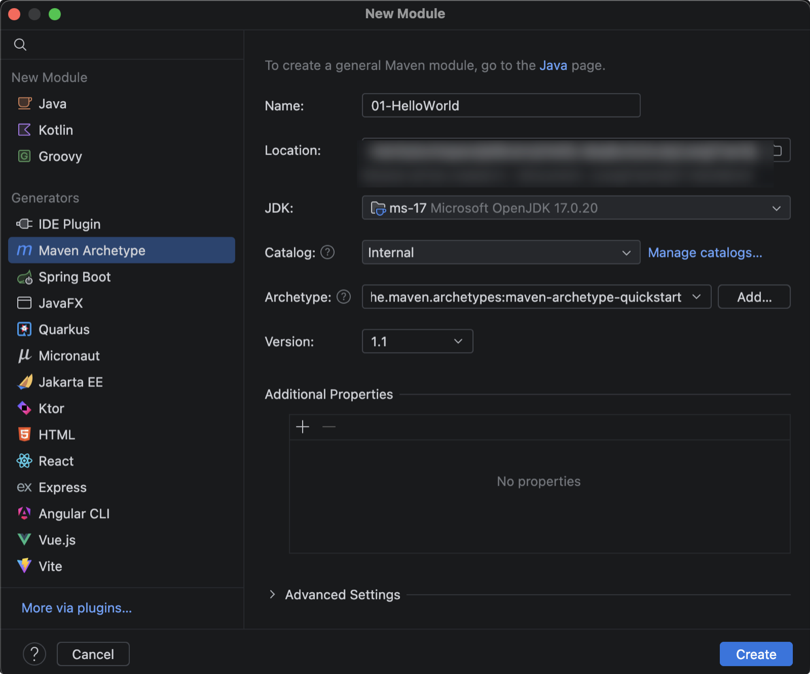
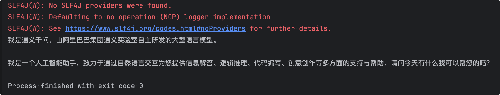
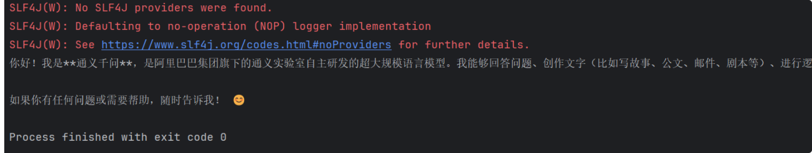
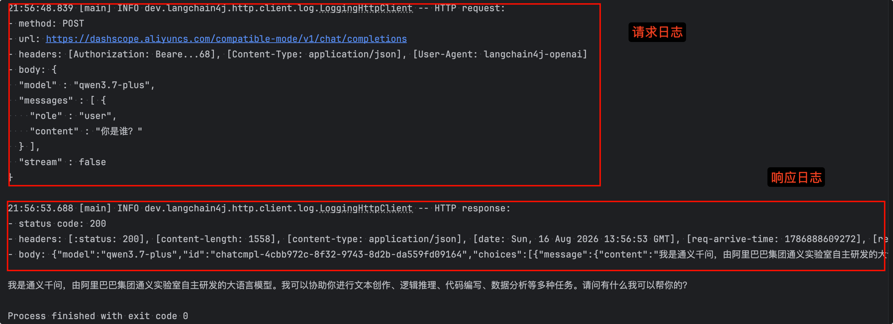

# hello-world 实现

## 使用大模型平台接口实现

新建helloWorld项目，选择Maven Archetype，JDK版本17，骨架选quickstart。



然后点Create按钮。

pom.xml里加上langchain4j依赖：

```xml
<dependency>
    <groupId>dev.langchain4j</groupId>
    <artifactId>langchain4j-open-ai</artifactId>
    <version>1.19.0</version>
</dependency>
```

实现模型定义和调用。

```java
import dev.langchain4j.model.openai.OpenAiChatModel;

/**
 * Hello world!
 *
 */
public class App {
    public static void main( String[] args ) {
        OpenAiChatModel model = OpenAiChatModel.builder()
            .baseUrl("https://dashscope.aliyuncs.com/compatible-mode/v1") // 模型地址
            .modelName("qwen3.7-plus") // 模型名称
            .apiKey("sk-4feab9b9xxxxxxxxxxxxxdf1e9268") // 密钥
            .build();// 构建模型

        String answer = model.chat("你是谁？"); // 提问
        System.out.println(answer);
    }
}

```

运行输出：



## 使用Ollama实现

调用Ollama的模型，使用的baseurl是 `http://localhost:11434/v1`,以及不需要密钥。

实现模型定义和调用

```java
import dev.langchain4j.model.openai.OpenAiChatModel;

/**
 * Hello world!
 */
public class App2 {
    public static void main(String[] args) {
        // 创建模型
        OpenAiChatModel model = OpenAiChatModel.builder()
                .baseUrl("http://localhost:11434/v1") // 模型地址
                .modelName("qwen3:4b") // 模型名称
                .build(); // 构建模型

        String answer = model.chat("你是谁？"); // 提问
        System.out.println(answer);
    }
}
```

运行输出：



## SLF4J日志配置

LangChain4j 使用[SLF4J](https://www.slf4j.org/)进行日志记录，允许您插入任何您喜欢的日志后端，例如[Logback](https://logback.qos.ch/)或[Log4j](https://logging.apache.org/log4j/2.x/index.html)。

SLF4J是一套日志规范，类似JDBC规范，具体实现由厂家或者开源组织去实现。

前面我们运行的代码，都会有警告提示，没找到SLF4J的提供者。

我们可以pom.xml加下Logback依赖：

```xml
<dependency>
  <groupId>ch.qos.logback</groupId>
  <artifactId>logback-classic</artifactId>
  <version>1.5.13</version>
</dependency>
```

可以通过在创建模型实例时进行设置

`.logRequests(true)`来启用对 LLM 的每个请求的日志记录

`.logResponses(true)`来启用对 LLM 的每个响应的日志记录

代码实现：

```java
import dev.langchain4j.model.openai.OpenAiChatModel;

/**
 * Hello world!
 *
 */
public class App {
    public static void main( String[] args ) {
        OpenAiChatModel model = OpenAiChatModel.builder()
            .logRequests(true) // 打印请求日志
            .logResponses(true) // 打印响应日志
            .baseUrl("https://dashscope.aliyuncs.com/compatible-mode/v1") // 模型地址
            .modelName("qwen3.7-plus") // 模型名称
            .apiKey("sk-4feab9xxxxxxxxxxxxxxxxx268") // 密钥
            .build();// 构建模型

        String answer = model.chat("你是谁？"); // 提问
        System.out.println(answer);
    }
}
```

运行输出：

