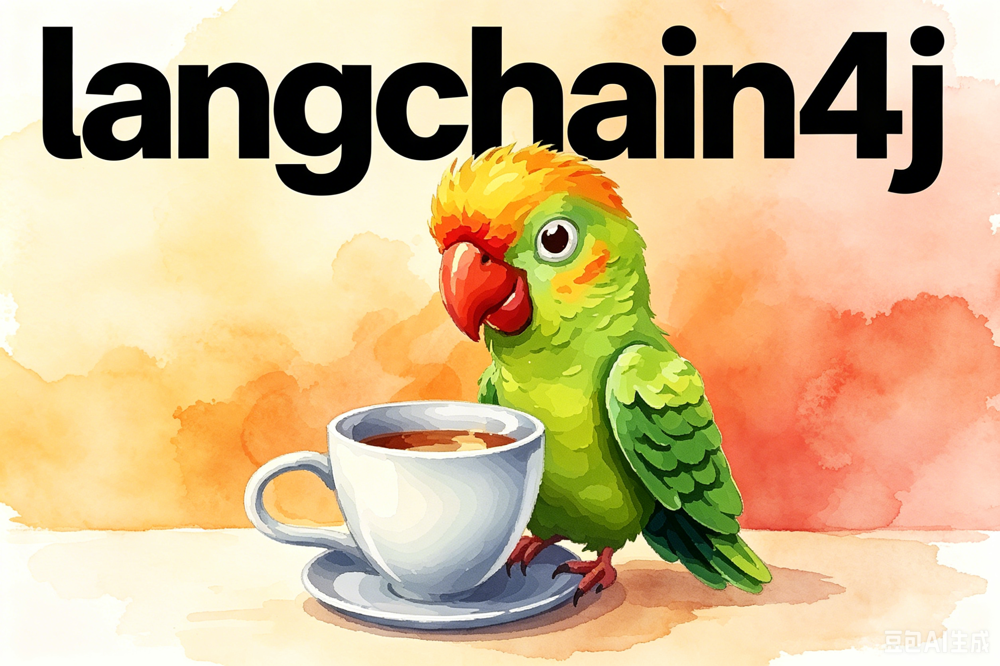
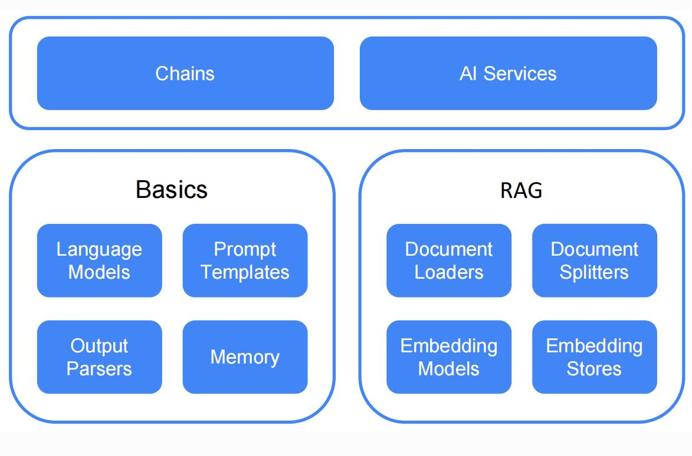

# 概述

## 简介

LangChain4j 是面向 Java 生态的**开源大模型应用开发框架**，核心是用统一、原生 Java 的方式快速构建 LLM 驱动的应用（聊天机器人、RAG、Agent、智能助手等）。它不是简单 “Java 版 LangChain”，而是专为 JVM 重新设计，深度融入 Spring Boot 等主流栈。最新版本：1.19

官方站点：https://docs.langchain4j.dev/

官网学习指南：https://docs.langchain4j.dev/category/tutorials

## 核心定位与设计目标

- **一句话**：让 Java 工程师**无需 Python**，就能高效构建生产级 AI 应用。

- 核心目标

  - **统一 API**：抹平 OpenAI、通义千问、Claude、Llama 等 20+ 大模型与 30+ 向量库的异构差异，**一行代码切换模型 / 存储**。
  - **Java 原生**：基于接口、注解、动态代理，**声明式 AI 编程**，贴合 Java 开发习惯。
  - **生产就绪**：内置重试、缓存、流式响应、结构化输出、监控等企业级能力。

## 核心架构（四层）

1. **Core 层**：纯接口、零依赖，定义模型、记忆、工具、RAG 等标准抽象。
2. **AI Services 层（核心）**：动态代理 + 注解驱动，用 Java 接口定义 AI 服务，框架自动生成实现。
3. **Provider 层**：对接各类 LLM、向量库、工具的实现，即插即用。
4. **Agentic 层**：多智能体编排、复杂任务拆解（实验中）。

## 核心能力

### 多模型统一接入

- 支持 OpenAI、Azure OpenAI、Google Gemini、Anthropic Claude、通义千问、文心一言、Llama 2/3、Ollama（本地模型）等 20+ 提供商。
- 支持**文本 / 图像多模态输入**、流式响应、函数调用LangChain4j。

### RAG（检索增强生成）全链路

- **数据接入**：支持 PDF、DOCX、TXT、Markdown、URL、S3 等多源文档加载LangChain4j。
- **文档处理**：分割、清洗、摘要、元数据提取。
- **向量存储**：支持 Pinecone、Milvus、FAISS、Weaviate、MongoDB、Elasticsearch 等 30+ 向量库。
- **检索优化**：查询扩展、重排序、混合检索、路由、RRF 融合LangChain4j。

### 聊天记忆（Chat Memory）

- 支持**持久化 / 内存**两种模式，内置消息窗口、Token 窗口等算法，解决上下文窗口限制LangChain4j。
- 可按用户隔离记忆，适配多用户聊天场景。

### 工具调用（Function Calling）

- 可将 Java 方法声明为工具，LLM 自动判断何时调用、参数生成与结果回传。
- 支持动态工具（执行 LLM 生成的代码）LangChain4j。

### 输出解析

- 自动解析 LLM 输出为**Java 基本类型、POJO、集合**，支持自定义解析器LangChain4j。

## 典型应用场景

- **企业智能客服**：基于 RAG 对接知识库，精准回答业务问题。
- **代码助手**：代码生成、审查、解释、重构。
- **文档问答**：PDF/Word 文档智能检索与摘要。
- **个人助理**：日程管理、邮件处理、信息查询。
- **内容创作**：文案、报告、诗歌、脚本生成。