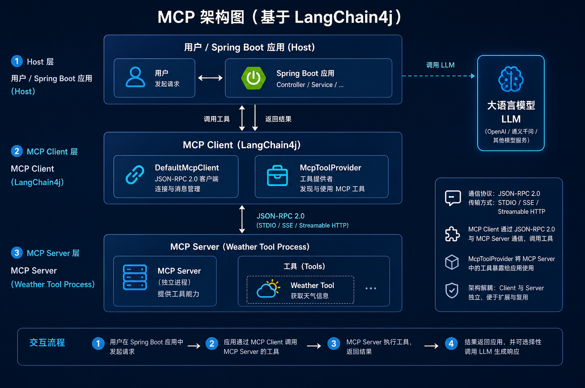
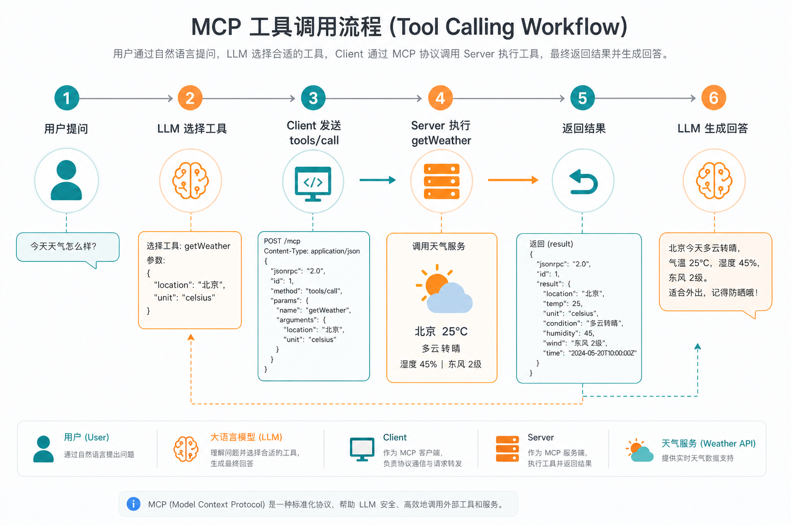
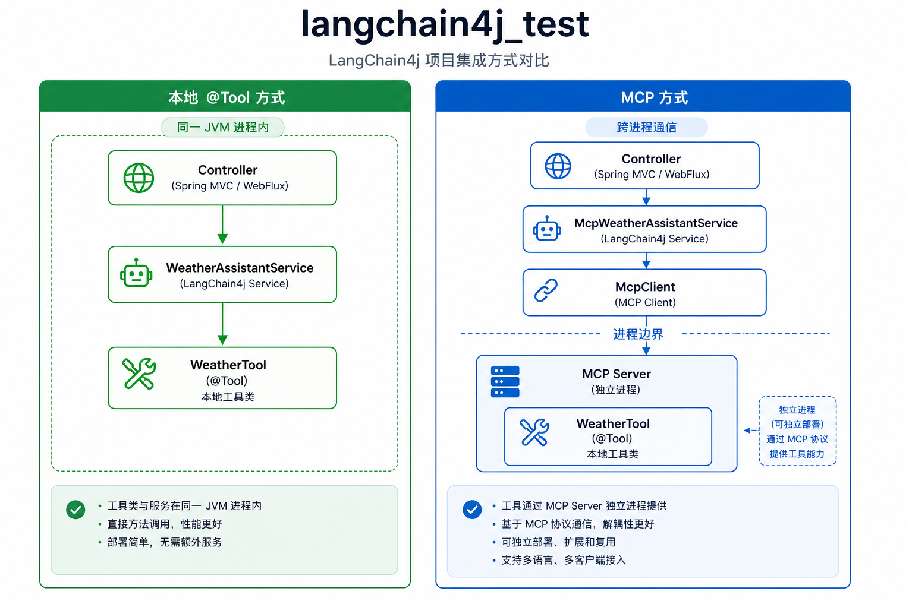
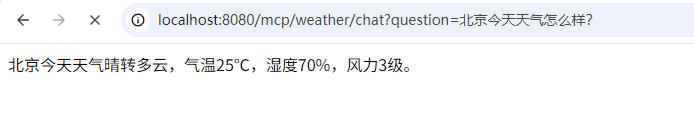

# 模型上下文协议

## 什么是 MCP？

**MCP（Model Context Protocol，模型上下文协议）** 是一项开放标准，用于在大语言模型应用与外部工具、数据源之间建立**统一、可互操作**的通信方式。

可以把它理解为 AI 世界的 **USB 接口**：

| 传统方式                                  | MCP 方式                                           |
| :---------------------------------------- | :------------------------------------------------- |
| 每个框架单独集成 GitHub、数据库、天气 API | 只要提供 MCP Server，任何 Client 都能接入          |
| 工具代码与应用强耦合                      | 工具运行在独立进程，通过协议调用                   |
| 跨语言复用困难                            | Server 可用 Java/Node/Python 实现，Client 统一消费 |

**官方资源：**

- MCP 规范：https://modelcontextprotocol.io/
- LangChain4j 教程：[MCP Tutorial](https://docs.langchain4j.dev/tutorials/mcp)

## MCP 整体架构

MCP 涉及四个核心角色：

| 角色             | 在本项目中的对应                                      |
| :--------------- | :---------------------------------------------------- |
| **Host（宿主）** | Spring Boot 应用，接收 HTTP 请求                      |
| **MCP Client**   | LangChain4j `DefaultMcpClient`，负责协议通信          |
| **MCP Server**   | 独立进程，暴露 `getWeather` 等工具                    |
| **LLM**          | 配置中的 `openAiChatModel` / Ollama，决定是否调用工具 |



## MCP 工作原理

MCP 基于 **JSON-RPC 2.0**，典型调用流程如下：

1. **initialize** — Client 与 Server 握手，协商协议版本
2. **tools/list** — Client 获取 Server 提供的工具列表及参数 Schema
3. **tools/call** — LLM 选中工具后，Client 将请求转发给 Server 执行
4. **回传结果** — Server 返回执行结果，LLM 生成自然语言回答



## LangChain4j MCP 模块分层

```markdown
AI Service（@AiService）          ← 业务接口，与 Controller 对接
        ↓
McpToolProvider                   ← 将 MCP 工具适配为 LangChain4j Tool
        ↓
DefaultMcpClient                  ← JSON-RPC 协议、缓存、健康检查
        ↓
McpTransport（stdio / HTTP 等）   ← 进程间或网络通信
```

## 常见传输方式

| 传输方式            | 适用场景             | LangChain4j 类               |
| :------------------ | :------------------- | :--------------------------- |
| **stdio**           | 本地子进程（最常见） | `StdioMcpTransport`          |
| **Streamable HTTP** | 远程 HTTP 服务       | `StreamableHttpMcpTransport` |
| **Docker stdio**    | 容器化 MCP Server    | `DockerMcpTransport`         |

开发环境下，**stdio** 最为常用。

## 与现有实现的对比

本项目已有天气助手，使用的是 **本地 `@Tool`** 方式：

- `WeatherTool` — 带 `@Tool` 注解的工具类，运行在 Spring 容器内
- `WeatherAssistantService` — `@AiService(tools = {"weatherTool"})`
- `MyWeatherController` — 暴露 `/weather/chat` 接口

MCP 方式则将工具放到**独立进程**，通过协议远程调用，架构解耦程度更高：




## 具体天气MCP实例

首先pom.xml里加下mcp server和client依赖：

```xml
<!-- MCP Client -->
<dependency>
  <groupId>dev.langchain4j</groupId>
  <artifactId>langchain4j-mcp</artifactId>
  <version>1.19.0-beta29</version>
</dependency>

<!-- MCP Server（社区版） -->
<dependency>
  <groupId>dev.langchain4j</groupId>
  <artifactId>langchain4j-community-mcp-server</artifactId>
  <version>1.18.0-beta28</version>
</dependency>
```


接着 创建mcp-server WeatherMcpServerMain

```java
package com.bufx.mcp;

import com.bufx.tool.WeatherTool;
import dev.langchain4j.community.mcp.server.McpServer;
import dev.langchain4j.community.mcp.server.transport.StdioMcpServerTransport;
import dev.langchain4j.mcp.protocol.McpImplementation;
import java.util.List;

/**
 * 天气 MCP Server。独立进程运行，通过 stdio 与 Client 通信。
 * 注意：JSON-RPC 走 System.out，日志请输出到 System.err。
 */
public class WeatherMcpServerMain {

    public static void main(String[] args) throws Exception {
        McpImplementation info = new McpImplementation(); // MCP Server 信息
        info.setName("bufx-weather-mcp-server"); // MCP Server 名称
        info.setVersion("1.0.0"); // MCP Server 版本

        McpServer server = new McpServer(List.of(new WeatherTool()), info); // 创建 MCP Server
        new StdioMcpServerTransport(System.in, System.out, server); // 创建 stdio 适配器

        Thread.currentThread().join(); // 阻塞当前线程，等待退出
    }
}

```


再新建McpConfig

```java
package com.bufx.config;

import dev.langchain4j.mcp.McpToolProvider;
import dev.langchain4j.mcp.client.DefaultMcpClient;
import dev.langchain4j.mcp.client.McpClient;
import dev.langchain4j.mcp.client.transport.McpTransport;
import dev.langchain4j.mcp.client.transport.stdio.StdioMcpTransport;
import java.nio.file.Path;
import java.util.List;
import org.springframework.context.annotation.Bean;
import org.springframework.context.annotation.Configuration;

@Configuration
public class McpConfig {

    /**
     * 创建 MCP Client
     */
    @Bean(destroyMethod = "close")
    public McpClient weatherMcpClient() {
        String javaBin = Path.of(System.getProperty("java.home"), "bin", "java").toString();
        String classpath = System.getProperty("java.class.path");

        McpTransport transport = StdioMcpTransport.builder()  // 创建 stdio 适配器
            .command(List.of(
                javaBin,
                "-cp", classpath,
                "com.bufx.mcp.WeatherMcpServerMain"
            ))
            .logEvents(true)
            .build();

        return DefaultMcpClient.builder()  // 创建 MCP Client
            .key("weather-mcp")
            .transport(transport)
            .build();
    }

    /**
     * 创建 MCP 工具提供者
     */
    @Bean
    public McpToolProvider weatherMcpToolProvider(McpClient weatherMcpClient) {
        return McpToolProvider.builder()
            .mcpClients(weatherMcpClient)
            .filterToolNames("getWeather")  // 只添加 getWeather 工具
            .build();
    }
}
```


接着再新建McpWeatherAssistantService，配置上toolProvider

```java
package com.bufx.service;

import dev.langchain4j.service.SystemMessage;
import dev.langchain4j.service.spring.AiService;
import dev.langchain4j.service.spring.AiServiceWiringMode;

@AiService(
    wiringMode = AiServiceWiringMode.EXPLICIT,
    chatModel = "openAiChatModel",
    toolProvider = "weatherMcpToolProvider"   // 关键：使用 MCP 工具
)
public interface McpWeatherAssistantService {

    @SystemMessage("""
        你是天气助手。用户询问某地天气时，必须调用 getWeather 工具获取数据，
        再基于工具返回结果用中文简洁回答；不要编造未在工具结果中出现的数值。
        """)
    String chat(String userMessage);
}

```


最后新建MyMcpWeatherController

```java
package com.bufx.controller;

import com.bufx.service.McpWeatherAssistantService;
import org.springframework.beans.factory.annotation.Autowired;
import org.springframework.web.bind.annotation.GetMapping;
import org.springframework.web.bind.annotation.RequestMapping;
import org.springframework.web.bind.annotation.RestController;

@RestController
@RequestMapping("/mcp/weather")
public class MyMcpWeatherController {

    @Autowired
    private McpWeatherAssistantService mcpWeatherAssistantService;

    @GetMapping("/chat")
    public String chat(String question) {
        return mcpWeatherAssistantService.chat(question);
    }
}
```


最后编译测试下：

**1. 编译**

```shell
mvn compile
```

**2. 启动应用**

```shell
mvn spring-boot:run
```

启动时 `McpConfig` 会自动拉起 `WeatherMcpServerMain` 子进程并完成 MCP 握手。

**3. 调用 MCP 接口**

`http://localhost:8080/mcp/weather/chat?question=北京今天天气怎么样？`



## 有了 `@Tool` 还要 MCP？

不是因为 `@Tool` 不够用，而是因为场景不同。

### 用@Tool场景

- `@Tool` 使用与大多数业务代码

- 工具是你自己写的 Java 代码
- 和业务服务在同一个 Spring Boot 里
- 逻辑简单、团队只用 LangChain4j/Java
- 追求简单、稳定、少运维

例如：查订单、算价格、调内部 Service——直接 `@Tool` 最合适。

### 用 MCP场景

1. 接入第三方/社区工具 GitHub、文件系统、数据库等已有 MCP Server，不用为每个框架单独写集成。
2. 工具与 AI 应用解耦 工具独立部署、独立升级、独立扩缩容；AI 应用只连 MCP Client。
3. 跨语言复用 Server 用 Python/Node 写，Java 应用通过 MCP 调用，不必重写一遍。
4. 多 Client 共享同一套工具 Cursor、Claude Desktop、你的 Spring Boot 应用都能连同一个 MCP Server。
5. 安全与隔离 工具在子进程/容器里跑，权限、资源、崩溃与主应用隔离。
6. 动态扩展工具 运行时连上 MCP Server 就能 `tools/list` 发现新工具，不必改主应用代码。