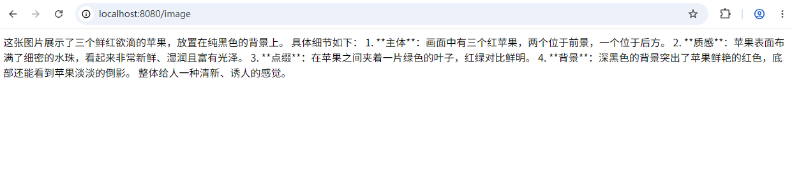

# 多模态支持

## 什么是多模态

**多模态（Multimodal）** 指大模型不仅能处理文本，还能理解或生成其他类型的媒体内容。

常见场景举例：

| 场景     | 输入                           | 模型输出     |
| -------- | ------------------------------ | ------------ |
| 图片描述 | 一张猫的照片 +「请描述这张图」 | 自然语言描述 |
| 票据识别 | 发票截图 +「提取金额和日期」   | 结构化文字   |
| 文档问答 | PDF 论文 +「总结核心观点」     | 摘要         |
| 视频理解 | 短视频 +「列出关键章节」       | 章节列表     |

在 LangChain4j 中，多模态内容通过 `Content` 接口的不同实现类来表达，最终组装进 `UserMessage` 发送给支持该能力的 `ChatModel`。

## 支持的多模态核心类

```shell
UserMessage
  └── List<Content>
        ├── TextContent      文本
        ├── ImageContent     图片（URL 或 Base64）
        ├── AudioContent     音频
        ├── VideoContent     视频
        └── PdfFileContent   PDF 文件
```

对应包路径：

- `dev.langchain4j.data.message.UserMessage`
- `dev.langchain4j.data.message.TextContent`
- `dev.langchain4j.data.message.ImageContent`
- `dev.langchain4j.data.message.AudioContent`
- `dev.langchain4j.data.message.VideoContent`
- `dev.langchain4j.data.message.PdfFileContent`

## 适用模型

LangChain4j 支持多种多模态模型。在选择时，你需要注意模型支持的“模态”（如图像、音频）。常用模型支持情况如下：

| 模型提供商 (Provider)        | 支持的多模态输入 (Supported Modalities)                      | 特点描述 (Key Features)                        |
| :--------------------------- | :----------------------------------------------------------- | :--------------------------------------------- |
| **OpenAI** (如 GPT-4/GPT-4o) | 文本 (Text)、图像 (Image)                                    | 技术领先，支持JSON模式等，性能强大。           |
| **Google Gemini**            | 文本、图像、**音频、视频、PDF** (Text, Image, Audio, Video, PDF) | 原生多模态，支持文件类型最丰富，适合复杂场景。 |
| **DashScope (阿里云)**       | 文本、图像、**音频** (Text, Image, Audio)                    | 提供如Qwen-VL等国产模型，对中文场景支持友好。  |
| **智谱AI (Zhipu AI)**        | 主要支持图像生成和理解 (Primarily Text and Image)            | 提供视觉推理模型等，并提供免费模型便于测试。   |
| **Anthropic (Claude)**       | 文本 (Text)、图像 (Image)                                    | 以强大的推理能力和安全性著称。                 |
| **Amazon Bedrock**           | 文本、图像、PDF (Text, Image, PDF)                           | 平台服务，适合已在AWS上的用户。                |
| **Ollama (本地)**            | 支持文本、图像等 (Supports various local models)             | 可在本地运行模型，保证数据隐私。               |


## 具体示例

我们先准备一个图片apple.png：


新建一个VisionAssistantService

```java
package com.bufx.service;

import dev.langchain4j.data.message.ImageContent;
import dev.langchain4j.service.SystemMessage;
import dev.langchain4j.service.UserMessage;
import dev.langchain4j.service.spring.AiService;
import dev.langchain4j.service.spring.AiServiceWiringMode;

@AiService(
    wiringMode = AiServiceWiringMode.EXPLICIT, // 手动指定接入模型 手动装配
    chatModel = "openAiChatModel"  // 指定模型
)
public interface VisionAssistantService {

    @SystemMessage("你是图片理解助手。请根据用户提供的图片，用中文准确、简洁地回答用户问题。")
    String analyze(@UserMessage String question, @UserMessage ImageContent image);
}
```


再新建一个MyVisionController

```java
package com.bufx.controller;

import com.bufx.service.VisionAssistantService;
import dev.langchain4j.data.message.ImageContent;
import java.nio.file.Files;
import java.nio.file.Path;
import java.nio.file.Paths;
import java.util.Base64;
import org.springframework.web.bind.annotation.GetMapping;
import org.springframework.web.bind.annotation.RequestParam;
import org.springframework.web.bind.annotation.RestController;

@RestController
public class MyVisionController {
    
    private final VisionAssistantService visionAssistantService;

    public MyVisionController(VisionAssistantService visionAssistantService) {
        this.visionAssistantService = visionAssistantService;
    }

    @GetMapping("/image")
    public String analyzeApple(
        @RequestParam(defaultValue = "请描述这张图片中的内容") String question) throws Exception {
        Path imagePath = Paths.get("upload/apple.png");
        byte[] bytes = Files.readAllBytes(imagePath);
        String base64 = Base64.getEncoder().encodeToString(bytes);
        ImageContent image = ImageContent.from(base64, "image/png");
        return visionAssistantService.analyze(question, image);
    }
}
```

我们可以浏览器测试下：`http://localhost:8080/image`

成功解析：

