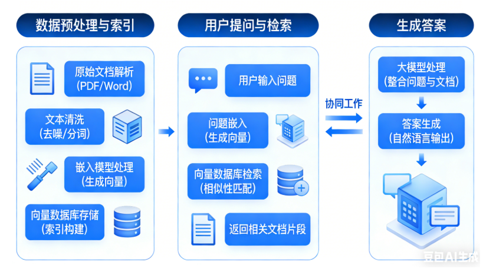
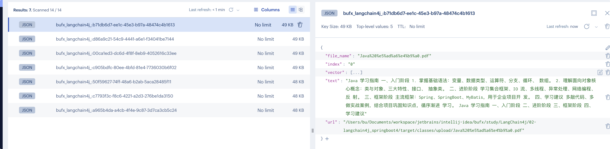
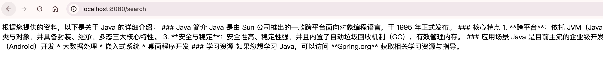
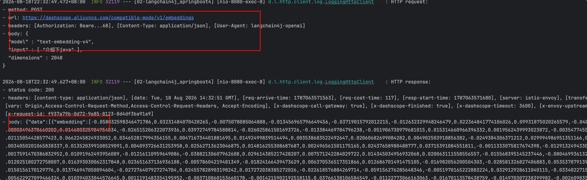
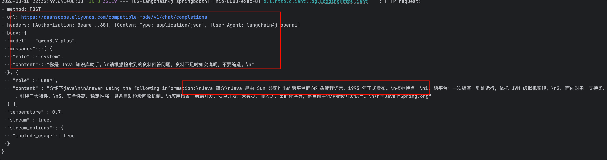
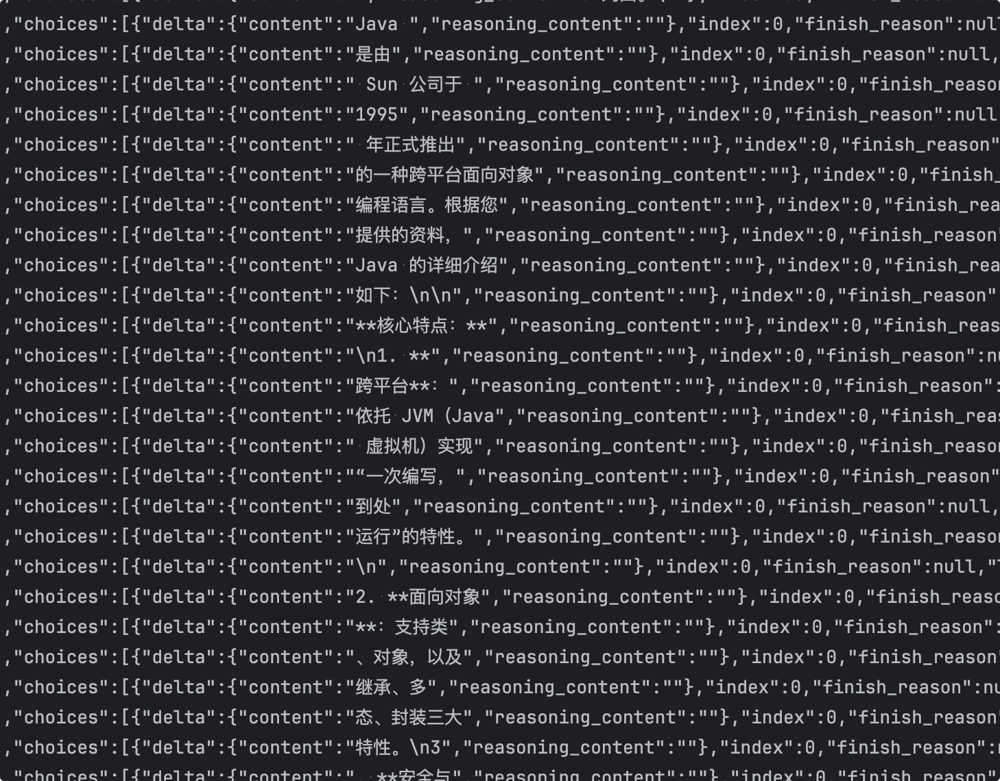

# 检索增强生成

## 简介

`RAG`(`Retrieval-Augmented-Generation`，检索增强生成) 是在大模型回答前，先从外部知识库检索相关内容，再把这些内容作为上下文交给 LLM 生成答案。



这是目前最经典的AI应用架构，可以清晰地看到嵌入模型和向量数据库是如何配合的。

**场景**：构建一个基于公司内部知识库的智能问答机器人。

**第一步：数据预处理与索引（入库阶段）**

1. **准备文档**：收集所有公司文档（PDF、Word、内部Wiki等）。
2. **文本分块**：将长文档切分成更小的段落或“块”。
3. **生成嵌入**：使用**嵌入模型**，为每一个文本块生成一个向量。
4. **存储**：将生成的向量，连同原始的文本块和相关的元数据（如文档来源、页码），一起存入**向量数据库**。

**第二步：用户提问与检索（查询阶段）**

1. **用户提问**：用户问：“我们公司的年假政策是什么？”
2. **问题嵌入**：使用**相同的嵌入模型**，将用户的这个问题也转换成一个向量。
3. **向量检索**：将这个代表问题的向量发送到**向量数据库**进行查询。数据库会迅速返回与问题向量最相似的K个文本块向量。
4. **获取上下文**：根据返回的向量ID，取出对应的原始文本块内容。

**第三步：生成答案（生成阶段）**

1. **构建提示词**：将用户的问题 + 检索到的相关文本块（作为上下文）组合成一个提示词。
2. **调用大语言模型**：将提示词发送给大语言模型（如GPT-4），并指示它“请根据提供的上下文回答问题”。
3. **返回答案**：大模型阅读并理解上下文后，生成一个准确、有据可依的答案返回给用户。

## 技术背景

随着大语言模型（LLM）快速普及，**RAG（检索增强生成）**技术成为解决大模型幻觉、私有化知识库落地的核心方案。传统本地知识库开发存在文档适配单一、向量库部署复杂、代码冗余度高等问题。


要想开发轻量化RAG工程，需完整实现以下核心能力：

- **多格式文档解析**：支持PDF、Word(DOC)、纯文本(TXT)、Markdown(MD)四种主流文档格式；
- **智能文本切分**：基于令牌数实现语义分片，避免语义割裂，适配大模型上下文限制；
- **Redis向量存储**：文档切片生成向量，持久化存入Redis向量数据库；
- **标准化RAG架构**：遵循ETL（抽取-转换-加载）流程，代码可直接生产复用；
- **极简接口调试**：提供文件上传、向量检索、知识库清空接口，方便测试验证。

## RAG执行流程

严格遵循标准RAG的ETL执行流程，流程简洁清晰：

1. **E抽取（Extract）**：读取本地上传的PDF/DOC/TXT/MD文件，提取纯文本内容，过滤乱码、格式符号、空白行；
2. **T转换（Transform）**：通过分词器将长文本切分为固定大小的文本切片，补充切片元数据（文件名、格式、上传时间）；
3. **L加载（Load）**：调用Embedding模型将文本切片转为浮点型向量，存入Redis向量索引；
4. **检索问答**：用户提问时，将问题转为向量，在Redis中相似度匹配，召回相似文档片段，结合大模型生成答案。


**RAG在LangChain4j中可分为入库（Ingestion）和检索增强（Retrieval+Augmentation+Generation）两阶段**

## 文档加载和解析器

| 组件                     | 职责                                                         | 类比                              |
| :----------------------- | :----------------------------------------------------------- | :-------------------------------- |
| DocumentLoader（加载器） | 从某个来源找到文件，读取字节流，附带 metadata（文件名、路径等） | 「把文件从磁盘/Classpath 拿出来」 |
| DocumentParser（解析器） | 把字节流按格式解析成纯文本，封装成 `Document`                | 「把 PDF/Word/TXT 转成可读文字」  |


### Document Loader

**文档加载器**

加载器负责从哪里读，不负责怎么解析格式。

1. 内置加载器（`langchain4j` 主模块）

| 加载器                     | 来源           | 典型场景                           |
| :------------------------- | :------------- | :--------------------------------- |
| `ClassPathDocumentLoader`  | classpath 资源 | Spring Boot 的 `resources/upload/` |
| `FileSystemDocumentLoader` | 本地磁盘路径   | 服务器上的绝对路径目录             |
| `UrlDocumentLoader`        | HTTP/HTTPS URL | 网页、远程文件                     |


### Document Parser

**文档解析器**

| 解析器                       | Maven 模块                                  | 支持格式               | 说明                   |
| :--------------------------- | :------------------------------------------ | :--------------------- | :--------------------- |
| `TextDocumentParser`         | `langchain4j`                               | TXT、MD、HTML 等纯文本 | 最简单，按字符流读     |
| `MarkdownDocumentParser`     | `langchain4j-document-parser-markdown`      | Markdown               | 专门处理 MD 结构       |
| `ApachePdfBoxDocumentParser` | `langchain4j-document-parser-apache-pdfbox` | PDF                    | 基于 PDFBox            |
| `ApachePoiDocumentParser`    | `langchain4j-document-parser-apache-poi`    | DOC/DOCX/PPT/XLS 等    | Office 文档            |
| `ApacheTikaDocumentParser`   | `langchain4j-document-parser-apache-tika`   | 几乎全格式             | 自动识别类型，万能解析 |
| `YamlDocumentParser`         | `langchain4j-document-parser-yaml`          | YAML                   | 配置文件类文档         |
| `DoclingDocumentParser`      | `langchain4j-document-parser-docling`       | 多种格式               | 基于 Docling           |

## 代码使用

首先我们使用ApacheTikaDocumentParser解析器，所以pom.xml加下对应的依赖

```xml
<dependency>
    <groupId>dev.langchain4j</groupId>
    <artifactId>langchain4j-document-parser-apache-tika</artifactId>
    <version>1.19.0-beta29</version>
</dependency>
```


接着MyEmController里加上addDocs方法

```java
@RequestMapping("/addDocs")
public String addDocs() {
    try {
        // 1. 读取 upload 下所有文件（txt / md 等）
        List<Document> documents = ClassPathDocumentLoader.loadDocuments("upload",new ApacheTikaDocumentParser());
        // 2. 构建入库管道：切分 -> 向量化 -> 写入 Redis
        EmbeddingStoreIngestor ingestor = EmbeddingStoreIngestor.builder()
            .embeddingStore(embeddingStore) // 存储
            .embeddingModel(embeddingModel) // 模型
            // 小文档可 300~500 字符一段，重叠 50 提升检索效果
            .documentSplitter(DocumentSplitters.recursive(400, 50)) // 切分
            .build();
        ingestor.ingest(documents); // 入库
        return "OK，已入库 " + documents.size() + " 个文件";
    } catch (Exception e) {
        e.printStackTrace();
        return "入库失败: " + e.getMessage();
    }
}
```


再新建一个RagConfig ，配置内容检索器

```java
package com.bufx.config;

import dev.langchain4j.data.segment.TextSegment;
import dev.langchain4j.model.embedding.EmbeddingModel;
import dev.langchain4j.rag.content.retriever.EmbeddingStoreContentRetriever;
import dev.langchain4j.store.embedding.EmbeddingStore;
import org.springframework.context.annotation.Bean;
import org.springframework.context.annotation.Configuration;

/**
 * rag 配置
 */
@Configuration
public class RagConfig {

    /**
     *   rag 内容检索器
     */
    @Bean
    EmbeddingStoreContentRetriever embeddingStoreContentRetriever(EmbeddingStore<TextSegment> embeddingStore, EmbeddingModel embeddingModel) {
        return EmbeddingStoreContentRetriever.builder()
            .embeddingStore(embeddingStore) // 存储
            .embeddingModel(embeddingModel) // 模型
            .maxResults(2) // 最大结果数
            .minScore(0.5) // 最小分数
            .build();
    }
}

```


再新建一个RagService，AiService里要配置内置内容检索器contentRetriever

```java
package com.bufx.service;

import dev.langchain4j.service.SystemMessage;
import dev.langchain4j.service.spring.AiService;
import dev.langchain4j.service.spring.AiServiceWiringMode;
import reactor.core.publisher.Flux;

@AiService(
    wiringMode = AiServiceWiringMode.EXPLICIT, // 手动指定接入模型 手动装配
    streamingChatModel = "openAiStreamingChatModel", // 配置流式模型
    contentRetriever = "embeddingStoreContentRetriever" // 指定内容检索器
)
public interface RagService {

    @SystemMessage("""
            你是 Java 知识库助手。
            请根据检索到的资料回答问题，资料不足时如实说明，不要编造。
            """)
    Flux<String> chat(String question);
}

```


最后MyEmController里加下RagService注入，以及新增search方法：

```java
private final RagService ragService;

@RequestMapping(value ="/search",produces = "text/html;charset=utf-8")
public Flux<String> search() {
    String question="介绍下java";
    return ragService.chat(question);
}
```


接下来我们测试下：`http://localhost:8080/addDocs` ，已经入库。



我们在测试下搜索：`http://localhost:8080/search`



我们在看下控制台输出，来剖析下底层运行机制：

首先把用户问题，提交嵌入模型，生成向量。



接着用返回的用户提问向量去redis向量库里去检索两条最相关的文档。

然后就是 带这个用户问题和向量数据库返回的相关文档再次向大模型请求。



最后就是大模型响应，流式返回结果。

