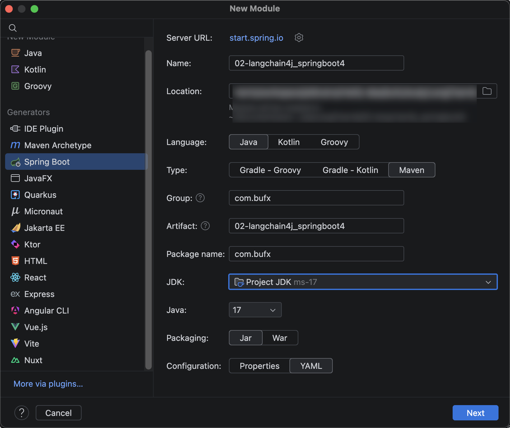
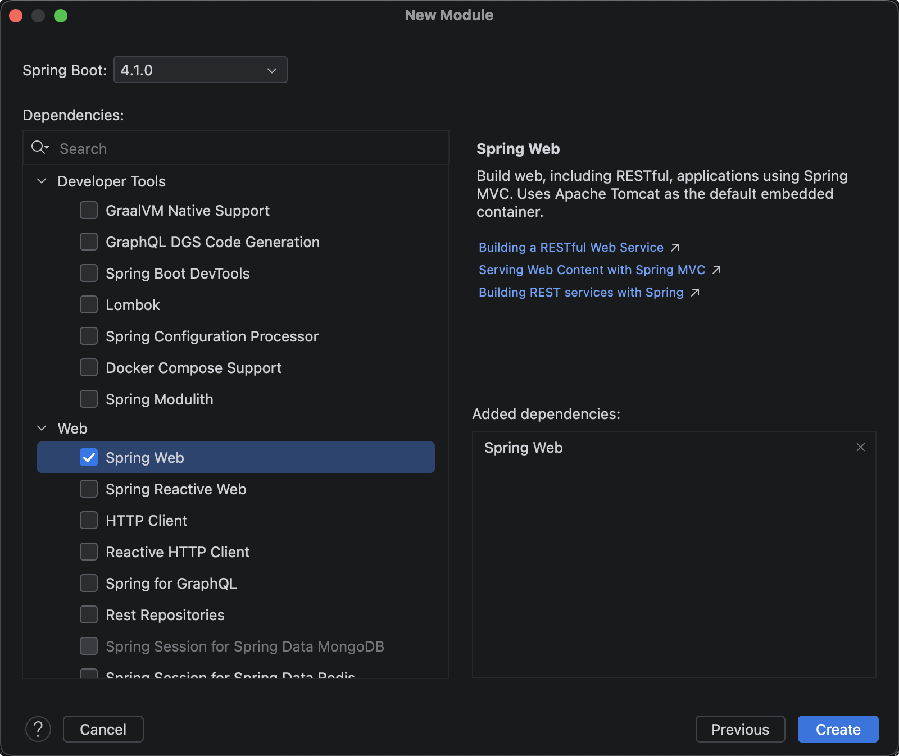
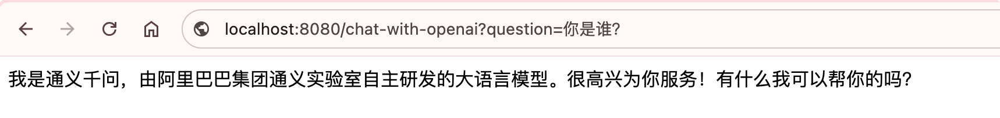
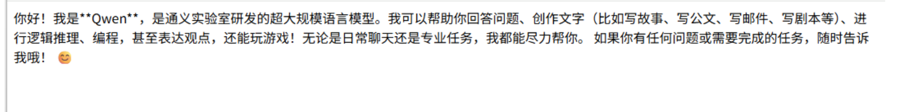

# 整合SpringBoot4

## 使用大模型平台接口实现

现在把LangChain4j整合到SpringBoot4里面去。

首先新建项目langchain4j_springboot4，选Maven构建，jdk版本选17



继续Next下一步，选SpringBoot版本4.1.0，以及选择Spring Web依赖。



根据官方文档，pom.xml加下LangChain4j依赖：

```xml
<dependency>
    <groupId>dev.langchain4j</groupId>
    <artifactId>langchain4j-open-ai-spring-boot4-starter</artifactId>
    <version>1.19.0-beta29</version>
</dependency>
```


application.yml里配置上模型参数，以及日志和日志级别：

```yaml
spring:
  application:
    name: 02-langchain4j_springboot4

langchain4j:
  open-ai:
    chat-model:
      api-key: sk-4feaxxxxxxxxxxxxxxxxxxxxxxxx268
      model-name: qwen3.7-plus
      base-url: https://dashscope.aliyuncs.com/compatible-mode/v1
      temperature: 0.7 # 是控制大语言模型（LLM）生成文本随机性或创造性的超参数。 它的值越高，模型随机性越高，创造性越强。 范围是0-1
      log-requests: true
      log-responses: true

logging:
  level:
    dev.langchain4j: debug
```


再新建一个MyChatController来测试下：

```java
import dev.langchain4j.model.openai.OpenAiChatModel;
import org.springframework.beans.factory.annotation.Autowired;
import org.springframework.web.bind.annotation.GetMapping;
import org.springframework.web.bind.annotation.RestController;

@RestController
public class MyChatController {

    private final OpenAiChatModel openAiChatModel;

    public MyChatController(OpenAiChatModel openAiChatModel) {
        this.openAiChatModel = openAiChatModel;
    }

    /**
     * 使用OpenAI的模型进行问答
     * @param question
     * @return
     */
    @GetMapping("/chat-with-openai")
    public String chatWithOpenAi(String question) {
        return openAiChatModel.chat(question);
    }
}
```


我们启动项目，浏览器输入测试：`http://localhost:8080/chat-with-openai?question=你是谁？`

浏览器返回：



## 使用Ollama实现

LangChain4j专门开发了适配Ollama的库，pom.xml里加下：

```xml
<dependency>
    <groupId>dev.langchain4j</groupId>
    <artifactId>langchain4j-ollama-spring-boot4-starter</artifactId>
    <version>1.19.0-beta29</version>
</dependency>
```


application.yml里配置ollama模型参数：

```yaml
spring:
  application:
    name: 02-langchain4j_springboot4

langchain4j:
  open-ai:
    chat-model:
      api-key: sk-4feaxxxxxxxxxxxxxxxxxxxxxe9268
      model-name: qwen3.7-plus
      base-url: https://dashscope.aliyuncs.com/compatible-mode/v1
      temperature: 0.7 # 是控制大语言模型（LLM）生成文本随机性或创造性的超参数。 它的值越高，模型随机性越高，创造性越强。 范围是0-1
      log-requests: true
      log-responses: true
  ollama:
    chat-model:
      model-name: qwen3:4b
      base-url: http://localhost:11434
      temperature: 0.7 # 是控制大语言模型（LLM）生成文本随机性或创造性的超参数。 它的值越高，模型随机性越高，创造性越强。 范围是0-1
      log-requests: true
      log-responses: true

logging:
  level:
    dev.langchain4j: debug
```


MyChatController里注入OllamaChatModel，以及实现chat2方法

```java
import dev.langchain4j.model.ollama.OllamaChatModel;
import dev.langchain4j.model.openai.OpenAiChatModel;
import org.springframework.web.bind.annotation.GetMapping;
import org.springframework.web.bind.annotation.RestController;

@RestController
public class MyChatController {

    private final OpenAiChatModel openAiChatModel;

    private final OllamaChatModel ollamaChatModel;

    public MyChatController(OpenAiChatModel openAiChatModel, OllamaChatModel ollamaChatModel) {
        this.openAiChatModel = openAiChatModel;
        this.ollamaChatModel = ollamaChatModel;
    }

    /**
     * 使用OpenAI的模型进行问答
     * @param question
     * @return
     */
    @GetMapping("/chat-with-openai")
    public String chatWithOpenAi(String question) {
        return openAiChatModel.chat(question);
    }

    /**
     * 使用Ollama的模型进行问答
     * @param question
     * @return
     */
    @GetMapping("/chat-with-ollama")
    public String chatWithOllama(String question) {
        return ollamaChatModel.chat(question);
    }

}

```


启动项目，浏览器输入测试：`http://localhost:8080/chat-with-ollama?question=你是谁`

浏览器返回内容：

