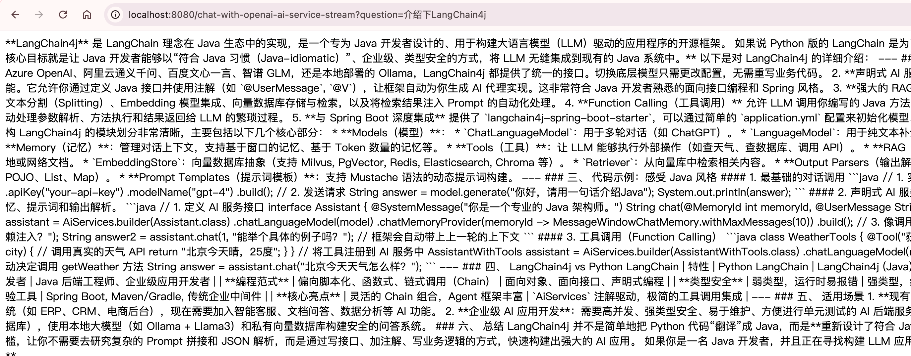

# 流式响应输出

## 引入

前面的实例大模型响应输出都是阻塞式完整输出，本质就是等大模型完全把回复内容响应了，才返回给系统，后端再完整的返回到前端。这里会有一个很大的弊端，就是当内容很多的时候，用户要等待好长时间，才能看到响应内容，而且是一下子出来一大片内容。这样很不友好。我们经常用deepseek，或者豆包之类的AI工具，我们提问的话，AI工具都是流失一段一段的响应内容，我们能够立即看到回答，这样用户体验就会好很多。

## 代码实现-OpenAi

LangChan4j也同样支持流式响应的输出设置。

首先加下langchain4j-reactor依赖

```xml
<dependency>
	<groupId>dev.langchain4j</groupId>
	<artifactId>langchain4j-reactor</artifactId>
	<version>1.19.0-beta29</version>
</dependency>
```

再加一个webflux，让springboot支持流式响应

```xml
<dependency>
	<groupId>org.springframework.boot</groupId>
	<artifactId>spring-boot-starter-webflux</artifactId>
</dependency>
```

然后application.yml里配置streaming-chat-model，配置内容和chat-model一样。

```yaml
spring:
  application:
    name: 02-langchain4j_springboot4

langchain4j:
  open-ai:
    chat-model:
      api-key: sk-4feabxxxxxxxxxxxxxxxxxxxx268
      model-name: qwen3.7-plus
      base-url: https://dashscope.aliyuncs.com/compatible-mode/v1
      temperature: 0.7 # 是控制大语言模型（LLM）生成文本随机性或创造性的超参数。 它的值越高，模型随机性越高，创造性越强。 范围是0-1
      log-requests: true
      log-responses: true
    streaming-chat-model:
      api-key: sk-4feabxxxxxxxxxxxxxxxxxxxx268
      model-name: qwen3.7-plus
      base-url: https://dashscope.aliyuncs.com/compatible-mode/v1
      temperature: 0.7 # 是控制大语言模型（LLM）生成文本随机性或创造性的超参数。 它的值越高，模型随机性越高，创造性越强。 范围是0-1
      log-requests: true
      log-responses: true
  ollama:
    chat-model:
      model-name: qwen3:4b
      base-url: http://localhost:11434
      temperature: 0.7 # 是控制大语言模型（LLM）生成文本随机性或创造性的超参数。 它的值越高，模型随机性越高，创造性越强。 范围是0-1
      log-requests: true
      log-responses: true
    streaming-chat-model:
      model-name: qwen3:4b
      base-url: http://localhost:11434
      temperature: 0.7 # 是控制大语言模型（LLM）生成文本随机性或创造性的超参数。 它的值越高，模型随机性越高，创造性越强。 范围是0-1
      log-requests: true
      log-responses: true

logging:
  level:
    dev.langchain4j: debug
```


接着新建Assistant3Service，配置流式模型`streamingChatModel = "openAiStreamingChatModel"`，以及方法返回值是`Flux<String>`

```java
package com.bufx.service;

import dev.langchain4j.service.spring.AiService;
import dev.langchain4j.service.spring.AiServiceWiringMode;
import reactor.core.publisher.Flux;

@AiService(
    wiringMode = AiServiceWiringMode.EXPLICIT, // 手动指定接入模型 手动装配
    streamingChatModel = "openAiStreamingChatModel" // 指定模型
)
public interface Assistant3Service {

    Flux<String> chat(String userMessage);
}

```


最后MyChatController里注入 private Assistant3Service assistant3Service;以及实现chatWithOpenAiAndAiServiceStreaming方法

```java
private final Assistant3Service assistant3Service;

/**
 * 使用ai service 注解 调用OpenAI的模型进行问答-流式问答
 */
@GetMapping(value = "/chat-with-openai-ai-service-stream", produces = "text/html;charset=utf-8")
public Flux<String> chatWithOpenAiAndAiServiceStreaming(String question) {
    return assistant3Service.chat(question);
}
```


我们浏览器输入测试下：`http://localhost:8080/chat-with-openai-ai-service-stream?question=介绍下LangChain4j`



效果就是一段一段流式响应。

## 代码实现-Ollama

如果要换成ollama，只需要把streamingChatModel = "ollamaStreamingChatModel"

```java
package com.bufx.service;

import dev.langchain4j.service.spring.AiService;
import dev.langchain4j.service.spring.AiServiceWiringMode;
import reactor.core.publisher.Flux;

@AiService(
    wiringMode = AiServiceWiringMode.EXPLICIT, // 手动指定接入模型 手动装配
//    streamingChatModel = "openAiStreamingChatModel" // 指定模型
    streamingChatModel = "ollamaStreamingChatModel" // 指定模型
)
public interface Assistant3Service {

    Flux<String> chat(String userMessage);
}

```

