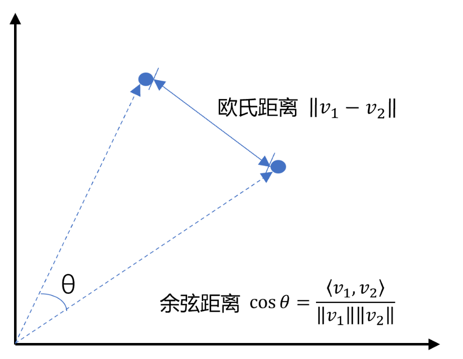
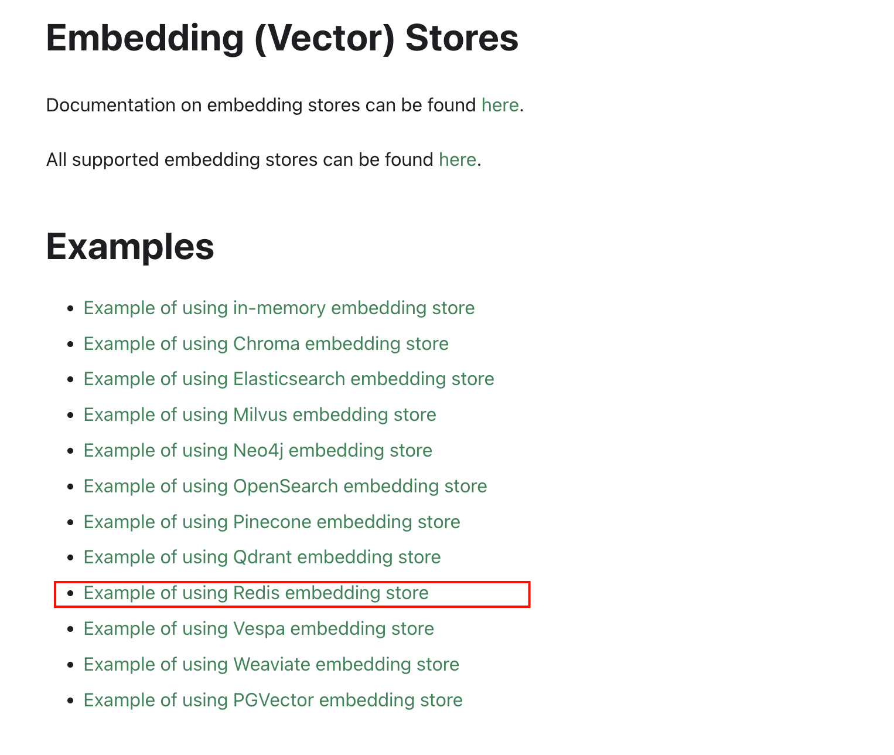
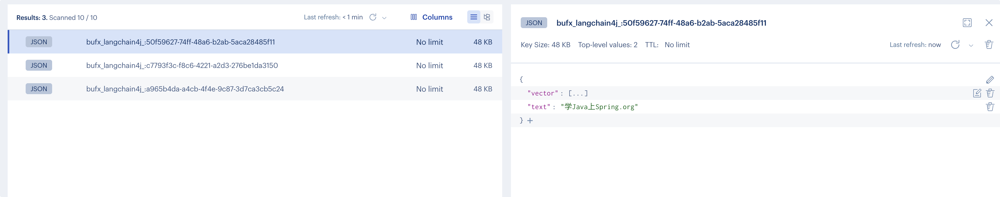
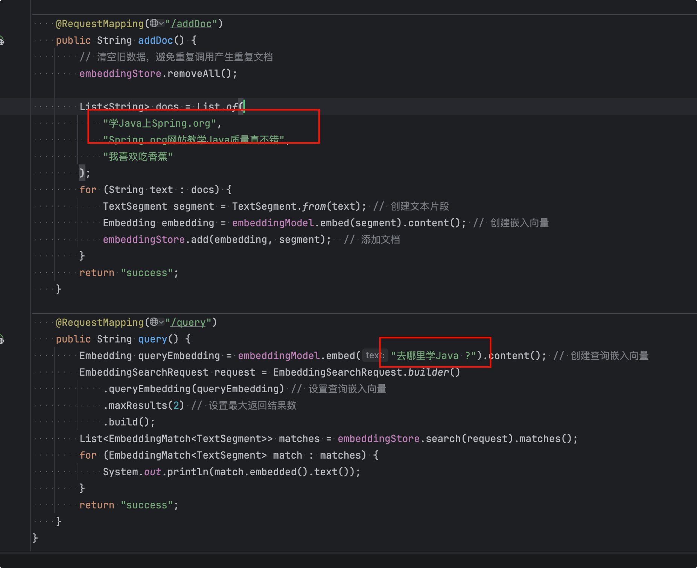

# 向量数据库

## 什么是向量数据库


**向量数据库是一种专门设计用来存储、索引和查询向量数据的数据库。**

传统的关系型数据库擅长存储和查询结构化数据（如表格中的姓名、年龄），但它们无法高效处理向量的“相似性检索”需求。

## 向量数据库的核心作用

**相似性搜索**



向量数据库的核心能力是**近似最近邻检索**。

- **任务**：给定一个查询向量，在数据库中快速找到与之最相似的K个向量。
- **算法**：它不进行暴力的一一比对，而是使用专门的索引算法（如 HNSW——分层可导航小世界图，IVF——倒排文件索引）来极大地提高搜索效率。即便数据库中有十亿个向量，也能在毫秒级内返回结果。
- **距离度量**：通常通过计算向量之间的“距离”来衡量相似度。
  - **余弦相似度**：衡量方向上的相似度（最常用）。
  - **欧氏距离**：衡量空间中的直线距离。
  - **点积**：衡量两个向量的投影。

## 为什么需要向量数据库

1. **高效的检索性能**：专为大规模向量相似性搜索优化，这是传统数据库无法做到的。
2. **元数据过滤**：在实际应用中，向量通常还附带元数据。例如，一个商品图片的向量可能还附有“商品ID”、“价格”、“类别”等信息。向量数据库允许你在进行相似性搜索时，同时根据这些元数据进行过滤（例如，“找到与这件红色T恤最相似的衣服，且价格低于100元”）。
3. **数据管理**：提供增删改查、数据持久化、备份、容灾等标准的数据库功能。
4. **与嵌入模型和大模型的完美集成**：它们共同构成了现代AI应用（如RAG——检索增强生成）的数据流水线。

## 常用的向量数据库

以下是5个最常用的向量数据库对比表格：

| 数据库       | 类型           | 特点                       | 优点                                     | 适用场景                             |
| :----------- | :------------- | :------------------------- | :--------------------------------------- | :----------------------------------- |
| **Pinecone** | 商业SaaS       | 全托管云服务               | 上手最快，零运维，提供免费额度           | 快速原型开发，不想自己搭建维护的项目 |
| **Milvus**   | 开源/商业      | 功能最全面的专业向量数据库 | 支持十亿级向量，索引类型丰富，性能强大   | 大规模生产环境，对性能要求高的场景   |
| **Qdrant**   | 开源/商业      | Rust编写，性能优异         | 内存占用低，API友好，支持过滤            | 需要高性能、资源受限的环境           |
| **Chroma**   | 开源           | Python原生，轻量级         | 极简API，与LangChain集成好，本地开发友好 | 本地开发、学习、小型项目             |
| **pgvector** | PostgreSQL扩展 | 基于PostgreSQL             | 支持ACID事务，SQL语法，无需引入新数据库  | 已有PostgreSQL，向量数据量百万级以内 |

## 嵌入模型与向量数据库协同工作


这是目前最经典的AI应用架构，可以清晰地看到嵌入模型和向量数据库是如何配合的。

**场景**：构建一个基于公司内部知识库的智能问答机器人。

**第一步：数据预处理与索引（入库阶段）**

1. **准备文档**：收集所有公司文档（PDF、Word、内部Wiki等）。
2. **文本分块**：将长文档切分成更小的段落或“块”。
3. **生成嵌入**：使用**嵌入模型**，为每一个文本块生成一个向量。
4. **存储**：将生成的向量，连同原始的文本块和相关的元数据（如文档来源、页码），一起存入**向量数据库**。

**第二步：用户提问与检索（查询阶段）**

1. **用户提问**：用户问：“我们公司的年假政策是什么？”
2. **问题嵌入**：使用**相同的嵌入模型**，将用户的这个问题也转换成一个向量。
3. **向量检索**：将这个代表问题的向量发送到**向量数据库**进行查询。数据库会迅速返回与问题向量最相似的K个文本块向量。
4. **获取上下文**：根据返回的向量ID，取出对应的原始文本块内容。

**第三步：生成答案（生成阶段）**

1. **构建提示词**：将用户的问题 + 检索到的相关文本块（作为上下文）组合成一个提示词。
2. **调用大语言模型**：将提示词发送给大语言模型（如GPT-4），并指示它“请根据提供的上下文回答问题”。
3. **返回答案**：大模型阅读并理解上下文后，生成一个准确、有据可依的答案返回给用户。


LangChain4j支持的向量数据库还是比较多的。这里选用Redis。

https://docs.langchain4j.dev/tutorials/embedding-stores



这里的Redis不是普通的Redis Server，而是支持向量存储的redis-stack。

### 选用Redis-stack

6379端口映射的是redis-stack服务，8001端口映射的是可视化服务。

```yml
services:
  redis-stack:
    container_name: redis-stack
    image: redis/redis-stack:latest
    ports:
      - 6379:6379
      - 8001:8001
    volumes:
      - ./volumes/config/redis-stack.conf:/redis-stack.conf
      - ./volumes/data:/data
    environment:
      TZ: "Asia/Shanghai"
      REDIS_ARGS: "--requirepass redis-stack"
    networks: 
      - redis-stack

networks:
  redis-stack:
    driver: bridge
    name: redis-stack
```

### 代码使用

项目里把向量存入Redis-stack向量数据库。

首先第一步：pom.xml里加下redis依赖

```xml
<dependency>
  <groupId>dev.langchain4j</groupId>
  <artifactId>langchain4j-community-redis-spring-boot4-starter</artifactId>
  <version>1.18.0-beta28</version>
</dependency>
```


接下来第二步：application.yml里配置下redis连接

```yml
langchain4j:
  community:
    redis:
      enabled: true   # 关闭 Redis 向量库自动配置，仅保留手动配置的会话记忆
      host: localhost
      port: 6379
      password: redis-stack # 无密码留空
      dimension: 2048        # 与 text-embedding-v4 一致（也可省略，starter 会从 EmbeddingModel 自动读取）
      index-name: bufx_langchain4j_vector-index
      prefix: 'bufx_langchain4j_:'
```

MyEmController 添加文档实现

```java
private final EmbeddingStore<TextSegment> embeddingStore;

@RequestMapping("/addDoc")
public String addDoc() {
    // 清空旧数据，避免重复调用产生重复文档
    embeddingStore.removeAll();

    List<String> docs = List.of(
        "学Java上Spring.org",
        "Spring.org网站教学Java质量真不错",
        "我喜欢吃香蕉"
    );
    for (String text : docs) {
        TextSegment segment = TextSegment.from(text); // 创建文本片段
        Embedding embedding = embeddingModel.embed(segment).content(); // 创建嵌入向量
        embeddingStore.add(embedding, segment);  // 添加文档
    }
    return "success";
}
```


MyEmController 查询实现：

```java
@RequestMapping("/query")
public String query() {
    Embedding queryEmbedding = embeddingModel.embed("去哪里学Java ?").content(); // 创建查询嵌入向量
    EmbeddingSearchRequest request = EmbeddingSearchRequest.builder()
        .queryEmbedding(queryEmbedding) // 设置查询嵌入向量
        .maxResults(2) // 设置最大返回结果数
        .build();
    List<EmbeddingMatch<TextSegment>> matches = embeddingStore.search(request).matches();
    for (EmbeddingMatch<TextSegment> match : matches) {
        System.out.println(match.embedded().text());
    }
    return "success";
}
```


我们先测试添加文档：`http://localhost:8080/addDoc`

redis里查看下，已经入库了



再进行相似性搜索：`http://localhost:8080/query`

控制台输出：



