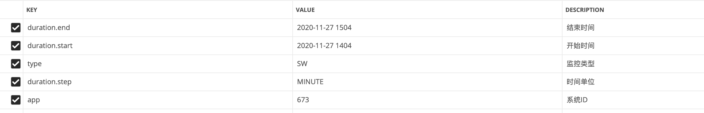
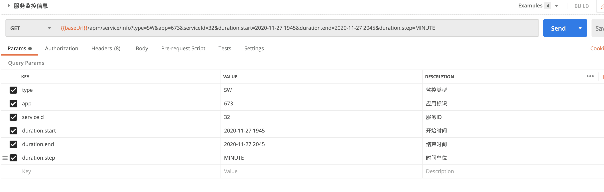
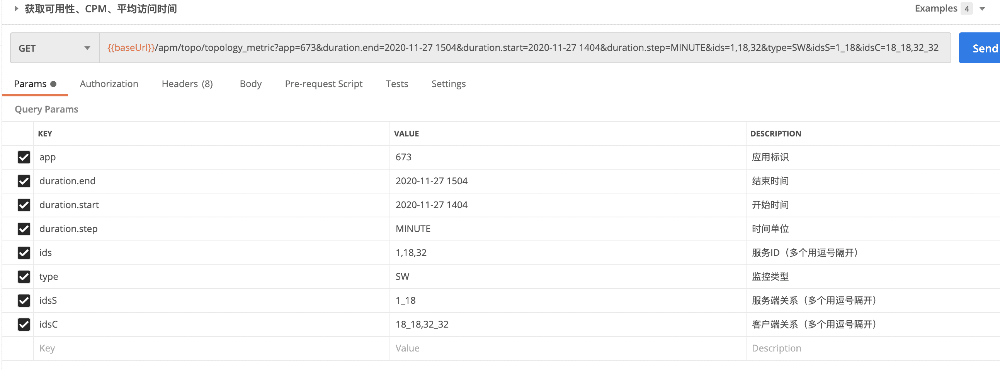
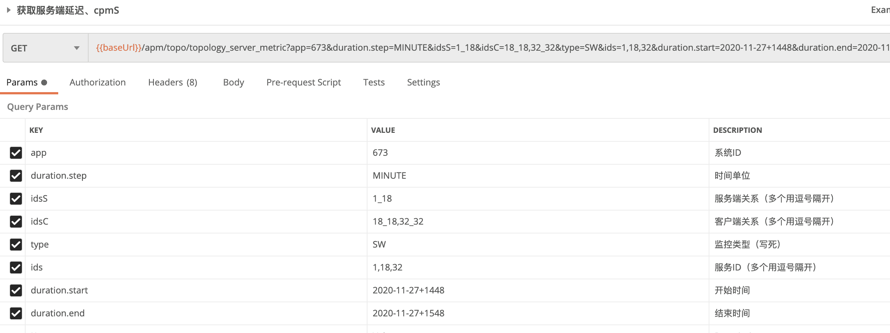
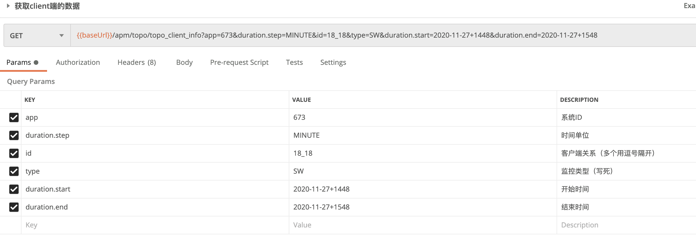
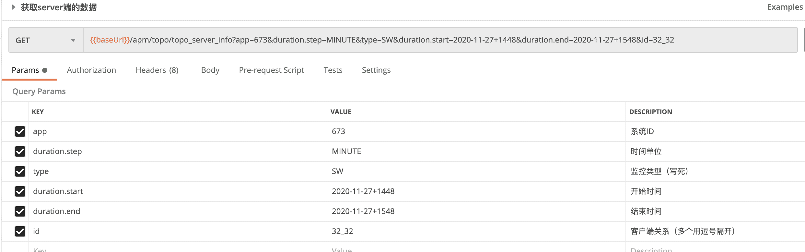
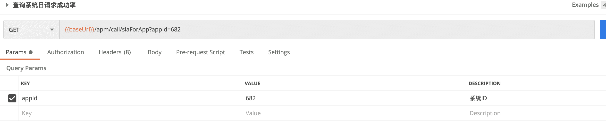
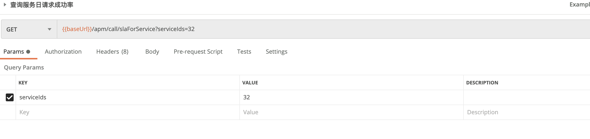

# 系统拓扑图涉及到的skywalking接口说明

### 接口列表

| 序号 | 接口地址                         | 接口说明                      |
| ---- | -------------------------------- | ----------------------------- |
| 1    | /apm/topo/global_topology        | 获取拓扑图                    |
| 2    | /apm/service/info                | 获取可用性、CPM、平均访问时间 |
| 3    | /apm/topo/topology_client_metric | 获取客户端延迟、cpmC          |
| 4    | /apm/topo/topology_server_metric | 获取服务端延迟、cpmS          |
| 5    | /apm/topo/topo_client_info       | 获取client端的数据            |
| 6    | /apm/topo/topo_server_info       | 获取server端的数据            |

#### 获取拓扑图

- 地址：/apm/topo/global_topology
- 请求方式：GET 
- 请求参数说明

```js
duration.end:2020-11-27 1504
duration.start:2020-11-27 1404
type:SW
duration.step:MINUTE
app:673
```



- 返回值说明(这里只解释data里面的数据)

```json
"data": {
    "getGlobalTopologyByLabel": {
        "nodes": [{ --拓扑图的服务节点集合
                "id": "32",--服务节点ID
                "name": "sc-nacos-demo-8789",--节点服务名称
                "type": "SpringMVC",--节点服务类型
                "isReal": "true",--是否是真实的
                "nodeType": 0
            },
            {
                "id": "1",
                "name": "User",
                "type": "USER",
                "isReal": "false",
                "nodeType": 0
            },
            {
                "id": "18",
                "name": "bufx-sc-nacos-demo-8789",
                "type": "SpringMVC",
                "isReal": "true",
                "nodeType": 0
            }
        ],
        "calls": [{ --拓扑图的链路结合
                "id": "18_18",--链路ID
                "source": "18",--链路起始节点ID
                "target": "18",--链路结束阶段ID
                "callType": "SpringRestTemplate",--链路类型
                "detectPoint": null,
                "detectPoints": [--链路侦查端类型
                    "CLIENT",
                    "SERVER"
                ]
            },
            {
                "id": "32_32",
                "source": "32",
                "target": "32",
                "callType": "SpringRestTemplate",
                "detectPoint": null,
                "detectPoints": [
                    "CLIENT",
                    "SERVER"
                ]
            },
            {
                "id": "1_18",
                "source": "1",
                "target": "18",
                "callType": "",
                "detectPoint": null,
                "detectPoints": [
                    "SERVER"
                ]
            }
        ]
    }
}
}
```

#### 获取可用性、CPM、平均访问时间

- 地址：/apm/service/info
- 请求方式：GET
- 请求参数说明

```json
type:SW
app:673
serviceId:32
duration.start:2020-11-27 1945
duration.end:2020-11-27 2045
duration.step:MINUTE
```



- 返回值说明(这里只解释data里面的数据)

```json
"data": {
        "data": {
            "getSlowEndpoint": [],
            "getServiceInstanceThroughput": [],
            "getServiceInstances": [],
            "getServiceTopology": {},
            "getResponseTimeTrend": { --延迟
                "values": [
                    {
                        "value": 1 --具体的值
                    },
                    {
                        "value": 2
                    },
                    {
                        "value": 1
                    }
                ]
            },
            "getThroughputTrend": { --每分钟请求量
                "values": [
                    {
                        "value": 12 --具体的值
                    },
                    {
                        "value": 12
                    },
                    {
                        "value": 12
                    }
                ]
            },
            "getSLATrend": { -- SLA
                "values": [
                    {
                        "value": 5833 --具体的值
                    },
                    {
                        "value": 4166
                    },
                    {
                        "value": 5833
                    }
                ]
            },
            "getApdexScore": {},
            "servicePercentile": []
        }
    }
```


#### 获取客户端延迟、cpmC

- 地址：/apm/topo/topology_client_metric
- 请求方式：GET
- 请求参数说明

```json
app:673
duration.end:2020-11-27+1548
duration.start:2020-11-27+1448
duration.step:MINUTE
ids:1,18,32
type:SW
idsS:1_18
idsC:18_18,32_32
```



- 返回值说明(这里只解释data里面的数据)

```json
"data": {
        "data": {
            "cpmC": {--每分钟请求量数据
                "values": [
                    {
                        "id": "18_18",--call链路的ID
                        "value": 12 --每分钟请求量值
                    },
                    {
                        "id": "32_32",
                        "value": 12
                    }
                ]
            },
            "latencyC": {--延迟数据
                "values": [
                    {
                        "id": "18_18",--call链路的ID
                        "value": 4-- 延迟的值
                    },
                    {
                        "id": "32_32",
                        "value": 2
                    }
                ]
            }
        }
    }
```

#### 获取服务端延迟、cpmC

- 地址：/apm/topo/topology_server_metric
- 请求方式：GET
- 请求参数说明

```json
app:673
duration.step:MINUTE
idsS:1_18
idsC:18_18,32_32
type:SW
ids:1,18,32
duration.start:2020-11-27+1448
duration.end:2020-11-27+1548
```



- 返回值说明(这里只解释data里面的数据)

```json
"data": {
        "data": {
            "cpmS": {--每分钟请求量数据
                "values": [
                    {
                        "id": "1_18",--call链路的ID
                        "value": 7--每分钟请求量值
                    }
                ]
            },
            "latencyS": {--延迟数据
                "values": []
            }
        }
    }
```

#### 获取client端的数据

- 地址：/apm/topo/topo_client_info
- 请求方式：GET
- 请求参数说明

```json
app:673
duration.step:MINUTE
id:18_18
type:SW
duration.start:2020-11-27+1448
duration.end:2020-11-27+1548
```



- 返回值说明(这里只解释data里面的数据)

```json
"data": {
        "data": {
            "getResponseTimeTrend": {--侦查端-客户端那里的响应时间
                "values": [
                    {
                        "value": 4--响应时间的值
                    },
                    {
                        "value": 5
                    }
                ]
            },
            "getThroughputTrend": {--侦查端-客户端那里的吞吐量
                "values": [
                    {
                        "value": 12--吞吐量的值
                    },
                    {
                        "value": 12
                    }
                ]
            },
            "getSLATrend": {-- 侦查端-客户端那里的SLA数据
                "values": [
                    {
                        "value": 5833-- SLA值
                    },
                    {
                        "value": 5000
                    }
                ]
            }
        }
    }
```

#### 获取server端的数据

- 地址：/apm/topo/topo_server_info
- 请求方式：GET
- 请求参数说明

```json
app:673
duration.step:MINUTE
type:SW
duration.start:2020-11-27+1448
duration.end:2020-11-27+1548
id:32_32
```



- 返回值说明(这里只解释data里面的数据)

```json
"data": {
        "data": {
            "getResponseTimeTrend": {--侦查端-服务端那里的响应时间
                "values": [
                    {
                        "value": 2 --响应时间的值
                    },
                    {
                        "value": 1
                    }
                ]
            },
            "getThroughputTrend": { --侦查端-服务端那里的吞吐量
                "values": [
                    {
                        "value": 12--吞吐量的值
                    },
                    {
                        "value": 12
                    }
                ]
            },
            "getSLATrend": { -- 侦查端-服务端那里的SLA数据
                "values": [
                    {
                        "value": 4166-- SLA值
                    },
                    {
                        "value": 7500
                    }
                ]
            }
        }
    }
```

#### 查询系统日请求成功率

- 地址：/apm/call/slaForApp
- 请求方式：GET
- 请求参数说明

```json
appId:682
```



- 返回值说明(这里只解释data里面的数据)

```json
{
    "message": null,
    "exceptionStackTrace": null,
    "state": "success",
    "code": 200,
    "data": {
        "id": "682",--系统ID
        "value": 4901 --系统请求成功率
    },
    "entity": null
}
```

#### 查询服务日请求成功率

- 地址：/apm/call/slaForService
- 请求方式：GET
- 请求参数说明

```json
serviceIds:32
```



- 返回值说明(这里只解释data里面的数据)

```json
"data": {
  "slaForService": {
    "values": [
      {
        "id": "32",
        "value": 5033 --日成功率
      }
    ]
  }
}
```
