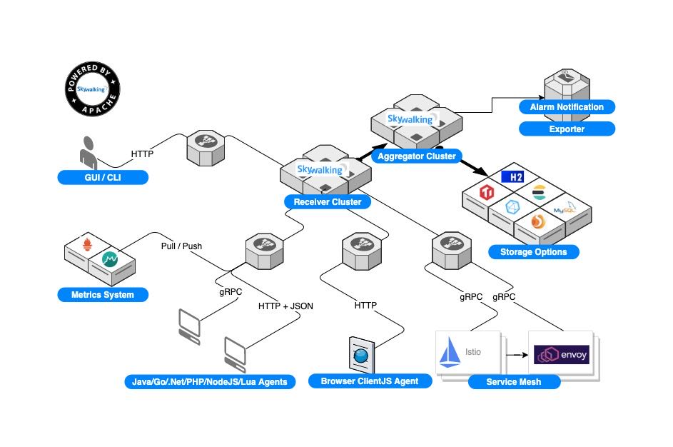
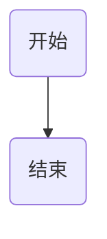
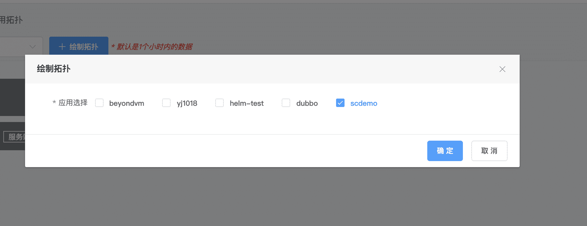
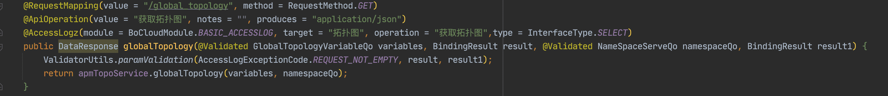
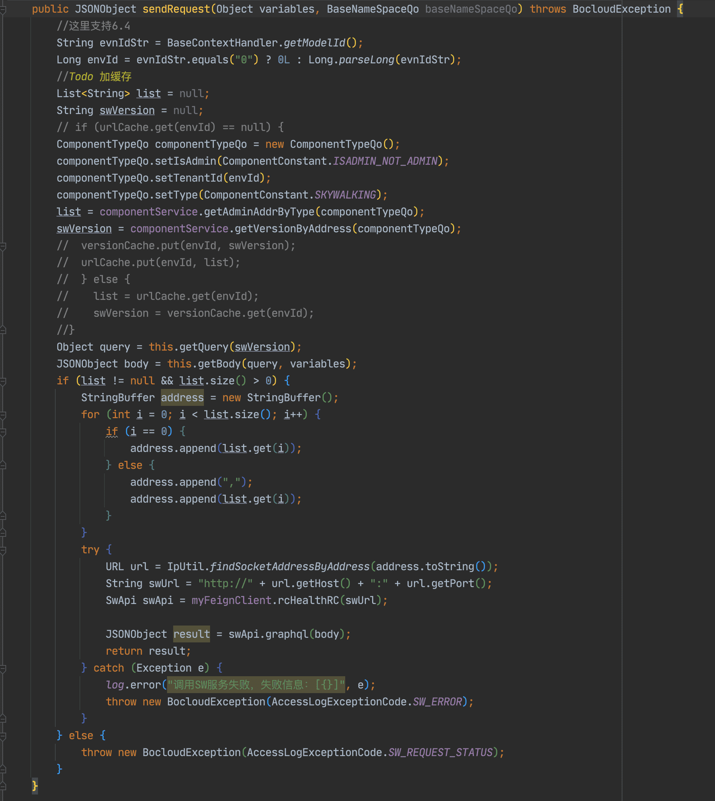
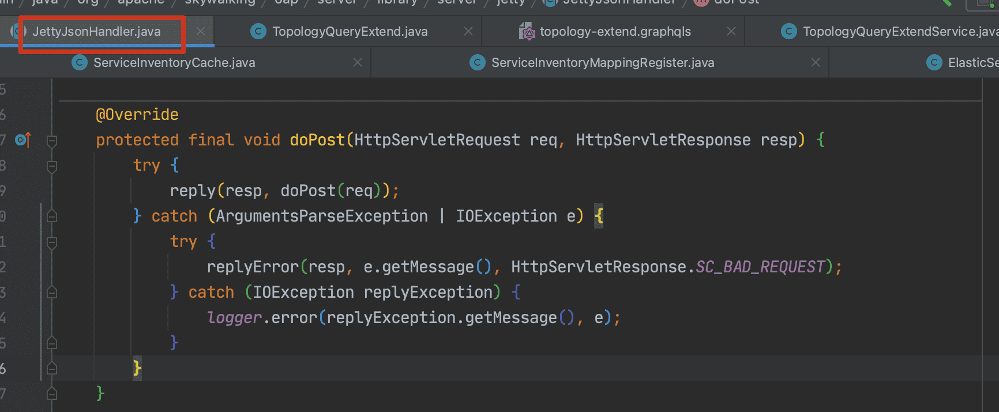
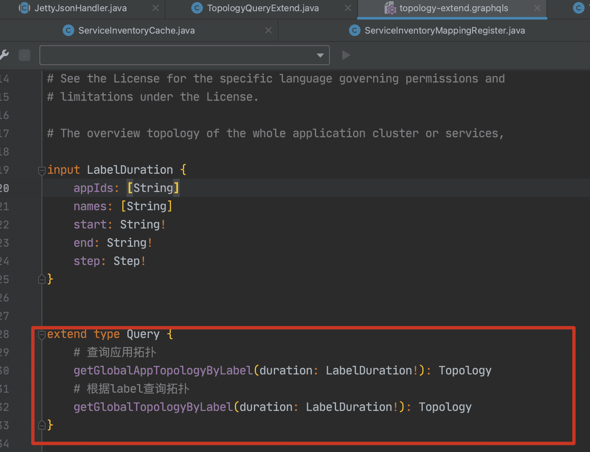
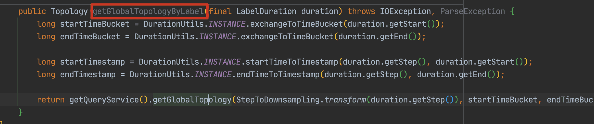
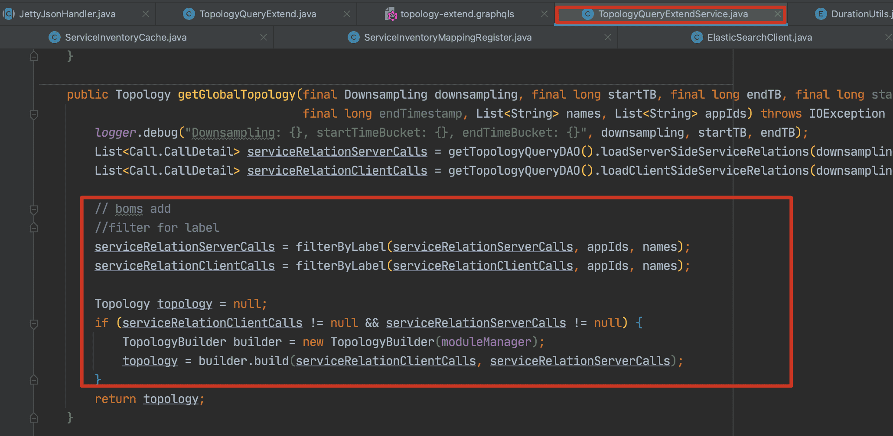
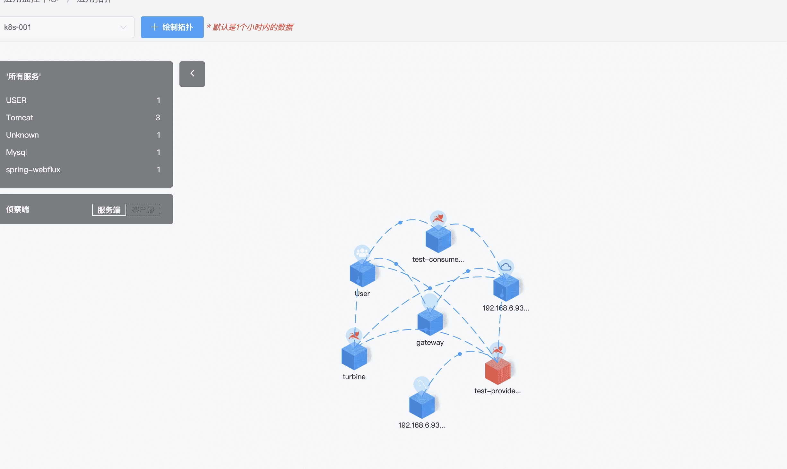

# skywalking从7.0升级到8.2.0分析



### boms与skw7.0调用的流程



#### 以获取拓扑图为例:

1. 页面选择具体的应用，可以多选



2. 调用broker工程后台接口：{{baseUrl}}/apm/topo/global_topology



3. 具体通过这里和skw通信：



这里做了以下主要操作：

- 封装请求体body
  - 根据服务关联的skw版本选择对应的GrapHQL
  - 参数放到variables里面
  - HQL放到query里面
- 调用skw接口
  - 根据服务关联的skw的OAP地址来进行拼接URL

4. 这一步完成后就没有broker工程的事情了，接下来去skw源码看看


5. 通过第三步调用到了skw



6. 通过了doPost，根据定制的GrapHQL找到对应的方法







最后一张图做了以下操作：

- 根据查询条件（开始时间，结束时间）调用原生skw接口从ES获取所有服务的拓扑图数据
- 在根据boms传过来的参数（appids,appnames）对结果进行过滤，只保留我们需要的服务拓扑图数据
- 最后返回给boms

7. 最后显示在页面上




### boms与sky8.2.0调用的流程

#### 以获取拓扑图为例:

1. 页面选择具体的应用，可以多选


2. 调用broker工程后台接口：{{baseUrl}}/apm/topo/global_topology_new

该接口做了以下操作：

- 获取前台传入的参数（主要是application.name）
- 调用skw接口获取所有的服务列表

```java
public List<Service> getAllServices(final Duration duration) throws IOException, ParseException {
        return getMetadataQueryService().getAllServices(duration.getStartTimestamp(), duration.getEndTimestamp());
    }
```

- 返回值包含了label（application.name)和key，并结合传入的参数做交集，获取对应的key

3. 调用skw接口获取选择服务的拓扑图数据，serviceIds就是上一步获取的交集keys

```java
    public Topology getServicesTopology(final List<String> serviceIds, final Duration duration) throws IOException {
        return getQueryService().getServiceTopology(
            duration.getStartTimeBucket(), duration.getEndTimeBucket(), serviceIds);
    }
```

4. 最后显示在页面上


### 分析两种方法的区别

1. 第二种方法不需要定制查询接口
2. 第二种方法是先查询所有列表在进行筛选，而第一种是先查询拓扑图在进行筛选，相较于第一种，查询速度会快一些。

3. 不需要做新增应用时，进行手动补偿

### sky8.2.0相较于老版本新增的可用功能

- 从7.1.0开始，概要分析跟踪自动收集Tomcat和SpringMVC Controller的HTTP请求参数。

https://github.com/apache/skywalking/blob/v8.2.0/docs/en/ui/README.md

- 从6.5.0开始，可以通过[动态配置](https://github.com/SkyAPM/document-cn-translation-of-skywalking/blob/master/docs/zh/8.0.0/setup/backend/dynamic-config.md)在运行时动态更新报警设置 , 它将覆盖 `alarm-settings.yml` 中的设置.

  为了确定是否触发告警规则, SkyWalking 需要为每个告警规则缓存时间窗的指标, 如果任何属性 (`metrics-name`, `op`, `threshold`, `period`, `count`, etc.) 的规则改变, 滑动窗口将会毁坏和重建, 导致此告警规则重新启动.

https://github.com/apache/skywalking/blob/v8.2.0/docs/en/setup/backend/backend-alarm.md

- 8.0版本以后 oal脚本存放目录 '/config/oal/*.oal' 你可以修改相关内容，重启OAP服务，即可生效。

  此脚本中命名的所有指标都可以用于报警和UI查询.

  注意！

  建议基于自定义指标构建的自定义UI功能才能添加或删除一些指标，否则UI可能会有问题。

https://github.com/apache/skywalking/blob/v8.2.0/docs/en/guides/backend-oal-scripts.md

- 6.3版本以后, OAL引擎嵌入在OAP服务器运行时中，称为"OAL -rt"(OAL运行时)。 OAL脚本现在位于' /config '文件夹，用户可以简单地改变和重新启动服务器，使其有效。 但是，OAL脚本仍然是编译语言，OAL运行时动态生成java代码。 您可以在system env上打开set ' SW_OAL_ENGINE_DEBUG=Y '，查看生成了哪些类。

https://github.com/apache/skywalking/blob/v8.2.0/docs/en/concepts-and-designs/oal.md#observability-analysis-language

- **百分位**是自7.0版本引入的第一个多值度量。由于有多个值，可以通过' getMultipleLinearIntValues ' GraphQL查询进行查询。 在本例中，所有传入请求的"p99"、"p95"、"p90"、"p75"、"p50"。参数是p99延迟计算的精度，如在上述情况下，120ms和124被认为是相同的。 在7.0.0之前，使用' p99 '、' p95 '、' p90 '、' p75 '、' p50 '函数分别计算指标。在7.x版本仍然支持，但不推荐且不包括在正式脚本。

  > All_p99 = from(All.latency).p99(10);

  在本例中，p99为所有传入请求的值。参数是p99延迟计算的精度，如在上述情况下，120ms和124被认为是相同的。

https://github.com/apache/skywalking/blob/v8.2.0/docs/en/concepts-and-designs/oal.md#aggregation-function

- 7.0.0 以上支持令牌认证

https://github.com/apache/skywalking/blob/v8.2.0/docs/en/setup/backend/backend-token-auth.md
