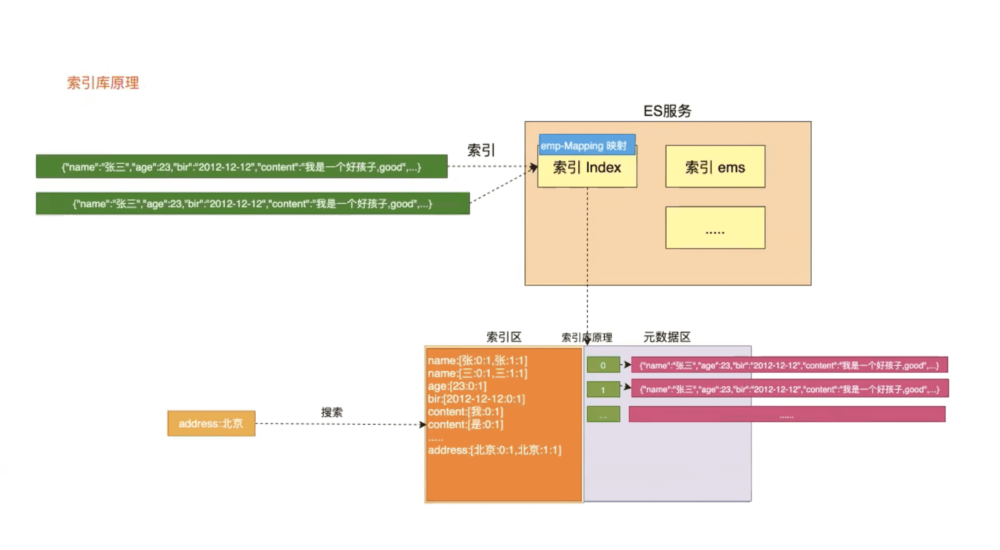

# ElasticSearch中的高级检索

##  两种检索方式(_search)

ES官方提供了两中检索方式:**一种是通过 URL 参数进行搜索,另一种是通过 DSL(Domain Specified Language) 进行搜索**。**官方更推荐使用第二种方式第二种方式是基于传递JSON作为请求体(request body)格式与ES进行交互，这种方式更强大，更简洁**。


**使用语法**

- URL查询: `GET /索引/类型/_search?参数`

- DSL查询: `GET /索引/类型/_search {}`

##  测试数据

###  删除索引

```json
DELETE /buubiu
```

###  创建索引并指定类型

```json
PUT /buubiu
{
  "mappings":{
    "user":{
      "properties":{
        "name":{
          "type":"text"
        },
        "age":{
          "type":"integer"
        },
        "bir":{
          "type":"date"
        },
        "content":{
          "type":"text"
        },
        "address":{
          "type":"keyword"
        }
      }
    }
  }
}
```

###  插入数据

```json
PUT /buubiu/user/_bulk
  {"index":{}}
  {"name":"小黑","age":23,"bir":"2012-12-12","content":"为开发团队选择一款优秀的MVC框架是件难事儿，在众多可行的方案中决择需要很高的经验和水平","address":"北京"}
  {"index":{}}
  {"name":"王小黑","age":24,"bir":"2012-12-12","content":"Spring 框架是一个分层架构，由 7 个定义良好的模块组成。Spring 模块构建在核心容器之上，核心容器定义了创建、配置和管理 bean 的方式","address":"上海"}
  {"index":{}}
  {"name":"张小五","age":8,"bir":"2012-12-12","content":"Spring Cloud 作为Java 语言的微服务框架，它依赖于Spring Boot，有快速开发、持续交付和容易部署等特点。Spring Cloud 的组件非常多，涉及微服务的方方面面，井在开源社区Spring 和Netflix 、Pivotal 两大公司的推动下越来越完善","address":"无锡"}
  {"index":{}}
  {"name":"win7","age":9,"bir":"2012-12-12","content":"Spring的目标是致力于全方位的简化Java开发。 这势必引出更多的解释， Spring是如何简化Java开发的？","address":"南京"}
  {"index":{}}
  {"name":"梅超风","age":43,"bir":"2012-12-12","content":"Redis是一个开源的使用ANSI C语言编写、支持网络、可基于内存亦可持久化的日志型、Key-Value数据库，并提供多种语言的API","address":"杭州"}
  {"index":{}}
  {"name":"张无忌","age":59,"bir":"2012-12-12","content":"ElasticSearch是一个基于Lucene的搜索服务器。它提供了一个分布式多用户能力的全文搜索引擎，基于RESTful web接口","address":"北京"}
```

##  索引库原理图



##  QueryString检索

###  常用的API

```json
GET /buubiu/user/_search?q=*&sort=age:desc&size=2&from=0&_source=age,name,bir
```

- q=* 匹配所有文档
- sort 以结果中的指定字段排序（默认asc升序，desc降序
- size 分页用到的，每页显示的条数
- from 分页用到的，第几条开始显示
- _source 筛选结果显示的字段

##  QueryDSL检索

###  返回结果解释

```json
{
  "took" : 1, #响应时间：毫秒
  "timed_out" : false, #是否超时
  "_shards" : { #分片情况
    "total" : 5,
    "successful" : 5,
    "skipped" : 0,
    "failed" : 0
  },
  "hits" : { #击中结果（查询结果）
    "total" : 6, #总数
    "max_score" : null,#最大得分
    "hits" : [ #具体的击中结果
      {
        "_index" : "buubiu", #索引名称
        "_type" : "user", #索引类型
        "_id" : "lBBijXYBDhufrFchzxS8", #索引id
        "_score" : null,#得分
        "_source" : { #文档内容
          "address" : "北京",
          "name" : "张无忌",
          "age" : 59
        },
        "sort" : [ #排序
          59,
          "北京"
        ]
      }
    ]
  }
}
```

###  查询所有

**match_all关键字:**  返回索引中的全部文档

```json
GET /buubiu/user/_search
{
  "query": {
    "match_all": {}
  }
}
```

###  查询所有并排序

**sort关键字：**默认升序

```json
GET /buubiu/user/_search
{
  "query": {
    "match_all": {}
  },
  "sort": [
    {
      "age": {
        "order": "desc"
      },
      "address":{
        "order": "desc"
      }
    }
  ]
}
```

###  查询结果中返回指定条数(size)

**size 关键字**: 指定查询结果中返回指定条数。  **默认返回值10条**

```json
GET /buubiu/user/_search
{
  "query": {
    "match_all": {}
  },
  "sort": [
    {
      "age": {
        "order": "desc"
      },
      "address":{
        "order": "desc"
      }
    }
  ],
  "size": 2
}
```

###  分页查询

**from 关键字**: 用来指定起始返回位置

**size关键字:**每次取多少条,默认10条

```json
GET /buubiu/user/_search
{
  "query": {
    "match_all": {}
  },
  "sort": [
    {
      "age": {
        "order": "desc"
      },
      "address":{
        "order": "desc"
      }
    }
  ],
  "size": 2,
  "from": 0
}
```

###  查询结果中指定字段

**__source关键字：**是一个数组,在数组中用来指定展示那些字段

```json
GET /buubiu/user/_search
{
  "query": {
    "match_all": {}
  },
  "sort": [
    {
      "age": {
        "order": "desc"
      },
      "address":{
        "order": "desc"
      }
    }
  ],
  "size": 2,
  "from": 0,
  "_source": ["age","address","name"]
}
```

###  关键词查询（term）

**term 关键字**: 用来使用关键词查询

**`注意：`**

1. `通过使用term查询得知,在ES的Mapping Type 中 keyword , date ,integer, long , double , boolean or ip 这些类型不分词，只有text类型分词。`
2. `通过使用term查询得知ES中默认使用分词器为标准分词器(StandardAnalyzer),标准分词器对于英文单词分词,对于中文单字分词。`

```json
GET /buubiu/user/_search
{
  "query": {
    "term": {
      "content": {
        "value": "框"
      }
    }
  }
}
```

###  范围查询（range）

**range 关键字**: 用来指定查询指定范围内的文档

```json
GET /buubiu/user/_search
{
  "query": {
    "range": {
      "age": {
        "gte": 8,#大于等于
        "lte": 20 #小于等于
      }
    }
  }
}
```

###  前缀查询（prefix）

**prefix 关键字**: 用来检索含有指定前缀的关键词`分词`的相关文档

```json
GET /buubiu/user/_search
{
  "query": {
    "prefix": {
      "address": {
        "value": "北"
      }
    }
  }
}
```

###  通配符查询（wildcard）

**wildcard 关键字**: 通配符查询     

- `?` 用来匹配一个任意字符 
- `*`用来匹配多个任意字符

```json
GET /buubiu/user/_search
{
  "query": {
    "wildcard": {
      "address": {
        "value": "北?"
      }
    }
  }
}
```

###  多id查询（ids）

**ids 关键字** : 值为数组类型,用来根据一组id获取多个对应的文档，前提需要知道有哪些id

```json
GET /buubiu/user/_search
{
  "query": {
    "ids": {
      "values": ["kBBijXYBDhufrFchzxS8","kxBijXYBDhufrFchzxS8"]
    }
  }
}
```

###  模糊查询（fuzzy）

**fuzzy 关键字**: 用来模糊查询含有指定关键字的文档，最大模糊错误 必须在0-2之间

- `搜索关键词长度为 2 不允许存在模糊 0`

- `搜索关键词长度为3-5 允许一次模糊 0 1`

- `搜索关键词长度大于5 允许最大2模糊`

```json
GET /buubiu/user/_search
{
  "query": {
    "fuzzy": {
      "content": "elasticse99ch"
    }
  }
}
```

###  布尔查询（bool）

**bool 关键字**: 用来组合多个条件实现复杂查询

- **must: 相当于&& 同时成立**

- **should: 相当于|| 成立一个就行**
- **must_not: 相当于!  不能满足任何一个**

```json
GET /buubiu/user/_search
{
  "query": {
    "bool": {
      "must": [
        {
          "term": {
            "address": {
              "value": "北京"
            }
          }
        },
        {
          "range": {
            "age": {
              "gte": 10,
              "lte": 30
            }
          }
        }
      ],
      "must_not": [
        {
          "term": {
            "age": {
              "value": 59
            }
          }
        }
      ]
    }
  }
}
```

###  高亮查询（highlight）

**highlight 关键字**: 可以让符合条件的文档中的关键词高亮

- `*`表示所有字段都高亮
- **自定义高亮html标签**: 可以在highlight中使用`pre_tags`和`post_tags`

- 多字段高亮 使用`require_field_match`开启多个字段高亮

```json
GET /buubiu/user/_search
{
  "query": {
    "term": {
      "content": {
        "value": "的"
      }
    }
  },
  "highlight": {
    "fields": {
      "*":{}
    },
    "pre_tags": ["<span style='color:red'>"],
    "post_tags": ["</span>"],
    "require_field_match": "false"
  }
}

```

###  多字段查询（multi_match）

- 如果搜索的字段分词，它会对query进行先分词在搜索
- 如果搜索的字段不分词，它会直接使用query整体进行改字段搜索

```json 
GET /buubiu/user/_search
{
  "query": {
    "multi_match": {
      "query": "Redis小",
      "fields": ["name","content","address"]
    }
  }
}
```

###  多字段分词查询（query_string）

**query_string关键字：**

- default_field：根据哪个字段查询
- query：搜索条件，会把值先进行分词在进行查询
- filleds：根据哪些字段查询

```json
GET /buubiu/user/_search
{
  "query": {
    "query_string": {
      "default_field": "content",
      "query": "redis是一个好的语言"
    }
  }
}

#该写法结果与multi_match一致
GET /buubiu/user/_search
{
  "query": {
    "query_string": {
      "query": "redis是一个好的语言",
      "fields": ["name","content","address"]
    }
  }
}
```

###  去重聚合查询

**collapse关键字：**指定字段进行去重，相当于数据库中的distinct

**agg，cardinality关键字：**指定字段进行聚合，相当于数据库中的count，group by

```json
GET /buubiu/user/_search
{
  "query": {
    "match_all": {}
  },
  "collapse": {
    "field": "name"
  },
  "aggs": {
    "distinct_name_count": {
      "cardinality": {
        "field": "name"
      }
    }
  }
}
```

