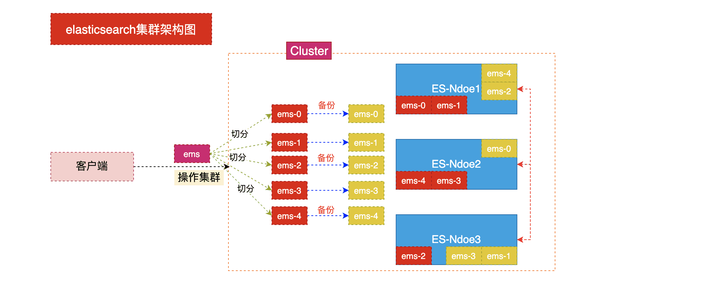
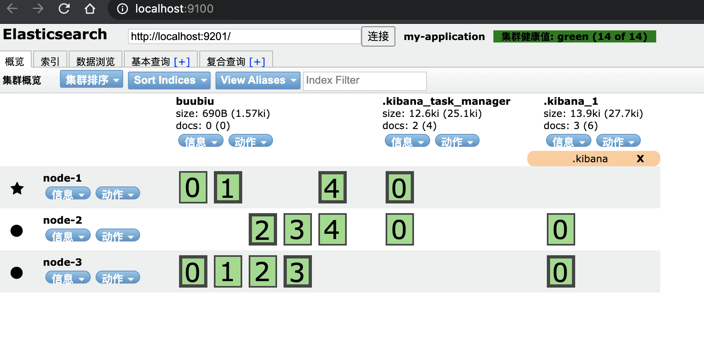

# ElasticSearch中的集群

##  相关概念

###  集群(cluster)

- 一个集群就是由一个或多个节点组织在一起，它们共同持有你整个的数据，并一起提供索引和搜索功能。
- 一个集群是由一个唯一的名字标识，这个名字默认就是`elasticsearch`。这个名字是重要的，因为一个节点只能通过指定某个集群的名字，来加入这个集群。在产品环境中显式地设定这个名字是一个好习惯，但是使用默认值来进行测试/开发也是不错的。 

###  节点(node)

- 一个节点是你集群中的一个服务器，作为集群的一部分，它存储你的数据，参与集群的索引和搜索功能。和集群类似，一个节点也是由一个名字来标识的，默认情况下，这个名字是一个随机的漫威漫画角色的名字，这个名字会在启动的时候赋予节点。这个名字对于管理工作来说挺重要的，因为在这个管理过程中，你会去确定网络中的哪些服务器对应于Elasticsearch集群中的哪些节点。 
- 一个节点可以通过配置集群名称的方式来加入一个指定的集群。默认情况下，每个节点都会被安排加入到一个叫 做`elasticsearch`的集群中，这意味着，如果你在你的网络中启动了若干个节点，并假定它们能够相互发现彼此，它们将会自动地形成并加入到一个叫做`elasticsearch`的集群中。 
- 在一个集群里，可以拥有任意多个节点。而且，如果当前你的网络中没有运行任何Elasticsearch节点， 这时启动一个节点，会默认创建并加入一个叫做`elasticsearch`的集群。 

###  分片和复制(shards & replicas)

- 一个索引可以存储超出单个结点硬件限制的大量数据。比如，一个具有10亿文档的索引占据1TB的磁盘空间，而任一节点都没有这样大的磁盘空间;或者单个节点处理搜索请求，响应太慢。为了解决这个问题，Elasticsearch提供了将索引划分成多份的能力，这些份就叫做分片。当你创建一个索引的时候，你可以指定你想要的分片的数量。每个分片本身也是一个功能完善并且独立的“索引”，这个“索引”可以被放置 到集群中的任何节点上。 **分片之所以重要，主要有两方面的原因:** 
  1. 允许你水平分割/扩展你的内容容量
  2. 允许你在分片(潜在地，位于多个节点上)之上进行分布式的、并行的操作，进而提高性能/吞吐量 至于一个分片怎样分布，它的文档怎样聚合回搜索请求，是完全由Elasticsearch管理的，对于作为用户的你来说，这些都是透明的。 

- 在一个网络/云的环境里，失败随时都可能发生，在某个分片/节点不知怎么的就处于离线状态，或者由于任何原因 消失了。这种情况下，有一个故障转移机制是非常有用并且是强烈推荐的。为此目的，Elasticsearch允许你创建分片的一份或多份拷贝，这些拷贝叫做**复制分片**，或者直接叫复制。**复制之所以重要，主要有两方面的原因:** 
  1. 在分片/节点失败的情况下，提供了高可用性。因为这个原因，复制分片从不与原/主要 (original/primary)分片置于同一节点上是非常重要的。
  2. 扩展你的搜索量/吞吐量，因为搜索可以在所有的复制上并行运行 

- 总之，每个索引可以被分成多个分片。一个索引也可以被复制0次(意思是没有复制)或多次。一旦复制了，每个索引就有了主分片(作为复制源的原来的分片)和复制分片(主分片的拷贝)之别。分片和复制的数量可以在索引创建的时候指定。在索引创建之后，你可以在任何时候动态地改变复制数量，但是不能改变分片的数量。

- 默认情况下**（在7.0版本之前）**，`Elasticsearch中的每个索引被分片5个主分片和1个复制`，这意味着，如果你的集群中至少有两个节点，你的索引将会有5个主分片和另外5个复制分片(1个完全拷贝)，这样的话每个索引总共就有10个分片。一个 索引的多个分片可以存放在集群中的一台主机上，也可以存放在多台主机上，这取决于你的集群机器数量。主分片和复制分片的具体位置是由ES内在的策略所决定的。 

**`7.0版本之后：默认情况下，Elasticsearch中的每个索引被分片1个主分片和1个复制`**

##  集群架构图



###  搭建集群

ES 搭建集群非常简单，就是分别启动多台ES服务，并且保持集群的名称一致以及每个节点的名称不同即可；如果在同一台机器搭建集群，要保重 9200 9300 端点不能冲突

###  搭建步骤

1. 将原有ES安装包复制三份

```shell
cp -r elasticsearch-6.8.0/ elasticsearch-6.8.0-node1/
cp -r elasticsearch-6.8.0/ elasticsearch-6.8.0-node2/
cp -r elasticsearch-6.8.0/ elasticsearch-6.8.0-node3/
```

2. 删除复制目录中的data目录

   **注意:由于复制目录之前使用过因此需要在创建集群时将原来数据删除**

```shell
rm -rf elasticsearch-6.8.0-node1/data
rm -rf elasticsearch-6.8.0-node2/data
rm -rf elasticsearch-6.8.0-node3/data
```

3. 编辑每个节点config目录中的`jvm.options`文件修改启动内存

   分别修改：`-Xms512m -Xmx512m`

```shell
vim elasticsearch-6.8.0-node1/config/jvm.options
vim elasticsearch-6.8.0-node2/config/jvm.options
vim elasticsearch-6.8.0-node3/config/jvm.options
```

4. 编辑每个节点config目录中`elasticsearch.yml`文件

```shell
vim elasticsearch-6.8.0-node1/config/elasticsearch.yml
vim elasticsearch-6.8.0-node2/config/elasticsearch.yml
vim elasticsearch-6.8.0-node3/config/elasticsearch.yml

#分别修改如下配置:
		cluster.name: my-es                       #集群名称(集群名称必须一致)
		node.name: es-1                         #节点名称(节点名称不能一致)
		network.host: 0.0.0.0                     #监听地址(必须开启远程权限,并关闭防火墙)
		http.port: 9201                           #监听端口(同一台机器时服务端口不能一致)
		discovery.zen.ping.unicast.hosts: ["172.30.2.175:9302", "172.30.2.201:9303"] #另外两个节点的ip
		gateway.recover_after_nodes: 3            #集群可做master的最小节点数
		transport.tcp.port: 9301				  				#集群TCP端口(同一台机器搭建必须修改)  
```

5. 启动每个ES

```shell
./elasticsearch-6.8.0-node1/bin/elasticsearch
./elasticsearch-6.8.0-node2/bin/elasticsearch
./elasticsearch-6.8.0-node3/bin/elasticsearch
```

6. 查看每个节点启动状态

```shell
curl http://127.0.0.1:9201
curl http://127.0.0.1:9202
curl http://127.0.0.1:9203
```

7. 查看集群健康状态

   - 直接浏览器查看

   ```shell
   curl http://127.0.0.1:9201/_cat/health?v
   ```

   - 在kibana上查看

     - 修改kibana的配置文件，改为任意节点的IP+端口

     ```shell
     vim kibana.yml
     elasticsearch.hosts: ["http://127.0.0.1:9201"]
     ```

     - 执行命令

     ```json
     GET /_cat/health?v
     ```

##  安装elasticsearch-head 插件

###  下载elasticsearch-head

```shell
git clone git://github.com/mobz/elasticsearch-head.git
cd elasticsearch-head
npm install #编译安装
```

###  编写ES配置文件开启head插件的访问

在每个ES节点的`elastsearch.yml`最后添加以下内容，并重启

```shell
http.cors.enabled: true
http.cors.allow-origin: "*"
```

###  进入elasticsearch-head的目录启动插件

```shell
npm run start
```

###  通过插件查看集群状态

```shell
http://127.0.0.1:9100
```



##  Java对集群的操作

在初始化ES客户端的代码处，把所有节点都写上，之后的操作都和单节点一样了。

```java
/**
 * @author buubiu
 **/
@Configuration
public class ElasticSearchRestClientConfig extends AbstractElasticsearchConfiguration {

	//这个client用来替换transportClient(9300)对象
	@Override
	@Bean
	public RestHighLevelClient elasticsearchClient() {
		//定义客户端配置对象 RestClient 9200
		final ClientConfiguration clientConfiguration = ClientConfiguration.builder()
			.connectedTo("127.0.0.1:9201","127.0.0.1:9202","127.0.0.1:9203")
			.build();
		//通过RestClients对象创建
		return RestClients.create(clientConfiguration).rest();
	}
}
```

